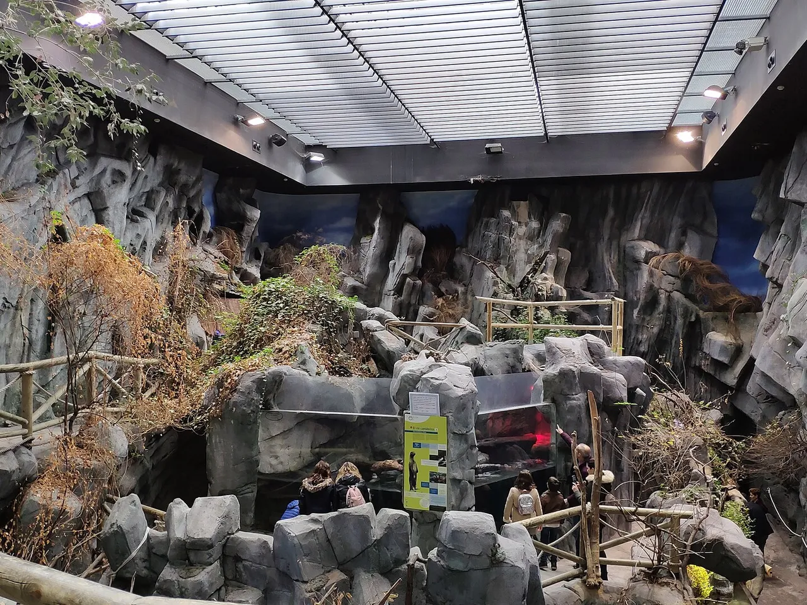
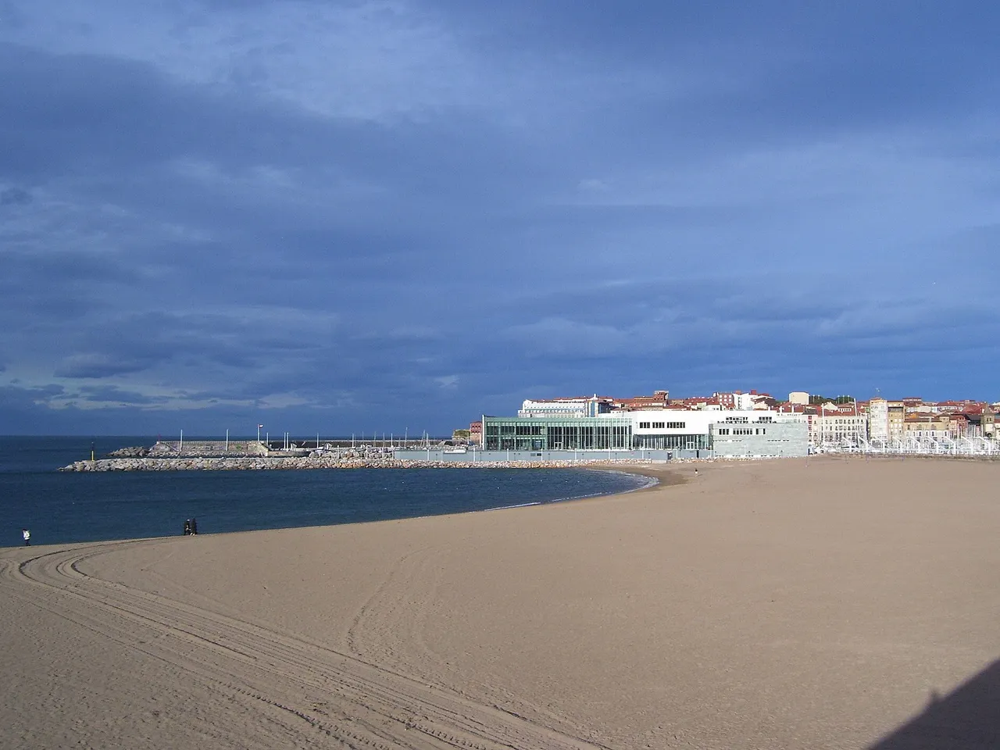

Un acuario de **2.000 m² de exposición** con **60 tanques**, unas **250 especies** y ocho tiburones. El **Acuario de Gijón**, junto a la playa de Poniente, abrió en 2006 y es un plan muy práctico para un día de lluvia.

Te cuento qué ver, cuánto dura la visita y qué hacer cerca 👇

En un vistazo<h2>Lo que vas a encontrar</h2>

<b>🦈</b>Tiburones

<b>🐠</b>250 especies

<b>🧪</b>12 zonas temáticas

<b>🌊</b>Playa de Poniente

<b>⏱️</b>Hora y media

Antes de ir<h2>Acuario de Gijón: lo básico</h2>

<h3>🐠 Qué es</h3>
El <strong>BIOPARC Acuario de Gijón</strong>, inaugurado el 9 de junio de 2006 y abierto al público el día siguiente.

<h3>🦈 Qué tiene</h3>
60 tanques de agua dulce y salada, unas 250 especies y 8 tiburones de entre 1,5 y 3 m.

<h3>🗺️ Visita</h3>
12 zonas visitables. El acuario calcula <strong>una hora y media</strong> de visita, y todo el recorrido es accesible con rampas y ascensores.

<h3>🎟️ Precio</h3>
<strong>21,50 €</strong> de 15 a 64 años, <strong>13 €</strong> de 3 a 14, <strong>14 €</strong> para mayores de 65 y gratis para menores de 3. No hace falta reservar.

<h3>🕙 Horario</h3>
Abre todos los días a las <strong>10:30</strong>. El cierre cambia según la temporada y la taquilla cierra una hora antes: mira el calendario de su web.

<h3>📍 Dónde</h3>
En el paseo de la playa de Poniente, en los antiguos Astilleros del Cantábrico.

Curiosidades<h2>Datos y curiosidades</h2>

Además de las zonas temáticas, el acuario tiene un <strong>auditorio</strong>, un aula educativa de unos 100 m² y una zona de exhibición de mamíferos y reptiles marinos. Entre lo más llamativo están el <strong>Gran Oceanario</strong>, donde algunos días se puede ver cómo dan de comer a los animales, la zona de <strong>Madagascar</strong> y los encuentros con <strong>tiburones cebra</strong>. Las visitas guiadas en español se llenan rápido, así que si te interesa una, resérvala con tiempo.

Dentro no se puede comer ni entrar con comida o bebida (salvo agua en envase que no sea de cristal y algo para los más pequeños). Para eso tienes la cafetería de la planta baja y el restaurante de la segunda planta.

Qué ver<h2>Qué ver en el Acuario</h2>
Tanques, tiburones y mar.

<ol class="guide__grid guide__grid--cuenca">
<li class="gcard reveal">
01

<h3>El edificio</h3>
Junto a la playa de Poniente.

</li>
<li class="gcard reveal">
02

<h3>El interior</h3>
Tanques con peces y otros animales.

</li>
<li class="gcard reveal">
03

<h3>La playa de Poniente</h3>
El paseo y la playa, justo al lado.

</li>
</ol>

Más paradas<h2>Otros lugares con encanto</h2>

<ul class="checklist" style="margin:0 0 1rem;"><li><strong>Gijón:</strong> <a href='/blog/gijon-que-ver.html'>qué ver en Gijón</a>.</li><li><strong>Playa de Poniente:</strong> paseo marítimo al lado.</li><li><strong>Laboral:</strong> <a href='/blog/laboral-ciudad-de-la-cultura.html'>edificio monumental</a>.</li><li><strong>Jardín Botánico:</strong> <a href='/blog/jardin-botanico-atlantico.html'>un plan tranquilo</a>.</li></ul>

Cómo llegar<h2>Cómo llegar</h2>

<strong>En coche:</strong> está en la playa de Poniente, en el centro de Gijón. No tiene parking propio: hay aparcamiento gratuito en la avenida de José Manuel Palacio Álvarez y en la calle Desfiladero de los Arrudos, y de pago en el Parking Playa de Poniente y en el de la estación Sanz Crespo.

<strong>En autobús:</strong> las líneas 1, 4, 6, 12 y 16 paran en la parada Acuario.

<strong>En tren:</strong> la estación Gijón-Sanz Crespo está a unos 900 metros.

<a class="btn guide__mapbtn" href="https://www.google.com/maps/dir/?api=1&destination=Acuario+de+Gijón" target="_blank" rel="noopener"><svg class="ico" viewBox="0 0 24 24" width="15" height="15" aria-hidden="true" fill="currentColor"><path d="M12 2a7 7 0 0 0-7 7c0 5.25 7 13 7 13s7-7.75 7-13a7 7 0 0 0-7-7zm0 9.5a2.5 2.5 0 1 1 0-5 2.5 2.5 0 0 1 0 5z"/></svg> Cómo llegar en Google Maps</a>

Consejos de Cheno<h2>El Acuario en una mañana</h2><ul><li><b>Cuándo</b>: Con lluvia o calor, es un buen plan.</li><li><b>Tiempo</b>: Calcula una hora y media.</li><li><b>Con niños</b>: los menores de 3 años entran gratis y los menores de 14 deben ir con un adulto. Mira los horarios de las exhibiciones.</li><li><b>Combínalo</b>: con un paseo por Poniente.</li></ul>

<!--faq-->

<h2>¿Te gustan estos planes?</h2>
Sígueme en Instagram como <a href="https://www.instagram.com/chenoaventuras/" target="_blank" rel="noopener">@chenoaventuras</a>: subo escapadas como esta cada semana.
<a class="btn guide__btn" href="/blog.html">Ver más planes en el blog</a>

Información consultada en noviembre de 2026 en la web oficial del acuario. Los precios, horarios y accesos cambian: consúltalos en las webs oficiales. Fotos de Wikimedia Commons: <a href="https://commons.wikimedia.org/wiki/File:Gijon_Acuario.jpg" target="_blank" rel="noopener">Xauxa Håkan Svensson</a> (CC BY-SA 3.0) · <a href="https://commons.wikimedia.org/wiki/File:Interior_del_Acuario_de_Gij%C3%B3n.jpg" target="_blank" rel="noopener">Alonso de Mendoza</a> (CC BY-SA 4.0) · <a href="https://commons.wikimedia.org/wiki/File:Gijon-playa-poniente-1.jpg" target="_blank" rel="noopener">AsturiasVerde</a> (Public domain).

