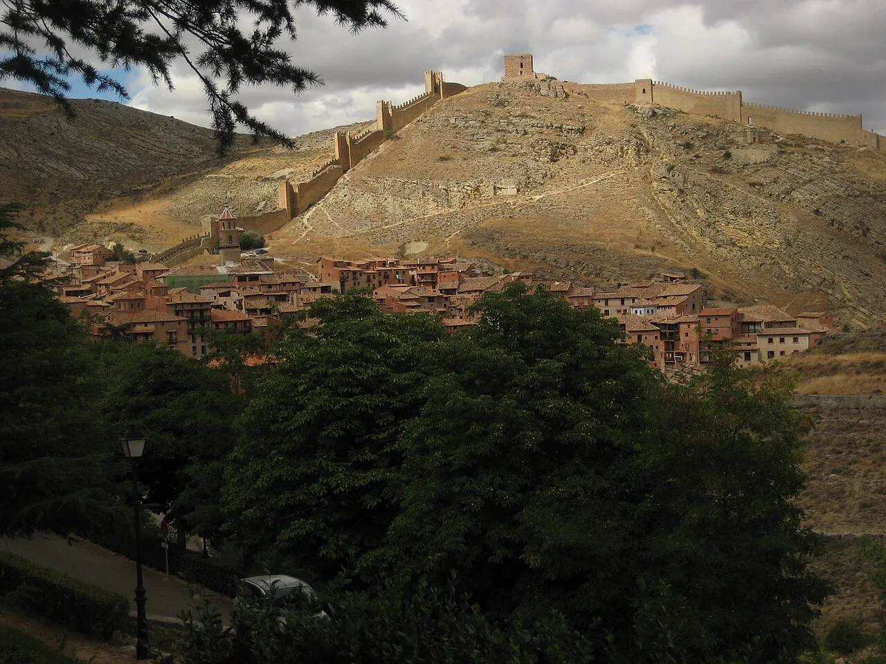
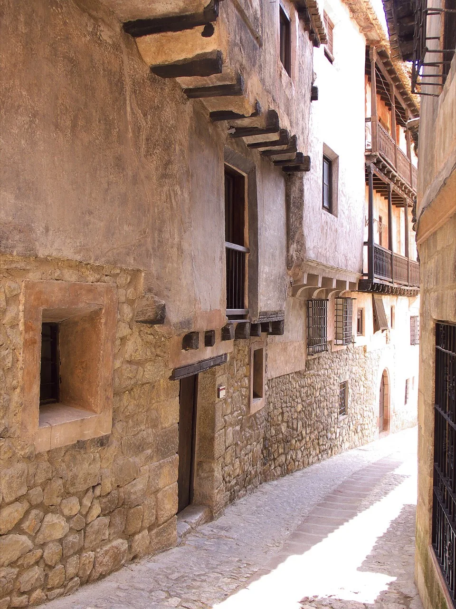
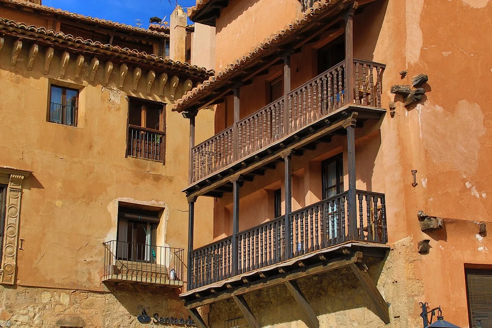
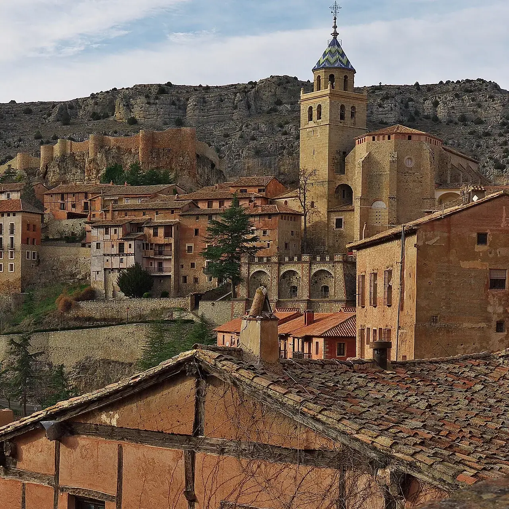
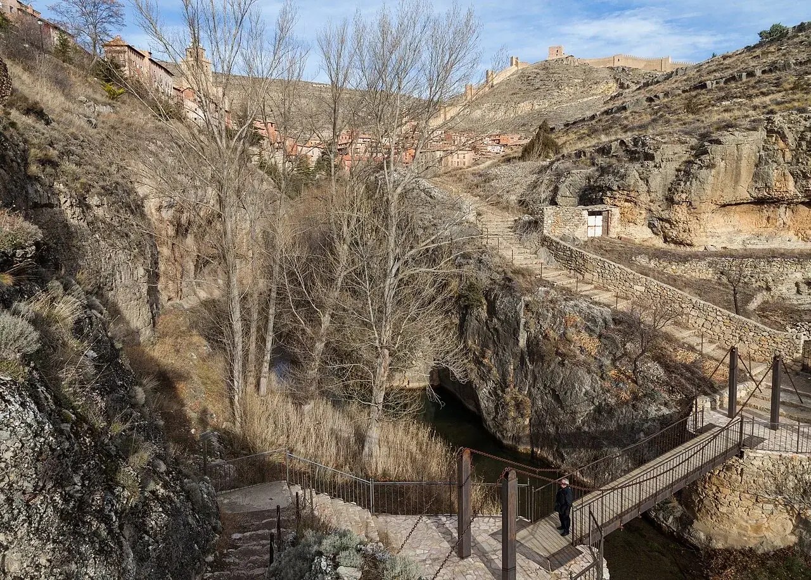
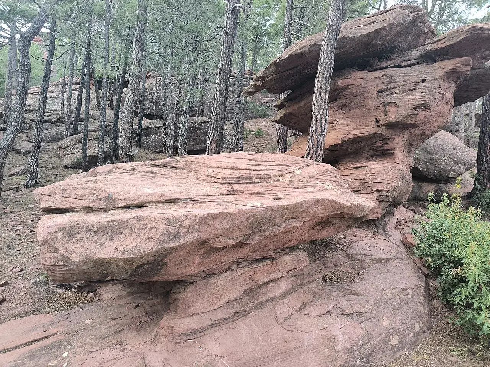

Casas de color rosado colgadas sobre una hoz del río, callejuelas tan estrechas que los aleros casi se tocan y una muralla que trepa por la montaña. **Albarracín** parece un decorado medieval, pero es un pueblo de verdad, y uno de los más bonitos de España.

Y a 15 minutos tienes los **Pinares de Rodeno**: rocas rojas, pinturas rupestres y uno de los mejores sitios de Europa para escalar en bloque. Te cuento qué ver 👇

En un vistazo<h2>Lo que vas a encontrar</h2>

<b>🧱</b>Muralla

<b>🏘️</b>Casas rosadas

<b>🌉</b>Río Guadalaviar

<b>⛪</b>Catedral

<b>🏔️</b>Pinares

<h3>🎄 Candidato a pueblo de la Navidad 2026</h3>
<strong>Albarracín</strong> es uno de los 17 pueblos que compiten en el concurso «Juntos Brillamos Más» de Ferrero Rocher por la iluminación navideña de 2026. El ganador se conoce el 14 de diciembre: <a href="/blog/pueblo-navidad-ferrero-rocher-2026.html">aquí tienes los candidatos y cómo votar</a>.

Antes de ir<h2>Lo básico de Albarracín</h2>

<h3>📍 Dónde está</h3>
En la <strong>Sierra de Albarracín</strong>, a unos <strong>35-40 minutos de Teruel</strong> en coche.

<h3>⏱️ Tiempo</h3>
El pueblo se ve en <strong>medio día</strong>. Si sumas los Pinares de Rodeno o alguna ruta, cuenta un día entero o quédate a dormir.

<h3>🎟️ Precio</h3>
Pasear y subir a la muralla es <strong>gratis</strong>. Catedral <strong>5,50 €</strong>, castillo <strong>4,50 €</strong> y visita guiada «Albarracín + Catedral» <strong>8,50 €</strong>; menores de 10, gratis.

Curiosidades<h2>Un reino en miniatura</h2>

El nombre viene de los <strong>Banu Razin</strong>, la familia bereber que gobernó aquí un pequeño reino taifa en el siglo XI. Después, durante más de un siglo, Albarracín fue un <strong>señorío independiente</strong> entre Castilla y Aragón, hasta que pasó definitivamente a la Corona de Aragón a finales del siglo XIII.

<h3>🎨 ¿Por qué es rosa?</h3>
Las casas están revocadas con <strong>yeso rojizo</strong> de la zona, que les da ese color rosado tan característico. Al atardecer, el pueblo entero se vuelve naranja.

Qué ver<h2>Qué ver en Albarracín</h2>
Lo imprescindible del pueblo y sus alrededores.

<ol class="guide__grid guide__grid--cuenca">
<li class="gcard reveal">
01

<h3>La muralla</h3>
Sube por el camino de la muralla hasta la torre del Andador: la vista del pueblo desde arriba es la mejor foto de Albarracín.

</li>
<li class="gcard reveal">
02

<h3>Las callejuelas</h3>
Calles empinadas, aleros de madera y rincones como el Portal de Molina o la casa de la Julianeta.

</li>
<li class="gcard reveal">
03

<h3>La Plaza Mayor</h3>
Con sus balcones de madera asomados a la hoz del río. Ideal para un vermú.

</li>
<li class="gcard reveal">
04

<h3>La catedral</h3>
La catedral del Salvador, del siglo XVI, con su campanario dominando los tejados.

</li>
<li class="gcard reveal">
05

<h3>El paseo del río</h3>
Un sendero rodea el pueblo junto al río Guadalaviar, con pasarelas y un pequeño túnel excavado en la roca.

</li>
<li class="gcard reveal">
06

<h3>Los Pinares de Rodeno</h3>
Rocas rojas entre pinos, abrigos con pinturas rupestres y bloques de arenisca famosos entre escaladores de todo el mundo.

</li>
</ol>

<!--actividades-->

<h3>🗺️ Si estás por la zona</h3>
Sierra arriba está <strong>Frías de Albarracín</strong>, un pueblecito de montaña desde el que se llega al <strong>nacimiento del río Tajo</strong>, en el paraje de <strong>Fuente García</strong>: un monumento a las tres provincias por las que empieza el río (Teruel, Cuenca y Guadalajara), prados y pinares. Por el camino verás una <strong>sima</strong> enorme, un hundimiento del terreno de unos 80 metros de ancho y casi 60 de hondo. La carretera tiene muchas curvas: cuenta medio día. En la vecina serranía de Cuenca tienes otro nacimiento espectacular, el del <a href="/blog/nacimiento-rio-cuervo.html">río Cuervo</a>, y en Teruel capital, los <a href="/blog/amantes-de-teruel.html">Amantes de Teruel</a>.

<!--cerca-->

Qué ver cerca<h2>Para completar la escapada</h2>

<ul class="checklist" style="margin:0 0 1rem;"><li><strong><a href="/blog/teruel-que-ver.html">Teruel</a>:</strong> torres mudéjares y el Torico (a menos de una hora en coche).</li><li><strong><a href="/blog/amantes-de-teruel.html">Teruel</a>:</strong> la leyenda más romántica de Aragón (a menos de una hora en coche).</li><li><strong>Pinares de Rodeno:</strong> un paisaje protegido de rocas rojas y pinares con pinturas rupestres, a unos 10 minutos.</li></ul>

Cómo llegar<h2>Cómo llegar a Albarracín</h2>

Desde <strong>Teruel</strong>, en unos 35-40 minutos por la <strong>A-1512</strong>. Desde Valencia o Zaragoza son unas dos horas y media.

Deja el coche en los <strong>aparcamientos de la entrada</strong> del pueblo: el casco antiguo es peatonal en la práctica y muy empinado. Los <strong>Pinares de Rodeno</strong> están a unos 15 minutos en coche, con aparcamientos junto a las rutas señalizadas.

<a class="btn guide__mapbtn" href="https://www.google.com/maps/dir/?api=1&destination=Albarracín" target="_blank" rel="noopener"><svg class="ico" viewBox="0 0 24 24" width="15" height="15" aria-hidden="true" fill="currentColor"><path d="M12 2a7 7 0 0 0-7 7c0 5.25 7 13 7 13s7-7.75 7-13a7 7 0 0 0-7-7zm0 9.5a2.5 2.5 0 1 1 0-5 2.5 2.5 0 0 1 0 5z"/></svg> Cómo llegar en Google Maps</a>

Consejos de Cheno<h2>Para disfrutarlo al máximo</h2><ul><li><b>Sube a la muralla al atardecer</b>: la luz sobre las casas rosadas es espectacular.</li><li><b>Duerme allí</b>: cuando se van las excursiones, el pueblo de noche es otro.</li><li><b>Haz una ruta en Rodeno</b>: las rutas de las pinturas rupestres son cortas y aptas para casi todos.</li><li><b>¿Escalas?</b>: Rodeno es uno de los grandes destinos de búlder de Europa: lleva tu crashpad.</li></ul>

<!--faq-->

<h2>¿Te gustan estos planes?</h2>
Sígueme en Instagram como <a href="https://www.instagram.com/chenoaventuras/" target="_blank" rel="noopener">@chenoaventuras</a>: subo escapadas como esta cada semana.
<a class="btn guide__btn" href="/blog.html">Ver más planes en el blog</a>

Información consultada en noviembre de 2026 en la web de la Fundación Santa María de Albarracín (precios y horarios de las visitas guiadas; pueden cambiar por actos religiosos o culturales). Fotos de Wikimedia Commons: <a href="https://commons.wikimedia.org/wiki/File%3AAlbarrac%C3%ADn%2C_Teruel%2C_Espa%C3%B1a%2C_2014-01-10%2C_DD_051.JPG" target="_blank" rel="noopener">Diego Delso</a> (CC BY-SA 3.0) · <a href="https://commons.wikimedia.org/wiki/File%3AAlbarrac%C3%ADn%2CTeruel_-_panoramio.jpg" target="_blank" rel="noopener">ferdee2</a> (CC BY 3.0) · <a href="https://commons.wikimedia.org/wiki/File%3AAlbarrac%C3%ADn.Urbanismo.jpg" target="_blank" rel="noopener">José Luis Filpo Cabana</a> (CC BY-SA 4.0) · <a href="https://commons.wikimedia.org/wiki/File%3AAlbarrac%C3%ADn_%28Teruel%29_--_20.jpg" target="_blank" rel="noopener">Fedoce1</a> (CC BY-SA 4.0) · <a href="https://commons.wikimedia.org/wiki/File%3ACatedral_de_Albarrac%C3%ADn._Campanario.jpg" target="_blank" rel="noopener">José Luis Filpo Cabana</a> (CC BY 3.0) · <a href="https://commons.wikimedia.org/wiki/File%3ARoca_bolet_dels_pinars_de_Rodeno_2.jpg" target="_blank" rel="noopener">Pitxiquin</a> (CC BY-SA 4.0) · <a href="https://commons.wikimedia.org/wiki/File:Albarrac%C3%ADn,_Teruel,_Espa%C3%B1a,_2014-01-10,_DD_036.JPG" target="_blank" rel="noopener">Diego Delso</a> (CC BY-SA 3.0).

