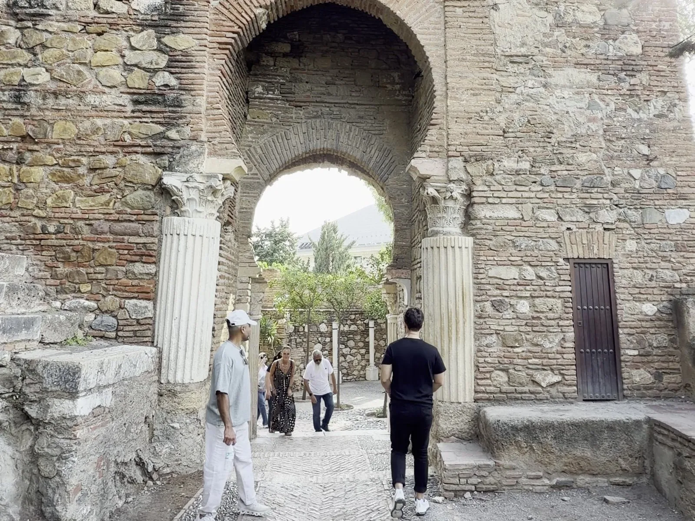
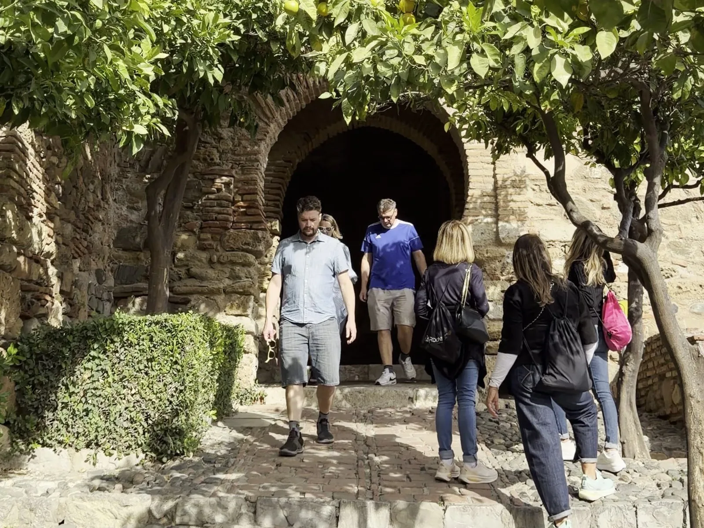
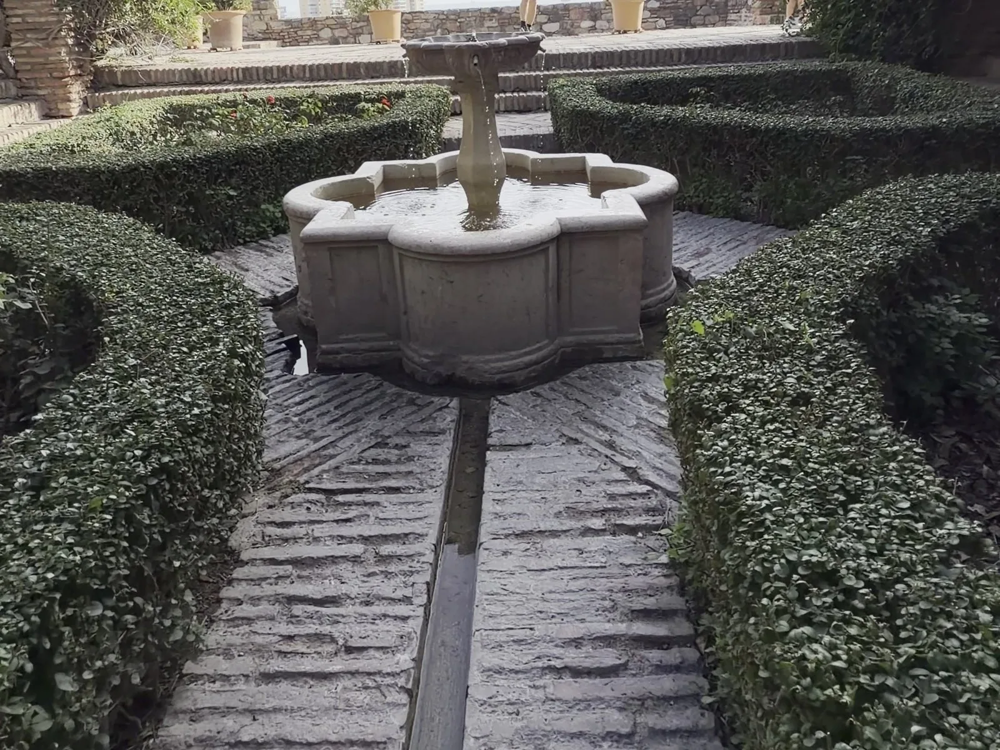
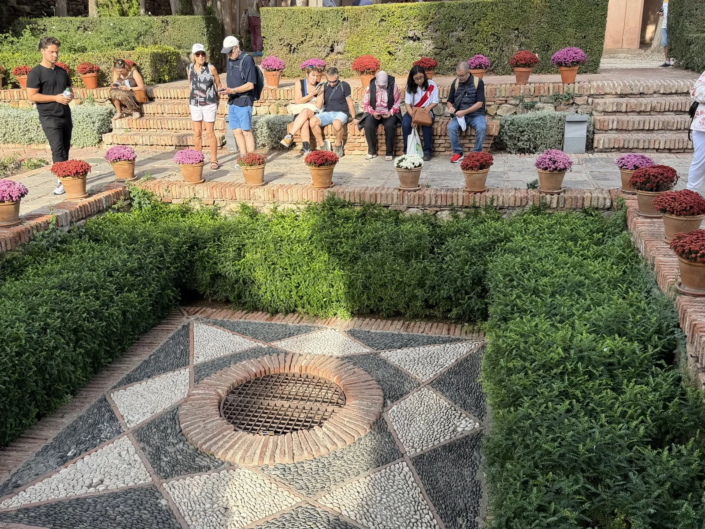
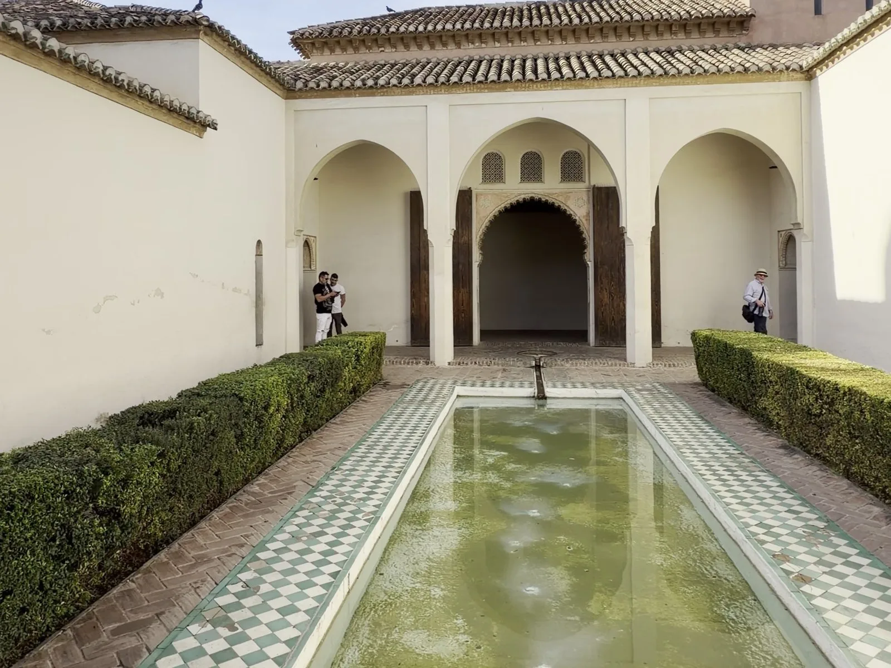
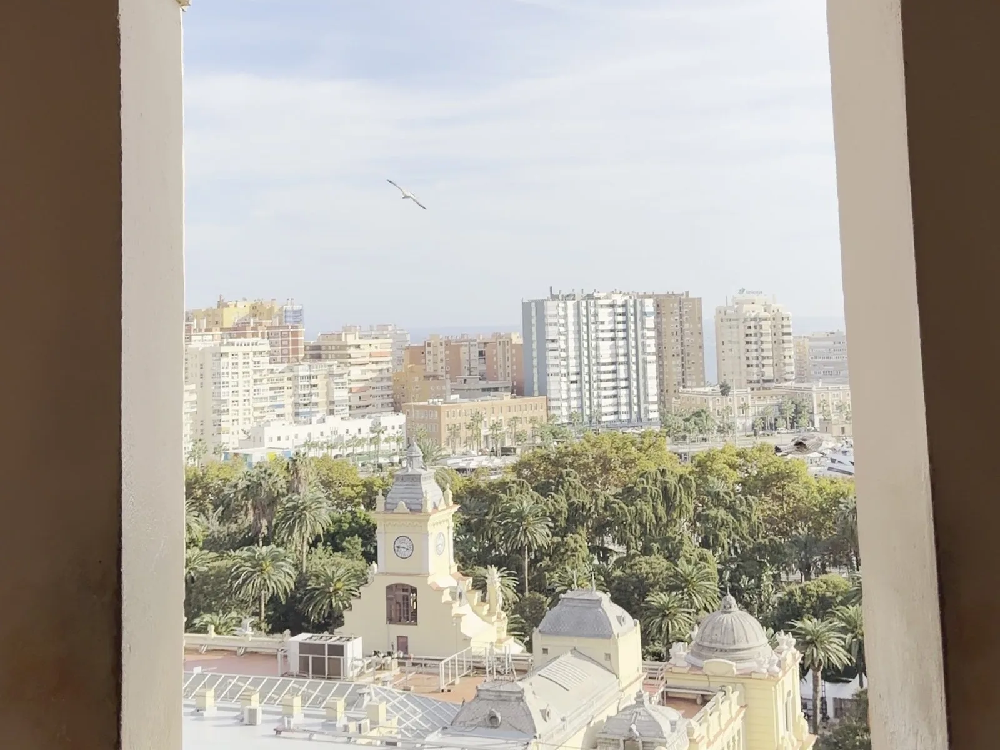
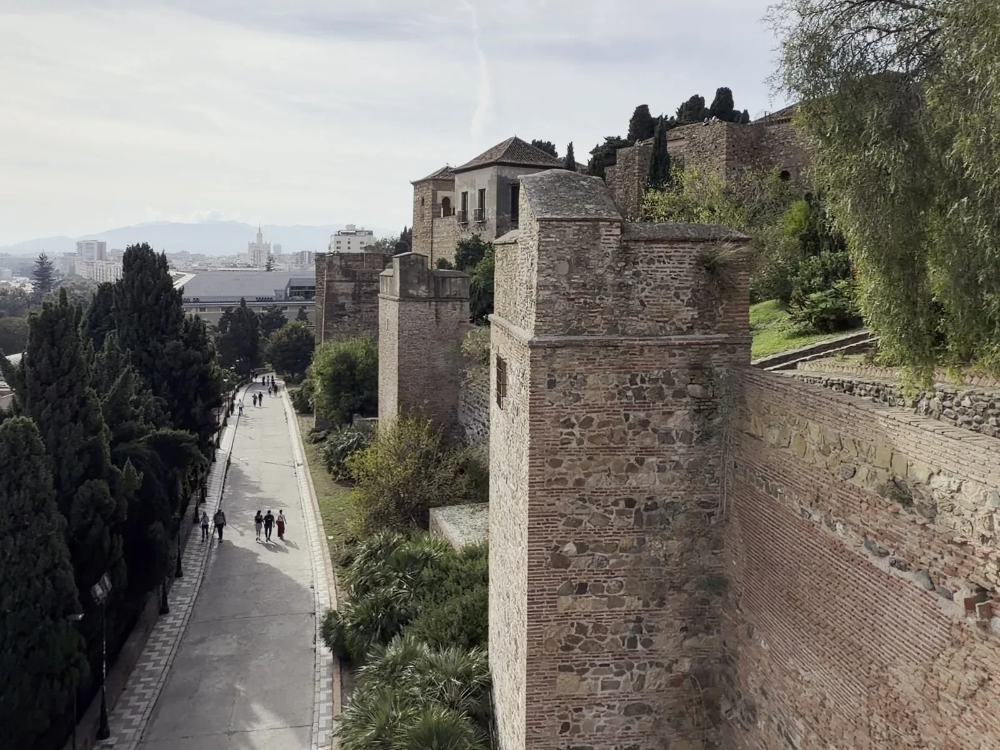
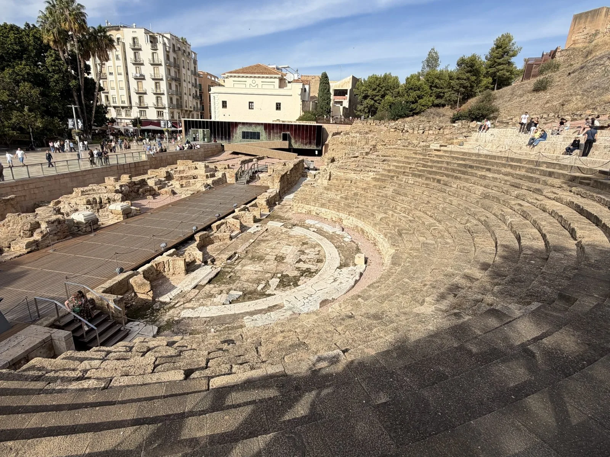
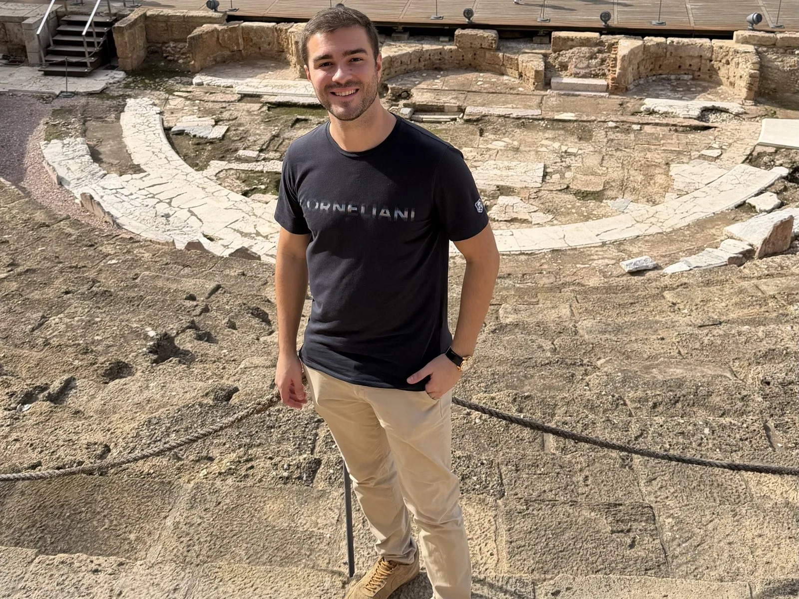
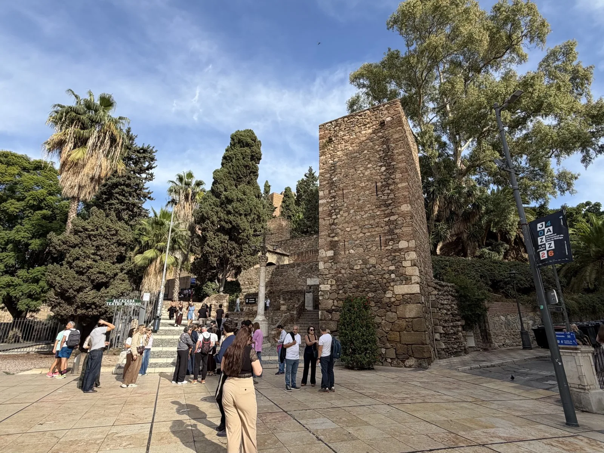

Una fortaleza árabe del siglo XI, con patios, fuentes y miradores sobre el puerto, y a sus pies un **teatro romano** de hace 2.000 años que estuvo enterrado hasta 1951. La **Alcazaba de Málaga** es lo primero que hay que ver en la ciudad, y además los domingos por la tarde es gratis.

Estas fotos son de mi visita en noviembre de 2026. Te cuento cuánto cuesta la entrada, cuándo no se paga, qué ver dentro y cómo subir 👇

En un vistazo<h2>Lo que vas a encontrar</h2>

<b>🏰</b>Fortaleza árabe

<b>⛲</b>Patios y fuentes

<b>🌅</b>Vistas al puerto

<b>🏛️</b>Teatro romano

<b>🎟️</b>Gratis el domingo

Antes de ir<h2>Entradas y horario de la Alcazaba</h2>

<h3>🎟️ Entradas</h3>
Se compran en la taquilla o en la web oficial. Los <strong>domingos desde las 14:00</strong> la entrada es <strong>gratis</strong>.

<ul class="guide__prices"><li>Entrada general<b>7 €</b></li><li>Alcazaba + Gibralfaro<b>10 €</b></li><li>Reducida<b>3 €</b></li><li>Menores de 6 años<b>Gratis</b></li></ul>

<h3>🕒 Horario</h3>
<strong>Invierno</strong> (1 nov - 31 mar): de 9:00 a 18:00. <strong>Verano</strong> (1 abr - 31 oct): de 9:00 a 20:00. Última entrada, <strong>una hora antes</strong> del cierre.

<h3>⏱️ Tiempo</h3>
Entre <strong>1 y 1,5 horas</strong> para la Alcazaba. Si sumas el Teatro Romano y Gibralfaro, deja <strong>media mañana</strong>.

Un poco de historia<h2>Mil años mirando al mar</h2>

La Alcazaba («ciudadela», en árabe) se levantó en el <strong>siglo XI</strong>, en tiempos de las taifas. Los cronistas musulmanes atribuyen la obra a <strong>Badis</strong>, rey zirí de Granada, aunque algunos estudios creen que reformó un recinto anterior. A finales del siglo XIII y en el XIV, ya con los <strong>nazaríes</strong>, se reforzaron sus murallas y torres.

Para construirla se reutilizaron <strong>columnas y capiteles del teatro romano</strong> que había justo debajo, y todavía se ven en sus puertas. Un paso amurallado, la <strong>Coracha</strong>, la unía con el castillo de <a href="/blog/malaga-que-ver.html">Gibralfaro</a>, en lo alto del monte. Tras la conquista de Málaga por los Reyes Católicos, en <strong>1487</strong>, se fue abandonando, y no se recuperó hasta los años treinta del siglo XX. Hoy ocupa unos <strong>15.000 m²</strong>, menos de la mitad de lo que llegó a medir.

<ol class="guide__timeline"><li><b>S. I d. C.</b>Se construye el teatro romano</li><li><b>S. XI</b>Se levanta la Alcazaba</li><li><b>S. XIII-XIV</b>Los nazaríes la refuerzan</li><li><b>1487</b>Los Reyes Católicos conquistan Málaga</li><li><b>1951</b>Aparece el teatro romano</li></ol>

La visita<h2>Qué ver en la Alcazaba de Málaga</h2>
Se sube por rampas y puertas en recodo, pensadas para frenar a los atacantes, hasta los palacios de la parte alta.

<ol class="guide__grid guide__grid--cuenca">
<li class="gcard reveal">
01

<h3>La Puerta de las Columnas</h3>
Después de la Puerta de la Bóveda llegas a esta, con <strong>columnas romanas</strong> reutilizadas a los lados del arco. Es la prueba de que el teatro sirvió de cantera.

</li>
<li class="gcard reveal">
02

<h3>El Arco de Cristo</h3>
Un paso en recodo dentro de una torre, entre naranjos. Al cruzarlo llegas a la Plaza de Armas, donde tras la conquista se colocó la artillería.

</li>
<li class="gcard reveal">
03

<h3>Jardines y fuentes</h3>
Fuentes, acequias y setos recortados: el sonido del agua acompaña casi todo el recorrido, como en la Alhambra.

</li>
<li class="gcard reveal">
04

<h3>Patios empedrados</h3>
Suelos de cantos rodados formando estrellas, macetas de colores y bancos a la sombra para descansar en la subida.

</li>
<li class="gcard reveal">
05

<h3>Los Cuartos de Granada</h3>
El palacio nazarí de la parte alta, donde vivían los gobernadores. Tiene tres patios; el más bonito es el de la <strong>Alberca</strong>, con su estanque y arcos.

</li>
<li class="gcard reveal">
06

<h3>Las ventanas al mar</h3>
Desde los arcos del palacio se ve el puerto, el Ayuntamiento y media ciudad. Es el sitio para la foto.

</li>
<li class="gcard reveal">
07

<h3>Murallas y barrio de viviendas</h3>
Doble muralla con torres y, dentro, las ruinas de un <strong>barrio del siglo XI</strong>: ocho casas, baños, un aljibe y letrinas.

</li>
</ol>

A sus pies<h2>El Teatro Romano de Málaga</h2>

Es de <strong>principios del siglo I d. C.</strong> y estuvo escondido durante siglos bajo casas y jardines. Apareció en <strong>1951</strong>, al hacer unos jardines delante de la Casa de la Cultura: primero se pensó que era una puerta de la muralla romana. Hoy se ven las gradas, la orquesta y parte del escenario, y la entrada es <strong>gratis</strong>.

<ol class="guide__grid guide__grid--cuenca">
<li class="gcard reveal">
01

<h3>Las gradas</h3>
Puedes sentarte en ellas y bajar hasta la orquesta. Abre de martes a sábado de 10:00 a 18:00, y domingos y festivos de 10:00 a 16:00.

</li>
<li class="gcard reveal">
02

<h3>Junto al escenario</h3>
Al lado del yacimiento hay un pequeño centro de interpretación, también gratis, para entender cómo era el teatro.

</li>
<li class="gcard reveal">
03

<h3>La calle Alcazabilla</h3>
Peatonal, con terrazas y la entrada a la Alcazaba. Bajo una pirámide de cristal se ven unas <strong>piletas de salazón</strong> donde se haría el famoso garum.

</li>
</ol>

<!--actividades-->

<!--cuando-->

Cuándo ir<h2>Mejor momento para la visita</h2>

<ul class="checklist" style="margin:0 0 1rem;"><li><strong>Gratis:</strong> el domingo desde las 14:00, pero es cuando más gente hay.</li><li><strong>Más tranquilo:</strong> a primera hora (abre a las 9:00) entre semana.</li><li><strong>Evita:</strong> el mediodía en verano: hay muchas rampas al sol.</li></ul>

Cómo llegar<h2>Cómo llegar a la Alcazaba</h2>

Está en pleno centro, a <strong>5 minutos andando</strong> de la catedral y de la calle Larios. La <strong>entrada principal</strong> está en la <strong>calle Alcazabilla</strong>, junto al Teatro Romano. Si no quieres subir rampas, hay un <strong>ascensor</strong> en la calle Guillén Sotelo, detrás del Ayuntamiento.

En coche, lo mejor es dejarlo en un aparcamiento subterráneo del centro o del puerto (el de la Alcazaba está justo debajo) y moverse andando.

<strong>Con guía:</strong> si quieres que te lo cuenten todo, hay una <a href="https://www.civitatis.com/es/malaga/visita-alcazaba-teatro-romano/?aid=110968" target="_blank" rel="noopener sponsored">visita guiada por la Alcazaba y el Teatro Romano</a> y un <a href="https://www.civitatis.com/es/malaga/free-tour-alcazaba-teatro-romano/?aid=110968" target="_blank" rel="noopener sponsored">free tour</a>.

<a class="btn guide__mapbtn" href="https://www.google.com/maps/dir/?api=1&destination=36.7210,-4.4159" target="_blank" rel="noopener"><svg class="ico" viewBox="0 0 24 24" width="15" height="15" aria-hidden="true" fill="currentColor"><path d="M12 2a7 7 0 0 0-7 7c0 5.25 7 13 7 13s7-7.75 7-13a7 7 0 0 0-7-7zm0 9.5a2.5 2.5 0 1 1 0-5 2.5 2.5 0 0 1 0 5z"/></svg> Cómo llegar en Google Maps</a><a class="btn guide__mapbtn btn--ghost" href="https://alcazabaygibralfaro.malaga.eu/" target="_blank" rel="noopener"><svg class="ico" viewBox="0 0 24 24" width="15" height="15" aria-hidden="true" fill="none" stroke="currentColor" stroke-width="2" stroke-linecap="round" stroke-linejoin="round"><path d="M7 3v3M17 3v3M4 9h16M5 5h14a1 1 0 0 1 1 1v13a1 1 0 0 1-1 1H5a1 1 0 0 1-1-1V6a1 1 0 0 1 1-1z"/></svg> Web oficial</a>

Si tienes más tiempo en Málaga, mira <a href="/blog/malaga-que-ver.html">qué ver en Málaga</a>, la <a href="/blog/cueva-del-tesoro.html">Cueva del Tesoro</a>, a 15 minutos, y el <a href="/blog/caminito-del-rey.html">Caminito del Rey</a>, a menos de una hora.

Consejos de Cheno<h2>Para disfrutarlo al máximo</h2><ul><li><b>Compra la combinada</b> si vas a subir a Gibralfaro: por 3 € más ves los dos.</li><li><b>Calzado cómodo</b>: el suelo es de piedra y hay muchas rampas.</li><li><b>Sube a la parte alta</b>: los Cuartos de Granada son lo mejor y mucha gente se da la vuelta antes.</li><li><b>Agua en verano</b>: hay poca sombra en las murallas.</li><li><b>Empieza por el teatro</b>: está en la misma calle y es gratis.</li></ul>

<!--faq-->

<h2>¿Te gustan estos planes?</h2>
Sígueme en Instagram como <a href="https://www.instagram.com/chenoaventuras/" target="_blank" rel="noopener">@chenoaventuras</a>: subo escapadas como esta cada semana.
<a class="btn guide__btn" href="/blog.html">Ver más planes en el blog</a>

Precios y horarios consultados en noviembre de 2026 en la web oficial de la Alcazaba y Gibralfaro (Ayuntamiento de Málaga) y en la de la Junta de Andalucía para el Teatro Romano; pueden cambiar, así que confírmalos antes de ir. Fotos de @chenoaventuras.

