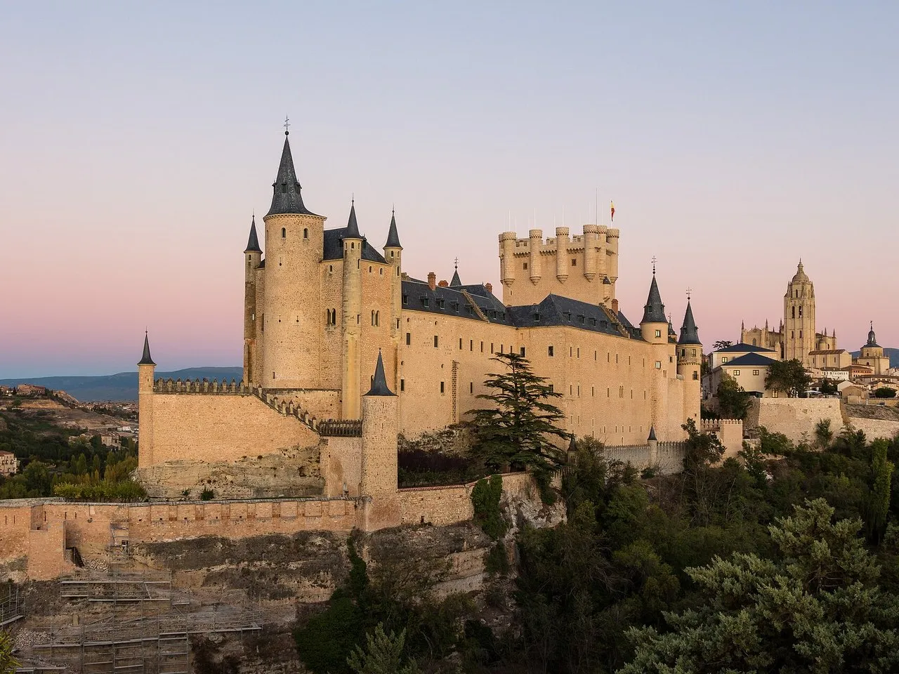
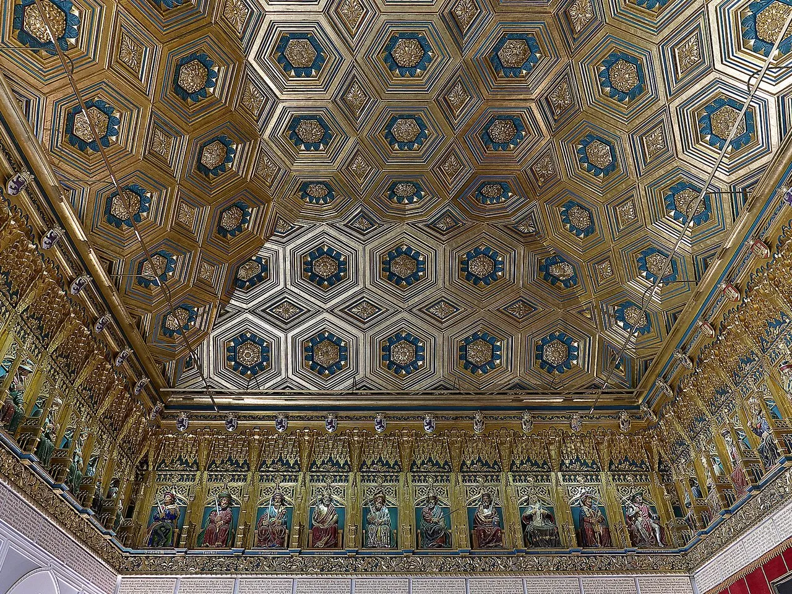
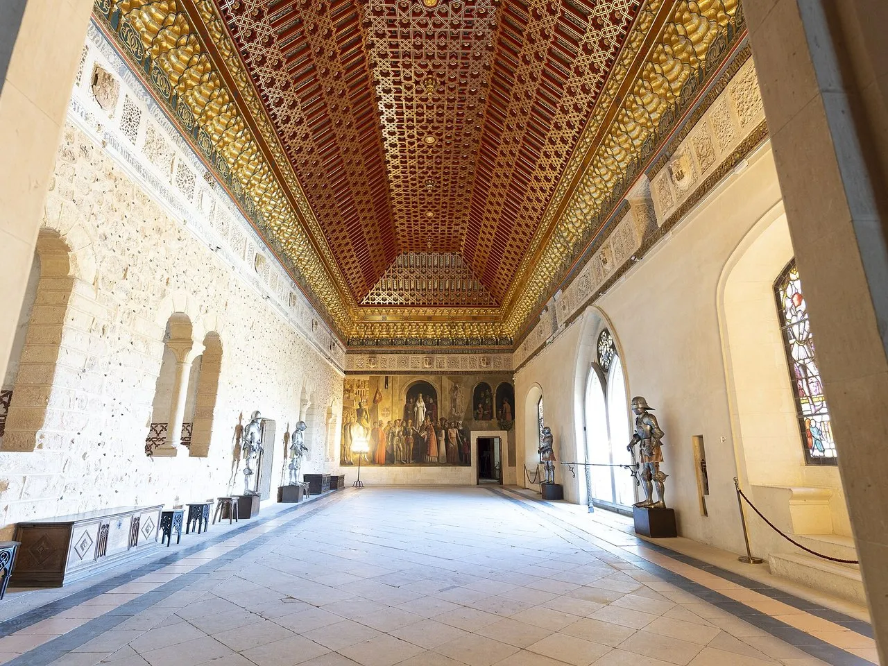
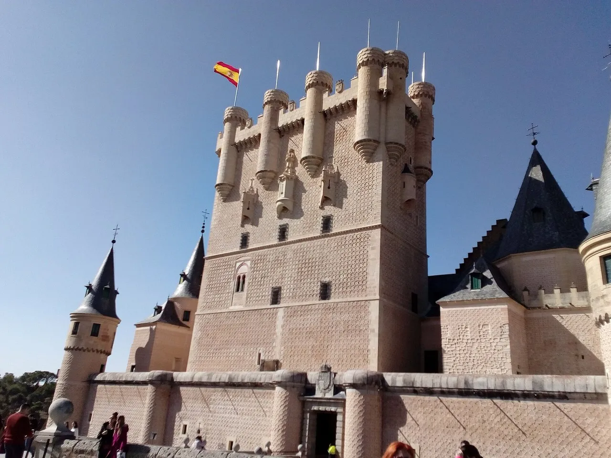
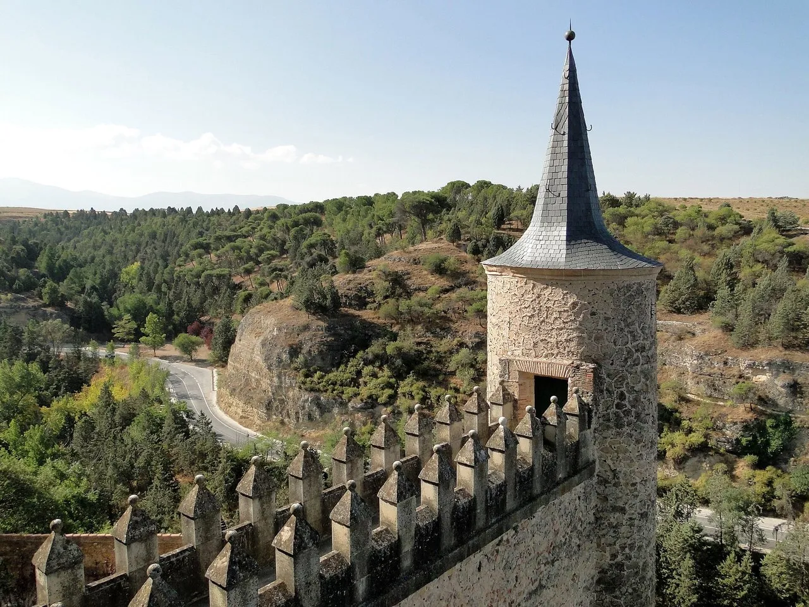
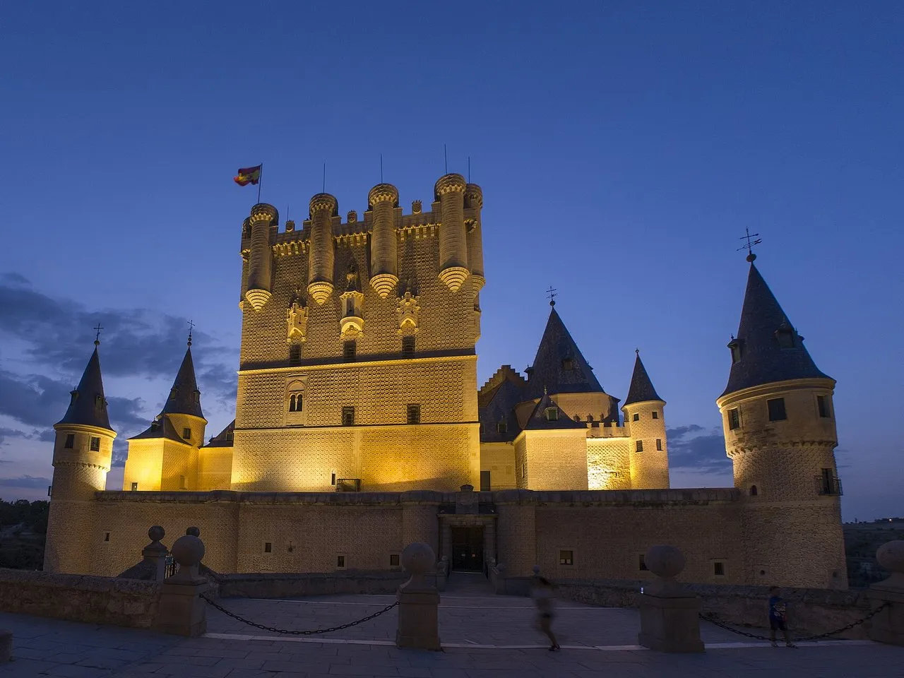

Una proa de piedra sobre la unión de dos ríos, torres con tejados de pizarra y salas con techos dorados. El **Alcázar de Segovia** es uno de los castillos más bonitos del mundo y, según cuenta el propio Alcázar, inspiró a **Walt Disney** para el castillo de Blancanieves.

Te cuento cuánto cuesta, cuándo es gratis, el horario y lo que no te puedes perder 👇

En un vistazo<h2>Lo que vas a encontrar</h2>

<b>🏰</b>Palacio real

<b>🗼</b>Torre de 152 escalones

<b>👑</b>Sala de Reyes

<b>💣</b>Museo de Artillería

<b>🎟️</b>Gratis los martes

Antes de ir<h2>Lo básico del Alcázar de Segovia</h2>

<h3>🎟️ Precio</h3>
<strong>Palacio + Museo + Torre: 10 €</strong> (reducida 8 €). <strong>Palacio + Museo: 7 €</strong> (reducida 5 €). Menores de 6 años, gratis.

<h3>🕙 Horario</h3>
Noviembre-marzo, <strong>10:00-18:00</strong>; abril-octubre, <strong>10:00-19:30</strong>. Abre todos los días.

<h3>🆓 Gratis</h3>
<strong>Martes de 14:00 a 16:00</strong>, Palacio + Museo, para ciudadanos de la UE que compren en taquilla (salvo festivos).

<h3>⚠️ La torre se agota</h3>
Las entradas con <strong>Torre de Juan II</strong> suelen agotarse: compra con antelación. La hora punta es de 11:00 a 13:30.

Qué ver<h2>Qué ver en el Alcázar de Segovia</h2>

<ol class="guide__grid guide__grid--cuenca">
<li class="gcard reveal">
01

<h3>El castillo por fuera</h3>
Su forma de <strong>proa de barco</strong> sobre la confluencia del Eresma y el Clamores se ve mejor desde abajo, desde los miradores del valle.

</li>
<li class="gcard reveal">
02

<h3>La Sala de Reyes</h3>
Un techo dorado espectacular y un friso con los <strong>reyes de Castilla y León</strong>. Es la sala más famosa del palacio.

</li>
<li class="gcard reveal">
03

<h3>La Sala de la Galera</h3>
Su techo recuerda el casco invertido de un barco. También verás la <strong>Sala del Trono</strong> y otras estancias de la corte castellana.

</li>
<li class="gcard reveal">
04

<h3>La Torre de Juan II</h3>
<strong>152 escalones</strong> de caracol hasta arriba, con vistas a la ciudad vieja, la catedral y el valle. Máximo 25 minutos arriba.

</li>
<li class="gcard reveal">
05

<h3>Almenas y Museo de Artillería</h3>
Desde las almenas se ve el valle del Eresma. Dentro, el museo recuerda que Carlos III fundó en 1762 el <strong>Real Colegio de Artillería</strong>, que funcionó aquí hasta el incendio de 1862. Hoy hay un museo con cañones e instrumentos científicos.

</li>
<li class="gcard reveal">
06

<h3>El Alcázar de noche</h3>
La plaza de la Reina Victoria Eugenia, ante la entrada, abre hasta las 22:00: al anochecer, con el castillo iluminado, merece la pena volver.

</li>
</ol>

<!--actividades-->

La historia<h2>De fortaleza a palacio real</h2>

El Alcázar fue residencia de los reyes de Castilla. En <strong>1256</strong> Alfonso X convocó aquí las primeras Cortes, y de sus puertas salió <strong>Isabel la Católica</strong> el <strong>13 de diciembre de 1474</strong> para ser proclamada reina. Más tarde fue prisión de Estado y, desde 1764, sede del Real Colegio de Artillería.

<h3>🔥 El incendio de 1862</h3>
El <strong>6 de marzo de 1862</strong> un incendio destruyó los techos y el interior. La restauración posterior le devolvió el aspecto de cuento que tiene hoy. Orson Welles lo usó en «Campanadas a medianoche».

Cómo llegar<h2>Cómo llegar al Alcázar de Segovia</h2>

<h3>🚄 En AVE</h3>
De Madrid-Chamartín a <strong>Segovia-Guiomar</strong> en menos de 30 minutos. La estación está a 6 km: buses urbanos 11 y 12 al centro.

<h3>🚌 En autobús</h3>
Desde Moncloa (Madrid), una hora. La estación de Segovia está a 5 minutos del Acueducto.

<h3>🚗 En coche</h3>
Unos 80 km desde Madrid. Aparca en el parking <strong>Catedral-Oblatas</strong> o en las zonas gratuitas del paseo Ezequiel González y San Marcos.

<h3>🧭 Con excursión</h3>
La <a href="https://www.civitatis.com/es/madrid/excursion-segovia/?aid=110968" target="_blank" rel="noopener sponsored">excursión a Segovia desde Madrid</a> o, ya allí, la <a href="https://www.civitatis.com/es/segovia/visita-guiada-segovia-catedral-alcazar/?aid=110968" target="_blank" rel="noopener sponsored">visita guiada con Catedral y Alcázar</a>.

Consejos de Cheno<h2>Para disfrutarlo al máximo</h2><ul><li><b>Compra la entrada con torre online</b>: es la que primero se agota.</li><li><b>Llega a primera hora</b> o después de las 14:00 para evitar la hora punta.</li><li><b>Audioguía</b> (3,50 €): sin ella te pierdes la mitad de la historia.</li><li><b>Haz la foto desde abajo</b>: el mirador de la Pradera de San Marcos da la mejor vista del castillo.</li><li><b>En diciembre</b>, el <a href="https://www.civitatis.com/es/segovia/tour-navidad-segovia/?aid=110968" target="_blank" rel="noopener sponsored">tour de Segovia en Navidad</a>. Y combínalo con el <a href="/blog/acueducto-de-segovia.html">Acueducto</a>.</li></ul>

⛲ <strong>Muy cerca:</strong> el <a href="/blog/palacio-real-la-granja.html">Palacio Real de La Granja</a>, con jardines gratis.

<!--faq-->

<h2>¿Te gustan estos planes?</h2>
Sígueme en Instagram como <a href="https://www.instagram.com/chenoaventuras/" target="_blank" rel="noopener">@chenoaventuras</a>: subo escapadas como esta cada semana.
<a class="btn guide__btn" href="/blog.html">Ver más planes en el blog</a>

Información consultada en noviembre de 2026 en la web oficial del Alcázar de Segovia y su tarifario. Fotos de Wikimedia Commons: <a href="https://commons.wikimedia.org/wiki/File:Segovia_-_Alc%C3%A1zar_de_Segovia_05_2017-10-22.jpg" target="_blank" rel="noopener">Rafa Esteve</a> (CC BY-SA 4.0) · <a href="https://commons.wikimedia.org/wiki/File:Segovia_-_Alc%C3%A1zar_de_Segovia_22_2017-10-24.jpg" target="_blank" rel="noopener">Rafa Esteve</a> (CC BY-SA 4.0) · <a href="https://commons.wikimedia.org/wiki/File:Sala_de_los_Reyes_(Alc%C3%A1zar_de_Segovia).jpg" target="_blank" rel="noopener">José Luis Filpo Cabana</a> (CC BY-SA 4.0) · <a href="https://commons.wikimedia.org/wiki/File:Sala_de_la_galera.jpg" target="_blank" rel="noopener">Ministrillo</a> (CC BY-SA 4.0) · <a href="https://commons.wikimedia.org/wiki/File:Torre_de_Juan_II_del_Alc%C3%A1zar_de_Segovia.jpg" target="_blank" rel="noopener">Arturo Francisco Barbero</a> (CC BY-SA 3.0) · <a href="https://commons.wikimedia.org/wiki/File:Alc%C3%A1zar_of_Segovia_11.jpg" target="_blank" rel="noopener">Bernard Gagnon</a> (CC BY-SA 3.0) · <a href="https://commons.wikimedia.org/wiki/File:Fotograf%C3%ADa_Nocturna_Alc%C3%A1zar_de_Segovia.jpg" target="_blank" rel="noopener">Ministrillo</a> (CC BY-SA 4.0).

