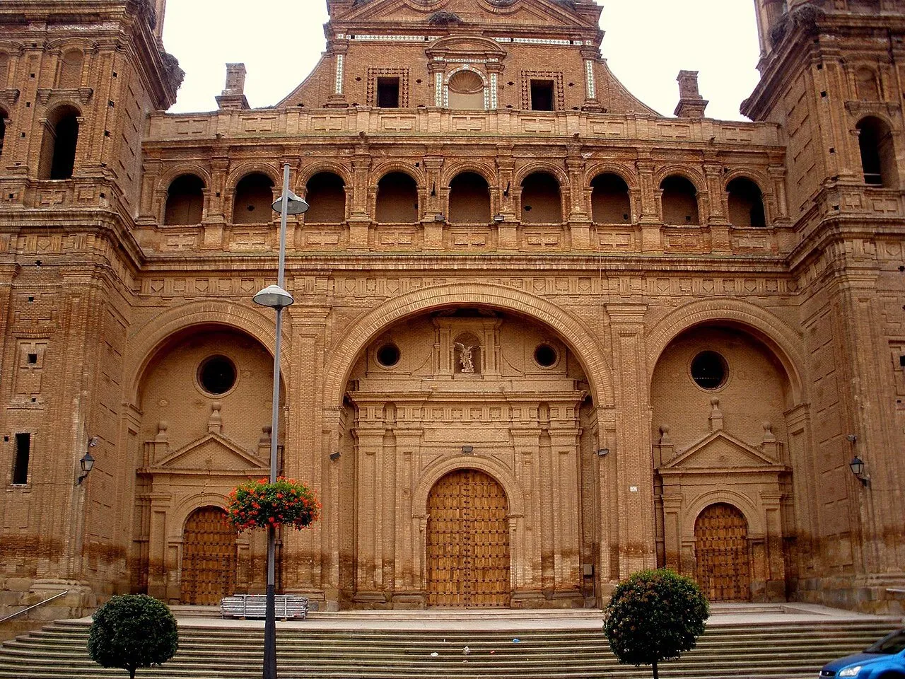
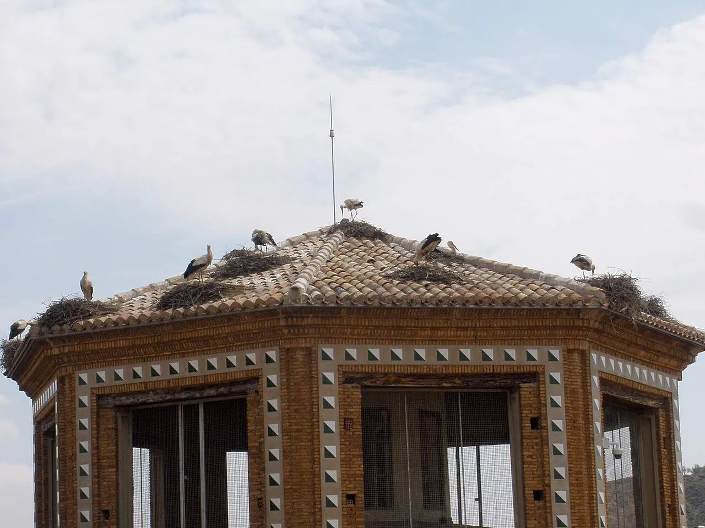
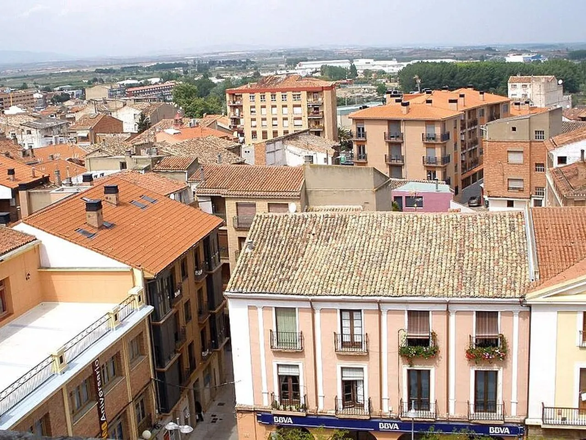
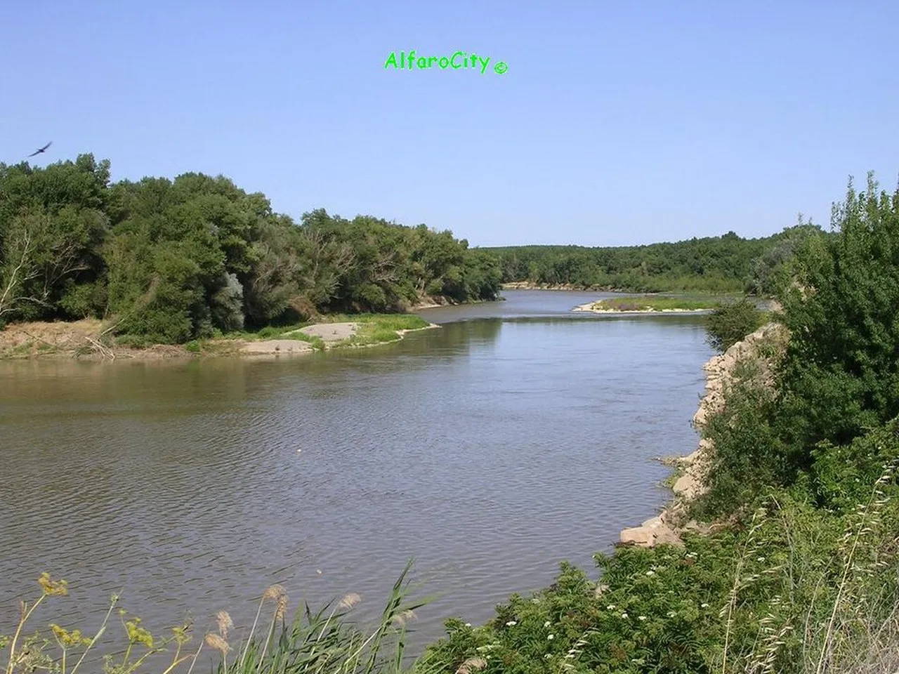
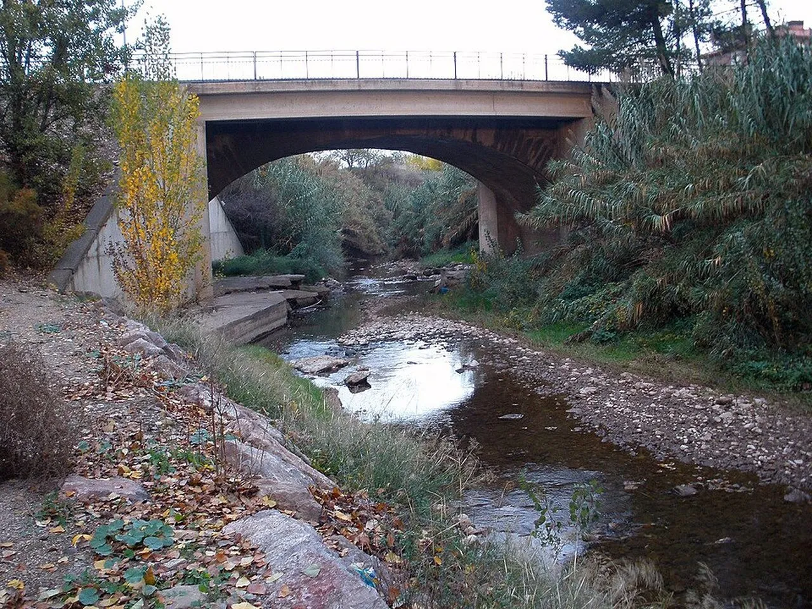

Cientos de nidos sobre los tejados y las torres de una iglesia barroca, el crotoreo de las cigüeñas de fondo y, a un paso, los sotos del río Ebro. **Alfaro**, en el extremo oriental de La Rioja, es la **ciudad de las cigüeñas** y este año compite por ser el **pueblo de la Navidad de Ferrero Rocher**.

Te cuento qué ver, cuándo ir y cómo llegar 👇

En un vistazo<h2>Lo que vas a encontrar</h2>

<b>🪺</b>Colonia de cigüeñas

<b>⛪</b>Barroco en ladrillo

<b>🌳</b>Sotos del Ebro

<b>🏛️</b>Ninfeo romano

<b>🎄</b>Candidato Ferrero 2026

Antes de ir<h2>Lo básico de Alfaro</h2>

<h3>📍 Dónde está</h3>
En la <strong>Rioja Baja</strong>, junto al Ebro, a 20 km de Tudela y 72 km de Logroño.

<h3>🪺 Cuándo ir</h3>
En <strong>primavera y verano</strong> para ver las cigüeñas en los nidos.

<h3>⏱️ Tiempo</h3>
<strong>Medio día</strong> para el casco y un paseo por los sotos.

<h3>ℹ️ Turismo</h3>
Oficina en el Centro Cultural de la Plaza de España. Tel. 941 18 00 32.

Qué ver<h2>Qué ver en Alfaro</h2>

<ol class="guide__grid guide__grid--cuenca">
<li class="gcard reveal">
01

<h3>La Colegiata de San Miguel</h3>
Templo de ladrillo de los siglos XVI y XVII con fachada del <strong>barroco aragonés</strong>. Monumento histórico-artístico nacional desde 1976.

</li>
<li class="gcard reveal">
02

<h3>La colonia de cigüeñas</h3>
Casi todas las cigüeñas de Alfaro anidan en la Colegiata: <strong>más de 400</strong> en verano, según el Ayuntamiento. Un espectáculo único.

</li>
<li class="gcard reveal">
03

<h3>El casco y la Plaza de España</h3>
La iglesia del <strong>Burgo</strong> y el convento de <strong>San Francisco</strong> (siglo XVII), el Palacio Abacial y el antiguo ayuntamiento neoclásico, hoy centro de interpretación.

</li>
<li class="gcard reveal">
04

<h3>Los Sotos del Ebro</h3>
Reserva Natural desde 2001, la segunda zona protegida de La Rioja. Bosques de ribera con paseos junto al río.

</li>
<li class="gcard reveal">
05

<h3>Graccurris y el río Alhama</h3>
Alfaro fue la celtíbera <strong>Ilurcis</strong> y la romana <strong>Graccurris</strong>, fundada por Tiberio Sempronio Graco. De entonces queda el <strong>Ninfeo</strong>, del siglo I.

</li>
</ol>

<!--actividades-->

<h3>🎄 Candidato a pueblo Ferrero Rocher</h3>
Alfaro representa a <strong>La Rioja</strong> en el concurso de la Navidad de Ferrero Rocher 2026. Mira cómo va y cómo votar en <a href="/blog/pueblo-navidad-ferrero-rocher-2026.html">el pueblo de la Navidad de Ferrero Rocher</a>.

Cómo llegar<h2>Cómo llegar a Alfaro</h2>

<h3>🚗 En coche</h3>
Por la <strong>N-232</strong>, entre Logroño y Zaragoza.

<h3>🚆 En tren</h3>
Estación en la línea <strong>Bilbao-Logroño-Zaragoza</strong>.

<h3>🚌 En autobús</h3>
Ruta <strong>Burgos-Logroño-Zaragoza</strong>.

<h3>🏜️ Muy cerca</h3>
Las Bardenas Reales, a un paso por Tudela: <a href="https://www.civitatis.com/es/tudela/tour-buggy-bardenas-reales/?aid=110968" target="_blank" rel="noopener sponsored">tour en buggy por las Bardenas</a>.

Consejos de Cheno<h2>Para disfrutarlo al máximo</h2><ul><li><b>Lleva prismáticos</b> o zoom para ver los nidos de cerca.</li><li><b>Ve al atardecer</b>, cuando las cigüeñas vuelven a la Colegiata.</li><li><b>Pasea por los sotos</b> por la Avenida del Ebro.</li><li><b>Combínalo con</b> las <a href="/blog/bardenas-reales.html">Bardenas Reales</a> y Tudela.</li></ul>

<!--faq-->

<h2>¿Te gustan estos planes?</h2>
Sígueme en Instagram como <a href="https://www.instagram.com/chenoaventuras/" target="_blank" rel="noopener">@chenoaventuras</a>: subo escapadas como esta cada semana.
<a class="btn guide__btn" href="/blog.html">Ver más planes en el blog</a>

Información consultada en noviembre de 2026 en la web del Ayuntamiento de Alfaro. Fotos de Wikimedia Commons: <a href="https://commons.wikimedia.org/wiki/File:Colegiata_de_San_Miguel_Arc%C3%A1ngel.jpg" target="_blank" rel="noopener">VirAlfaro</a> (CC BY-SA 4.0) · <a href="https://commons.wikimedia.org/wiki/File:Alfaro_-_Colegiata_de_San_Miguel_06.JPG" target="_blank" rel="noopener">Zarateman</a> (CC0) · <a href="https://commons.wikimedia.org/wiki/File:Alfaro_-_Colegiata,_cig%C3%BCe%C3%B1as_09.jpg" target="_blank" rel="noopener">Zarateman</a> (CC0) · <a href="https://commons.wikimedia.org/wiki/File:Alfaro_17.jpg" target="_blank" rel="noopener">Zarateman</a> (CC0) · <a href="https://commons.wikimedia.org/wiki/File:Sotos_Alfaro1.JPG" target="_blank" rel="noopener">AlfaroCity</a> (dominio público) · <a href="https://commons.wikimedia.org/wiki/File:Alfaro_-_Rio_Alhama_1.JPG" target="_blank" rel="noopener">Zarateman</a> (CC0).

