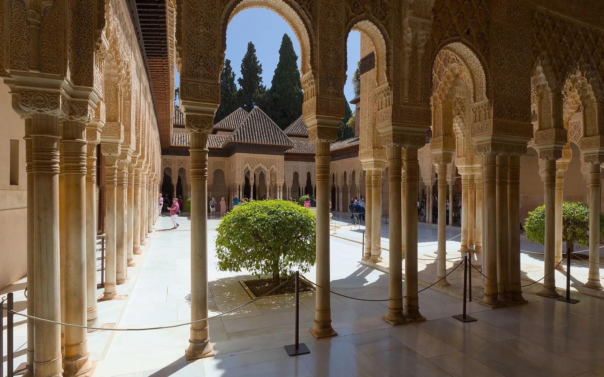
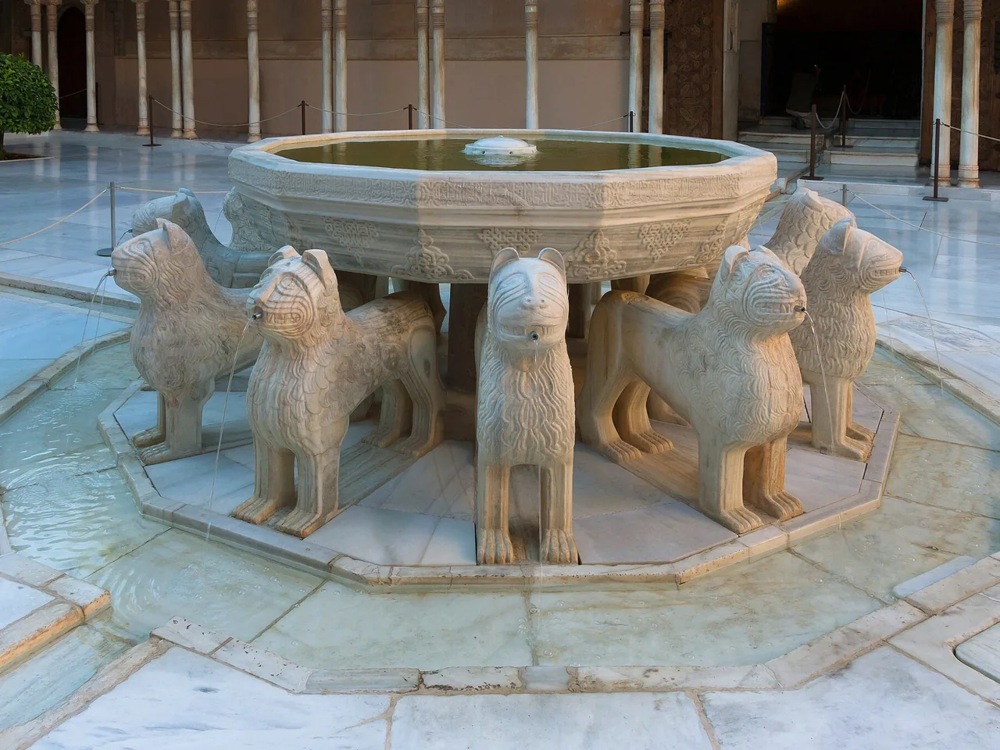
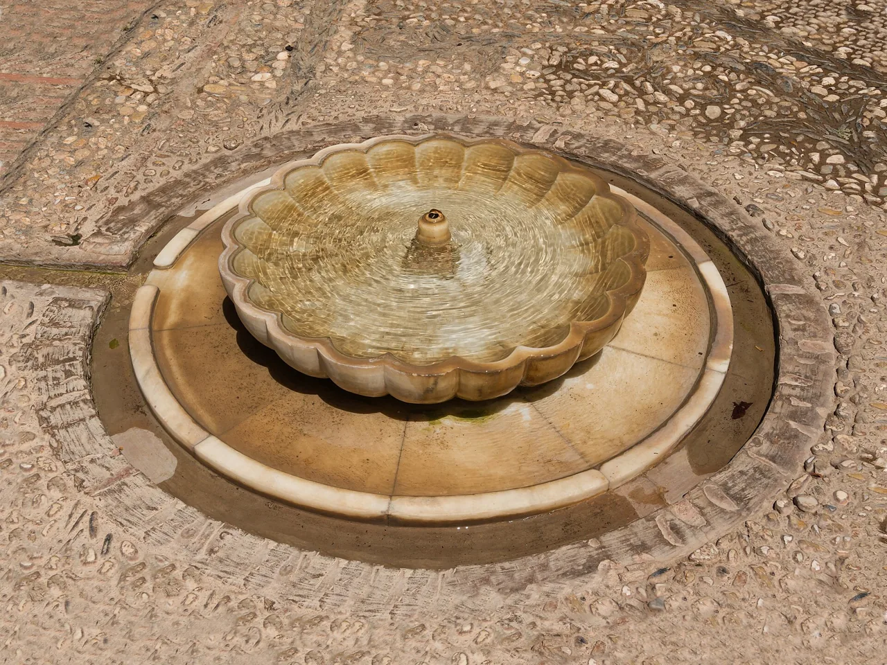
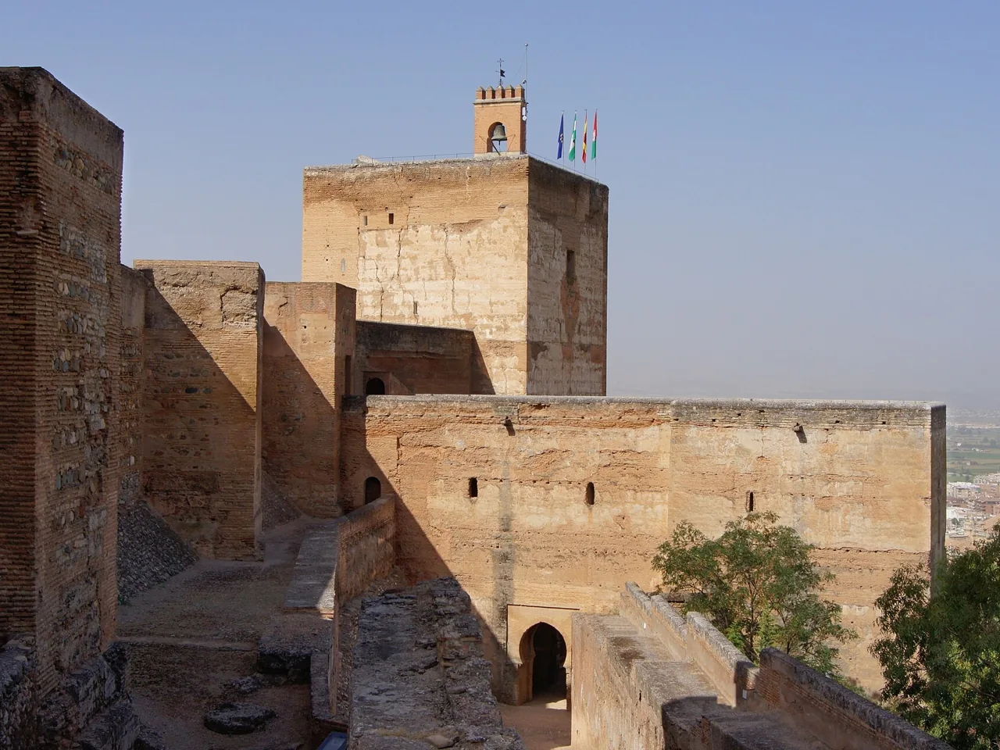
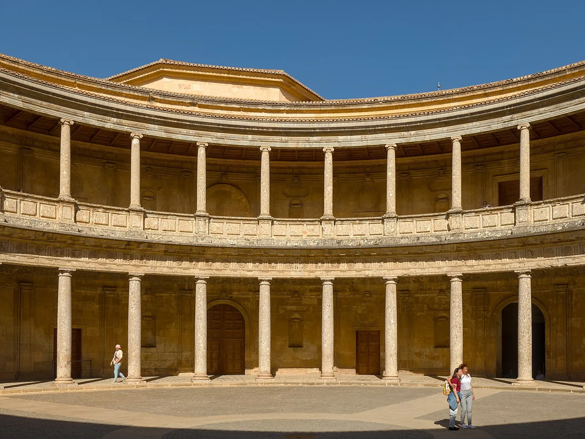
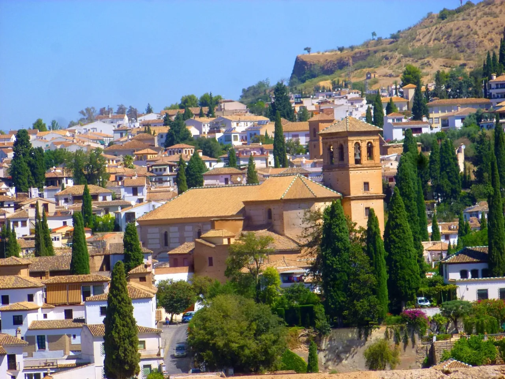

Palacios de yeserías y mármol, jardines con acequias, una fortaleza con vistas a toda Granada y la **Sierra Nevada** al fondo. La **Alhambra** es el monumento más visitado de España y también uno de los que **más cuesta conseguir entrada**: aquí te cuento cómo hacerlo bien, qué incluye cada ticket y cómo recorrerla.

En un vistazo<h2>Lo que vas a encontrar</h2>

<b>🎟️</b>Entradas

<b>🕌</b>Palacios Nazaríes

<b>🦁</b>Patio de los Leones

<b>🌿</b>Generalife

<b>🏰</b>Alcazaba

Antes de ir<h2>Alhambra: cómo conseguir entradas</h2>

<h3>🎟️ Entrada general</h3>
La <strong>Alhambra General</strong> (diurna) incluye los <strong>Palacios Nazaríes, el Generalife y la Alcazaba</strong>. Según el Patronato, cuesta <strong>22,27 €</strong> según la tabla oficial (por internet se suma una comisión de servicio); los menores de 12 años entran gratis, pero hay que sacar su entrada a la vez.

<h3>📅 Reserva con antelación</h3>
Los Palacios Nazaríes tienen aforo limitado: el Patronato habla de unas <strong>300 personas cada media hora</strong>. En temporada alta las entradas se agotan con mucha antelación, así que reserva online cuanto antes. Compra solo en la <strong>web oficial</strong> o en vendedores autorizados.

<h3>⏰ La hora de los Palacios</h3>
Los Palacios Nazaríes tienen <strong>franja horaria</strong> de 30 minutos impresa en la entrada: si llegas tarde, pierdes tu plaza. El resto del recinto se puede visitar hasta el cierre.

Horarios y precios<h2>Horario de la Alhambra y tipos de entrada</h2>

<h3>❄️ Invierno</h3>
Del <strong>15 de octubre al 31 de marzo</strong>, todos los días de <strong>8:30 a 18:00</strong>.

<h3>☀️ Verano</h3>
Del <strong>1 de abril al 14 de octubre</strong>, todos los días de <strong>8:30 a 20:00</strong>.

<h3>🌙 Nocturna</h3>
Palacios Nazaríes, <strong>12,73 €</strong>. En invierno, viernes y sábados de <strong>20:00 a 21:30</strong>; en verano, de martes a sábado de <strong>22:00 a 23:30</strong>.

<h3>🚫 Cierra</h3>
El <strong>25 de diciembre y el 1 de enero</strong>.

<ul class="guide__prices"><li>Visita diurna general<b>22,27 €</b></li><li>Jardines y palacio del Generalife<b>12,73 €</b></li><li>Nocturna Palacios Nazaríes<b>12,73 €</b></li><li>Nocturna jardines Generalife<b>8,48 €</b></li><li>Menores de 12<b>Gratis</b></li></ul>

Hay entrada reducida para <strong>mayores de 65 de la UE, Carnet Joven y discapacidad del 33 % o más</strong>, enseñando el justificante en taquilla. Se compra hasta las <strong>23:59 del día anterior</strong>. Gratis: la <strong>Silla del Moro</strong> y las <strong>Torres Bermejas</strong> (fines de semana) y los monumentos andalusíes del Albaicín los <strong>domingos</strong>.

Curiosidades<h2>Una ciudad palatina dentro de una colina</h2>

La Alhambra no es un solo edificio: es un <strong>conjunto de palacios, fortaleza, jardines y barrios</strong> de la época nazarí, la última dinastía musulmana de la Península. Los <strong>Palacios Nazaríes</strong> son el corazón del recinto y lo más delicado: salas con <strong>yeserías y azulejos</strong>, techos de madera labrada y patios con agua, como el famoso <strong>Patio de los Leones</strong>, con su fuente de doce leones de piedra.

Frente a ellos se alza el <strong>Palacio de Carlos V</strong>, renacentista y con un gran patio circular que contrasta con la delicadeza nazarí, y en lo alto la <strong>Alcazaba</strong>, la parte más antigua del recinto. Al otro lado, el <strong>Generalife</strong> era la casa de campo de los reyes, con jardines, fuentes y acequias.

<h3>🌅 Mi consejo</h3>
Para ver la Alhambra de fuera, sube al <strong>Mirador de San Nicolás</strong>, en el Albaicín, al atardecer: es gratis y es la vista clásica, con la Sierra Nevada detrás.

<!--enr-->

La historia<h2>De fortaleza a ciudad palatina nazarí</h2>

En la colina de la <strong>Sabika</strong> ya había una fortaleza entre los siglos IX y XI, la futura <strong>Alcazaba</strong>. Pero la Alhambra tal como la conocemos nace con el <strong>reino nazarí de Granada</strong>: <strong>Muhammad I</strong> (el fundador de la dinastía, nacido en Arjona hacia 1195) la convirtió en ciudad palatina hacia 1238, y sus sucesores la fueron ampliando. Su máximo esplendor fue en los siglos <strong>XIII y XIV</strong>, bajo reyes como <strong>Yusuf I</strong> (1333-1354) y <strong>Muhammad V</strong>.

Tras la entrega de Granada a los Reyes Católicos en 1492, la Alhambra se conservó pero cambió: en 1527 <strong>Carlos V</strong> mandó levantar su palacio renacentista junto a los palacios nazaríes. La UNESCO la declaró <strong>Patrimonio de la Humanidad en 1984</strong> (junto al Generalife), y en 1994 amplió la declaración al Albaicín.

Qué ver<h2>Qué ver en la Alhambra</h2>
Por orden de visita.

<ol class="guide__grid guide__grid--cuenca">
<li class="gcard reveal">
01

<h3>Los Palacios Nazaríes</h3>
El corazón de la Alhambra: salas, patios y techos decorados con una delicadeza increíble. Llega a tu hora exacta.

</li>
<li class="gcard reveal">
02

<h3>La Fuente de los Leones</h3>
Doce leones de piedra sostienen la fuente del patio más famoso del conjunto.

</li>
<li class="gcard reveal">
03

<h3>Los jardines del Generalife</h3>
Patios con agua, fuentes y flores: la casa de campo de los reyes nazaríes. Mejor a primera hora.

</li>
<li class="gcard reveal">
04

<h3>La Alcazaba</h3>
La fortaleza más antigua del recinto, con torres desde las que se ve Granada y la Sierra Nevada.

</li>
<li class="gcard reveal">
05

<h3>El Palacio de Carlos V</h3>
Un palacio renacentista con un patio redondo muy original, justo al lado de los palacios nazaríes.

</li>
<li class="gcard reveal">
06

<h3>El Albaicín desde la Alhambra</h3>
Desde el recinto se ve el barrio del Albaicín, con sus casas blancas, y se entiende por qué Granada es única.

</li>
</ol>

Cómo llegar<h2>Cómo llegar</h2>

<strong>Llegar al recinto:</strong> desde el centro de Granada se sube en <strong>bus</strong> (hay líneas urbanas), en <strong>taxi</strong> o andando por la cuesta de Gomérez, unos 20-30 minutos. Si vas en coche, hay aparcamientos junto al monumento.

<strong>Granada:</strong> el AVE y los autobuses conectan con Madrid, Sevilla y Málaga. Consulta los horarios en Renfe y Alsa.

<strong>Si se agotan las entradas sueltas:</strong> mira la <a href="https://www.civitatis.com/es/granada/tour-alhambra-palacios-nazaries/?aid=110968" target="_blank" rel="noopener sponsored">visita guiada por la Alhambra y los Palacios Nazaríes con entradas</a>, que lleva la entrada incluida.

<a class="btn guide__mapbtn" href="https://www.google.com/maps/dir/?api=1&destination=Alhambra+de+Granada" target="_blank" rel="noopener"><svg class="ico" viewBox="0 0 24 24" width="15" height="15" aria-hidden="true" fill="currentColor"><path d="M12 2a7 7 0 0 0-7 7c0 5.25 7 13 7 13s7-7.75 7-13a7 7 0 0 0-7-7zm0 9.5a2.5 2.5 0 1 1 0-5 2.5 2.5 0 0 1 0 5z"/></svg> Cómo llegar en Google Maps</a>

Consejos de Cheno<h2>Cómo planificar la visita</h2><ul><li><b>Calcula 3-4 horas</b>: dos horas son lo mínimo para ver bien los palacios, la Alcazaba y el Generalife.</li><li><b>Orden recomendado</b>: empieza por el Generalife, sigue por la Alcazaba y llega a los Palacios a tu hora.</li><li><b>Visita nocturna</b>: hay entradas nocturnas más baratas que la general, para ver los Palacios iluminados.</li><li><b>Lleva agua y protección solar</b>: pasarás mucho rato al aire libre.</li><li><b>Cuidado con los intermediarios</b>: compra en la web oficial o en vendedores autorizados.</li></ul>

<!--faq-->

<h2>¿Te gustan estos planes?</h2>
Sígueme en Instagram como <a href="https://www.instagram.com/chenoaventuras/" target="_blank" rel="noopener">@chenoaventuras</a>: subo escapadas como esta cada semana.
<a class="btn guide__btn" href="/blog.html">Ver más planes en el blog</a>

Información consultada en noviembre de 2026 en la web oficial del Patronato de la Alhambra y Generalife (horarios y tarifas). Los precios, los horarios y la disponibilidad de entradas cambian: confírmalos siempre en la web oficial de la Alhambra. Fotos de Wikimedia Commons: <a href="https://commons.wikimedia.org/wiki/File:Granada_-_Alhambra_-_Palacios_nazar%C3%ADes_-_Patio_de_los_Leones_-_1.jpg" target="_blank" rel="noopener">Benjamin Smith</a> (CC BY-SA 4.0) · <a href="https://commons.wikimedia.org/wiki/File:Fountain_patio_de_los_Leones_Alhambra_Granada_Spain.jpg" target="_blank" rel="noopener">Jebulon</a> (CC0) · <a href="https://commons.wikimedia.org/wiki/File:Fountain_Generalife_gardens,_Granada,_Spain.jpg" target="_blank" rel="noopener">Jebulon</a> (CC0) · <a href="https://commons.wikimedia.org/wiki/File:Alcazaba_remparts_Alhambra_Grenade.jpg" target="_blank" rel="noopener">Jebulon</a> (CC0) · <a href="https://commons.wikimedia.org/wiki/File:Granada_-_El_Albaic%C3%ADn_desde_el_Partal_de_la_Alhambra_2.jpg" target="_blank" rel="noopener">Zarateman</a> (CC0) · <a href="https://commons.wikimedia.org/wiki/File:Granada_-_Alhambra_-_Palacio_de_Carlos_V.jpg" target="_blank" rel="noopener">Benjamin Smith</a> (CC BY-SA 4.0).

