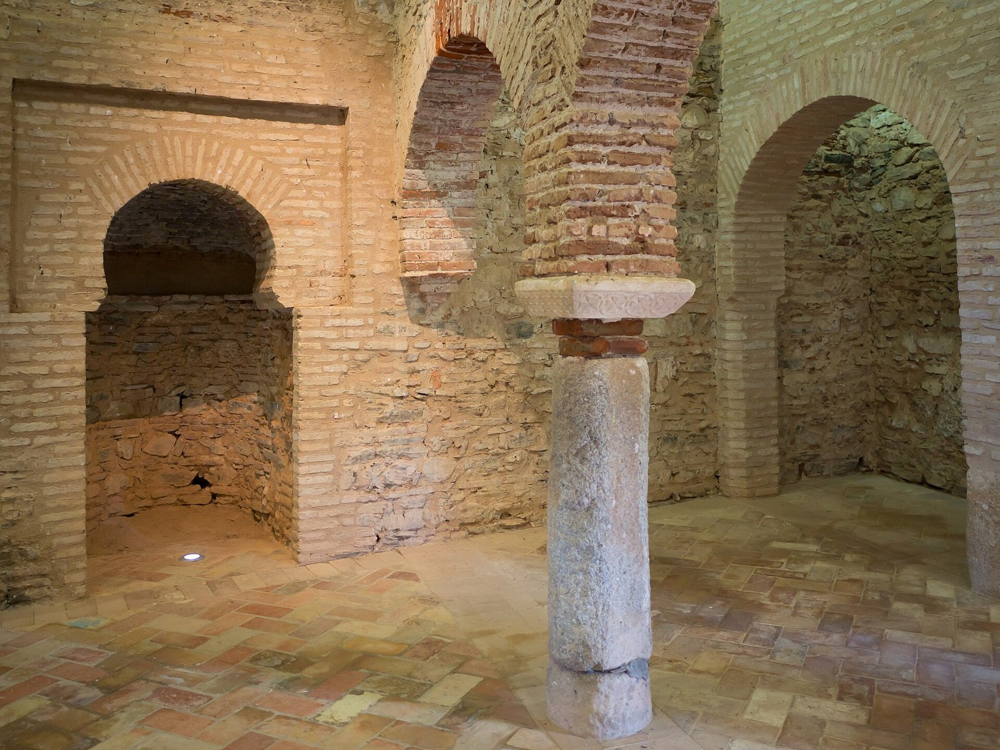
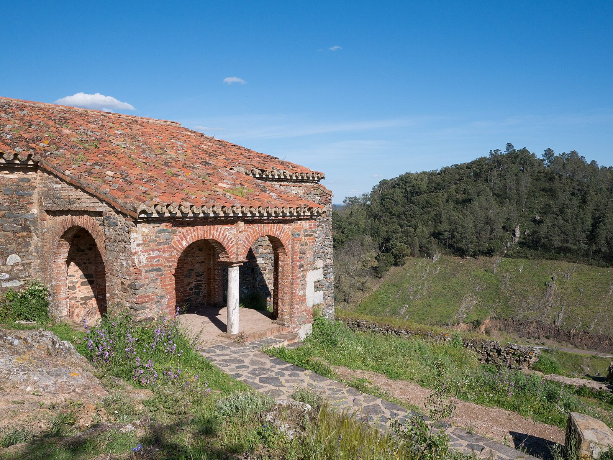
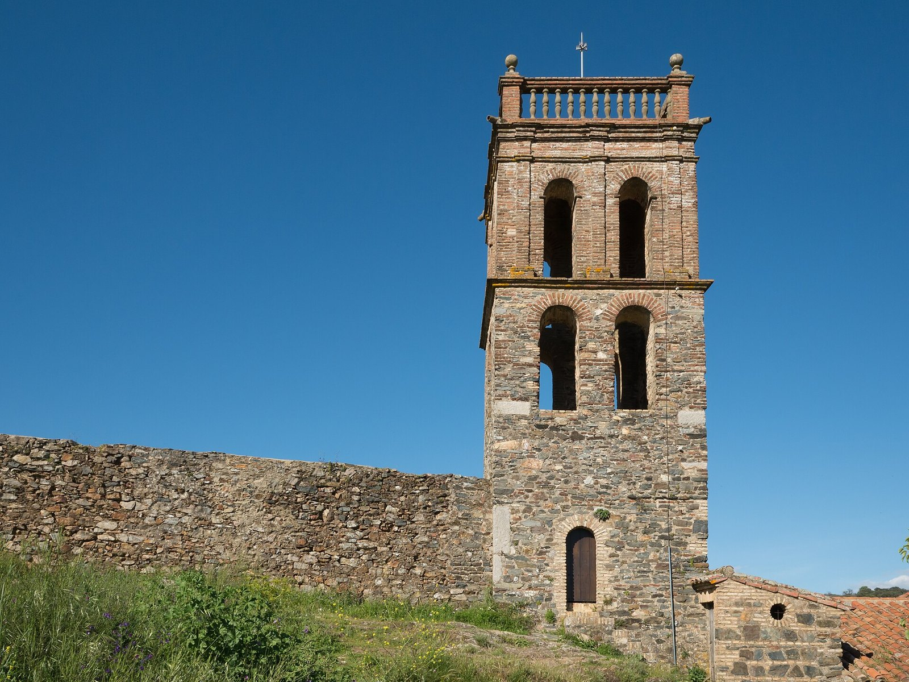
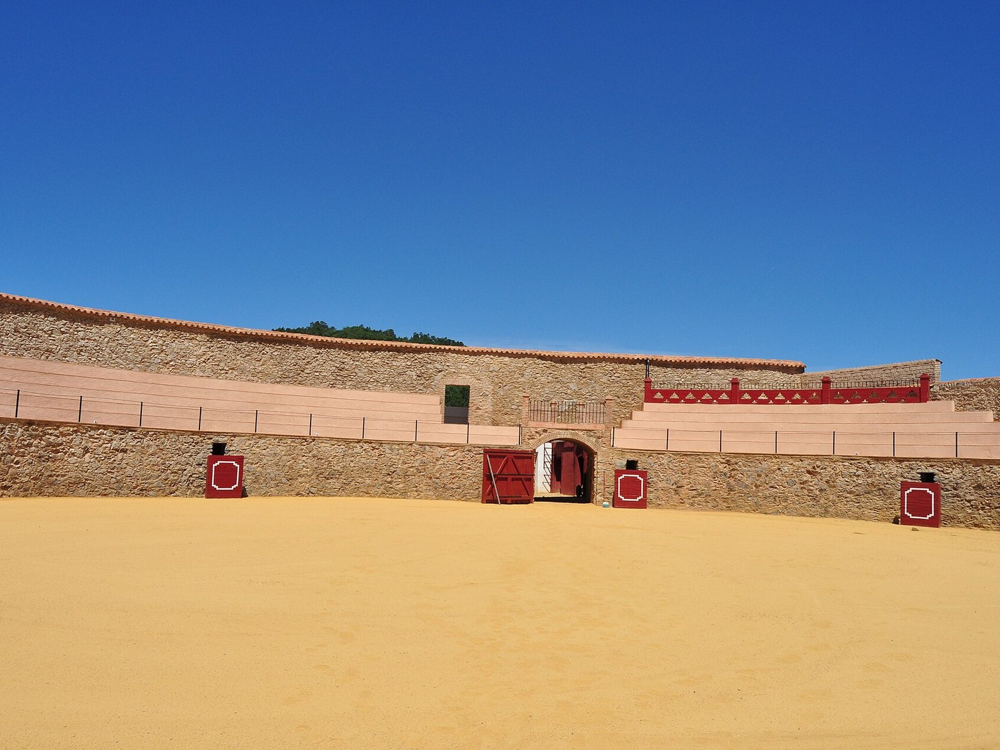
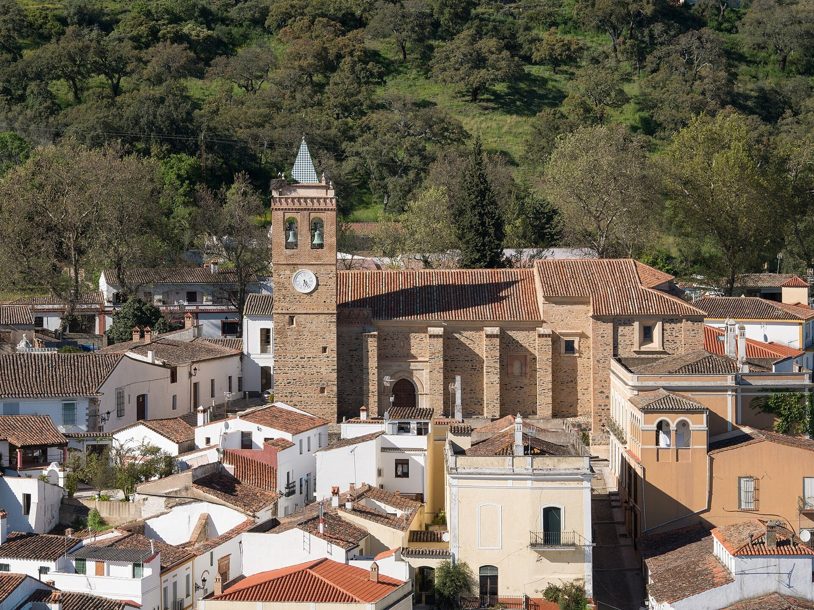
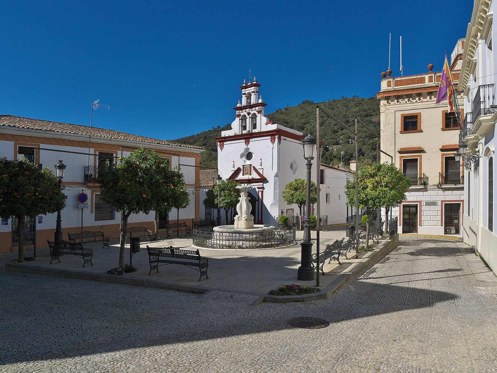

En lo alto de **Almonaster la Real**, dentro de un castillo y rodeada de castaños y encinas, hay una **mezquita de hace más de mil años**. Pequeña, silenciosa y casi intacta, es uno de los rincones más sorprendentes de Andalucía. Y por si fuera poco, justo al lado hay una **plaza de toros**. Abajo, un pueblo blanco de la **Sierra de Aracena** que forma parte de **los pueblos más bonitos de España**.

Te cuento qué ver 👇

En un vistazo<h2>Lo que vas a encontrar</h2>

<b>🕌</b>Mezquita del siglo X

<b>🏰</b>Castillo

<b>🐂</b>Plaza de toros

<b>🌳</b>Sierra de Aracena

<b>🆓</b>Visita gratis

Antes de ir<h2>Lo básico de Almonaster</h2>

<h3>📍 Dónde está</h3>
En la <strong>Sierra de Aracena</strong>, al norte de Huelva, a 30 minutos de Aracena.

<h3>⏱️ Tiempo</h3>
Dos o tres horas para el pueblo y la mezquita. Un día si añades una ruta.

<h3>🆓 Mezquita</h3>
La visita es <strong>gratis</strong>. Se sube a pie desde la plaza en unos minutos.

Qué ver<h2>Qué ver en Almonaster la Real</h2>

<ol class="guide__grid guide__grid--cuenca">
<li class="gcard reveal">
01

<h3>La mezquita</h3>
Naves con arcos de ladrillo sobre columnas reaprovechadas, un <strong>mihrab</strong> y un patio. Es de los siglos IX y X y se usó después como ermita, por eso se ha conservado tan bien.

</li>
<li class="gcard reveal">
02

<h3>El castillo</h3>
La mezquita está dentro del recinto amurallado, en lo alto del cerro. Desde aquí se ve el pueblo y la sierra cubierta de bosque.

</li>
<li class="gcard reveal">
03

<h3>La torre</h3>
El antiguo alminar, convertido luego en campanario, se ve desde muchos puntos del pueblo.

</li>
<li class="gcard reveal">
04

<h3>La plaza de toros</h3>
Pegada a la mezquita, de muros de piedra. Una mezquita y una plaza de toros juntas: no lo verás en muchos sitios.

</li>
<li class="gcard reveal">
05

<h3>La iglesia de San Martín</h3>
La parroquia del pueblo, con su torre sobre los tejados. Fíjate en su <strong>portada de estilo manuelino</strong>, rara en esta zona.

</li>
<li class="gcard reveal">
06

<h3>El pueblo blanco</h3>
Calles empedradas, casas encaladas y la plaza de la Constitución con su fuente. Ideal para pasear antes de comer.

</li>
</ol>

Naturaleza<h2>Rutas por la sierra</h2>

Almonaster está rodeado de bosques de castaños, encinas y alcornoques del <strong>Parque Natural Sierra de Aracena y Picos de Aroche</strong>. Hay senderos que unen el pueblo con aldeas cercanas y con el <strong>cerro de San Cristóbal</strong>, uno de los mejores miradores de la sierra. En otoño, los castañares se ponen dorados.

<h3>🕌 Jornadas de Cultura Islámica</h3>
Cada otoño, normalmente en <strong>octubre</strong>, el pueblo celebra unas jornadas con mercado, música y actividades alrededor de la mezquita. Es el momento con más ambiente del año.

Cómo llegar<h2>Cómo llegar a Almonaster</h2>

En coche: a unos <strong>30 minutos de Aracena</strong> y alrededor de <strong>hora y media de Sevilla</strong> y de Huelva. Deja el coche a la entrada del pueblo y sube a pie a la mezquita.

<a class="btn guide__mapbtn" href="https://www.google.com/maps/dir/?api=1&destination=37.8728,-6.7864" target="_blank" rel="noopener"><svg class="ico" viewBox="0 0 24 24" width="15" height="15" aria-hidden="true" fill="currentColor"><path d="M12 2a7 7 0 0 0-7 7c0 5.25 7 13 7 13s7-7.75 7-13a7 7 0 0 0-7-7zm0 9.5a2.5 2.5 0 1 1 0-5 2.5 2.5 0 0 1 0 5z"/></svg> Cómo llegar en Google Maps</a>

Combínalo con <a href="/blog/aracena-que-ver.html">Aracena</a> y su <a href="/blog/gruta-de-las-maravillas-aracena.html">Gruta de las Maravillas</a>, o con el paisaje de otro planeta de <a href="/blog/rio-tinto.html">Río Tinto</a>.

Consejos de Cheno<h2>Para disfrutarlo al máximo</h2><ul><li><b>Sube a la mezquita a primera hora</b>: tendrás el sitio para ti.</li><li><b>Respeta el silencio</b> dentro de la mezquita.</li><li><b>Prueba el jamón ibérico</b> de la sierra: estás en tierra de Jabugo.</li><li><b>Ven en otoño</b> para ver los castaños.</li></ul>

<!--actividades-->

<!--faq-->

<h2>¿Te gustan estos planes?</h2>
Sígueme en Instagram como <a href="https://www.instagram.com/chenoaventuras/" target="_blank" rel="noopener">@chenoaventuras</a>: subo escapadas como esta cada semana.
<a class="btn guide__btn" href="/blog.html">Ver más planes en el blog</a>

Información consultada en noviembre de 2026 (Turismo de Andalucía y Los Pueblos Más Bonitos de España). El horario de la mezquita puede cambiar. Fotos de Wikimedia Commons: <a href="https://commons.wikimedia.org/wiki/File:Almonaster_la_Real_R02.jpg" target="_blank" rel="noopener">Marc Ryckaert</a> (CC BY-SA 4.0) · <a href="https://commons.wikimedia.org/wiki/File:Almonaster_La_Real_Mezquita_01.jpg" target="_blank" rel="noopener">Basotxerri</a> (CC BY-SA 4.0) · <a href="https://commons.wikimedia.org/wiki/File:Almonaster_La_Real_Mezquita_03.jpg" target="_blank" rel="noopener">Basotxerri</a> (CC BY-SA 4.0) · <a href="https://commons.wikimedia.org/wiki/File:Almonaster_La_Real_Mezquita_04.jpg" target="_blank" rel="noopener">Basotxerri</a> (CC BY-SA 4.0) · <a href="https://commons.wikimedia.org/wiki/File:Almonaster_la_Real_-_005_(30713805305).jpg" target="_blank" rel="noopener">Luis Rogelio HM</a> (CC BY-SA 2.0) · <a href="https://commons.wikimedia.org/wiki/File:Almonaster_La_Real_02.jpg" target="_blank" rel="noopener">Basotxerri</a> (CC BY-SA 4.0) · <a href="https://commons.wikimedia.org/wiki/File:Plaza_de_la_Constituci%C3%B3n,_Almonaster_la_Real.jpg" target="_blank" rel="noopener">Jl FilpoC</a> (CC BY-SA 4.0).

