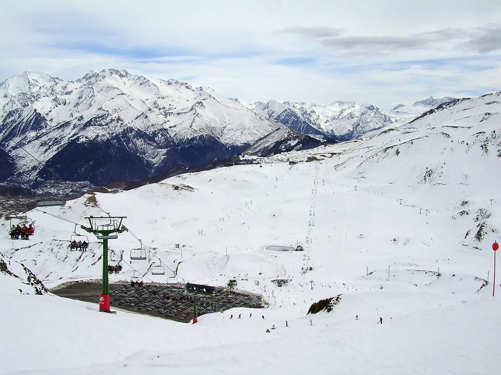
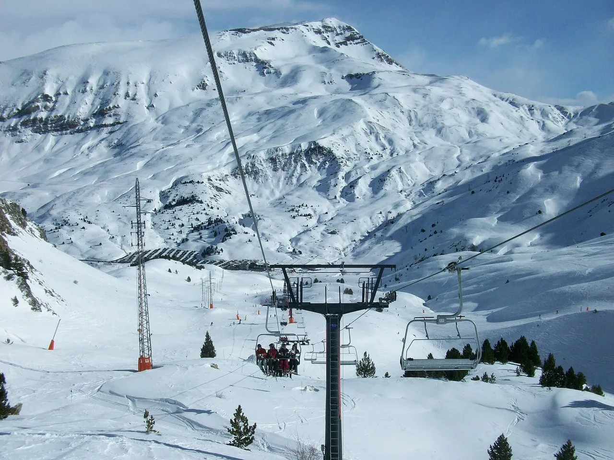
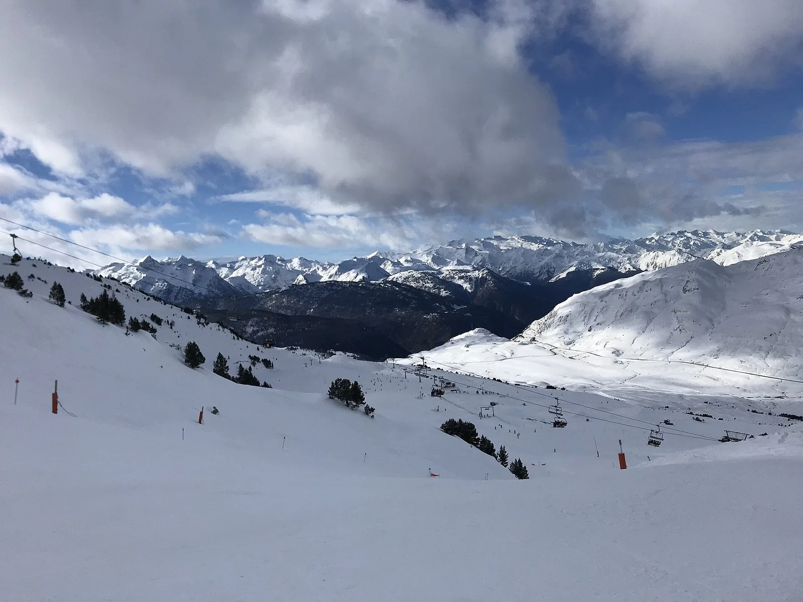
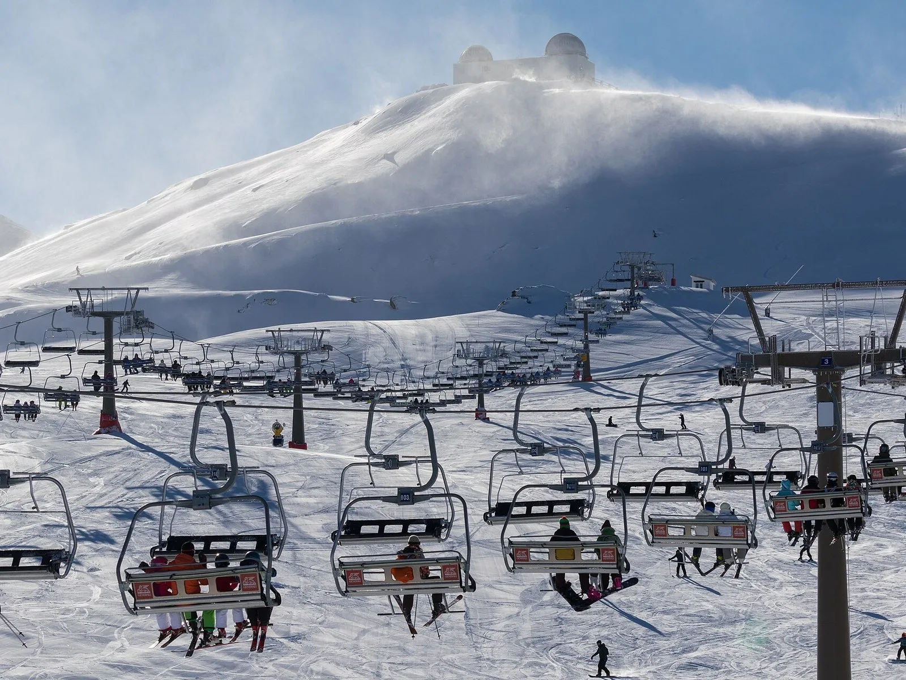

Ya empieza la temporada de nieve. Las estaciones de **Aramón** (Formigal-Panticosa y Cerler) abren el **viernes 27 de noviembre**, **Baqueira Beret** y **Sierra Nevada** apuntan al **sábado 28**, y **La Molina** y **Andorra**, al **4 de diciembre**.

Pero ojo: casi todas son **fechas previstas**, y al final manda la nieve. Te digo cuáles están confirmadas, cuáles no y dónde esquiar en el puente de diciembre 👇

❄️ <strong>Cómo está a 25 de noviembre:</strong> Aramón anuncia en su web el <strong>inicio de temporada el viernes 27</strong>. Sierra Nevada todavía dice que «la temporada no ha empezado» y no ha confirmado el 28. Antes de salir, mira siempre el parte de nieve de la estación: el primer fin de semana suele haber pocas pistas abiertas.

En un vistazo<h2>Lo que vas a encontrar</h2>

<b>🎿</b>Aramón, el 27 nov

<b>🏔️</b>Baqueira, el 28 nov

<b>☀️</b>Sierra Nevada, el 28 nov

<b>⛷️</b>Andorra, el 4 dic

<b>📅</b>Puente de diciembre

Calendario<h2>Fechas de apertura de las estaciones de esquí 2026-2027</h2>
Apertura y cierre previstos. Pueden cambiar según la nieve.

<ul class="guide__prices">
<li><strong>Formigal-Panticosa</strong> (Huesca)<b>27 nov – 4 abr ✅</b></li>
<li><strong>Cerler</strong> (Huesca)<b>27 nov – 4 abr ✅</b></li>
<li><strong>Manzaneda</strong> (Ourense)<b>27 nov – 11 abr</b></li>
<li><strong><a href="/blog/baqueira-beret.html">Baqueira Beret</a></strong> (Lleida)<b>28 nov – 4 abr</b></li>
<li><strong><a href="/blog/sierra-nevada-esqui.html">Sierra Nevada</a></strong> (Granada)<b>28 nov – 18 abr</b></li>
<li><strong>Valdezcaray</strong> (La Rioja)<b>28 nov – 4 abr</b></li>
<li><strong>San Isidro y Leitariegos</strong> (León)<b>1 dic – 4 abr</b></li>
<li><strong>La Molina</strong> (Girona)<b>4 dic – 4 abr</b></li>
<li><strong>Boí Taüll, Port Ainé</strong> (Lleida)<b>4 dic – 4 abr</b></li>
<li><strong>Vall de Núria, Vallter</strong> (Girona)<b>4 dic – 4 abr</b></li>
<li><strong>Grandvalira, Pal Arinsal, Ordino Arcalís</strong> (Andorra)<b>4 dic – 4 abr</b></li>
<li><strong>Espot</strong> (Lleida)<b>5 dic – 4 abr</b></li>
<li><strong>Valdelinares</strong> (Teruel)<b>5 dic – 28 mar</b></li>
<li><strong>Javalambre</strong> (Teruel)<b>19 dic – 21 mar</b></li>
<li><strong>Astún, Candanchú, Masella, Valdesquí, Navacerrada, Alto Campoo, La Pinilla</strong><b>sin fecha</b></li>
</ul>
✅ = confirmado en la web oficial de la estación a 25 de noviembre. El resto son las fechas previstas que han dado las estaciones a la prensa.

Las primeras<h2>Las estaciones que abren primero</h2>

<ol class="guide__grid guide__grid--cuenca">
<li class="gcard reveal">
01

<h3>Formigal-Panticosa</h3>
Abre el <strong>viernes 27 de noviembre</strong>, confirmado por Aramón. Es el dominio más grande de Aragón, en el valle de Tena, y cierra el <strong>4 de abril</strong>.

</li>
<li class="gcard reveal">
02

<h3>Cerler</h3>
También el <strong>27 de noviembre</strong>, sobre el valle de Benasque. Si vas, aprovecha para conocer el pueblo de Benasque y sus montañas.

</li>
<li class="gcard reveal">
03

<h3>Baqueira Beret</h3>
La estación más grande de España quiere abrir el <strong>sábado 28 de noviembre</strong> si hay nieve. Forfait, accesos y consejos en mi guía de <a href="/blog/baqueira-beret.html">Baqueira Beret</a>.

</li>
<li class="gcard reveal">
04

<h3>Sierra Nevada</h3>
Prevé el <strong>28 de noviembre</strong>, aún sin confirmar, y es la que más alarga la temporada (hasta el <strong>18 de abril</strong>). Todo en mi guía de <a href="/blog/sierra-nevada-esqui.html">Sierra Nevada</a>.

</li>
</ol>

<!--actividades-->

Puente de diciembre<h2>Dónde esquiar en el puente de diciembre de 2026</h2>

Si se cumplen las fechas, en el <a href="/blog/puente-de-diciembre-2026.html">puente de diciembre</a> (del 5 al 8) estarán abiertas <strong>Formigal-Panticosa, Cerler, Baqueira Beret y Sierra Nevada</strong>, y además <strong>La Molina</strong> y las estaciones de <strong>Andorra</strong>, que empiezan el día 4.

En esas fechas suele haber <strong>pocas pistas abiertas</strong> y mucha gente. Compra el forfait online y con antelación, y reserva alojamiento cuanto antes. Si solo quieres ver nieve sin esquiar, mira mis planes de <a href="/blog/nieve-cerca-de-madrid.html">nieve cerca de Madrid</a> y de <a href="/blog/raquetas-de-nieve-pirineo.html">raquetas de nieve en el Pirineo</a>.

Consejos de Cheno<h2>Antes de ir a la nieve</h2><ul><li><b>Mira el parte de nieve</b> el mismo día: la apertura puede retrasarse o empezar con pocas pistas.</li><li><b>Lleva cadenas</b> o neumáticos de invierno: en muchos puertos son obligatorios con nieve.</li><li><b>Compra el forfait online</b>: suele salir más barato y te ahorras la cola.</li><li><b>Ve entre semana</b> si puedes: los primeros fines de semana se llenan.</li></ul>

<!--faq-->

<h2>¿Te gustan estos planes?</h2>
Sígueme en Instagram como <a href="https://www.instagram.com/chenoaventuras/" target="_blank" rel="noopener">@chenoaventuras</a>: subo escapadas como esta cada semana.
<a class="btn guide__btn" href="/blog.html">Ver más planes en el blog</a>

Fechas consultadas el 25 de noviembre de 2026 en la <a href="https://www.aramon.com/" target="_blank" rel="noopener">web oficial de Aramón</a> (inicio de temporada el 27 de noviembre), la web de Sierra Nevada y los calendarios publicados por idealista (16 de noviembre de 2026) y Nevasport (previsión de Baqueira). Las aperturas dependen de la nieve: confírmalas en la web de cada estación antes de ir. Fotos de Wikimedia Commons: <a href="https://commons.wikimedia.org/wiki/File:Vista_urbanizaci%C3%B3n_Formigal_desde_las_pistas.jpg" target="_blank" rel="noopener">es.topsportholidays.com</a> (CC BY-SA 2.0) · <a href="https://commons.wikimedia.org/wiki/File:Vista_de_la_estaci%C3%B3n_de_esqu%C3%AD_de_Formigal_desde_la_pista_del_Collado.jpg" target="_blank" rel="noopener">Keta</a> (CC BY-SA 3.0) · <a href="https://commons.wikimedia.org/wiki/File:Cerler,_telesilla.jpg" target="_blank" rel="noopener">total 13</a> (CC BY 2.0) · <a href="https://commons.wikimedia.org/wiki/File:Baqueira-Beret_13.jpg" target="_blank" rel="noopener">Cantabrucu</a> (CC0) · <a href="https://commons.wikimedia.org/wiki/File:Sierra_Nevada_-_Telesilla,_Pradollano.jpg" target="_blank" rel="noopener">Werner Wilmes</a> (CC BY 2.0).

