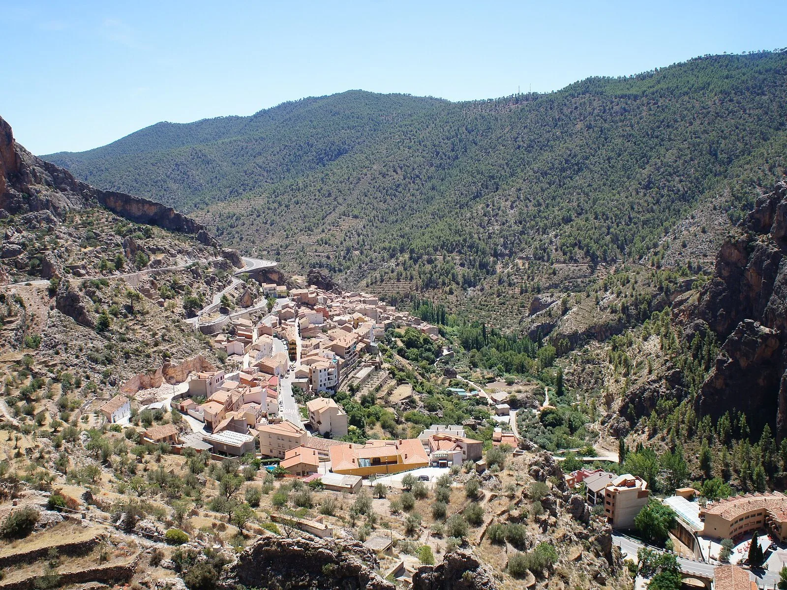
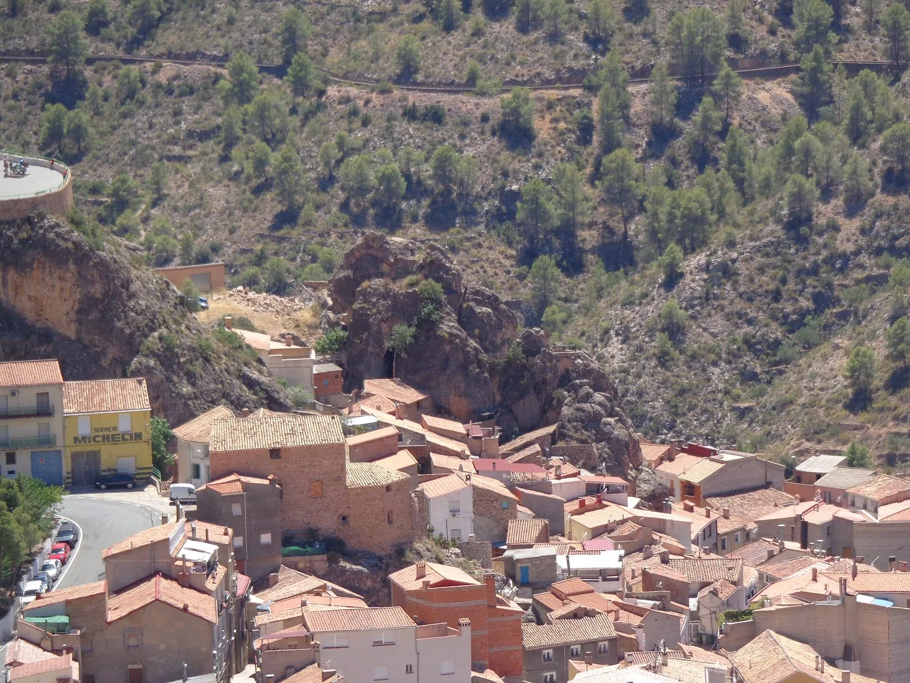
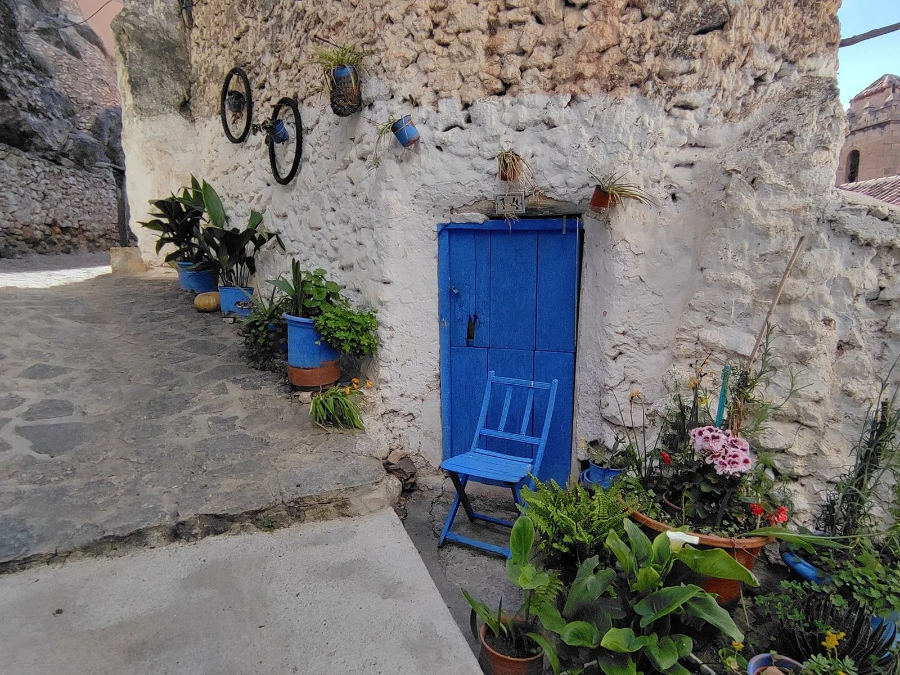
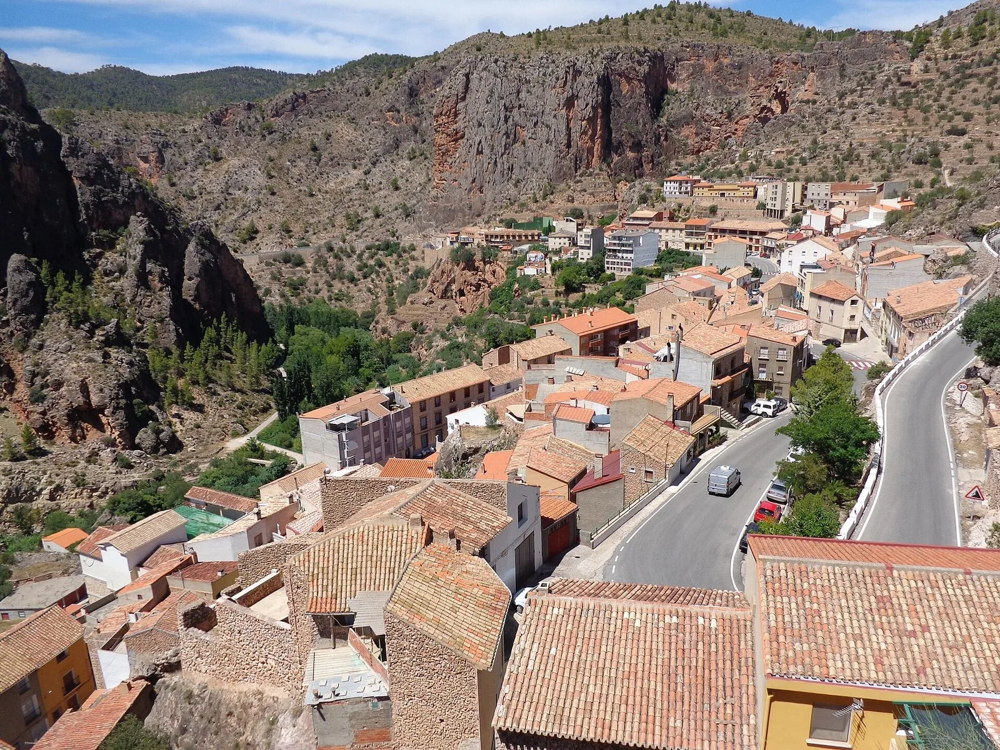
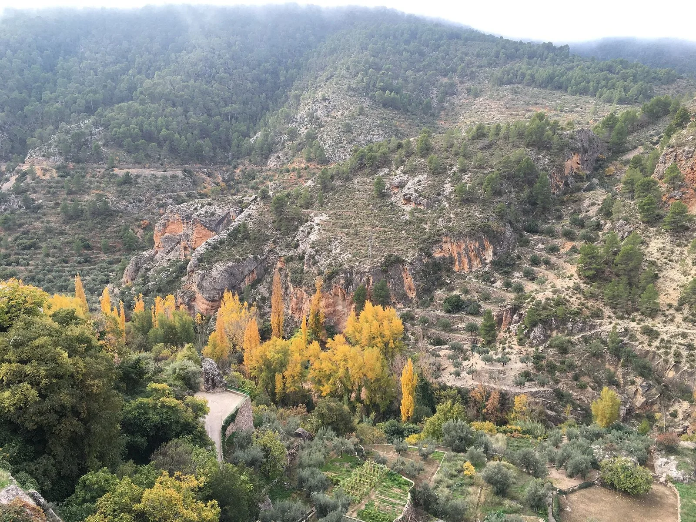
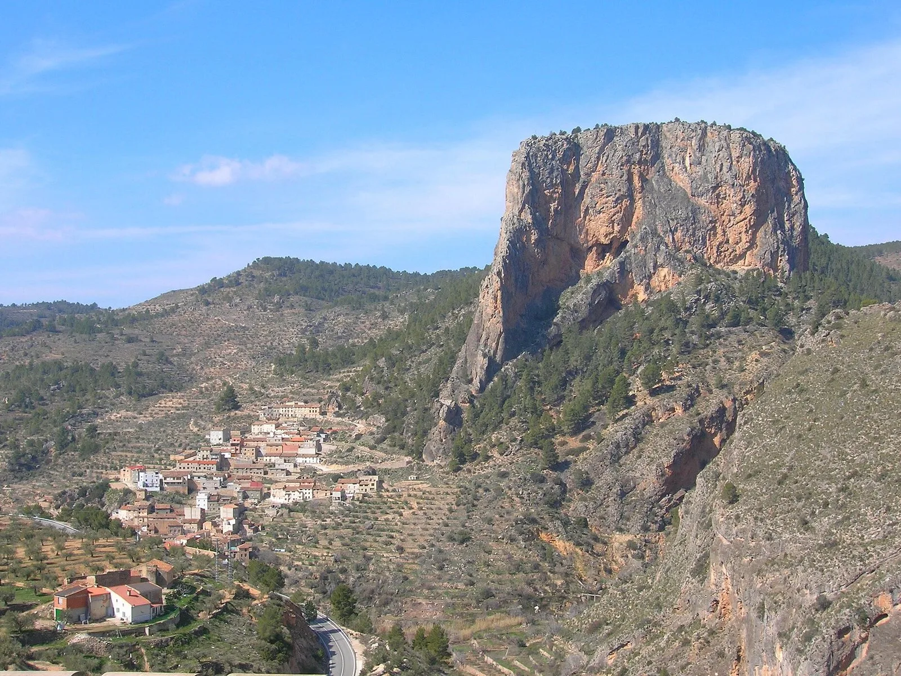

En la Mancha no todo es llanura. Al sur de Albacete, el **río Mundo** se abre paso entre montañas de roca y pinares, y en mitad del cañón, colgado de la ladera, aparece **Aýna**. Por su paisaje la llaman la **«Suiza manchega»**, y a muchos les sonará porque aquí se rodó la mítica **Amanece, que no es poco**.

Te cuento qué ver, los miradores imprescindibles y cómo llegar 👇

En un vistazo<h2>Lo que vas a encontrar</h2>

<b>⛰️</b>Cañón del río Mundo

<b>👹</b>Mirador del Diablo

<b>🎬</b>Amanece, que no es poco

<b>🎨</b>Arte rupestre

<b>🍂</b>Otoño

Antes de ir<h2>Lo básico de Aýna</h2>

<h3>📍 Dónde está</h3>
En la <strong>Sierra del Segura</strong>, al sur de Albacete, a algo más de una hora de la capital.

<h3>⏱️ Tiempo</h3>
Medio día para el pueblo y los miradores. Un fin de semana si quieres hacer rutas por la sierra.

<h3>🍂 Cuándo ir</h3>
En <strong>otoño</strong>, con los álamos amarillos junto al río, y en primavera. En verano el río invita al baño.

Qué ver<h2>Qué ver en Aýna</h2>

<ol class="guide__grid guide__grid--cuenca">
<li class="gcard reveal">
01

<h3>El Mirador del Diablo</h3>
A 1,5 km del pueblo, en la carretera CM-3203. Desde aquí ves Aýna entera, el cañón y la vega del río Mundo. Es la foto más famosa del pueblo.

</li>
<li class="gcard reveal">
02

<h3>El pueblo colgado</h3>
Casas de tejas rojizas escalonadas en la ladera, bajo paredes de roca. Sube por sus calles empinadas hasta la parte alta.

</li>
<li class="gcard reveal">
03

<h3>Sus rincones</h3>
Puertas pintadas, macetas y casas encajadas en la roca. Busca la iglesia de <strong>Santa María de lo Alto</strong> y los restos del castillo.

</li>
<li class="gcard reveal">
04

<h3>Los escenarios de la película</h3>
<strong>Amanece, que no es poco</strong> (1989), de José Luis Cuerda, se rodó aquí. Muchos vecinos salieron de figurantes, y los fans de la película la reconocen en cada rincón.

</li>
<li class="gcard reveal">
05

<h3>El río Mundo en otoño</h3>
En otoño los álamos de la vega se vuelven amarillos y el contraste con los pinos y la roca es precioso.

</li>
<li class="gcard reveal">
06

<h3>Royo Odrea y el Mirador del Infierno</h3>
Una aldea de Aýna bajo un enorme peñón. Cerca está el <strong>Mirador del Infierno</strong>, con vistas al valle salvaje del río Mundo.

</li>
</ol>

Prehistoria<h2>La Cueva del Niño</h2>

En el término de Aýna está la <strong>Cueva del Niño</strong>, un yacimiento con <strong>arte rupestre paleolítico</strong> (figuras de animales pintadas hace miles de años) declarado Bien de Interés Cultural. Para protegerla, las visitas son muy limitadas: pregunta en el Ayuntamiento antes de ir.

<h3>🎬 «Amanece, que no es poco»</h3>
La comedia surrealista de José Luis Cuerda, con Antonio Resines, Luis Ciges y Cassen, es una película de culto en España. Recorrer Aýna sabiendo que aquí se rodó tiene su gracia.

Cómo llegar<h2>Cómo llegar a Aýna</h2>

En coche desde <strong>Albacete</strong>, en algo más de una hora, por la <strong>CM-313</strong> en dirección a Elche de la Sierra. El último tramo baja al cañón con muchas curvas: tómatelo con calma y para en el Mirador del Diablo.

<a class="btn guide__mapbtn" href="https://www.google.com/maps/dir/?api=1&destination=38.5501,-2.0747" target="_blank" rel="noopener"><svg class="ico" viewBox="0 0 24 24" width="15" height="15" aria-hidden="true" fill="currentColor"><path d="M12 2a7 7 0 0 0-7 7c0 5.25 7 13 7 13s7-7.75 7-13a7 7 0 0 0-7-7zm0 9.5a2.5 2.5 0 1 1 0-5 2.5 2.5 0 0 1 0 5z"/></svg> Cómo llegar en Google Maps</a>

Siguiendo el río hacia arriba llegas al <a href="/blog/nacimiento-rio-mundo.html">nacimiento del río Mundo</a>, una de las cascadas más espectaculares de España. En la provincia tienes también <a href="/blog/alcala-del-jucar.html">Alcalá del Júcar</a>, <a href="/blog/alcaraz-que-ver.html">Alcaraz</a> y <a href="/blog/chinchilla-de-montearagon.html">Chinchilla</a>.

Consejos de Cheno<h2>Para disfrutarlo al máximo</h2><ul><li><b>Para en el Mirador del Diablo</b> al llegar: es la mejor vista del pueblo.</li><li><b>Ve en otoño</b> por los colores del río.</li><li><b>Combínalo con el nacimiento del río Mundo</b> en el mismo fin de semana.</li><li><b>Vuelve a ver la película</b> antes de ir.</li></ul>

<!--actividades-->

<!--faq-->

<h2>¿Te gustan estos planes?</h2>
Sígueme en Instagram como <a href="https://www.instagram.com/chenoaventuras/" target="_blank" rel="noopener">@chenoaventuras</a>: subo escapadas como esta cada semana.
<a class="btn guide__btn" href="/blog.html">Ver más planes en el blog</a>

Información consultada en noviembre de 2026 (Turismo de Castilla-La Mancha y Escapada Rural). Fotos de Wikimedia Commons: <a href="https://commons.wikimedia.org/wiki/File:Ayna_Spain_18.JPG" target="_blank" rel="noopener">Superchilum</a> (CC BY-SA 4.0) · <a href="https://commons.wikimedia.org/wiki/File:Ayna_Spain_08.JPG" target="_blank" rel="noopener">Superchilum</a> (CC BY-SA 4.0) · <a href="https://commons.wikimedia.org/wiki/File:Casas_de_A%C3%BDna.jpg" target="_blank" rel="noopener">Julen Iturbe-Ormaetxe</a> (CC BY-SA 2.0) · <a href="https://commons.wikimedia.org/wiki/File:Ayna_Spain_13.JPG" target="_blank" rel="noopener">Superchilum</a> (CC BY-SA 4.0) · <a href="https://commons.wikimedia.org/wiki/File:Ayna_(22636350027).jpg" target="_blank" rel="noopener">Antonio Periago Miñarro</a> (CC BY-SA 2.0) · <a href="https://commons.wikimedia.org/wiki/File:Pedan%C3%ADa_de_Royo_Odrea,_en_Ayna,_Albacete,_Espa%C3%B1a.jpg" target="_blank" rel="noopener">Lionni</a> (dominio público).

