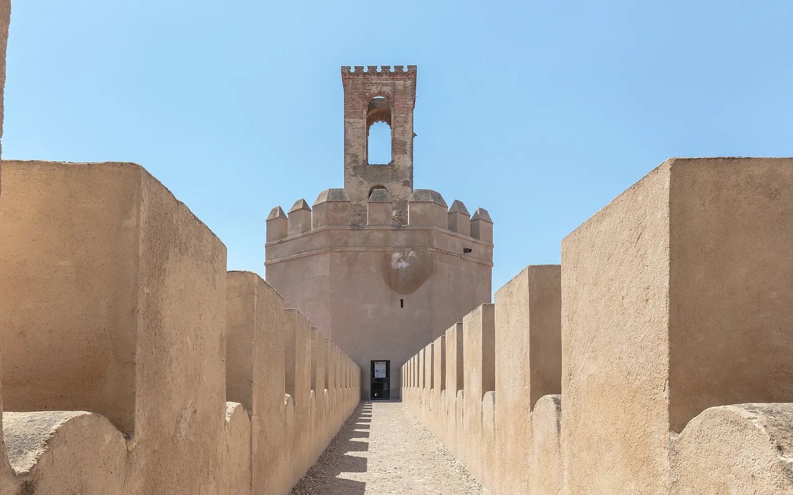
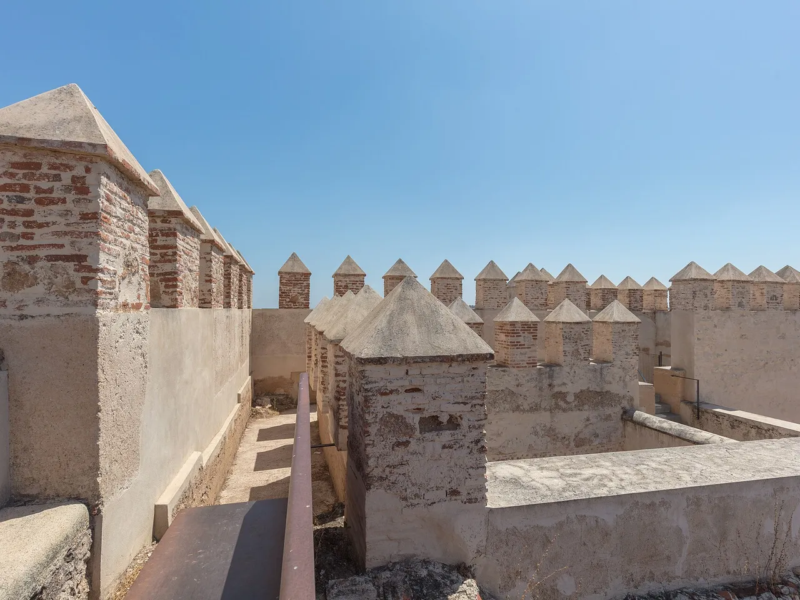
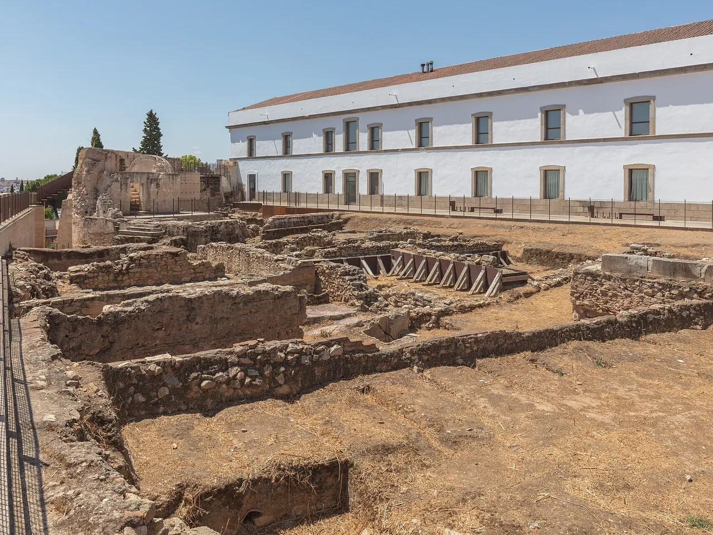
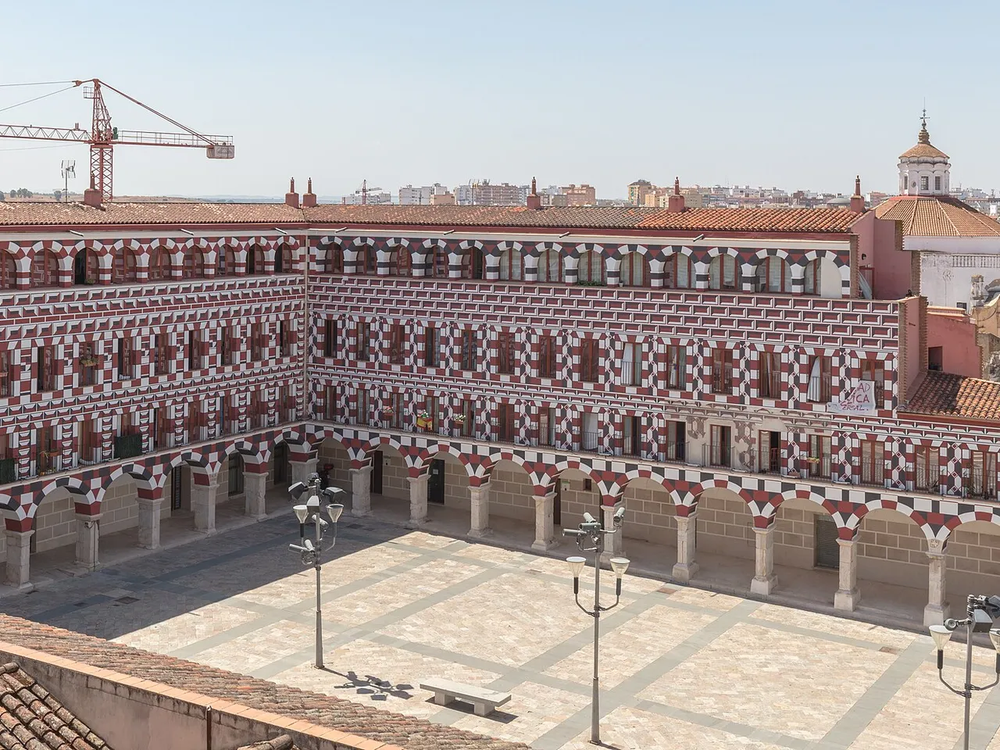
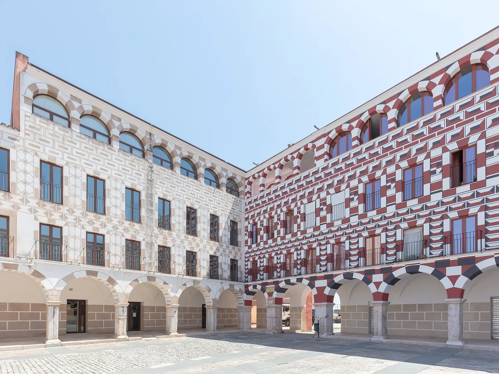
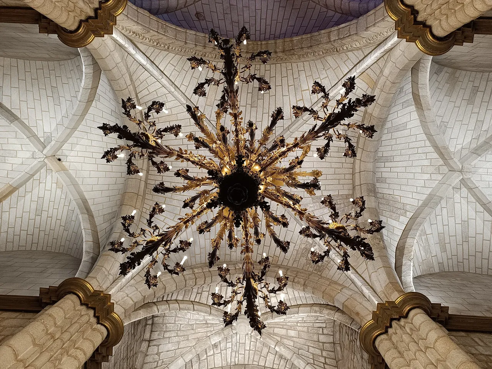
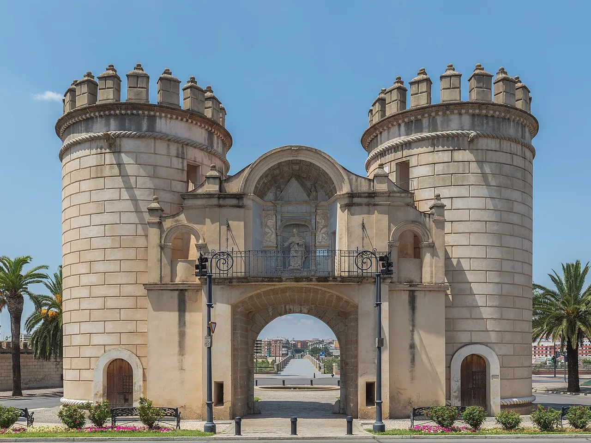
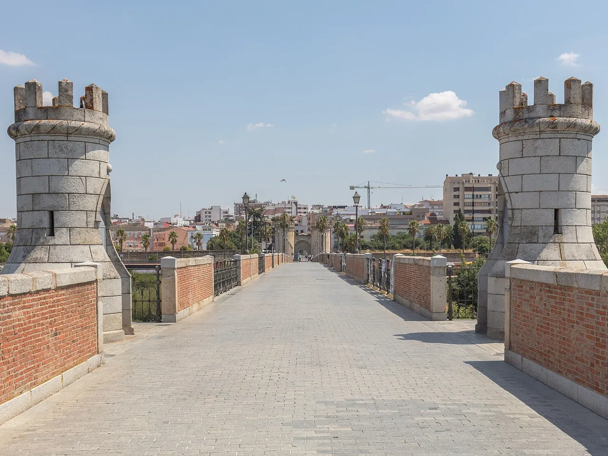

Una **alcazaba almohade** con una torre albarrana, una plaza con casas pintadas de rojo, un puente sobre el Guadiana y la frontera con Portugal a pocos kilómetros. **Badajoz** es una ciudad desconocida que se ve bien en **un día** y que tiene museos gratuitos. Te lo cuento **por franjas del día**, con qué ver, curiosidades, dónde comer y **actividades para reservar**.

En un vistazo<h2>Lo que vas a encontrar</h2>

<b>🏰</b>Alcazaba

<b>🗼</b>Torre de Espantaperros

<b>🏘️</b>Plaza Alta

<b>⛪</b>Catedral

<b>🌉</b>Puente de Palmas

Antes de ir<h2>Badajoz: lo básico</h2>

En verano hace mucho calor: ve por la mañana o al atardecer. Badajoz queda a unos 6 km de la frontera con Portugal y a unos 60 km de Mérida; lo más cómodo es el coche, aunque hay tren con Mérida y Madrid (consulta horarios). El MUBA es gratuito según su web oficial, el MEIAC también (según Turismo de Extremadura) y el Museo Arqueológico Provincial es gratuito para ciudadanos de la UE: confirma horarios en sus webs.

Mañana<h2>La Alcazaba y la Torre de Espantaperros</h2>

Empieza por la <strong>Alcazaba</strong>, que según las guías es una de las más grandes de Europa: murallas y torres de tapial que rodean un recinto enorme sobre el cerro, con restos arqueológicos de distintas épocas dentro. Junto a ella está la <strong>Torre de Espantaperros</strong>, una torre albarrana de origen almohade a la que en el siglo XVI se añadió la parte superior para el campanario. Dentro del recinto, el Palacio de los Duques de la Roca alberga el Museo Arqueológico Provincial. Se puede pasear por buena parte de las murallas. Hay un <a href="https://www.civitatis.com/es/badajoz/free-tour-badajoz/?aid=110968" target="_blank" rel="noopener sponsored">free tour por Badajoz</a> y una <a href="https://www.civitatis.com/es/badajoz/visita-guiada-badajoz/?aid=110968" target="_blank" rel="noopener sponsored">visita guiada por Badajoz</a>.

<ol class="guide__grid guide__grid--cuenca">
<li class="gcard reveal">
01

<h3>Torre de Espantaperros</h3>
Torre albarrana de <strong>origen almohade</strong>; en el siglo XVI se le añadió la parte de arriba para el campanario.

</li>
<li class="gcard reveal">
02

<h3>La Alcazaba</h3>
Según las guías, <strong>una de las más grandes de Europa</strong>: murallas y torres que rodean un recinto enorme sobre el cerro.

</li>
<li class="gcard reveal">
03

<h3>Las excavaciones</h3>
Dentro de la Alcazaba hay <strong>restos arqueológicos</strong> de distintas épocas.

</li>
</ol>

Mediodía<h2>Comer en la Plaza Alta</h2>

Baja a la <strong>Plaza Alta</strong>, una de las plazas más fotogénicas, con el antiguo Ayuntamiento mudéjar y las <strong>Casas Coloradas</strong>, con fachadas de dibujos geométricos en rojo, negro y blanco (se entra por el Arco del Peso). Es un buen sitio para comer tapas y platos extremeños: migas, productos del cerdo ibérico y queso. Una visita guiada por la zona ayuda a entender los detalles; hay también un <a href="https://www.civitatis.com/es/badajoz/tour-misterios-leyendas-badajoz/?aid=110968" target="_blank" rel="noopener sponsored">tour de misterios y leyendas de Badajoz</a>.

<ol class="guide__grid guide__grid--cuenca">
<li class="gcard reveal">
04

<h3>Plaza Alta</h3>
Una de las plazas más fotogénicas de Badajoz, con el <strong>antiguo Ayuntamiento mudéjar</strong>. Buen sitio para tapear.

</li>
<li class="gcard reveal">
05

<h3>Casas Coloradas</h3>
Fachadas con <strong>dibujos geométricos</strong> en rojo, negro y blanco. Se entra por el Arco del Peso.

</li>
</ol>

Tarde<h2>La catedral y la Plaza de España</h2>

La <strong>catedral de San Juan Bautista</strong>, en la Plaza de España, se visita mejor por la tarde; destaca la torre con campanario (puedes comprar la <a href="https://www.civitatis.com/es/badajoz/entrada-catedral-badajoz/?aid=110968" target="_blank" rel="noopener sponsored">entrada a la catedral de Badajoz</a>). Aprovecha para ver los museos gratuitos. Pasea también por el <strong>Paseo de San Francisco</strong>, la plaza de la Soledad (con una torre conocida como la Giralda) y la muralla abaluartada con el Fuerte de San Cristóbal. Si te interesa la frontera, hay un <a href="https://www.civitatis.com/es/badajoz/tour-castillos-badajoz-elvas/?aid=110968" target="_blank" rel="noopener sponsored">tour por las murallas de Badajoz y Elvas</a>.

<ol class="guide__grid guide__grid--cuenca">
<li class="gcard reveal">
06

<h3>Catedral de San Juan Bautista</h3>
En la Plaza de España. Se visita mejor por la tarde y destaca su <strong>torre con campanario</strong>.

</li>
</ol>

Atardecer<h2>La Puerta y el Puente de Palmas</h2>

Termina en la <strong>Puerta de Palmas</strong>, un arco emblemático junto al río, y cruza el <strong>Puente de Palmas</strong> sobre el Guadiana: al atardecer se ve la Alcazaba y la ciudad desde el río. Puedes cenar junto al Guadiana.

<ol class="guide__grid guide__grid--cuenca">
<li class="gcard reveal">
07

<h3>Puerta de Palmas</h3>
Un arco emblemático junto al río y <strong>símbolo de la ciudad</strong>.

</li>
<li class="gcard reveal">
08

<h3>Puente de Palmas</h3>
Crúzalo al atardecer: desde el Guadiana se ven la <strong>Alcazaba y la ciudad</strong>.

</li>
</ol>

🎟️ Actividades para reservar
<ul class="actbox" style="margin-bottom:2rem"><li><a href="https://www.civitatis.com/es/badajoz/free-tour-badajoz/?aid=110968" target="_blank" rel="sponsored noopener">CivitatisFree tour por BadajozVer &rarr;</a></li><li><a href="https://www.civitatis.com/es/badajoz/visita-guiada-badajoz/?aid=110968" target="_blank" rel="sponsored noopener">CivitatisVisita guiada por BadajozVer &rarr;</a></li><li><a href="https://www.civitatis.com/es/badajoz/tour-misterios-leyendas-badajoz/?aid=110968" target="_blank" rel="sponsored noopener">CivitatisTour de los misterios y leyendas de BadajozVer &rarr;</a></li><li><a href="https://www.civitatis.com/es/badajoz/entrada-catedral-badajoz/?aid=110968" target="_blank" rel="sponsored noopener">CivitatisEntrada a la catedral de BadajozVer &rarr;</a></li><li><a href="https://www.civitatis.com/es/badajoz/tour-castillos-badajoz-elvas/?aid=110968" target="_blank" rel="sponsored noopener">CivitatisTour por las murallas de Badajoz y ElvasVer &rarr;</a></li></ul>

Si tienes más días<h2>Cerca de Badajoz</h2>

Con más tiempo, ve a <a href='/blog/merida-que-ver.html'>Mérida</a>, <a href='/blog/olivenza-que-ver.html'>Olivenza</a>, <a href='/blog/zafra-que-ver.html'>Zafra</a> o <a href='/blog/jerez-de-los-caballeros.html'>Jerez de los Caballeros</a>.

<!--enr-->

Un poco de historia<h2>Una ciudad fundada por un rey de taifa</h2>

Badajoz nació en el año <strong>875</strong> cuando <strong>Ibn Marwan</strong>, un caudillo muladí, la fundó junto al Guadiana. Más tarde fue la capital de un <strong>reino de taifas</strong> (siglo XI), y por su situación fronteriza con Portugal vivió asedios y guerras durante siglos. Esa herencia se ve en la <strong>Alcazaba</strong>, una de las más grandes de Europa, y en la <strong>Torre de Espantaperros</strong>, de origen almohade.

Las murallas y baluartes abaluartados de época moderna, como el <strong>Fuerte de San Cristóbal</strong>, se construyeron para defender la frontera. Es una ciudad con mucho patrimonio sin la afluencia de otras capitales, y que además es puerta de entrada a Extremadura.

Cómo llegar<h2>Cómo llegar</h2>

<strong>En coche:</strong> desde Mérida, unos 60 km por la autovía. Deja el coche en un parking del centro y recorre la ciudad a pie.

<strong>En tren:</strong> hay conexión con Mérida y Madrid; consulta horarios.

<a class="btn guide__mapbtn" href="https://www.google.com/maps/dir/?api=1&destination=Badajoz" target="_blank" rel="noopener"><svg class="ico" viewBox="0 0 24 24" width="15" height="15" aria-hidden="true" fill="currentColor"><path d="M12 2a7 7 0 0 0-7 7c0 5.25 7 13 7 13s7-7.75 7-13a7 7 0 0 0-7-7zm0 9.5a2.5 2.5 0 1 1 0-5 2.5 2.5 0 0 1 0 5z"/></svg> Cómo llegar en Google Maps</a>

Consejos de Cheno<h2>Badajoz en un día</h2><ul><li><b>Mañana</b>: Alcazaba y Torre de Espantaperros.</li><li><b>Mediodía</b>: Comida en la Plaza Alta.</li><li><b>Tarde</b>: Catedral, Plaza de España y museos.</li><li><b>Atardecer</b>: Puerta y Puente de Palmas.</li><li><b>Si tienes más días</b>: Mérida, Olivenza y Zafra.</li></ul>

<!--faq-->

<h2>¿Te gustan estos planes?</h2>
Sígueme en Instagram como <a href="https://www.instagram.com/chenoaventuras/" target="_blank" rel="noopener">@chenoaventuras</a>: subo escapadas como esta cada semana.
<a class="btn guide__btn" href="/blog.html">Ver más planes en el blog</a>

Información consultada en octubre de 2026. Los precios, horarios y accesos cambian: consúltalos en las webs oficiales. Fotos de Wikimedia Commons: <a href="https://commons.wikimedia.org/wiki/File:Torre_de_Espantaperros,_Alcazaba,_Badajoz,_Espa%C3%B1a,_2020-07-22,_DD_38.jpg" target="_blank" rel="noopener">Diego Delso</a> (CC BY-SA 4.0) · <a href="https://commons.wikimedia.org/wiki/File:Amurallado_de_la_Alcazaba,_Badajoz,_Espa%C3%B1a,_2020-07-22,_DD_41.jpg" target="_blank" rel="noopener">Diego Delso</a> (CC BY-SA 4.0) · <a href="https://commons.wikimedia.org/wiki/File:Amurallado_de_la_Alcazaba,_Badajoz,_Espa%C3%B1a,_2020-07-22,_DD_34.jpg" target="_blank" rel="noopener">Diego Delso</a> (CC BY-SA 4.0) · <a href="https://commons.wikimedia.org/wiki/File:Excavaciones,_la_Alcazaba,_Badajoz,_Espa%C3%B1a,_2020-07-22,_DD_42.jpg" target="_blank" rel="noopener">Diego Delso</a> (CC BY-SA 4.0) · <a href="https://commons.wikimedia.org/wiki/File:Plaza_Alta,_Badajoz,_Espa%C3%B1a,_2020-07-22,_DD_35.jpg" target="_blank" rel="noopener">Diego Delso</a> (CC BY-SA 4.0) · <a href="https://commons.wikimedia.org/wiki/File:Casas_Coloradas,_Plaza_Alta,_Badajoz,_Espa%C3%B1a,_2020-07-22,_DD_50.jpg" target="_blank" rel="noopener">Diego Delso</a> (CC BY-SA 4.0) · <a href="https://commons.wikimedia.org/wiki/File:Puente_de_Palmas,_Badajoz,_Espa%C3%B1a,_2020-07-22,_DD_93.jpg" target="_blank" rel="noopener">Diego Delso</a> (CC BY-SA 4.0) · <a href="https://commons.wikimedia.org/wiki/File:Puerta_de_Palmas,_Badajoz,_Espa%C3%B1a,_2020-07-22,_DD_82.jpg" target="_blank" rel="noopener">Diego Delso</a> (CC BY-SA 4.0) · <a href="https://commons.wikimedia.org/wiki/File:Crucero_con_l%C3%A1mpara_de_ara%C3%B1a._Catedral_de_Badajoz._Espa%C3%B1a._Spain.jpg" target="_blank" rel="noopener">Carlos Teixidor Cadenas</a> (CC BY 4.0) · <a href="https://commons.wikimedia.org/wiki/File:Badajoz._Campanario_de_la_torre_de_la_catedral._Espa%C3%B1a._Spain.jpg" target="_blank" rel="noopener">Carlos Teixidor Cadenas</a> (CC BY 4.0).

