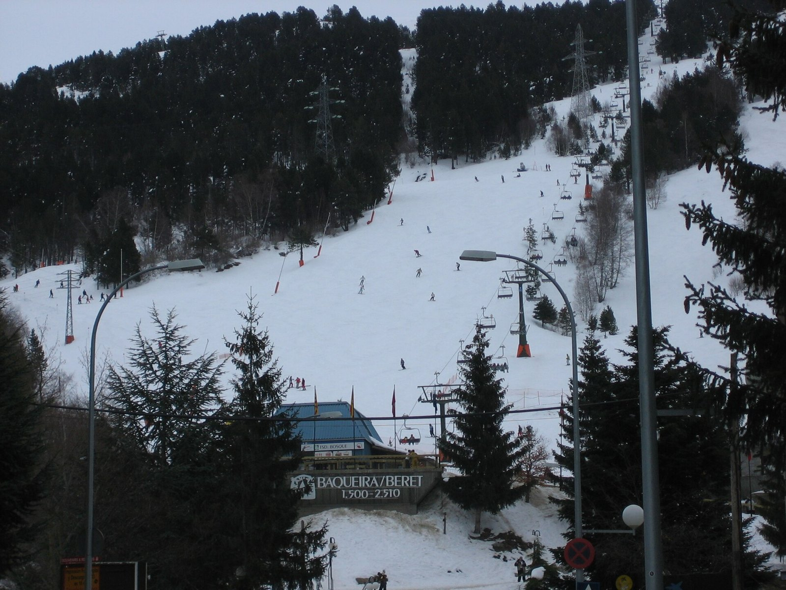
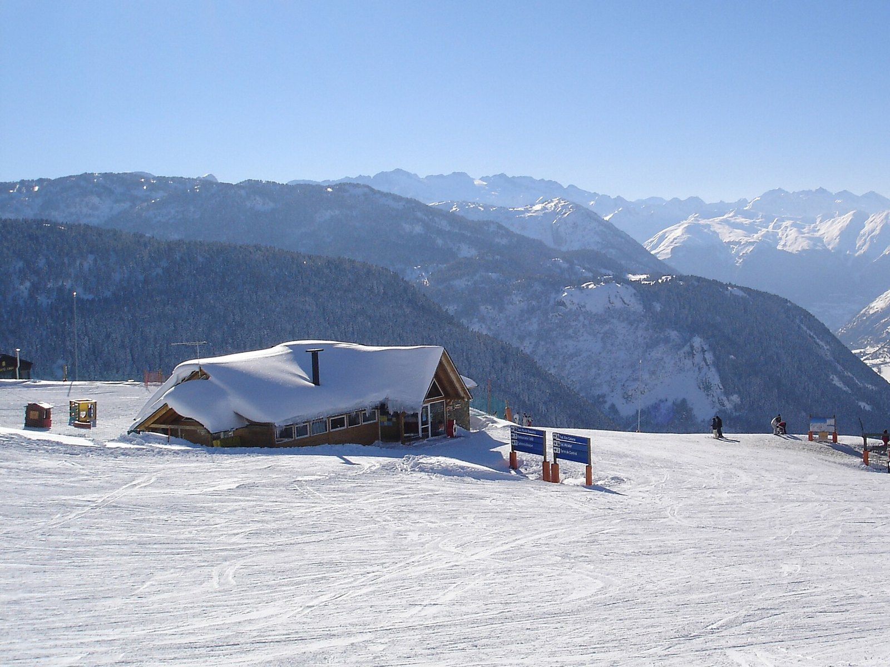
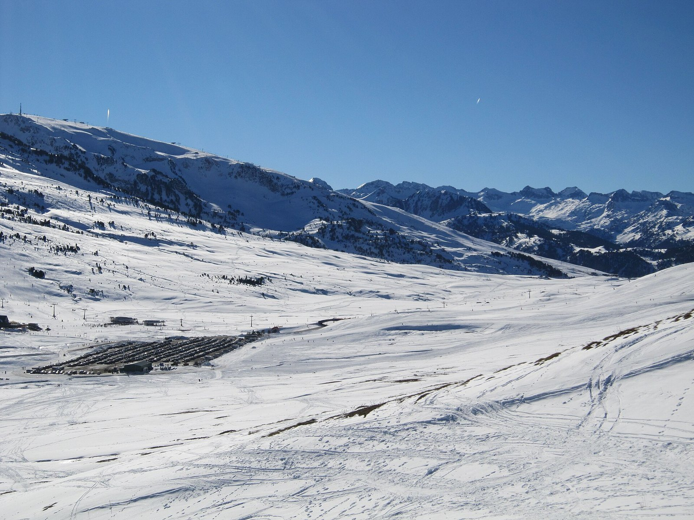
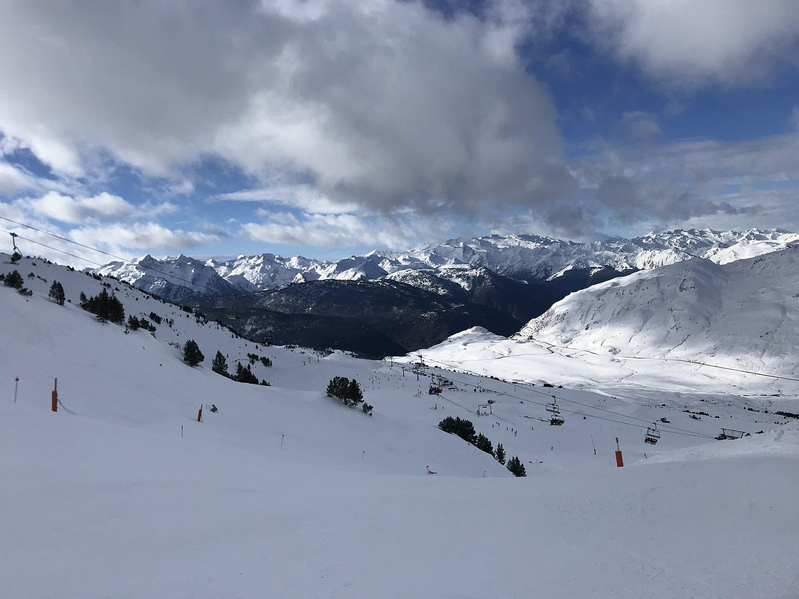
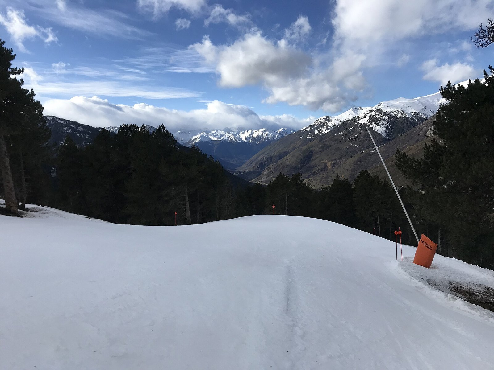
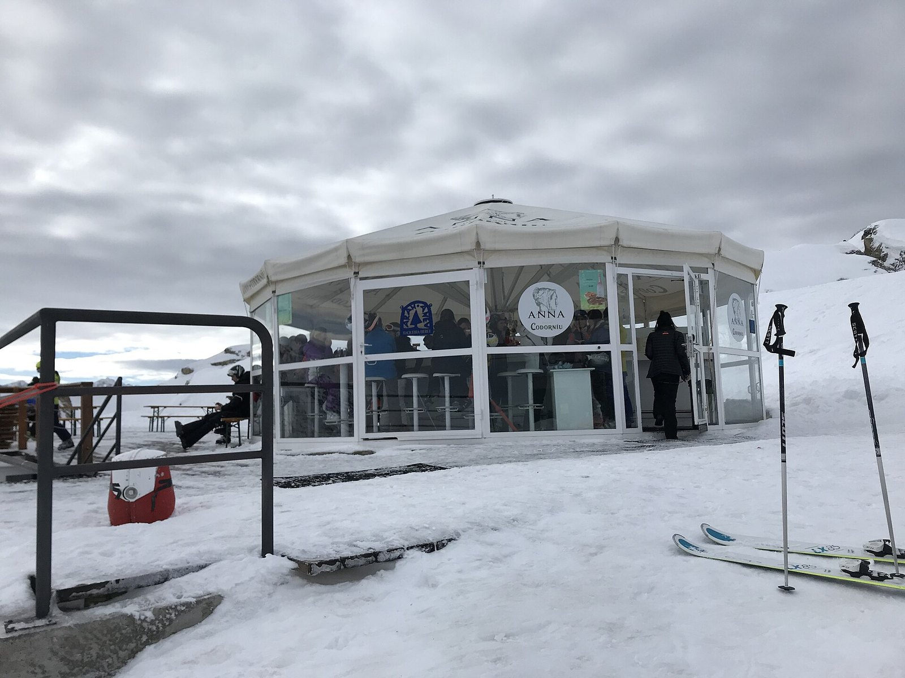

En el **Valle de Arán**, el rincón más atlántico del Pirineo catalán, está **Baqueira Beret**, la estación de esquí **más grande de España** y una de las de más nivel de Europa. Abrió en 1964, la frecuenta desde hace décadas la Familia Real y tiene nieve de calidad gracias al clima del valle, que mira al norte.

Te cuento las fechas de esta temporada, cuánto cuesta y cómo organizarte 👇

En un vistazo<h2>Lo que vas a encontrar</h2>

<b>⛷️</b>La más grande de España

<b>🏔️</b>4 zonas

<b>🎟️</b>71,50 € el día

<b>📅</b>28 nov - 4 abr

<b>🧀</b>Cocina aranesa

Antes de ir<h2>Temporada 2026-2027</h2>

<h3>📅 Fechas</h3>
Apertura prevista el <strong>28 de noviembre de 2026</strong> y cierre el <strong>4 de abril de 2027</strong>, si la nieve lo permite.

<h3>🎟️ Forfait</h3><ul class="guide__prices"><li>Día (adulto)<b>71,50 €</b></li><li>Fin de semana (por día)<b>66,50 €</b></li><li>Temporada (adulto)<b>1.400 €</b></li></ul>

<h3>🅿️ Novedad</h3>
El aparcamiento de la <strong>cota 1500</strong> pasa a ser de pago (hasta unos 12 € al día), y hay un <strong>telesilla nuevo</strong> en la cota 1800.

La estación<h2>Las zonas de Baqueira Beret</h2>

<ol class="guide__grid guide__grid--cuenca">
<li class="gcard reveal">
01

<h3>Baqueira 1500</h3>
El núcleo de la estación, con hoteles, tiendas y el telecabina que sube a la cota 1800. Si duermes aquí, sales esquiando de la puerta.

</li>
<li class="gcard reveal">
02

<h3>La cota 1800</h3>
El punto de encuentro en pistas, con escuelas, restaurantes y terrazas. Desde aquí salen los remontes hacia el resto de la estación.

</li>
<li class="gcard reveal">
03

<h3>Beret</h3>
Una gran meseta con pistas anchas y suaves, ideal para aprender y para familias. También es la zona de esquí de fondo.

</li>
<li class="gcard reveal">
04

<h3>Bonaigua y Baciver</h3>
Las zonas más salvajes: Bonaigua, junto al puerto, tiene descensos largos, y Baciver, pistas más técnicas para esquiadores con nivel.

</li>
<li class="gcard reveal">
05

<h3>Pistas entre bosques</h3>
Las pistas bajas pasan entre abetos y pinos: los días de niebla o nevada son las mejores para esquiar con visibilidad.

</li>
<li class="gcard reveal">
06

<h3>Comer en pistas</h3>
Hay restaurantes en las cotas altas. Para cenar, baja a los pueblos del valle y prueba la <strong>olla aranesa</strong>, el guiso típico.

</li>
</ol>

Sin esquiar<h2>Planes si no esquías</h2>

<ul class="checklist" style="margin:0 0 1rem;"><li><strong>Raquetas de nieve</strong> por el Pla de Beret o los bosques del valle.</li><li><strong>Los pueblos del Valle de Arán</strong>: Vielha, Arties, Salardú o Bagergue, con iglesias románicas y casas de piedra.</li><li><strong>Trineos de perros y motos de nieve</strong>, con empresas de la zona.</li><li><strong>Relajarte en un spa</strong> después de un día en la nieve: hay varios en los hoteles del valle.</li></ul>

Cómo llegar<h2>Cómo llegar a Baqueira</h2>

En coche, a unos <strong>15 minutos de Vielha</strong> por la C-28. Desde <strong>Lleida</strong>, unas 2 horas y 45 minutos por la N-230 y el <strong>túnel de Vielha</strong>; desde <strong>Barcelona</strong>, unas 4 horas. Lleva <strong>cadenas o neumáticos de invierno</strong> y mira el estado del puerto de la Bonaigua si llegas por el Pallars: puede cerrar con nieve.

<a class="btn guide__mapbtn" href="https://www.google.com/maps/dir/?api=1&destination=42.6983,0.9349" target="_blank" rel="noopener"><svg class="ico" viewBox="0 0 24 24" width="15" height="15" aria-hidden="true" fill="currentColor"><path d="M12 2a7 7 0 0 0-7 7c0 5.25 7 13 7 13s7-7.75 7-13a7 7 0 0 0-7-7zm0 9.5a2.5 2.5 0 1 1 0-5 2.5 2.5 0 0 1 0 5z"/></svg> Cómo llegar en Google Maps</a><a class="btn guide__mapbtn btn--ghost" href="https://www.baqueira.es/" target="_blank" rel="noopener"><svg class="ico" viewBox="0 0 24 24" width="15" height="15" aria-hidden="true" fill="none" stroke="currentColor" stroke-width="2" stroke-linecap="round" stroke-linejoin="round"><path d="M7 3v3M17 3v3M4 9h16M5 5h14a1 1 0 0 1 1 1v13a1 1 0 0 1-1 1H5a1 1 0 0 1-1-1V6a1 1 0 0 1 1-1z"/></svg> Web oficial y forfaits</a>

Si vas al valle, mira también mi guía del <a href="/blog/valle-de-aran.html">Valle de Arán</a>. Y si prefieres esquiar en el sur, tienes <a href="/blog/sierra-nevada-esqui.html">Sierra Nevada</a>.

Consejos de Cheno<h2>Para disfrutarlo al máximo</h2><ul><li><b>Compra el forfait online</b> y con antelación.</li><li><b>Llega pronto</b>: el aparcamiento se llena en puentes y fines de semana.</li><li><b>Evita el puente de diciembre y Navidad</b> si no te gustan las colas.</li><li><b>Mira el parte de aludes</b> si sales fuera de pista.</li></ul>

<!--faq-->

<h2>¿Te gustan estos planes?</h2>
Sígueme en Instagram como <a href="https://www.instagram.com/chenoaventuras/" target="_blank" rel="noopener">@chenoaventuras</a>: subo escapadas como esta cada semana.
<a class="btn guide__btn" href="/blog.html">Ver más planes en el blog</a>

Fechas, precios y novedades de la temporada 2026-2027 publicados por la estación y recogidos por Nevasport (noviembre de 2026). Pueden cambiar: confírmalos en baqueira.es. Fotos de Wikimedia Commons: <a href="https://commons.wikimedia.org/wiki/File:Baqueira-Beret_13.jpg" target="_blank" rel="noopener">Cantabrucu</a> (CC0) · <a href="https://commons.wikimedia.org/wiki/File:VISTA_BAQUEIRA_1500.jpg" target="_blank" rel="noopener">Eldelcarro</a> (Public domain) · <a href="https://commons.wikimedia.org/wiki/File:Baqueira_1800.jpg" target="_blank" rel="noopener">Faras</a> (CC BY-SA 4.0) · <a href="https://commons.wikimedia.org/wiki/File:Pla_de_Beret.jpg" target="_blank" rel="noopener">pastilletes (Joan Simon)</a> (CC BY-SA 2.0) · <a href="https://commons.wikimedia.org/wiki/File:Baqueira-Beret_16.jpg" target="_blank" rel="noopener">Cantabrucu</a> (CC0) · <a href="https://commons.wikimedia.org/wiki/File:Baqueira-Beret_14.jpg" target="_blank" rel="noopener">Cantabrucu</a> (CC0).

