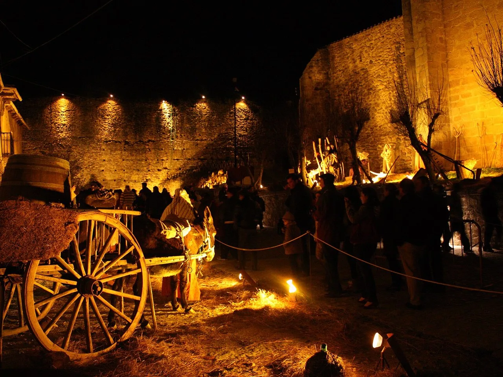
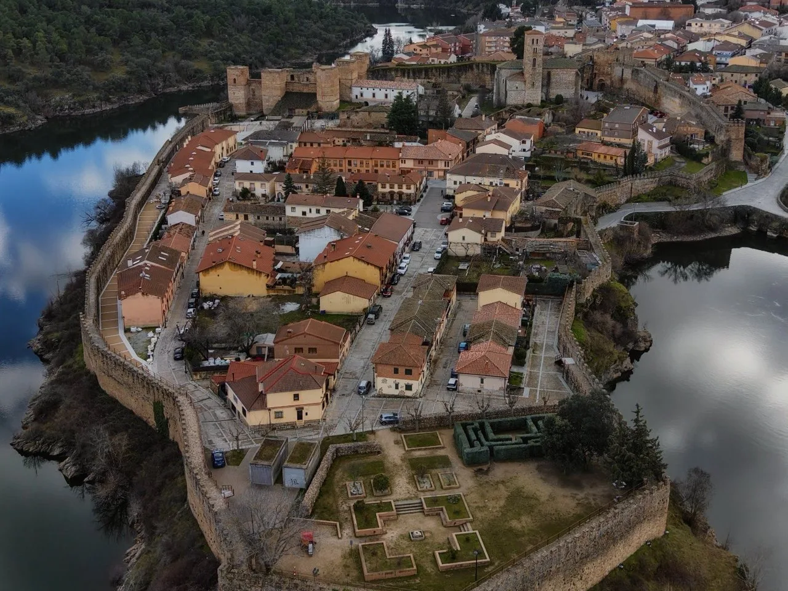
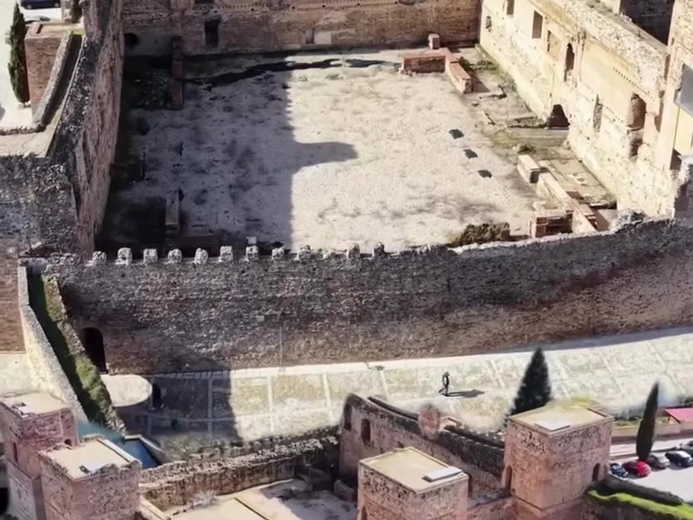
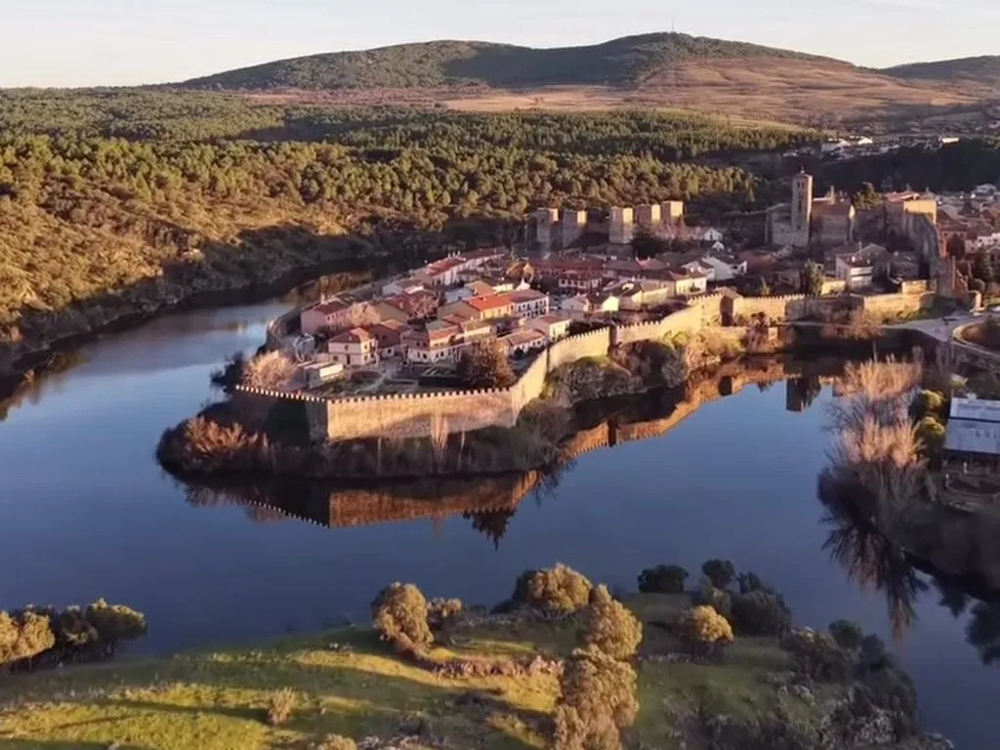

En Navidad, el pueblo amurallado de **Buitrago del Lozoya** se convierte en Belén. Más de **200 vecinos** recrean casi **40 escenas** por las calles de dentro de la **muralla medieval**, iluminadas con antorchas y hogueras. Es uno de los belenes vivientes más conocidos de España y, cada año, **las entradas se agotan**.

Te cuento las fechas de 2026, cómo conseguir entrada y cómo organizar la visita 👇

En un vistazo<h2>Lo que vas a encontrar</h2>

<b>🌟</b>Casi 40 escenas

<b>🏰</b>Dentro de la muralla

<b>👪</b>200 vecinos actores

<b>🔥</b>Antorchas y hogueras

<b>🎟️</b>Entradas que vuelan

Antes de ir<h2>Belén Viviente de Buitrago 2026: lo básico</h2>

<h3>📅 Fechas</h3>
<strong>12, 13, 19 y 20 de diciembre de 2026</strong>. Es la XXXVI edición.

<h3>🕕 Pases</h3>
Dos sesiones por noche, a las <strong>18:30 y a las 20:30</strong>, según la información publicada. Mira la hora en tu entrada.

<h3>🎟️ Entrada</h3>
Unos <strong>6 €</strong>. Menores de 3 años, gratis. Se compra en la <strong>web oficial</strong> y se agota pronto.

<h3>⏱️ Duración</h3>
Un recorrido de unos <strong>1,3 km</strong> por dentro de la muralla. Calcula alrededor de una hora.

Cómo es<h2>Qué vas a ver en el Belén Viviente</h2>

<ol class="guide__grid guide__grid--cuenca">
<li class="gcard reveal">
01

<h3>Las escenas</h3>
Escenas como <strong>el lagar</strong> o <strong>el edicto imperial</strong> y, al final, el <strong>Nacimiento</strong>. Cada escena con sus vecinos vestidos de época.

</li>
<li class="gcard reveal">
02

<h3>El recinto amurallado</h3>
Todo pasa dentro de la <strong>muralla medieval</strong>, la única completa de la Comunidad de Madrid. De noche y con antorchas, impresiona.

</li>
<li class="gcard reveal">
03

<h3>El castillo</h3>
El castillo de los Mendoza, junto al recorrido. Si llegas de día, aprovecha para verlo.

</li>
<li class="gcard reveal">
04

<h3>La muralla y el río</h3>
Antes de entrar, pasea junto al <strong>río Lozoya</strong>: la muralla reflejada en el agua al atardecer es la mejor foto del pueblo.

</li>
</ol>

<h3>🎟️ Cómo no quedarte sin entrada</h3>
Las entradas salen a la venta en la <strong>web oficial del Belén Viviente</strong> y en otras ediciones se han agotado en muy poco tiempo. Si quieres ir un día concreto, estate atento a la fecha de venta. Si no consigues entrada, el pueblo merece la pena igualmente de día: mira mi guía de <a href="/blog/buitrago-del-lozoya-que-ver.html">qué ver en Buitrago del Lozoya</a>.

Cómo llegar<h2>Cómo llegar a Buitrago del Lozoya</h2>

<strong>En coche:</strong> por la <strong>A-1</strong> (Madrid-Burgos), a unos 75 km de Madrid: algo menos de una hora. Esos días hay mucha gente: llega con tiempo para aparcar.

<strong>En autobús:</strong> salen desde el intercambiador de <strong>Plaza de Castilla</strong>. Revisa el horario de vuelta, sobre todo si vas al pase de las 20:30.

<a class="btn guide__mapbtn" href="https://www.google.com/maps/dir/?api=1&destination=40.9917,-3.6375" target="_blank" rel="noopener"><svg class="ico" viewBox="0 0 24 24" width="15" height="15" aria-hidden="true" fill="currentColor"><path d="M12 2a7 7 0 0 0-7 7c0 5.25 7 13 7 13s7-7.75 7-13a7 7 0 0 0-7-7zm0 9.5a2.5 2.5 0 1 1 0-5 2.5 2.5 0 0 1 0 5z"/></svg> Cómo llegar en Google Maps</a>

Más planes de estas fechas: la <a href="/blog/navidad-en-madrid.html">Navidad en Madrid</a> con Cortylandia y las luces, y las <a href="/blog/magicas-navidades-torrejon.html">Mágicas Navidades de Torrejón</a>.

Consejos de Cheno<h2>Para disfrutarlo al máximo</h2><ul><li><b>Compra la entrada en cuanto salga</b>: vuela.</li><li><b>Llega de día</b> y pasea por la muralla y el río antes del pase.</li><li><b>Abrígate mucho</b>: en diciembre, en la sierra, por la noche hace mucho frío.</li><li><b>Calzado cómodo</b>: el recorrido es de calles empedradas y cuestas.</li></ul>

<!--actividades-->

🎄 <strong>Más Navidad en España:</strong> <a href="/blog/navidad-en-madrid.html">Madrid</a> · <a href="/blog/magicas-navidades-torrejon.html">Mágicas Navidades de Torrejón</a> · <a href="/blog/navidad-en-barcelona.html">Barcelona</a> · <a href="/blog/navidad-en-sevilla.html">Sevilla</a> · <a href="/blog/navidad-en-valencia.html">Valencia</a> · <a href="/blog/navidad-en-zaragoza.html">Zaragoza</a> · <a href="/blog/navidad-en-malaga.html">Málaga</a> · <a href="/blog/luces-navidad-vigo.html">luces de Vigo</a> · <a href="/blog/pueblo-navidad-ferrero-rocher-2026.html">Pueblo Navidad Ferrero Rocher</a>.

<!--faq-->

<h2>¿Te gustan estos planes?</h2>
Sígueme en Instagram como <a href="https://www.instagram.com/chenoaventuras/" target="_blank" rel="noopener">@chenoaventuras</a>: subo escapadas como esta cada semana.
<a class="btn guide__btn" href="/blog.html">Ver más planes en el blog</a>

Información consultada en noviembre de 2026 en Visit Madrid (agenda de la Comunidad de Madrid) y Time Out Madrid. Los horarios y precios pueden cambiar: confírmalos en la web oficial del Belén Viviente. Fotos: Chenoaventuras y Wikimedia Commons (<a href="https://commons.wikimedia.org/wiki/File:Escena_de_El_Lagar.JPG" target="_blank" rel="noopener">BelenVivienteBuitrago</a>, CC BY-SA 4.0).

