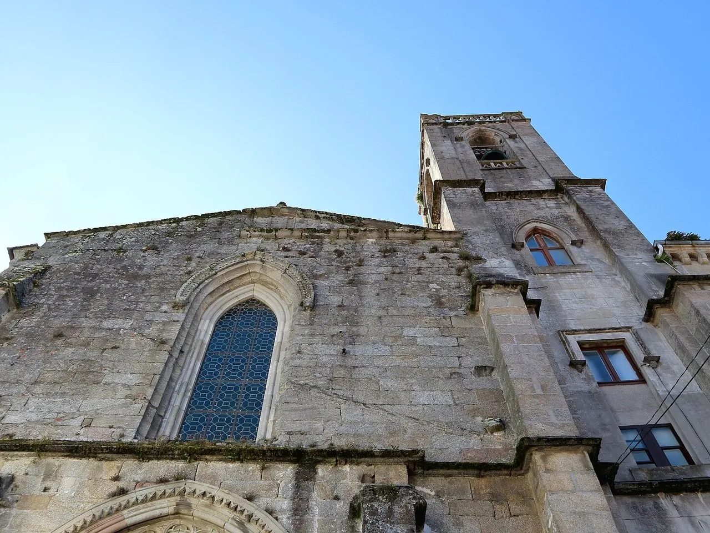
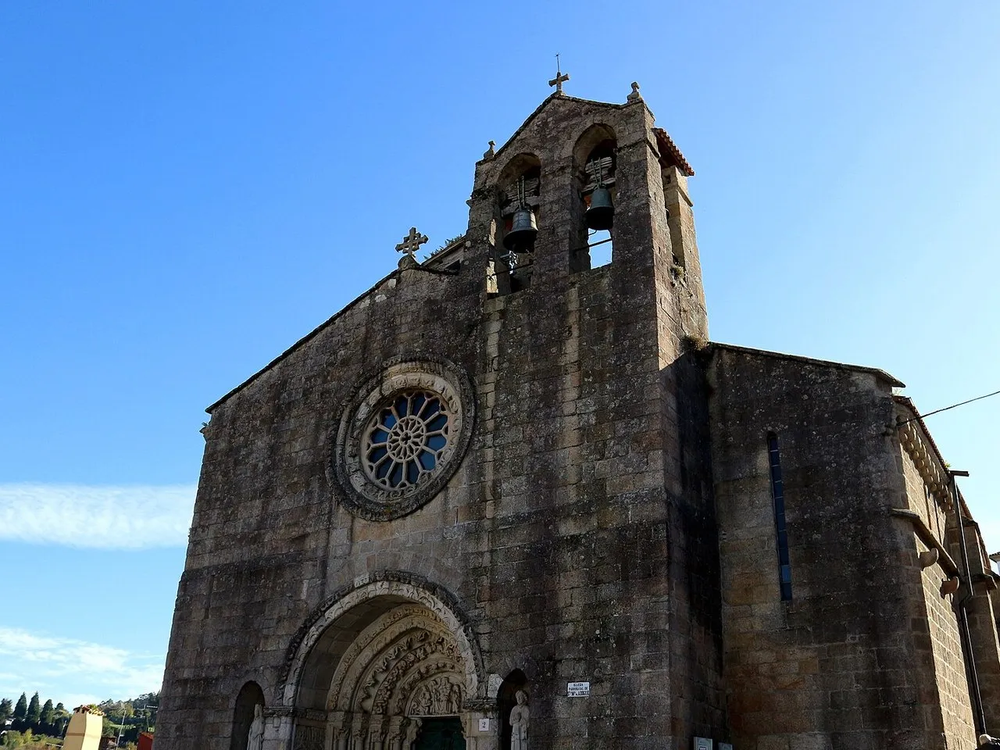
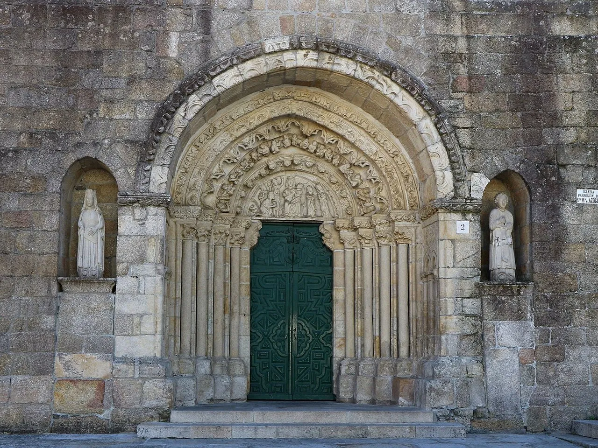
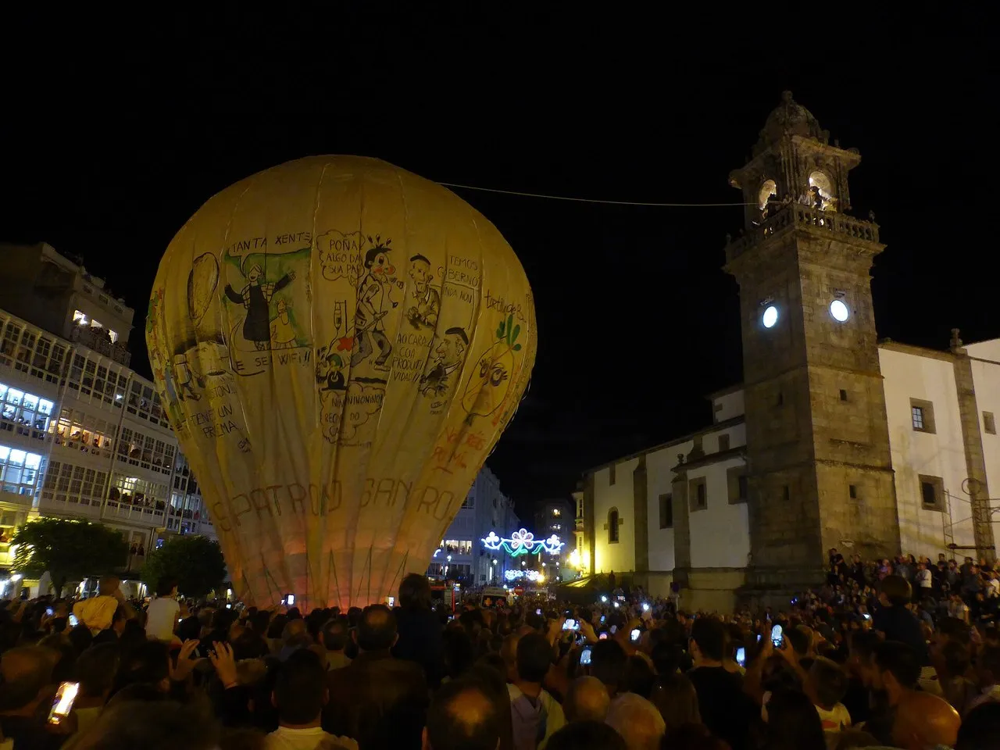
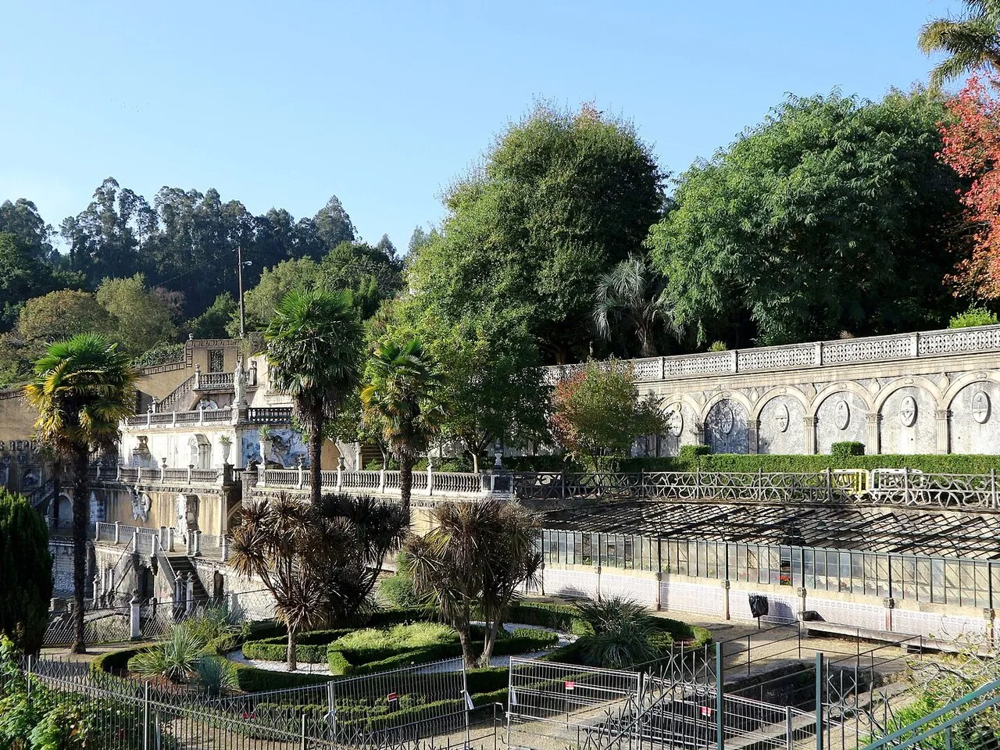

Casas blancas con galerías colgadas sobre el río, calles empinadas de piedra, iglesias góticas con caballeros esculpidos y un globo de papel gigante que sube al cielo cada 16 de agosto. **Betanzos**, en A Coruña, es uno de los cascos históricos más bonitos de Galicia y este año compite por ser el **pueblo de la Navidad de Ferrero Rocher**.

Te cuento qué ver, sus tradiciones y cómo llegar 👇

En un vistazo<h2>Lo que vas a encontrar</h2>

<b>⛪</b>Iglesias góticas

<b>🏰</b>Casco medieval

<b>🎈</b>Globo de San Roque

<b>🍳</b>Tortilla de Betanzos

<b>🎄</b>Candidato Ferrero 2026

Antes de ir<h2>Lo básico de Betanzos</h2>

<h3>📍 Dónde está</h3>
En la ría de Betanzos, en la provincia de <strong>A Coruña</strong>, con el aeropuerto de Alvedro a 19 km.

<h3>⏱️ Tiempo</h3>
<strong>Medio día</strong> para el casco histórico y sus iglesias; un día si sumas comer y los alrededores.

<h3>🍳 Para comer</h3>
La <strong>tortilla de Betanzos</strong>, poco cuajada y jugosa, y el vino blanco <strong>Branco Lexítimo</strong>.

<h3>ℹ️ Oficina de turismo</h3>
Praza de Galicia, 1. Tel. 981 776 666.

Qué ver<h2>Qué ver en Betanzos</h2>

<ol class="guide__grid guide__grid--cuenca">
<li class="gcard reveal">
01

<h3>La iglesia de San Francisco</h3>
Fundada por <strong>Fernán Pérez de Andrade</strong>, es Monumento Nacional. Dentro, sepulcros de caballeros medievales sostenidos por un <strong>oso y un jabalí</strong> esculpidos.

</li>
<li class="gcard reveal">
02

<h3>Santa María do Azougue</h3>
Iglesia gótica gremial con un <strong>calendario agrícola</strong> esculpido y un retablo con esculturas flamencas del siglo XV.

</li>
<li class="gcard reveal">
03

<h3>El casco histórico</h3>
La muralla y sus puertas medievales, la <strong>Torre del Reloj</strong> (siglo XVI), la iglesia de Santiago, el Pazo de Bendaña y la Casa Consistorial de Ventura Rodríguez (siglo XVIII).

</li>
<li class="gcard reveal">
04

<h3>El globo de San Roque</h3>
Cada <strong>16 de agosto</strong>, un globo de papel gigante se suelta sobre la ciudad. En julio, además, se celebra la <strong>Feria Franca Medieval</strong>.

</li>
<li class="gcard reveal">
05

<h3>El Parque del Pasatempo</h3>
Un parque insólito de finales del siglo XIX que crearon los hermanos García Naveira, emigrantes que volvieron de América. <strong>Ahora está cerrado por obras de restauración.</strong>

</li>
</ol>

<!--actividades-->

Historia<h2>Una ciudad que fue capital</h2>

En <strong>1219</strong>, el rey Alfonso IX trasladó la población desde «Betanzos O Vello» a su emplazamiento actual. La ciudad fue capital de una de las <strong>siete provincias del antiguo Reino de Galicia</strong> hasta 1834, cuando se integró en la de A Coruña. En <strong>1569</strong> un gran incendio destruyó más de 600 casas.

<h3>🎄 Candidato a pueblo Ferrero Rocher</h3>
Betanzos representa a <strong>Galicia</strong> en el concurso de la Navidad de Ferrero Rocher 2026. Mira cómo va y cómo votar en <a href="/blog/pueblo-navidad-ferrero-rocher-2026.html">el pueblo de la Navidad de Ferrero Rocher</a>.

Cómo llegar<h2>Cómo llegar a Betanzos</h2>

<h3>🚗 En coche</h3>
Por la <strong>A-6</strong>, la AP-9, la N-VI o la N-651.

<h3>🚆 En tren</h3>
Estación <strong>Betanzos-Ciudad</strong>, con enlaces a A Coruña y Ferrol.

<h3>✈️ En avión</h3>
A Coruña-Alvedro, a 19 km; Santiago, a 56 km.

<h3>🧭 Con guía</h3>
El <a href="https://www.civitatis.com/es/betanzos/free-tour-betanzos/?aid=110968" target="_blank" rel="noopener sponsored">free tour por Betanzos</a> recorre el casco y sus iglesias.

Consejos de Cheno<h2>Para disfrutarlo al máximo</h2><ul><li><b>Calzado cómodo</b>: el casco está en cuesta.</li><li><b>Pide tortilla</b> en cualquier bar del centro.</li><li><b>Ve en agosto</b> si quieres ver el globo de San Roque, o en julio para la Feria Medieval.</li><li><b>Combínalo con</b> <a href="/blog/coruna-que-ver.html">A Coruña</a>, a un paso.</li></ul>

<!--faq-->

<h2>¿Te gustan estos planes?</h2>
Sígueme en Instagram como <a href="https://www.instagram.com/chenoaventuras/" target="_blank" rel="noopener">@chenoaventuras</a>: subo escapadas como esta cada semana.
<a class="btn guide__btn" href="/blog.html">Ver más planes en el blog</a>

Información consultada en noviembre de 2026 en la web de turismo del Concello de Betanzos. Fotos de Wikimedia Commons: <a href="https://commons.wikimedia.org/wiki/File:Betanzos_desde_el_puente_viejo,_o_Ponte_Vella._Galicia,_Espa%C3%B1a.jpg" target="_blank" rel="noopener">Carlos Teixidor Cadenas</a> (CC BY-SA 4.0) · <a href="https://commons.wikimedia.org/wiki/File:Betanzos_Igrexa_Monacal_de_San_Francisco_22.jpg" target="_blank" rel="noopener">Miguel Branco</a> (CC BY-SA 4.0) · <a href="https://commons.wikimedia.org/wiki/File:Betanzos_Santa_Mar%C3%ADa_do_Azougue_1.jpg" target="_blank" rel="noopener">Miguel Branco</a> · <a href="https://commons.wikimedia.org/wiki/File:Betanzos_Santa_Mar%C3%ADa_do_Azougue_6.jpg" target="_blank" rel="noopener">Miguel Branco</a> · <a href="https://commons.wikimedia.org/wiki/File:Globo_de_Betanzos,_aerostato_de_papel._Betanzos,_Galicia,_Espa%C3%B1a.jpg" target="_blank" rel="noopener">Carlos Teixidor Cadenas</a> · <a href="https://commons.wikimedia.org/wiki/File:Betanzos_Parque_do_Pasatempo_10.jpg" target="_blank" rel="noopener">Miguel Branco</a> (CC BY-SA 4.0).

