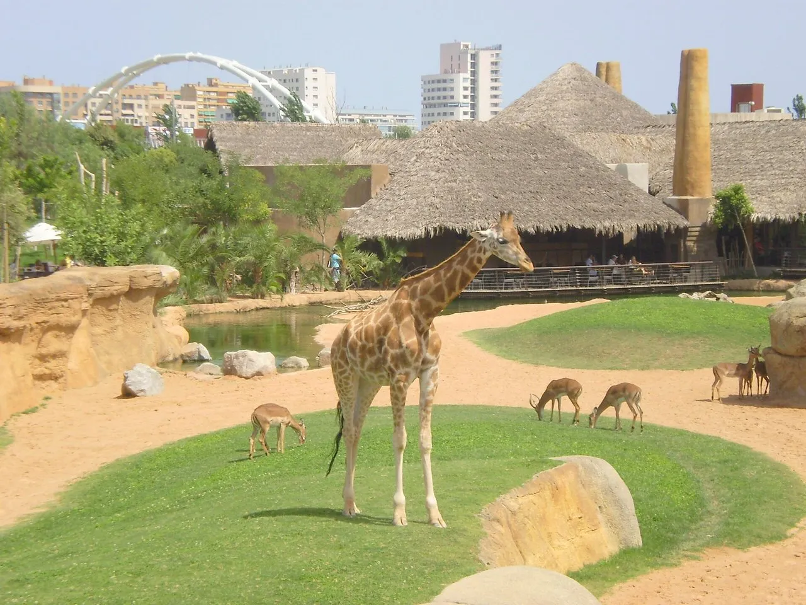
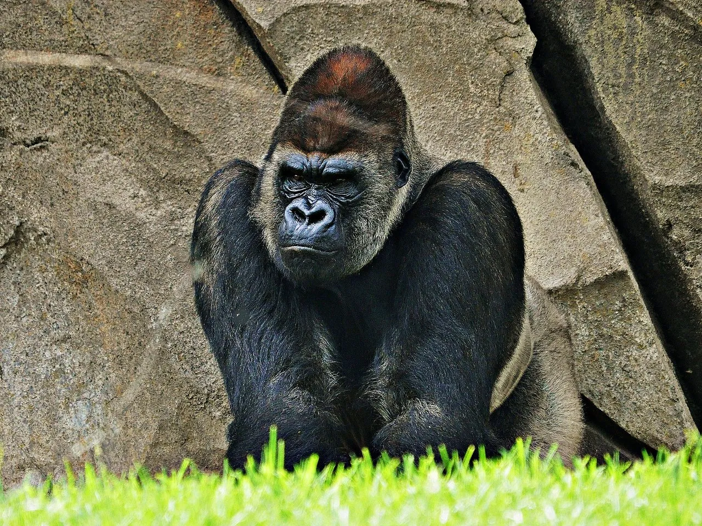
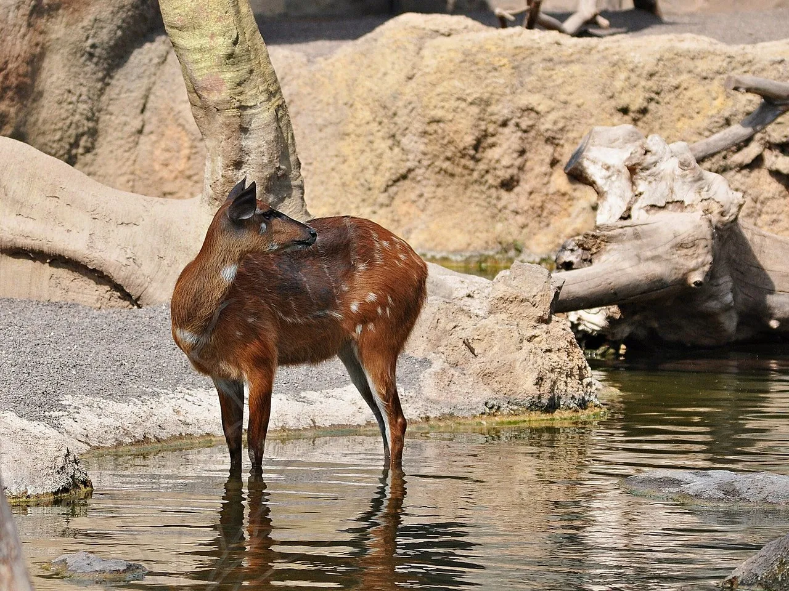
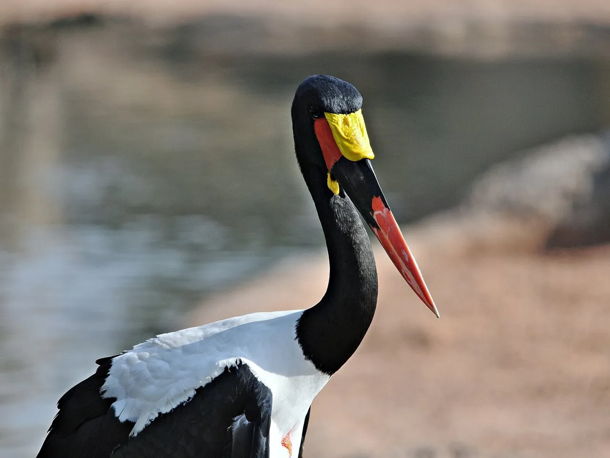

Gorilas a pocos metros, lémures saltando en una isla de Madagascar y una sabana con jirafas que parece de verdad. El **Bioparc Valencia** recrea los hábitats de África para que parezca que estás allí, y es uno de los planes favoritos de **Valencia** en familia.

Te cuento cuánto cuesta, cómo ahorrar, qué animales ver y cómo llegar 👇

En un vistazo<h2>Lo que vas a encontrar</h2>

<b>🦍</b>Gorilas

<b>🦒</b>Sabana africana

<b>🐒</b>Madagascar

<b>💸</b>Descuentos online

<b>🅿️</b>Parking 7 €

Antes de ir<h2>Lo básico del Bioparc</h2>

<h3>🎟️ Precio</h3>
General <strong>desde 29,50 €</strong>; de 4 a 12 años y mayores de 65, <strong>desde 23,50 €</strong>. Menores de 4, gratis.

<h3>💸 Ahorra</h3>
<strong>1 € menos</strong> comprando online, <strong>20 %</strong> en entradas de tarde (BIOTARDEO) y, hasta el 29 de noviembre, todo a precio infantil (BIOdías).

<h3>🕙 Horario</h3>
Abre <strong>todos los días del año</strong>; el horario cambia según la temporada (consúltalo en su calendario). Último acceso, una hora antes del cierre.

<h3>🅿️ Parking</h3>
Máximo <strong>7 €</strong> por la visita, sin reserva. Altura máxima, 2,10 m.

Qué ver<h2>Qué ver en el Bioparc Valencia</h2>

<ol class="guide__grid guide__grid--cuenca">
<li class="gcard reveal">
01

<h3>La sabana africana</h3>
Jirafas, antílopes y otros herbívoros en un gran espacio abierto, con baobabs y rocas que recrean el paisaje de África.

</li>
<li class="gcard reveal">
02

<h3>Los gorilas</h3>
En la <strong>selva ecuatorial</strong>, gorilas occidentales de llanura que se observan desde un centro de interpretación de primates.

</li>
<li class="gcard reveal">
03

<h3>La selva ecuatorial</h3>
Bosque de ribera, troncos caídos y un «bai» con chimpancés, leopardos, hipopótamos pigmeos, drils y sitatungas.

</li>
<li class="gcard reveal">
04

<h3>Los humedales</h3>
Zonas de agua con aves africanas como este jabirú, uno de los rincones más fotogénicos.

</li>
<li class="gcard reveal">
05

<h3>Madagascar y los pequeños</h3>
La isla de Madagascar, con varias especies de lémures, y animales que encantan a los niños, como las suricatas.

</li>
<li class="gcard reveal">
06

<h3>Los depredadores</h3>
Hienas y leopardos, en recintos que imitan su hábitat. Hay además encuentros con el equipo de cuidado animal (consulta la agenda del día).

</li>
</ol>

<!--actividades-->

Cómo llegar<h2>Cómo llegar al Bioparc Valencia</h2>

<h3>🚇 En metro</h3>
Líneas <strong>3, 5 y 9</strong>, parada <strong>Nou d'Octubre</strong>, a unos 10 minutos andando.

<h3>🚌 En autobús</h3>
EMT <strong>98 y 99</strong> (parada en la puerta), 73 y 95 (puente Nou d'Octubre) y 67.

<h3>🚗 En coche</h3>
Av. Pío Baroja, 3 (Campanar). Parking propio, máximo 7 €.

<h3>🎟️ Entradas</h3>
Online en la web oficial o con la <a href="https://www.civitatis.com/es/valencia/entrada-bioparc-valencia/?aid=110968" target="_blank" rel="noopener sponsored">entrada de Civitatis</a>.

Consejos de Cheno<h2>Para disfrutarlo al máximo</h2><ul><li><b>Compra online</b> y mira las promociones del momento.</li><li><b>Consulta la agenda</b> al entrar para no perderte los encuentros con los cuidadores.</li><li><b>Ve a primera hora</b>: los animales están más activos.</li><li><b>Haz doblete</b> con el <a href="/blog/oceanografic-valencia.html">Oceanogràfic</a> y la <a href="/blog/valencia-que-ver.html">guía de Valencia</a>.</li></ul>

<!--faq-->

<h2>¿Te gustan estos planes?</h2>
Sígueme en Instagram como <a href="https://www.instagram.com/chenoaventuras/" target="_blank" rel="noopener">@chenoaventuras</a>: subo escapadas como esta cada semana.
<a class="btn guide__btn" href="/blog.html">Ver más planes en el blog</a>

Información consultada en noviembre de 2026 en la web oficial de BIOPARC Valencia (entradas, cómo llegar y hábitats). Los precios cambian según la época. Fotos de Wikimedia Commons: <a href="https://commons.wikimedia.org/wiki/File:Animales_bioparc-valencia-2012.JPG" target="_blank" rel="noopener">Alberto-g-rovi</a> (CC BY-SA 3.0) · <a href="https://commons.wikimedia.org/wiki/File:Bioparc_-_Jirafa_de_fondo_Valencia.JPG" target="_blank" rel="noopener">Googledance</a> (CC BY-SA 1.0) · <a href="https://commons.wikimedia.org/wiki/File:Animales_bioparc-valencia-2012_(9).JPG" target="_blank" rel="noopener">Alberto-g-rovi</a> · <a href="https://commons.wikimedia.org/wiki/File:Animales_bioparc-valencia-2012_(7).JPG" target="_blank" rel="noopener">Alberto-g-rovi</a> · <a href="https://commons.wikimedia.org/wiki/File:Animales_bioparc-valencia-2012_(15).JPG" target="_blank" rel="noopener">Alberto-g-rovi</a> · <a href="https://commons.wikimedia.org/wiki/File:Animales_bioparc-valencia-2012_(13).JPG" target="_blank" rel="noopener">Alberto-g-rovi</a> · <a href="https://commons.wikimedia.org/wiki/File:Animales_bioparc-valencia-2012_(11).JPG" target="_blank" rel="noopener">Alberto-g-rovi</a> (CC BY-SA 3.0).

