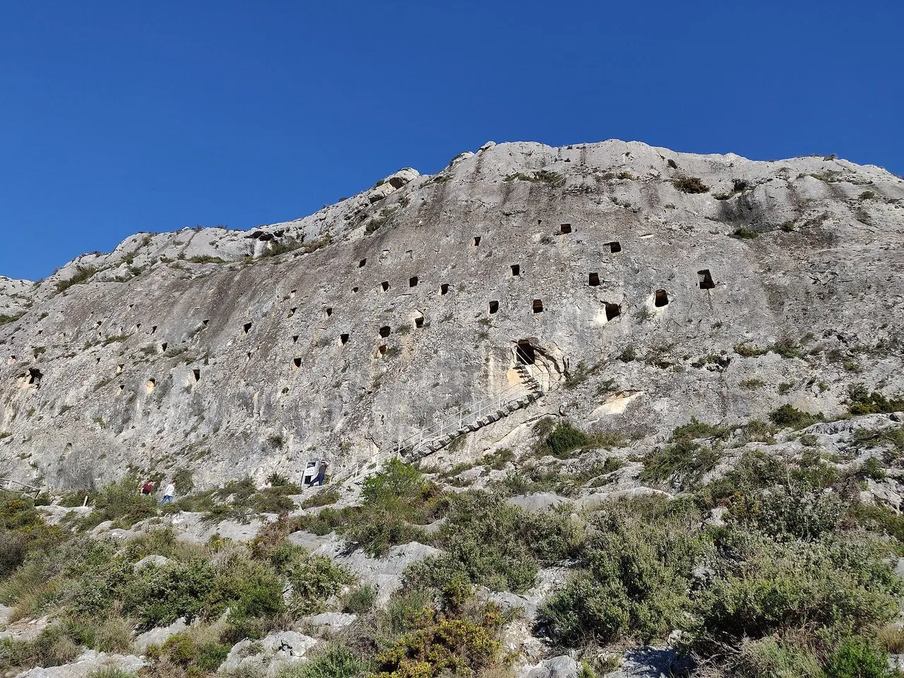
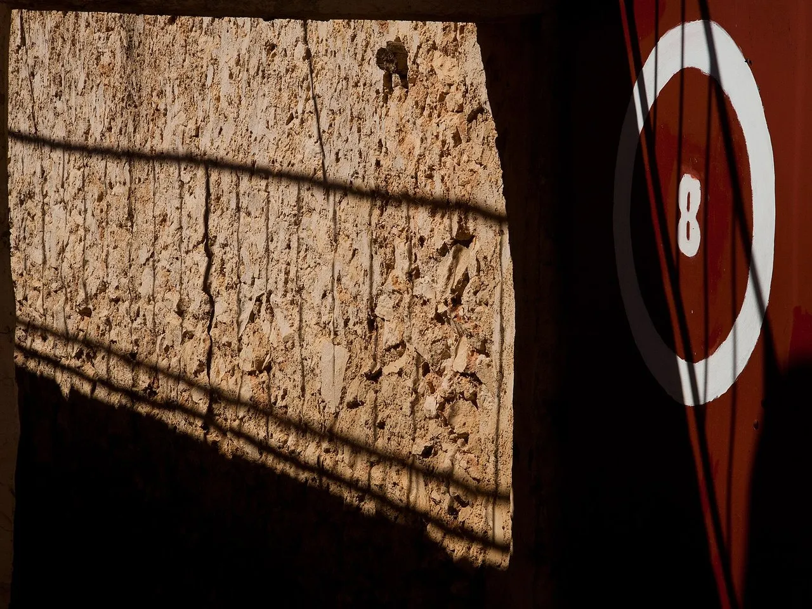
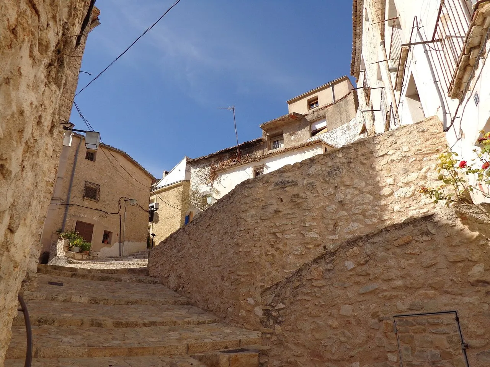
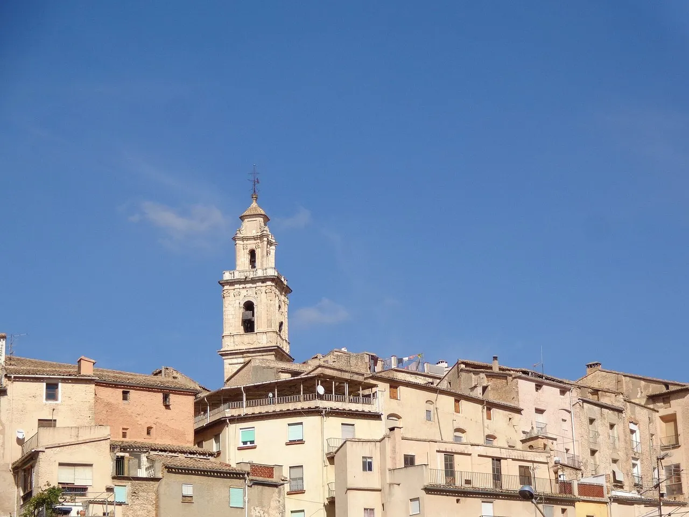
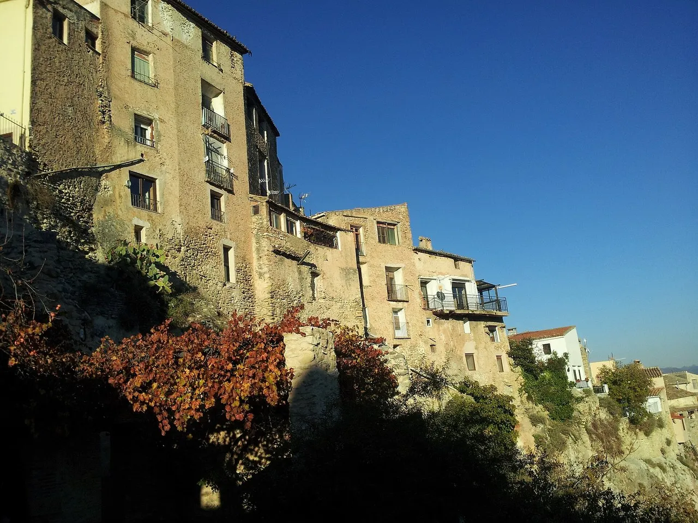

Un pueblo colgado de una peña, un acantilado agujereado por cincuenta ventanas misteriosas y una plaza de toros tallada en la roca. **Bocairent**, en el interior de Valencia, es uno de los pueblos más sorprendentes de la Comunitat Valenciana y este año compite por ser el **pueblo de la Navidad de Ferrero Rocher**.

Te cuento qué ver, cuánto cuestan las visitas y qué tener en cuenta 👇

En un vistazo<h2>Lo que vas a encontrar</h2>

<b>🕳️</b>Covetes dels Moros

<b>🐂</b>Plaza de toros en la roca

<b>🏘️</b>Casco medieval

<b>❄️</b>Cava de nieve

<b>🎄</b>Candidato Ferrero 2026

Antes de ir<h2>Lo básico de Bocairent</h2>

<h3>📍 Dónde está</h3>
En la comarca de la <strong>Vall d'Albaida</strong>, en el interior de la provincia de Valencia, cerca de Ontinyent.

<h3>⏱️ Tiempo</h3>
<strong>Un día</strong> para el casco, las Covetes y la plaza de toros sin prisas.

<h3>🎟️ Visitas</h3>
Covetes dels Moros <strong>4 €</strong>, plaza de toros <strong>3 €</strong>, iglesia <strong>3 €</strong> y Cava de Sant Blai <strong>2,50 €</strong>.

<h3>ℹ️ Oficina de turismo</h3>
Plaça de l'Ajuntament, 2. Tel. 96 290 50 62.

Qué ver<h2>Qué ver en Bocairent</h2>

<ol class="guide__grid guide__grid--cuenca">
<li class="gcard reveal">
01

<h3>Las Covetes dels Moros</h3>
Unas <strong>cincuenta ventanas</strong> excavadas en un acantilado, de época andalusí. La visita guiada se hace en gran parte <strong>gateando</strong> entre cámaras.

</li>
<li class="gcard reveal">
02

<h3>La plaza de toros</h3>
Inaugurada en <strong>1844</strong>, es la más antigua de la Comunidad Valenciana y está excavada en gran parte en la roca viva.

</li>
<li class="gcard reveal">
03

<h3>El casco medieval</h3>
Calles estrechas, escalinatas y pasadizos que trepan por la peña. Es peatonal, así que se recorre a pie.

</li>
<li class="gcard reveal">
04

<h3>La iglesia de la Asunción</h3>
Construida sobre el antiguo castillo árabe y consagrada en <strong>1516</strong>, gótica con reforma barroca. Tiene museo parroquial.

</li>
<li class="gcard reveal">
05

<h3>La Cava de Sant Blai y las ermitas</h3>
Un antiguo depósito de nieve de <strong>11 m de profundidad</strong>, detrás del barrio medieval, y la ermita del Santo Cristo, a 730 m de altitud por el camino del calvario.

</li>
</ol>

<!--actividades-->

<h3>🎄 Candidato a pueblo Ferrero Rocher</h3>
Bocairent representa a la <strong>Comunitat Valenciana</strong> en el concurso de la Navidad de Ferrero Rocher 2026. Mira cómo va y cómo votar en <a href="/blog/pueblo-navidad-ferrero-rocher-2026.html">el pueblo de la Navidad de Ferrero Rocher</a>.

Para tener en cuenta<h2>Antes de entrar en las Covetes</h2>

<h3>👟 Calzado</h3>
Solo <strong>calzado cerrado</strong> y atado: con sandalias o chanclas no se entra.

<h3>🎒 Sin mochila</h3>
No se puede entrar con bolsos, mochilas ni riñoneras.

<h3>⚠️ No apta para todos</h3>
Ni con claustrofobia o vértigo, ni embarazadas, ni bebés de 0 a 3 años.

<h3>🕐 Puntualidad</h3>
Las visitas empiezan a las horas en punto: llega <strong>10 minutos antes</strong>, porque luego no se puede entrar.

Consejos de Cheno<h2>Para disfrutarlo al máximo</h2><ul><li><b>Compra las entradas antes</b>: los grupos son de 15 personas.</li><li><b>Aparca fuera</b> del casco, en la zona de la calle Batalla de Lepanto.</li><li><b>Ve a principios de febrero</b> si quieres ver sus Moros y Cristianos de Sant Blai.</li><li><b>Combínalo con</b> <a href="/blog/valencia-que-ver.html">Valencia</a> en una escapada.</li></ul>

<!--faq-->

<h2>¿Te gustan estos planes?</h2>
Sígueme en Instagram como <a href="https://www.instagram.com/chenoaventuras/" target="_blank" rel="noopener">@chenoaventuras</a>: subo escapadas como esta cada semana.
<a class="btn guide__btn" href="/blog.html">Ver más planes en el blog</a>

Información consultada en noviembre de 2026 en la web de turismo de Bocairent. Fotos de Wikimedia Commons: <a href="https://commons.wikimedia.org/wiki/File:Bocairent._Vista_amb_el_pont_de_Darrere_la_Vila.JPG" target="_blank" rel="noopener">Enrique Íñiguez Rodríguez (Qoan)</a> (CC BY-SA 3.0) · <a href="https://commons.wikimedia.org/wiki/File:Covetes_dels_Moros.jpg" target="_blank" rel="noopener">Orniosviajero</a> (CC BY-SA 4.0) · <a href="https://commons.wikimedia.org/wiki/File:Bocairente,_Comunitat_Valenciana_(6927796231).jpg" target="_blank" rel="noopener">mandoft</a> (CC BY-SA 2.0) · <a href="https://commons.wikimedia.org/wiki/File:Bocairente_Espana_01.JPG" target="_blank" rel="noopener">Superchilum</a> · <a href="https://commons.wikimedia.org/wiki/File:Bocairente_Espana_04.JPG" target="_blank" rel="noopener">Superchilum</a> (CC BY-SA 4.0) · <a href="https://commons.wikimedia.org/wiki/File:Bocairent_-_1.jpeg" target="_blank" rel="noopener">Coentor</a> (CC BY-SA 3.0).

