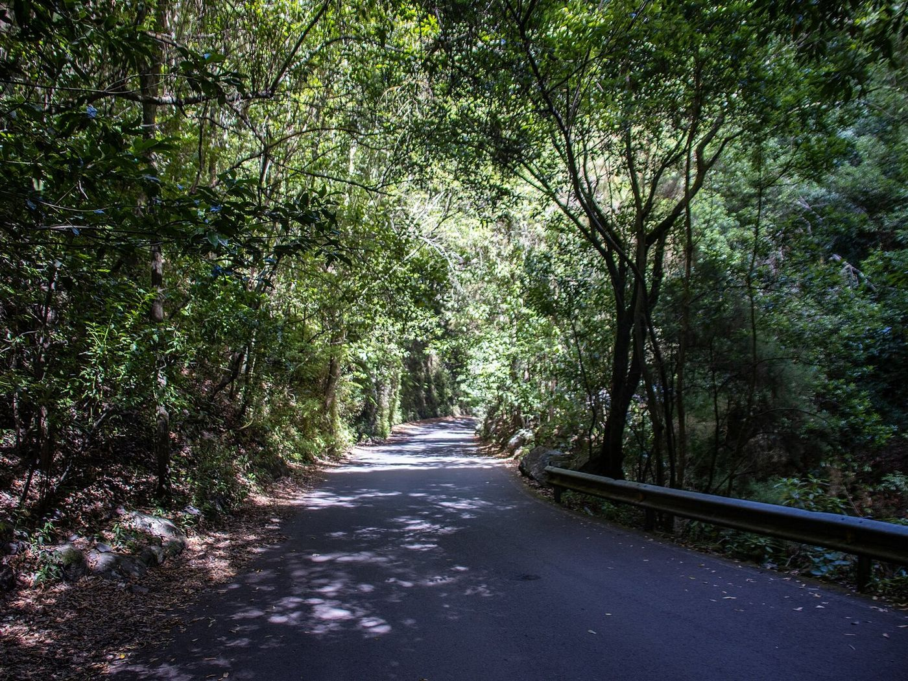
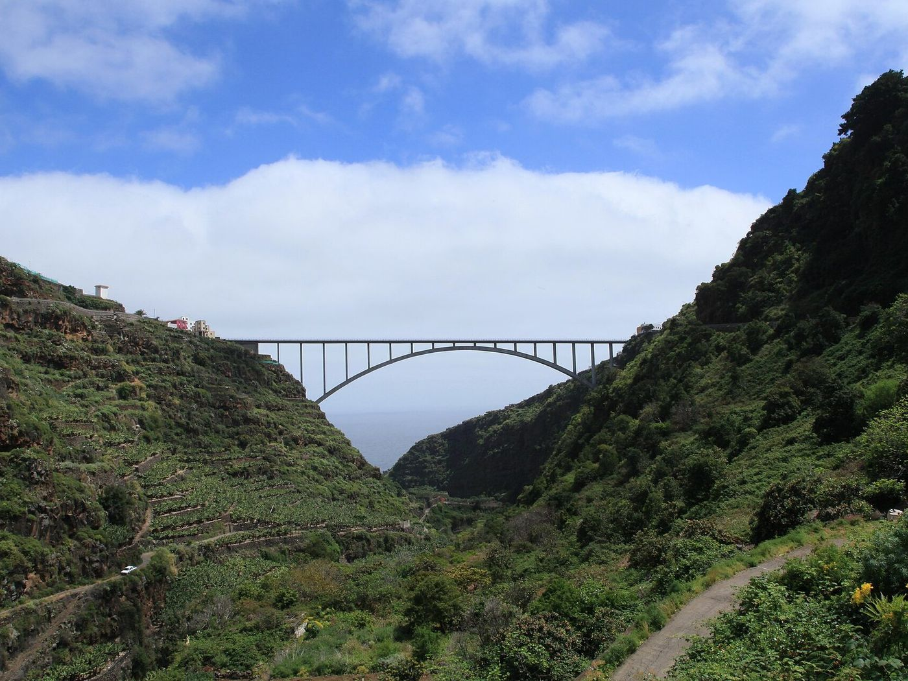
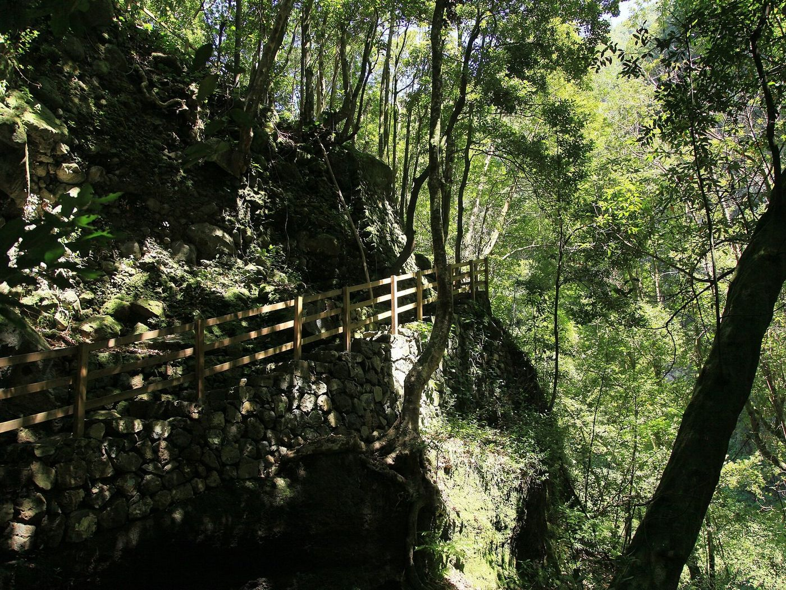
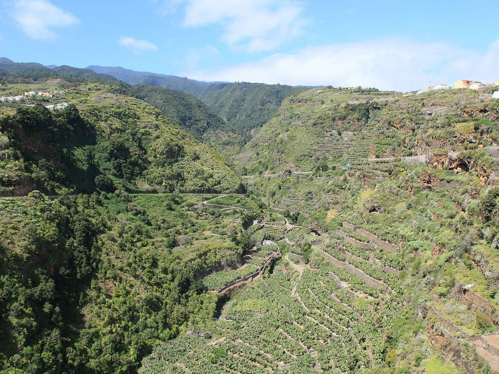

Un túnel de ramas, helechos gigantes, musgo en cada piedra y el ruido del agua al fondo del barranco. El **Bosque de Los Tilos** es la selva de laurisilva más famosa de **La Palma**, y está declarado **Reserva de la Biosfera desde 1983**.

Te cuento cómo llegar, qué se ve, qué senderos hay y cómo combinarlo con el cercano Charco Azul 👇

En un vistazo<h2>Lo que vas a encontrar</h2>

<b>🌳</b>Laurisilva

<b>💧</b>Cascadas

<b>🌿</b>Helechos gigantes

<b>🥾</b>Senderos

<b>🦅</b>Palomas endémicas

Antes de ir<h2>Lo básico de Los Tilos</h2>

<h3>📍 Dónde está</h3>
En <strong>San Andrés y Sauces</strong>, al final de la carretera <strong>LP-105</strong>, a unos 4 km del puente de Los Tilos.

<h3>🧥 Lleva</h3>
<strong>Chaqueta impermeable</strong> y calzado con buen agarre: es húmedo y resbala.

<h3>⏱️ Tiempo</h3>
Una <strong>mañana o tarde</strong> para el bosque y el sendero corto; el día entero si haces rutas largas.

El bosque<h2>Una reliquia de otra era</h2>

La <strong>laurisilva</strong> es un bosque subtropical húmedo que hace millones de años cubría buena parte del entorno mediterráneo. Los cambios de clima lo hicieron desaparecer del continente, pero en algunas islas atlánticas, con aire cargado de humedad por los alisios, ha sobrevivido. Aquí crecen laureles, <em>tiles</em> (el árbol que da nombre al lugar), madroños, palo blanco, viñátigos y helechos enormes. En <strong>1983</strong> la UNESCO declaró Reserva de la Biosfera unas 511 hectáreas de este monte, y en <strong>2002</strong> la protección se extendió a toda la isla.

Qué ver<h2>Qué ver en Los Tilos</h2>

<ol class="guide__grid guide__grid--cuenca">
<li class="gcard reveal">
01

<h3>La carretera bajo el dosel</h3>
La LP-105 entra en el barranco bajo un techo de ramas. Ya el trayecto merece la pena: conduce despacio, es estrecha y hay curvas cerradas.

</li>
<li class="gcard reveal">
02

<h3>El puente y el Barranco del Agua</h3>
Antes de subir al bosque, el puente de Los Tilos cruza el barranco a gran altura. Es una buena parada para fotos del tajo verde.

</li>
<li class="gcard reveal">
03

<h3>El sendero de la cascada</h3>
Un camino con barandilla pegado a la roca y entre la vegetación lleva hasta la zona de la cascada. Es corto, pero resbala: ve con calma.

</li>
<li class="gcard reveal">
04

<h3>El Barranco del Agua</h3>
Desde los miradores se ve el contraste entre el bosque cerrado y las laderas cultivadas, hasta el mar.

</li>
</ol>

Senderos<h2>Dónde caminar</h2>

Desde el centro de visitantes salen varios caminos señalizados. Hay un <strong>sendero autoguiado</strong> corto, apto para casi todos, y otros que llevan a miradores como el de <strong>Las Barandas</strong> o el del <strong>Espigón Atravesado</strong>, en la ruta hacia los nacientes de Marcos y Cordero. Esta última ruta (PR LP 06) está abierta solo en parte, según el Cabildo, así que consulta su estado antes de ir. Si no quieres complicarte, el paseo corto por el bosque y la cascada ya te da lo mejor del lugar.

Con suerte, entre las copas verás volar alguna de las <strong>palomas endémicas de la laurisilva</strong> canaria (la turqué y la rabiche), muy esquivas, así que llega temprano y en silencio.

Cómo llegar<h2>Cómo llegar a Los Tilos</h2>

<strong>En coche:</strong> desde Santa Cruz de La Palma, por la <strong>LP-1</strong> hacia el norte hasta San Andrés y Sauces; en el puente de Los Tilos, toma la <strong>LP-105</strong>, que sube unos 4 km hasta el aparcamiento y el centro de visitantes. Calcula unos 45 minutos desde la capital.

<strong>Ojo:</strong> la carretera es estrecha y con curvas; en días de lluvia hay desprendimientos y a veces se corta, así que mira el estado de las carreteras.

<strong>Para combinar:</strong> a pocos minutos está el <a href="/blog/charco-azul-la-palma.html">Charco Azul</a>, ideal para un baño después del bosque.

<a class="btn guide__mapbtn" href="https://www.google.com/maps/search/?api=1&query=Bosque%20de%20Los%20Tilos%2C%20San%20Andr%C3%A9s%20y%20Sauces%2C%20La%20Palma" target="_blank" rel="noopener"><svg class="ico" viewBox="0 0 24 24" width="15" height="15" aria-hidden="true" fill="currentColor"><path d="M12 2a7 7 0 0 0-7 7c0 5.25 7 13 7 13s7-7.75 7-13a7 7 0 0 0-7-7zm0 9.5a2.5 2.5 0 1 1 0-5 2.5 2.5 0 0 1 0 5z"/></svg> Cómo llegar en Google Maps</a>

Sigue por el norte con el <a href="/blog/charco-azul-la-palma.html">Charco Azul</a>. Y para ver más sitios de la isla, no te pierdas <a href="/blog/que-hacer-en-la-palma.html">qué hacer en La Palma</a> y el <a href="/blog/roque-de-los-muchachos.html">Roque de los Muchachos</a>.

Consejos de Cheno<h2>Para disfrutarlo al máximo</h2><ul><li><b>Sal pronto:</b> el bosque está más tranquilo y se oyen más pájaros.</li><li><b>Impermeable siempre,</b> aunque haga sol en la costa: arriba puede llover.</li><li><b>Suela con agarre:</b> las piedras y los tramos de barandilla resbalan.</li><li><b>Respeta las normas:</b> no cojas plantas ni salgas de los caminos.</li><li><b>Combínalo con el Charco Azul</b> y lo tienes en un día redondo del norte.</li></ul>

<h2>¿Te gustan estos planes?</h2>
Sígueme en Instagram como <a href="https://www.instagram.com/chenoaventuras/" target="_blank" rel="noopener">@chenoaventuras</a>: subo escapadas como esta cada semana.
<a class="btn guide__btn" href="/blog.html">Ver más planes en el blog</a>

Información consultada en noviembre de 2026. Los accesos, horarios y precios cambian: consúltalos en las webs oficiales del Cabildo de La Palma antes de ir. Fotos de Wikimedia Commons: <a href="https://commons.wikimedia.org/wiki/File:Los_Tilos,_La_Palma,_waterfall.jpg" target="_blank" rel="noopener">Gerda Arendt</a> (CC0) · <a href="https://commons.wikimedia.org/wiki/File:Cascada_de_los_Tilos_2020_007.jpg" target="_blank" rel="noopener">Photograph by Mike Peel</a> (CC BY-SA 4.0) · <a href="https://commons.wikimedia.org/wiki/File:La_Palma_-_San_Andr%C3%A9s_y_Sauces_-_Calle_Los_Tilos_-_Los_Tilos_01_ies.jpg" target="_blank" rel="noopener">Frank Vincentz</a> (CC BY-SA 3.0) · <a href="https://commons.wikimedia.org/wiki/File:La_Palma_-_San_Andr%C3%A9s_y_Sauces_-_Barranco_del_Agua_%2B_Puente_de_Los_Tilos_(Calle_Los_Tilos)_01_ies.jpg" target="_blank" rel="noopener">Frank Vincentz</a> (CC BY-SA 3.0) · <a href="https://commons.wikimedia.org/wiki/File:La_Palma_-_San_Andr%C3%A9s_y_Sauces_-_Barranco_del_Agua_%2B_Calle_Los_Tilos_(Puente_de_Los_Tilos)_01_ies.jpg" target="_blank" rel="noopener">Frank Vincentz</a> (CC BY-SA 3.0).

