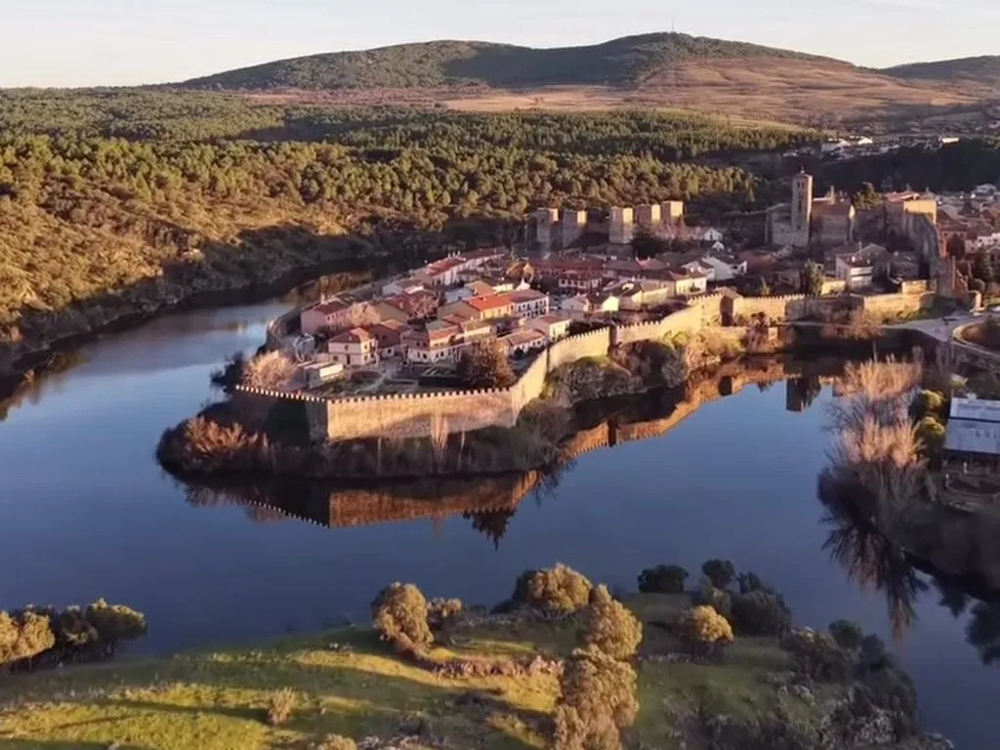
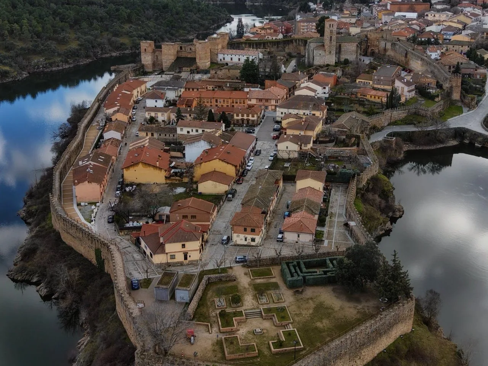
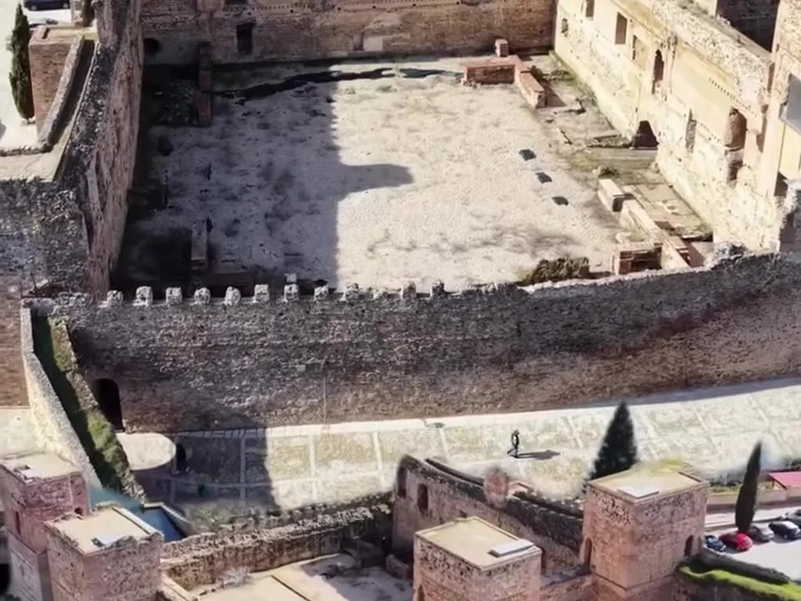
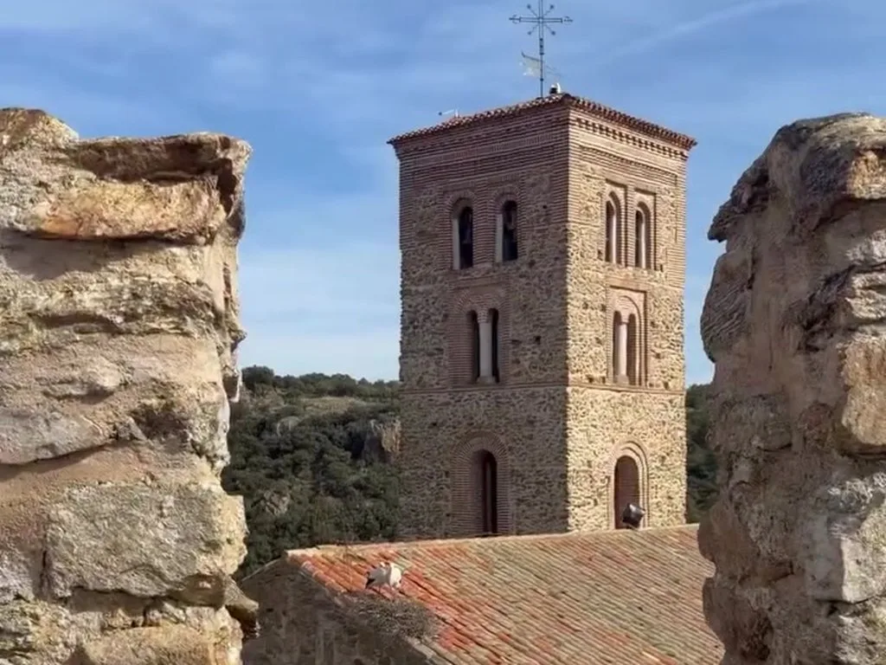
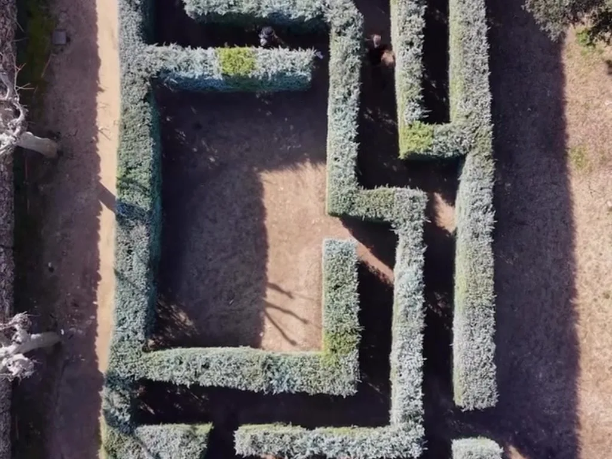

A poco más de una hora de Madrid capital hay un pueblo que conserva algo que ningún otro de la comunidad puede presumir: su muralla medieval completa, casi abrazada por un río. Se llama Buitrago del Lozoya, y es de esas escapadas que no hace falta planear con meses de antelación.

En un vistazo<h2>Lo que vas a encontrar</h2>

<b>🧱</b>Muralla completa

<b>🎨</b>Museo Picasso

<b>🏰</b>Castillo

<b>🌉</b>Río Lozoya

<b>🥾</b>Sierra Norte

Puedes ver el vídeo completo en [este reel de Instagram](https://www.instagram.com/reel/DVO6MY5jNxb/), grabado en Buitrago del Lozoya, Sierra Norte de Madrid.

Qué ver<h2>Qué ver en Buitrago del Lozoya</h2>

<ol class="guide__grid guide__grid--cuenca">
<li class="gcard reveal">
01

<h3>La muralla y el río</h3>
La única <strong>muralla medieval completa</strong> de la Comunidad de Madrid, casi rodeada por el Lozoya. En un día sin viento, el río la refleja como un espejo.

</li>
<li class="gcard reveal">
02

<h3>El recinto amurallado</h3>
Se puede recorrer <strong>buena parte de la muralla a pie</strong>, con vistas al río y al interior del casco histórico.

</li>
<li class="gcard reveal">
03

<h3>El castillo de los Mendoza</h3>
Lo levantó la familia <strong>Mendoza</strong> entre finales del siglo XIV y el XVI. Se dañó mucho en la Guerra de la Independencia.

</li>
<li class="gcard reveal">
04

<h3>Santa María del Castillo</h3>
Iglesia <strong>gótico-mudéjar</strong> de los siglos XIV y XV, con su torre asomando entre los muros. Entrar es gratis.

</li>
<li class="gcard reveal">
05

<h3>El laberinto</h3>
Un pequeño <strong>laberinto de setos</strong> junto al casco histórico: un plan sencillo, sobre todo si vas con niños.

</li>
</ol>

## La única muralla íntegra de la Comunidad de Madrid

Buitrago del Lozoya es el único pueblo de toda la Comunidad de Madrid que conserva su **muralla medieval completa**, rodeada casi por entero por el río Lozoya. Se puede recorrer buena parte de ella a pie, con vistas tanto al río como al interior del casco histórico, y es sin duda el motivo principal para visitar el pueblo.

## Un museo de Picasso nacido de una amistad

Uno de los rincones más curiosos de Buitrago es el **Museo Picasso – Colección Eugenio Arias**, dedicado al pintor malagueño. Su origen no tiene nada que ver con galerías ni subastas: Picasso fue amigo personal del barbero del pueblo, Eugenio Arias, y esa amistad terminó dando forma a una colección única que hoy se puede visitar en pleno casco histórico.

## El río Lozoya y un pequeño laberinto para desconectar

El **río Lozoya** rodea el pueblo y crea un paisaje perfecto para pasear, sentarse un rato o simplemente hacer fotos desde la muralla. En los meses de verano incluso se pueden alquilar canoas para recorrerlo desde el agua. Cerca del casco histórico hay también un pequeño **laberinto**, un plan sencillo pero divertido si vas con niños.

## Cuánto cuesta la visita

Pasear por el pueblo, el museo y buena parte de la muralla es gratuito. Si quieres acceder a la zona de la muralla con armas de asedio, la entrada cuesta 2€ (1€ para mayores de 65 años y gratis para menores de 12). La iglesia también es gratuita, aunque subir al campanario tiene un coste simbólico de 1€.

## Fiestas de Buitrago del Lozoya

**⭐ Belén Viviente.** En Navidad, Buitrago monta <strong>uno de los belenes vivientes más importantes de España</strong>: casi 40 escenas a lo largo de 1,3 km dentro del recinto amurallado, con más de 200 vecinos actuando. Lo visitan más de 25.000 personas cada año. En 2026 se celebra los días **12, 13, 19 y 20 de diciembre** y hace falta entrada (en [belenvivientebuitrago.es](https://belenvivientebuitrago.es)).

**🛡️ Feria Medieval.** El <strong>primer fin de semana de septiembre</strong>, desde 2001, la villa vuelve a la Edad Media: más de 100 puestos de artesanía, teatro, música y pasacalles dentro de la muralla. Es de las ferias medievales con más éxito de Madrid.

<!--actividades-->

<h3>Mi experiencia</h3>
Es uno de mis pueblos favoritos de Madrid. Fíjate en el reflejo de la muralla en el río Lozoya: en un día sin viento parece un espejo y es la mejor foto del pueblo.

<!--enr-->
## Una villa fortificada desde la Antigüedad

Buitrago es uno de los pueblos con más historia de la sierra norte. Los autores antiguos mencionan una fortaleza celtíbera en este meandro del Lozoya, y los visigodos y los musulmanes la reforzaron. Tras la conquista cristiana pasó a Castilla, y en el <strong>siglo XII</strong> se reformó su <strong>muralla</strong>, que se amplió y reformó de nuevo en el siglo XIV. Hoy es una de las murallas más largas y mejor conservadas de la Comunidad de Madrid y es <strong>Monumento Nacional desde 1931</strong>.

En la Edad Media la villa perteneció a la poderosa familia <strong>Mendoza</strong>, que construyó el castillo (entre finales del siglo XIV y el XVI) y promovió la iglesia gótico-mudéjar de <strong>Santa María del Castillo</strong>, del siglo XIV-XV. El castillo se dañó gravemente en la Guerra de la Independencia. Dentro de las murallas hay también un museo con obras del pintor Pablo Picasso.

<!--cerca-->
## Para completar la escapada

<ul class="checklist" style="margin:0 0 1rem;"><li><strong><a href="/blog/hayedo-de-montejo.html">Hayedo de Montejo</a>:</strong> un hayedo Patrimonio de la Humanidad (a unos 30 minutos en coche).</li><li><strong><a href="/blog/puerto-de-la-puebla-sierra-del-rincon.html">Sierra del Rincón</a>:</strong> ruta panorámica por la Sierra del Rincón (a unos 30 minutos en coche).</li><li><strong><a href="/blog/pedraza-que-ver.html">Pedraza</a>:</strong> una villa medieval en Segovia (a menos de una hora en coche).</li><li><strong><a href="/blog/chorrera-de-los-litueros.html">Chorrera de los Litueros</a>:</strong> cascada en Somosierra (a unos 30 minutos en coche).</li></ul>

## Cómo llegar a Buitrago del Lozoya

Buitrago del Lozoya tiene fácil acceso en coche desde Madrid capital, en aproximadamente una hora, con aparcamientos señalizados a la entrada del pueblo. Puedes consultar la ruta en [Google Maps](https://www.google.com/maps/search/?api=1&query=Buitrago%20del%20Lozoya%2C%20Madrid).

## Cuándo ir y qué combinar con la ruta

Cualquier época del año es buena: primavera y otoño son especialmente agradables para pasear, en verano se disfruta del río con más actividad, y en invierno el pueblo tiene un ambiente muy particular, conocido por su belén viviente. Con 2-3 horas puedes ver todo con calma.

Si quieres alargar la escapada, la Sierra Norte de Madrid da para mucho más: pueblos como **Rascafría** o **Patones de Arriba** están cerca, y a solo 15 minutos de Buitrago se esconde la cascada más alta de la Comunidad de Madrid, ideal para combinar en la misma ruta.

Y para seguir explorando la Sierra Norte, en la Sierra del Rincón tienes [Puebla de la Sierra](/blog/puerto-de-la-puebla-sierra-del-rincon.html) y la carretera que sube a su puerto.

<!--faq-->

¿Ya conocías Buitrago del Lozoya? Sígueme en Instagram como [@chenoaventuras](https://www.instagram.com/chenoaventuras/) para descubrir más rincones cerca de Madrid, y échale un vistazo al resto del blog para tu próxima escapada.
