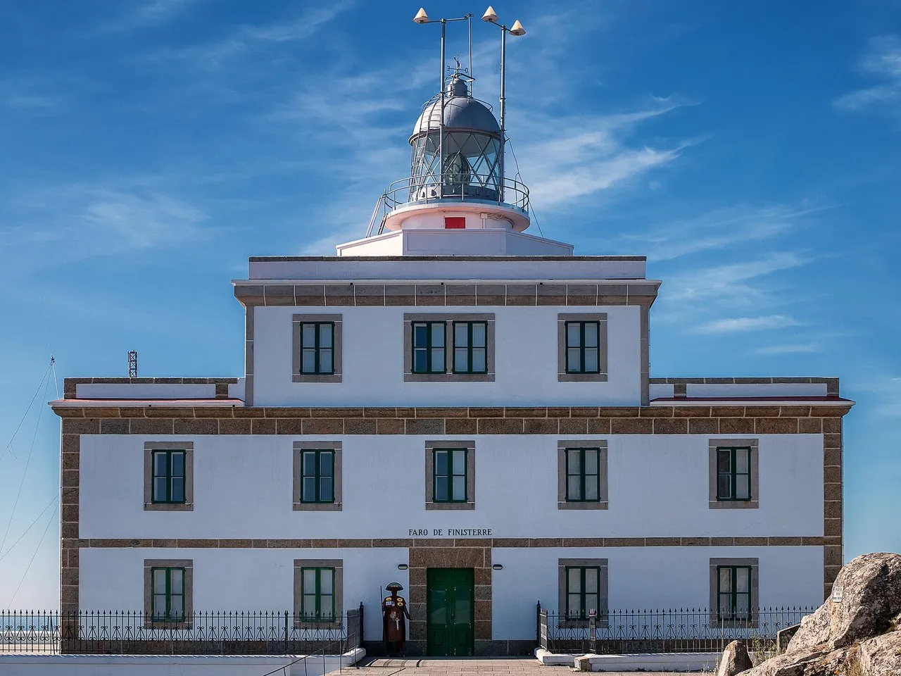
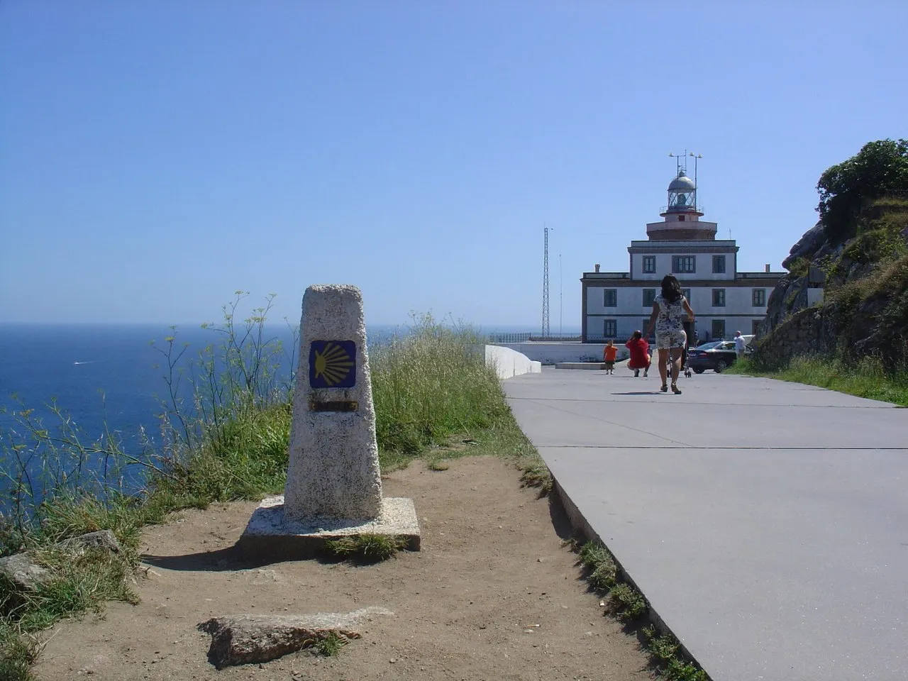
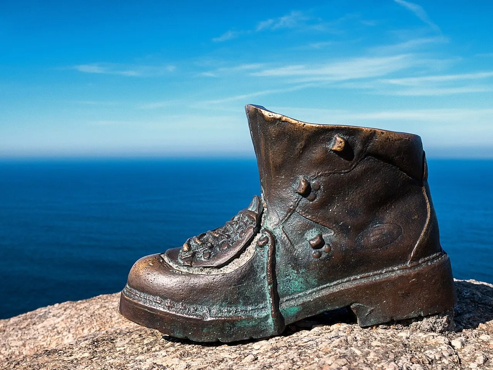
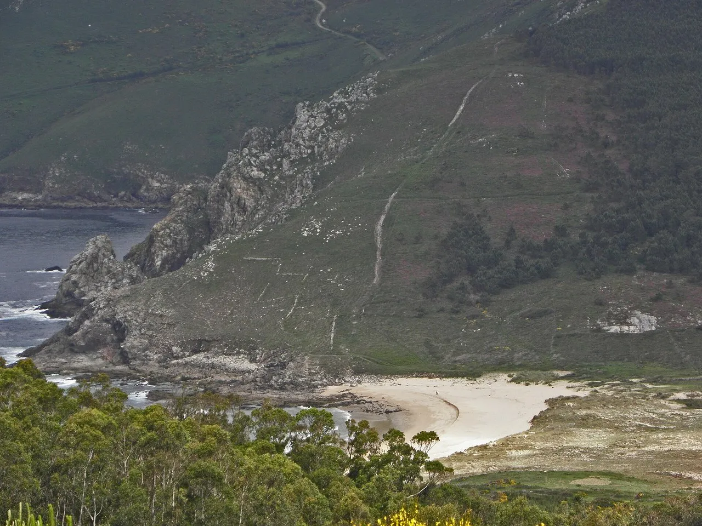
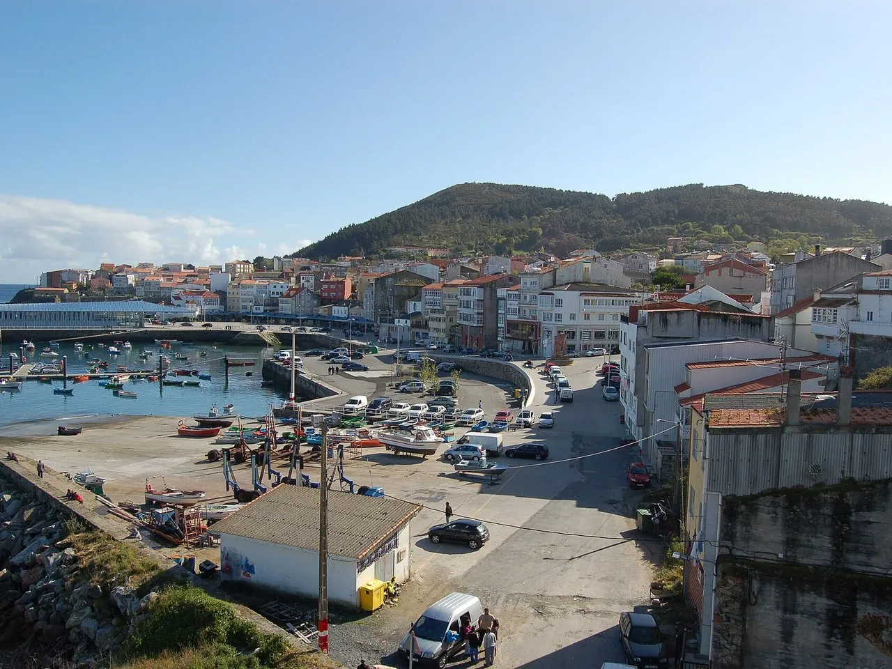
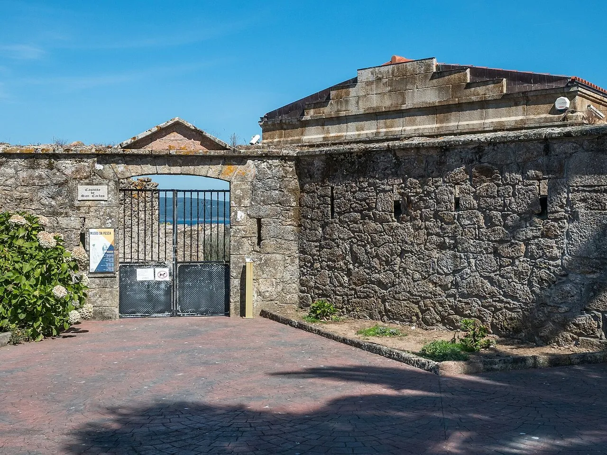

Un faro sobre las rocas, el Atlántico infinito delante y un mojón que marca el **kilómetro 0**. Para los romanos aquí acababa el mundo, y hoy el **Cabo de Fisterra** es el final del camino para muchos peregrinos y uno de los atardeceres más famosos de España.

Te cuento qué ver, cómo llegar desde Santiago y cuándo ir 👇

En un vistazo<h2>Lo que vas a encontrar</h2>

<b>🗼</b>Faro

<b>🥾</b>Km 0 del Camino

<b>🌅</b>Puesta de sol

<b>🌊</b>Costa da Morte

<b>⛰️</b>Monte Facho

Antes de ir<h2>Lo básico del Cabo de Fisterra</h2>

<h3>📍 Dónde está</h3>
En la <strong>Costa da Morte</strong> (A Coruña), a unos <strong>89 km de Santiago</strong> por el Camino.

<h3>💶 Precio</h3>
<strong>Gratis</strong>: el cabo y el entorno del faro son de acceso libre.

<h3>🌅 Cuándo ir</h3>
Al <strong>atardecer</strong>, aunque con niebla o temporal el cabo también impresiona.

<h3>🧥 Qué llevar</h3>
Algo de <strong>abrigo</strong>: el viento del Atlántico sopla fuerte casi todo el año.

Qué ver<h2>Qué ver en el Cabo de Fisterra</h2>

<ol class="guide__grid guide__grid--cuenca">
<li class="gcard reveal">
01

<h3>El faro</h3>
El edificio blanco del faro, sobre las rocas del cabo, es la imagen de Fisterra. Desde su mirador se abre todo el Atlántico.

</li>
<li class="gcard reveal">
02

<h3>El mojón del km 0</h3>
Junto a la carretera del faro, el mojón con la concha que marca el <strong>kilómetro 0,000</strong>. La foto obligada de los peregrinos.

</li>
<li class="gcard reveal">
03

<h3>La bota de bronce</h3>
Sobre una roca, frente al mar, una <strong>bota de peregrino de bronce</strong> recuerda a los que llegan andando hasta aquí.

</li>
<li class="gcard reveal">
04

<h3>La playa de Mar de Fóra</h3>
En la cara abierta al océano, una de las playas <strong>más salvajes de Galicia</strong>. Para pasear y mirar: el mar es muy bravo.

</li>
<li class="gcard reveal">
05

<h3>El pueblo y el puerto</h3>
Fisterra es un pueblo marinero con un puerto lleno de barcas, bueno para comer marisco y pescado antes de subir al cabo.

</li>
<li class="gcard reveal">
06

<h3>El Castillo de San Carlos</h3>
Una pequeña fortaleza junto al puerto, construida para defender la ensenada.

</li>
</ol>

<!--actividades-->

Leyendas<h2>El fin del mundo de los romanos</h2>

Para los romanos, Fisterra era el <strong>finis terrae</strong>, el último trozo de tierra antes del océano desconocido. Según Turismo de Galicia, en el <strong>Monte Facho</strong> (242 m), sobre el cabo, se cree que estaba el <strong>Ara Solis</strong>, un altar donde se celebraban ritos al sol; hoy una plaza del pueblo lleva ese nombre.

<h3>🥾 El final del Camino</h3>
Muchos peregrinos siguen andando desde Santiago hasta Fisterra, unos 89 km. La tradición era quemar la ropa del camino junto al mar, pero hacer fuego en el cabo es peligroso y daña el monte: mejor una foto en el km 0.

Cómo llegar<h2>Cómo llegar al Cabo de Fisterra</h2>

En coche desde <strong>Santiago</strong>, algo menos de hora y media hasta el pueblo de Fisterra; desde allí una carretera estrecha sube al faro. En verano y al atardecer el aparcamiento de arriba se llena: puedes dejar el coche antes y caminar.

<strong>Sin coche:</strong> la forma más cómoda es una excursión desde Santiago, como la de <a href="https://www.civitatis.com/es/santiago-de-compostela/excursion-finisterre-costa-morte/?aid=110968" target="_blank" rel="noopener sponsored">Finisterre, Muxía y la Costa da Morte</a> o la versión <a href="https://www.civitatis.com/es/santiago-de-compostela/excursion-finisterre-costa-morte-grupo-reducido/?aid=110968" target="_blank" rel="noopener sponsored">en grupo reducido</a>. Hay otra con <a href="https://www.civitatis.com/es/santiago-de-compostela/finisterre-mugia-cabo-vilan-barco/?aid=110968" target="_blank" rel="noopener sponsored">paseo en barco y Cabo Vilán</a>.

<a class="btn guide__mapbtn" href="https://www.google.com/maps/dir/?api=1&destination=Faro+de+Fisterra" target="_blank" rel="noopener"><svg class="ico" viewBox="0 0 24 24" width="15" height="15" aria-hidden="true" fill="currentColor"><path d="M12 2a7 7 0 0 0-7 7c0 5.25 7 13 7 13s7-7.75 7-13a7 7 0 0 0-7-7zm0 9.5a2.5 2.5 0 1 1 0-5 2.5 2.5 0 0 1 0 5z"/></svg> Cómo llegar al faro de Fisterra</a>

Consejos de Cheno<h2>Para disfrutarlo al máximo</h2><ul><li><b>Llega antes del atardecer</b> y busca sitio en las rocas del faro.</li><li><b>Cuidado en las rocas</b>: resbalan y el mar golpea fuerte.</li><li><b>Sube al Monte Facho</b> si tienes tiempo: las vistas del cabo desde arriba son otras.</li><li><b>Combínalo con</b> la <a href="/blog/fervenza-do-ezaro.html">Fervenza do Ézaro</a> y el <a href="/blog/horreo-de-carnota.html">hórreo de Carnota</a>, de camino.</li></ul>

⛪ <strong>Antes o después:</strong> la <a href="/blog/catedral-de-santiago.html">Catedral de Santiago</a>.

<!--faq-->

<h2>¿Te gustan estos planes?</h2>
Sígueme en Instagram como <a href="https://www.instagram.com/chenoaventuras/" target="_blank" rel="noopener">@chenoaventuras</a>: subo escapadas como esta cada semana.
<a class="btn guide__btn" href="/blog.html">Ver más planes en el blog</a>

Información consultada en noviembre de 2026 en Turismo de Galicia y el portal oficial del Camino de Santiago. Fotos de Wikimedia Commons: <a href="https://commons.wikimedia.org/wiki/File:Faro_de_Fisterra,_Galiza_(Spain).jpg" target="_blank" rel="noopener">amaianos</a> (CC BY 2.0) · <a href="https://commons.wikimedia.org/wiki/File:Cabo_de_Fisterra_-_Faro_-BT-_01.jpg" target="_blank" rel="noopener">Basotxerri</a> (CC BY-SA 4.0) · <a href="https://commons.wikimedia.org/wiki/File:Km._0_-_Fisterra_-_Camino_2009_-_panoramio.jpg" target="_blank" rel="noopener">Vicente Maza Gómez</a> (CC BY-SA 3.0) · <a href="https://commons.wikimedia.org/wiki/File:Cabo_de_Fisterra_-_Bota_-BT-_01.jpg" target="_blank" rel="noopener">Basotxerri</a> (CC BY-SA 4.0) · <a href="https://commons.wikimedia.org/wiki/File:Praia_de_Mar_de_F%C3%B3ra,_Fisterra.jpg" target="_blank" rel="noopener">amaianos</a> (CC BY 2.0) · <a href="https://commons.wikimedia.org/wiki/File:Vista_Fisterra.jpg" target="_blank" rel="noopener">Adrián Estévez</a> (CC BY-SA 4.0) · <a href="https://commons.wikimedia.org/wiki/File:Fisterra_-_Castillo_de_San_Carlos_-BT-_01.jpg" target="_blank" rel="noopener">Basotxerri</a> (CC BY-SA 4.0).

