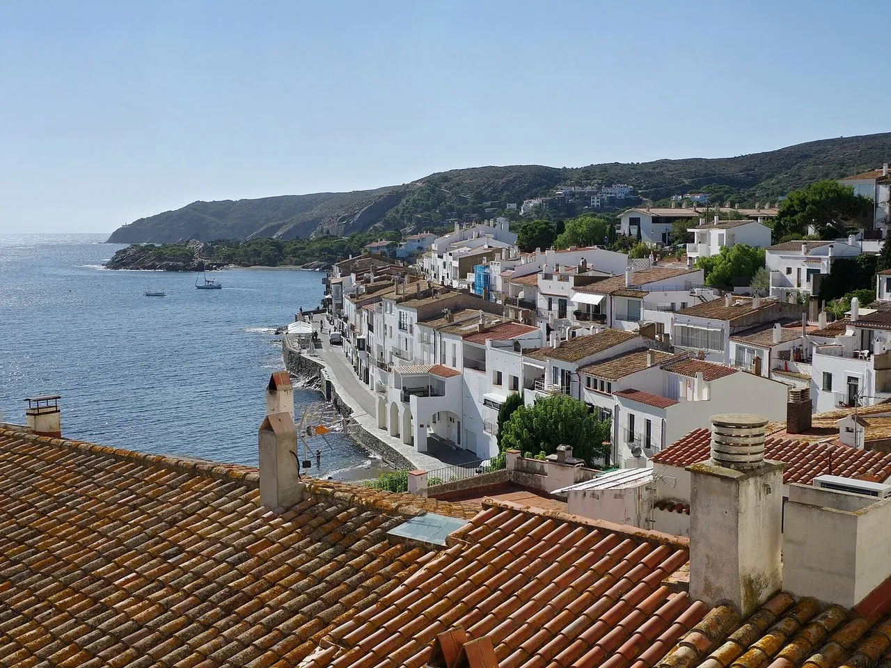
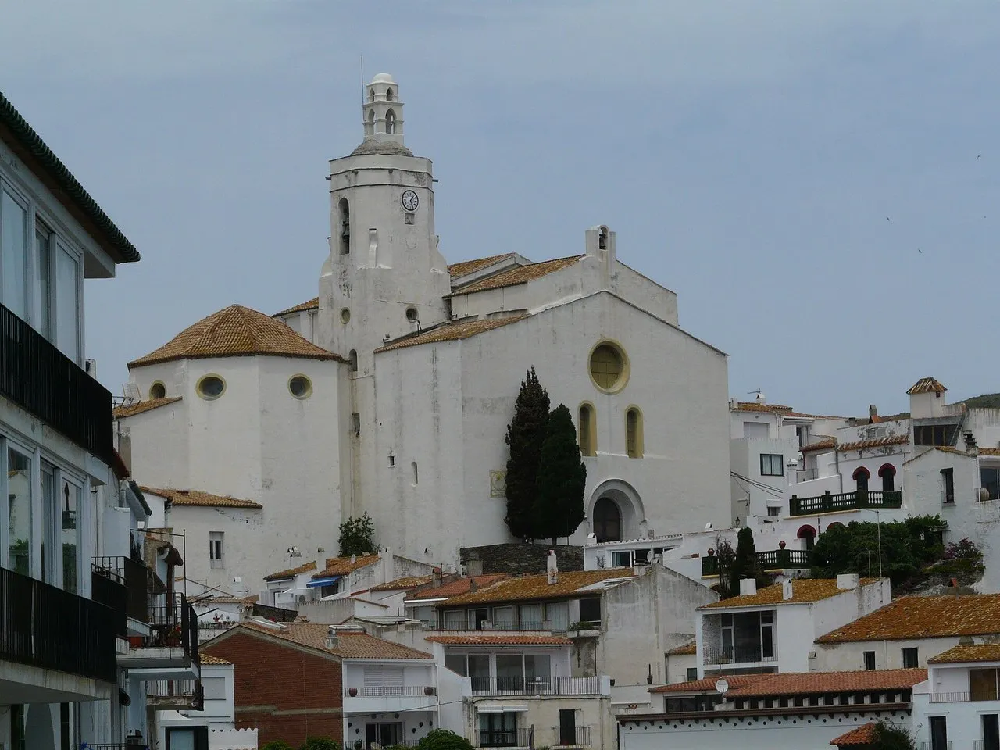
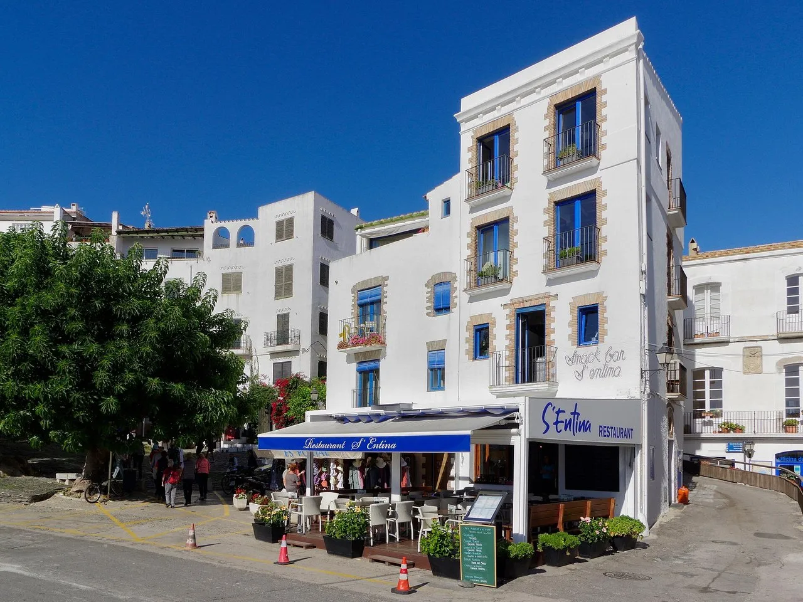
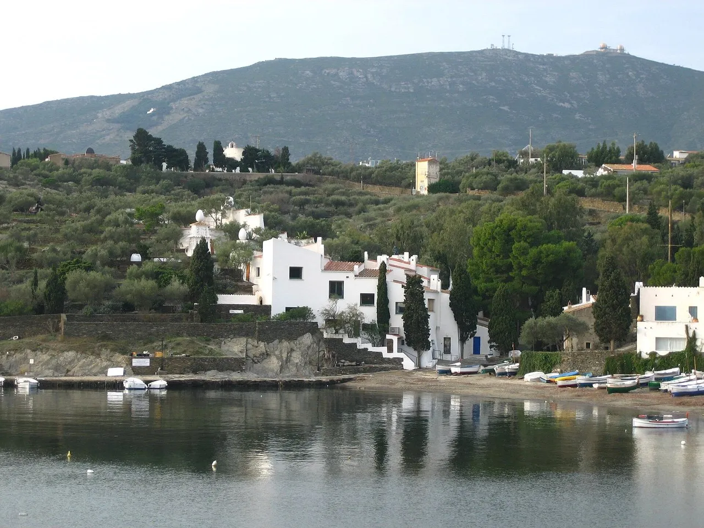
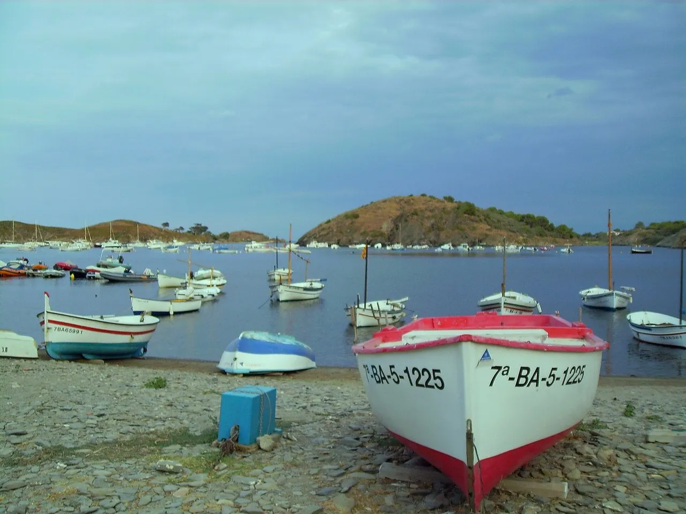
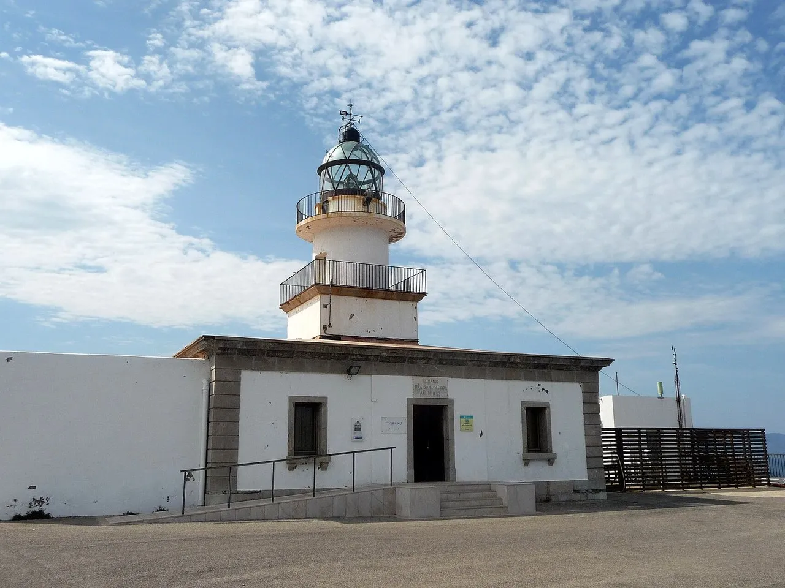

Casas encaladas que bajan hasta el agua, barcas de pescadores varadas en la playa y una iglesia blanca coronando el pueblo. **Cadaqués**, al final de una carretera de curvas en el Cap de Creus, es uno de los pueblos más bonitos de la **Costa Brava** y el rincón que Salvador Dalí eligió para vivir.

Te cuento qué ver, cómo llegar y cómo visitar la casa de Dalí 👇

En un vistazo<h2>Lo que vas a encontrar</h2>

<b>🏘️</b>Pueblo blanco

<b>⛪</b>Iglesia de Santa Maria

<b>🥚</b>Casa de Dalí

<b>🗼</b>Faro del Cap de Creus

<b>🌊</b>Calas y paseo

Antes de ir<h2>Lo básico de Cadaqués</h2>

<h3>📍 Dónde está</h3>
En el extremo noreste de <strong>Girona</strong>, dentro del Parque Natural del Cap de Creus.

<h3>🚗 Cómo llegar</h3>
Por la <strong>GI-614</strong> desde Roses, con curvas. Aparca a la entrada del pueblo: el centro es peatonal y estrecho.

<h3>🥚 Casa de Dalí</h3>
<strong>Reserva obligatoria</strong>. General 15,50 € (18,50 € en julio y agosto).

<h3>⏱️ Tiempo</h3>
<strong>Un día</strong> para el pueblo, Portlligat y el Cap de Creus.

Qué ver<h2>Qué ver en Cadaqués</h2>

<ol class="guide__grid guide__grid--cuenca">
<li class="gcard reveal">
01

<h3>El casco antiguo</h3>
Calles empinadas empedradas con pizarra, puertas de colores, buganvillas y galerías de arte. Piérdete subiendo hacia la iglesia.

</li>
<li class="gcard reveal">
02

<h3>La iglesia de Santa Maria</h3>
La silueta blanca que se ve desde todo el pueblo. Dentro guarda un gran <strong>retablo barroco dorado</strong>; desde su explanada hay de las mejores vistas de la bahía.

</li>
<li class="gcard reveal">
03

<h3>El paseo y las playas</h3>
Recorre la orilla de la playa Gran a la de Es Llané: barcas varadas, terrazas y pequeñas calas de piedra para bañarte en verano.

</li>
<li class="gcard reveal">
04

<h3>La Casa de Dalí en Portlligat</h3>
La casa-taller donde Dalí vivió durante cuarenta años, con los <strong>huevos gigantes</strong> en el tejado. Te lo cuento todo en <a href="/blog/casa-dali-portlligat.html">la Casa de Dalí en Portlligat</a>.

</li>
<li class="gcard reveal">
05

<h3>La bahía de Portlligat</h3>
Una pequeña ensenada con barcas de pescadores, a un paseo de Cadaqués. Si no tienes entrada para la casa, sus alrededores se pueden ver por fuera.

</li>
<li class="gcard reveal">
06

<h3>El faro del Cap de Creus</h3>
El <strong>punto más oriental de la península</strong>, con rocas de formas imposibles que inspiraron a Dalí. Más en <a href="/blog/cabo-de-creus.html">el Cabo de Creus</a>.

</li>
</ol>

<!--actividades-->

Dalí<h2>Visitar la Casa de Dalí: precios y horario</h2>

<ul class="guide__prices"><li><strong>General (casa y olivar):</strong> 15,50 €; en julio y agosto, 18,50 €</li><li><strong>Reducida:</strong> 12 €; en julio y agosto, 14 €</li><li><strong>Solo el olivar:</strong> 8 € (reducida 6 €)</li><li><strong>Gratis:</strong> menores de 9 años</li></ul>
<strong>Horario:</strong> de noviembre a marzo, de martes a domingo de 10:30 a 18:00; de abril a mediados de junio y de mediados de septiembre a octubre, todos los días de 10:30 a 18:00; en pleno verano (15 de junio-13 de septiembre), todos los días de 9:30 a 20:00. Cierra unas semanas en invierno (en 2026, del 7 de enero al 11 de febrero).

Si vienes desde Barcelona, el <a href="https://www.civitatis.com/es/barcelona/tour-dali-cadaques-figueras-portlligat/?aid=110968" target="_blank" rel="noopener sponsored">tour de Dalí por Cadaqués, Figueras y Portlligat</a> lo junta todo en un día.

Consejos de Cheno<h2>Para disfrutarlo al máximo</h2><ul><li><b>Reserva la Casa de Dalí</b> antes de ir: no se puede entrar sin hora.</li><li><b>Deja el coche</b> en el aparcamiento de la entrada y baja andando.</li><li><b>Calzado cómodo</b>: el suelo de pizarra resbala y todo son cuestas.</li><li><b>Ve al Cap de Creus</b> al atardecer.</li><li><b>Completa el triángulo daliniano</b> con el <a href="/blog/teatro-museo-dali-figueres.html">Teatro-Museo Dalí de Figueres</a>, y sigue por <a href="/blog/girona-que-ver.html">Girona</a> o <a href="/blog/besalu-que-ver.html">Besalú</a>.</li></ul>

<!--faq-->

<h2>¿Te gustan estos planes?</h2>
Sígueme en Instagram como <a href="https://www.instagram.com/chenoaventuras/" target="_blank" rel="noopener">@chenoaventuras</a>: subo escapadas como esta cada semana.
<a class="btn guide__btn" href="/blog.html">Ver más planes en el blog</a>

Precios y horarios de la Casa Salvador Dalí consultados en noviembre de 2026 en la web oficial de la Fundació Gala-Salvador Dalí. Fotos de Wikimedia Commons: <a href="https://commons.wikimedia.org/wiki/File:Cadaqu%C3%A9s_BW_2019-10-08_11-44-03.jpg" target="_blank" rel="noopener">Berthold Werner</a> (CC BY-SA 4.0) · <a href="https://commons.wikimedia.org/wiki/File:Cadaqu%C3%A9s_BW_2019-10-08_11-14-46.jpg" target="_blank" rel="noopener">Berthold Werner</a> (CC BY-SA 4.0) · <a href="https://commons.wikimedia.org/wiki/File:Esgl%C3%A9sia_de_Santa_Maria_de_Cadaqu%C3%A9s_P1130278.JPG" target="_blank" rel="noopener">Pere López</a> (CC BY-SA 3.0) · <a href="https://commons.wikimedia.org/wiki/File:Cadaqu%C3%A9s_BW_2019-10-08_11-07-25.jpg" target="_blank" rel="noopener">Berthold Werner</a> (CC BY-SA 4.0) · <a href="https://commons.wikimedia.org/wiki/File:Casa_Salvador_Dal%C3%AD_Portlligat.JPG" target="_blank" rel="noopener">CGE</a> (CC BY-SA 3.0) · <a href="https://commons.wikimedia.org/wiki/File:Cadaqu%C3%A9s_portlligat_2.JPG" target="_blank" rel="noopener">Antonio De Lorenzo, Marina Ventayol</a> (CC BY 2.5) · <a href="https://commons.wikimedia.org/wiki/File:Far_del_cap_de_creus_-_panoramio.jpg" target="_blank" rel="noopener">Olga Gairin</a> (CC BY-SA 3.0).

