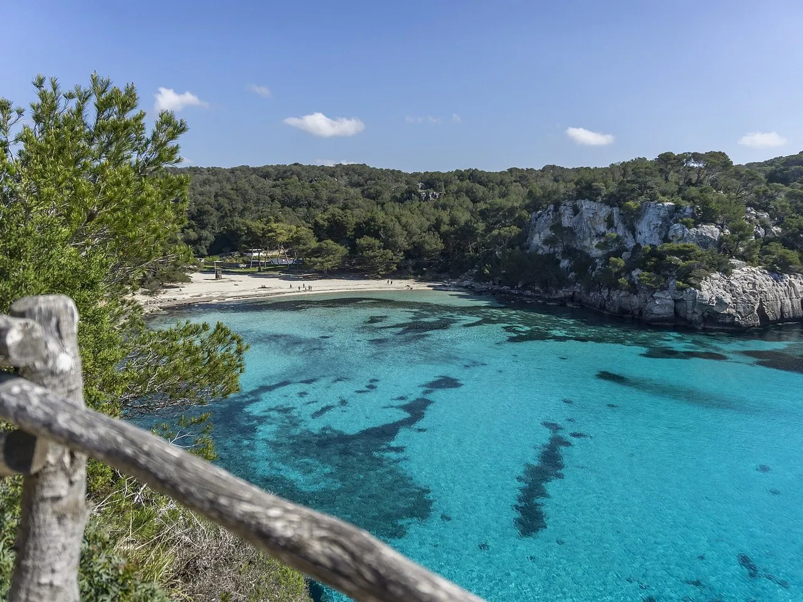
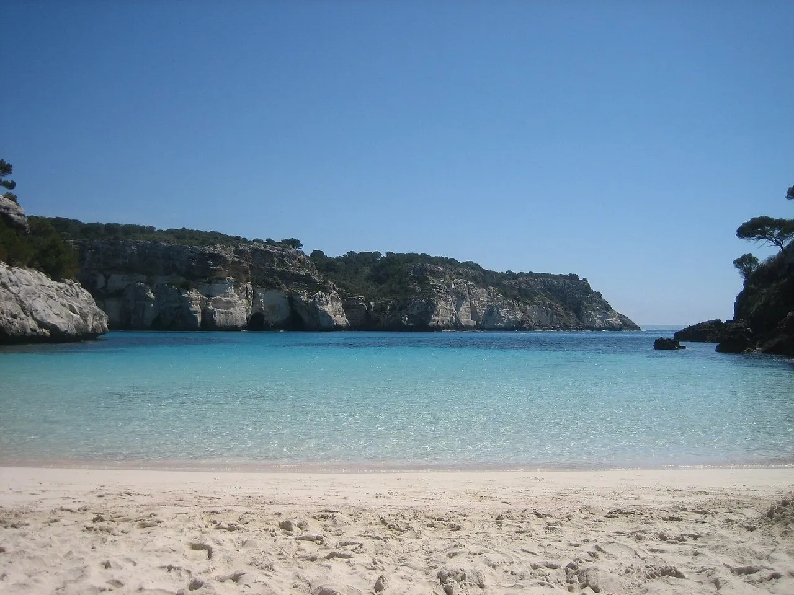
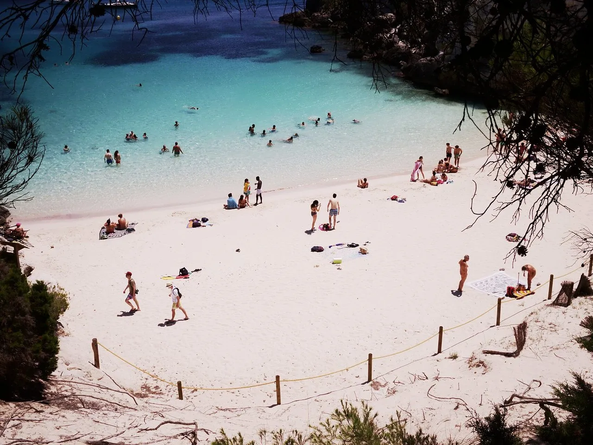
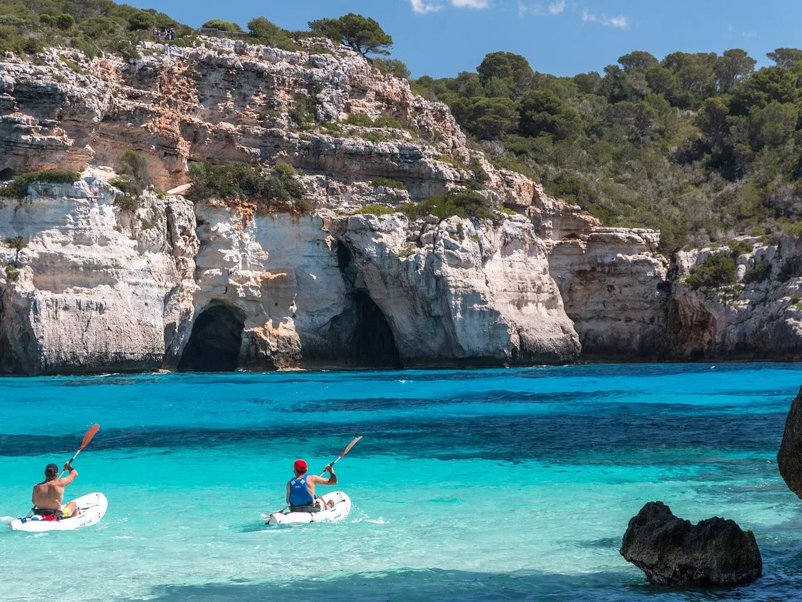
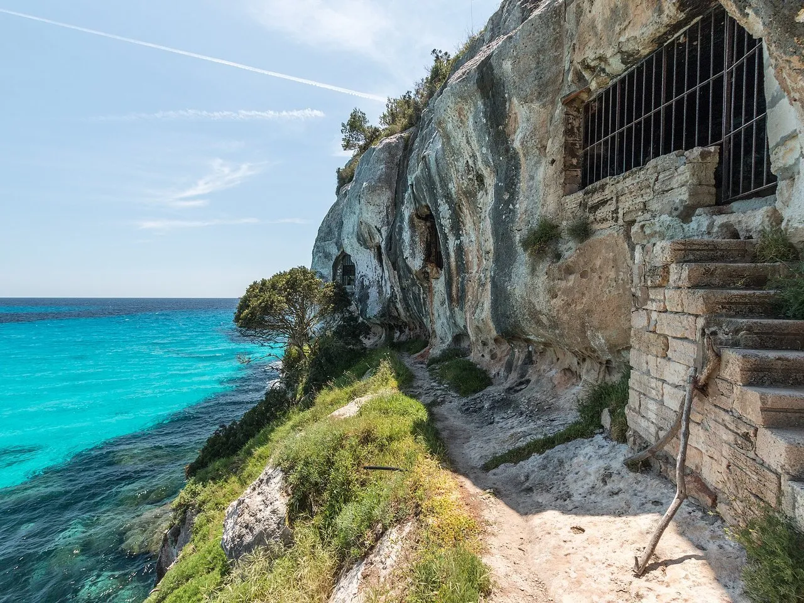
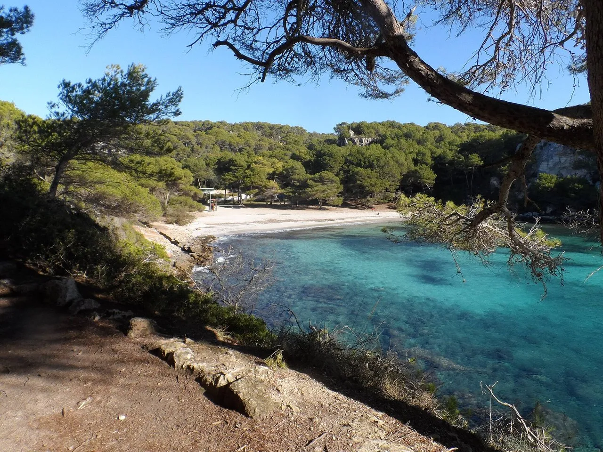

Arena blanca, agua turquesa, pinos que llegan hasta la orilla y acantilados de piedra clara a los lados. **Cala Macarella** es la postal de **Menorca**, y a diez minutos andando tiene a su hermana pequeña, **Macarelleta**, todavía más recogida.

Te cuento cómo llegar (ojo con el verano), cómo pasar a Macarelleta y cómo disfrutarlas sin agobios 👇

En un vistazo<h2>Lo que vas a encontrar</h2>

<b>🏖️</b>Arena blanca

<b>💧</b>Agua turquesa

<b>🌲</b>Pinar hasta la orilla

<b>🥾</b>Camí de Cavalls

<b>🚌</b>Bus en verano

Antes de ir<h2>Lo básico de Cala Macarella</h2>

<h3>📍 Dónde está</h3>
En la <strong>costa sur de Menorca</strong>, en el término de Ciutadella, entre Cala en Turqueta y Cala Galdana.

<h3>🚌 En verano</h3>
Desde 2018 el acceso en coche se <strong>restringe en temporada alta</strong>: lo normal es ir en el <strong>bus desde Ciutadella</strong>.

<h3>🚗 Fuera de temporada</h3>
Se puede llegar en coche al <strong>aparcamiento</strong> (unas 160 plazas) y bajar andando unos minutos por el pinar.

<h3>⏰ Cuándo ir</h3>
<strong>Primera hora</strong> o <strong>última de la tarde</strong>. En junio y septiembre el agua ya está buena y hay mucha menos gente.

Qué ver<h2>Qué ver en Macarella y Macarelleta</h2>

<ol class="guide__grid guide__grid--cuenca">
<li class="gcard reveal">
01

<h3>Cala Macarella</h3>
Una cala amplia de <strong>arena blanca</strong> encajada entre acantilados, con el pinar llegando casi al agua. El fondo es de arena y el agua, muy transparente.

</li>
<li class="gcard reveal">
02

<h3>Cala Macarelleta</h3>
La pequeña, a unos <strong>10 minutos</strong> por el sendero del lado oeste. Más recogida y tradicionalmente nudista.

</li>
<li class="gcard reveal">
03

<h3>Las vistas desde arriba</h3>
El camino entre las dos calas tiene varios puntos donde asomarse: desde arriba se ve el color del agua como en las fotos.

</li>
<li class="gcard reveal">
04

<h3>Acantilados y cuevas desde el agua</h3>
Los acantilados que cierran la cala tienen <strong>cuevas y arcos</strong> que se ven mejor en kayak o en barco.

</li>
<li class="gcard reveal">
05

<h3>Las cuevas excavadas</h3>
En las paredes cercanas hay <strong>cuevas excavadas en la roca</strong>, algunas de origen prehistórico, que más tarde se usaron como refugio.

</li>
<li class="gcard reveal">
06

<h3>El Camí de Cavalls</h3>
El sendero que da la vuelta a Menorca pasa por aquí: hacia el este llega a <strong>Cala Galdana</strong> y hacia el oeste, a <strong>Cala en Turqueta</strong>.

</li>
</ol>

<!--actividades-->

Cómo llegar<h2>Cómo llegar a Cala Macarella</h2>

<h3>🚌 En bus (temporada alta)</h3>
Desde <strong>Ciutadella</strong> sale un autobús lanzadera a Macarella mientras el aparcamiento está cerrado a los coches. Consulta horarios y precio del año antes de ir.

<h3>🚗 En coche (fuera de temporada)</h3>
Desde Ciutadella hay unos <strong>14 km</strong> hasta el aparcamiento. Cuando el bus funciona, el parking se cierra a los particulares.

<h3>🥾 A pie</h3>
Por el <strong>Camí de Cavalls</strong> desde Cala Galdana o Cala en Turqueta. Lleva agua y calzado cómodo: hay subidas y bajadas por roca.

<h3>⛵ En barco</h3>
La forma más cómoda en verano: un <a href="https://www.civitatis.com/es/cala-galdana/paseo-barco-cala-galdana/?aid=110968" target="_blank" rel="noopener sponsored">paseo en barco por las calas del sur</a> o una <a href="https://www.civitatis.com/es/cala-galdana/snorkel-macarella-cala-trebaluger/?aid=110968" target="_blank" rel="noopener sponsored">excursión de snorkel en Macarella y Trebalúger</a>, ambos desde Cala Galdana.

<a class="btn guide__mapbtn" href="https://www.google.com/maps/dir/?api=1&destination=Cala+Macarella+Menorca" target="_blank" rel="noopener"><svg class="ico" viewBox="0 0 24 24" width="15" height="15" aria-hidden="true" fill="currentColor"><path d="M12 2a7 7 0 0 0-7 7c0 5.25 7 13 7 13s7-7.75 7-13a7 7 0 0 0-7-7zm0 9.5a2.5 2.5 0 1 1 0-5 2.5 2.5 0 0 1 0 5z"/></svg> Cómo llegar a Cala Macarella</a>

Consejos de Cheno<h2>Para disfrutarla al máximo</h2><ul><li><b>Madruga</b>: con el primer bus o a primera hora, la cala es otra.</li><li><b>Lleva agua y comida</b>: los servicios son muy limitados.</li><li><b>Escarpines y gafas de snorkel</b> para las rocas de los extremos.</li><li><b>Respeta el entorno</b>: Menorca es Reserva de la Biosfera desde 1993; no te lleves arena ni piedras.</li><li><b>Combínala con</b> <a href="/blog/ciutadella-que-ver.html">Ciutadella</a> y el resto de <a href="/blog/menorca-calas.html">calas de Menorca</a>.</li></ul>

<!--faq-->

<h2>¿Te gustan estos planes?</h2>
Sígueme en Instagram como <a href="https://www.instagram.com/chenoaventuras/" target="_blank" rel="noopener">@chenoaventuras</a>: subo escapadas como esta cada semana.
<a class="btn guide__btn" href="/blog.html">Ver más planes en el blog</a>

Información consultada en noviembre de 2026. Las condiciones de acceso, el bus y el aparcamiento cambian cada temporada: confírmalas con el Ayuntamiento de Ciutadella o el Consell Insular de Menorca. Fotos de Wikimedia Commons: <a href="https://commons.wikimedia.org/wiki/File:Cala_Macarella_(16418874921).jpg" target="_blank" rel="noopener">Markus Trienke</a> (CC BY-SA 2.0) · <a href="https://commons.wikimedia.org/wiki/File:Cala_Macarella_2.jpg" target="_blank" rel="noopener">Marcelsala007</a> (CC BY-SA 3.0) · <a href="https://commons.wikimedia.org/wiki/File:Macarelleta.JPG" target="_blank" rel="noopener">Seruba</a> (CC BY-SA 3.0) · <a href="https://commons.wikimedia.org/wiki/File:Cala_Macarelleta_-_50130712267.jpg" target="_blank" rel="noopener">Nicolas Vigier</a> (CC0) · <a href="https://commons.wikimedia.org/wiki/File:Canoeing_near_Cala_Macarelleta_(16394689686).jpg" target="_blank" rel="noopener">Markus Trienke</a> (CC BY-SA 2.0) · <a href="https://commons.wikimedia.org/wiki/File:Man-made_caves_near_Cala_Macarella_(16394774576).jpg" target="_blank" rel="noopener">Markus Trienke</a> (CC BY-SA 2.0) · <a href="https://commons.wikimedia.org/wiki/File:Cala_Macarella_en_hiver.JPG" target="_blank" rel="noopener">Perri.G</a> (CC BY-SA 3.0).

