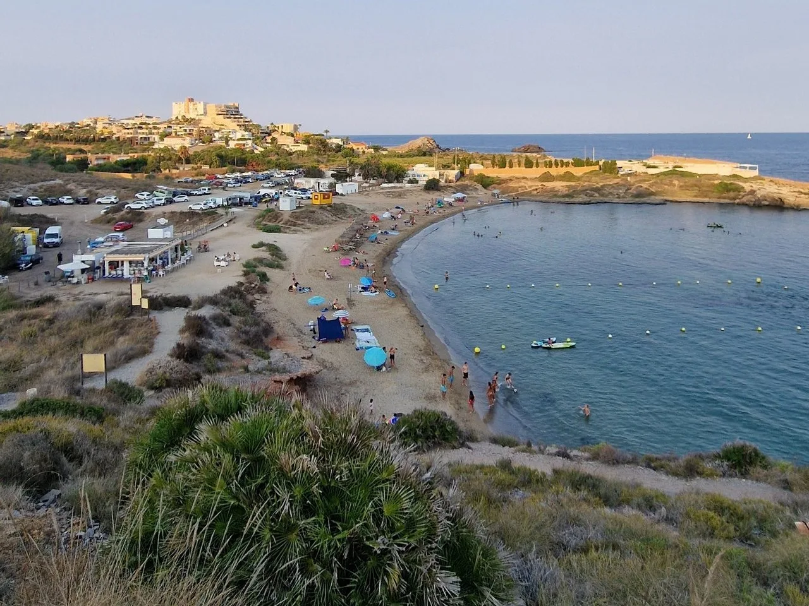
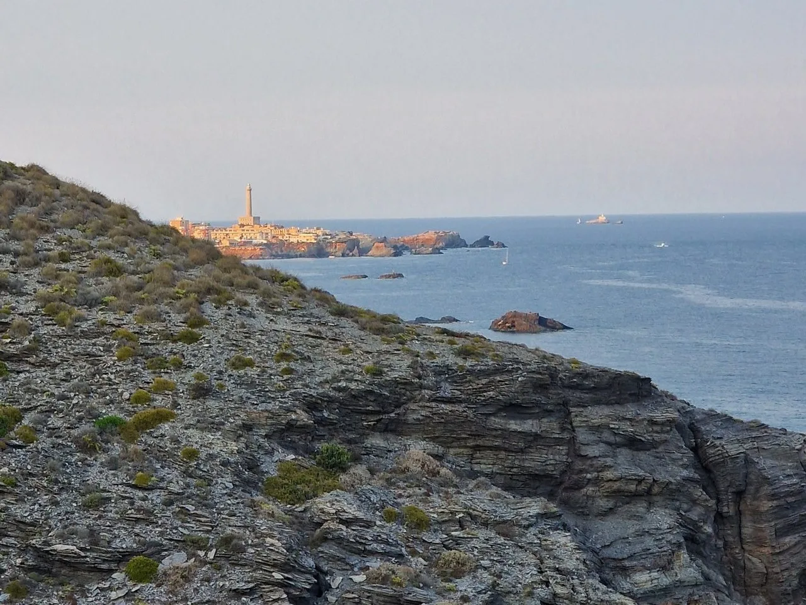
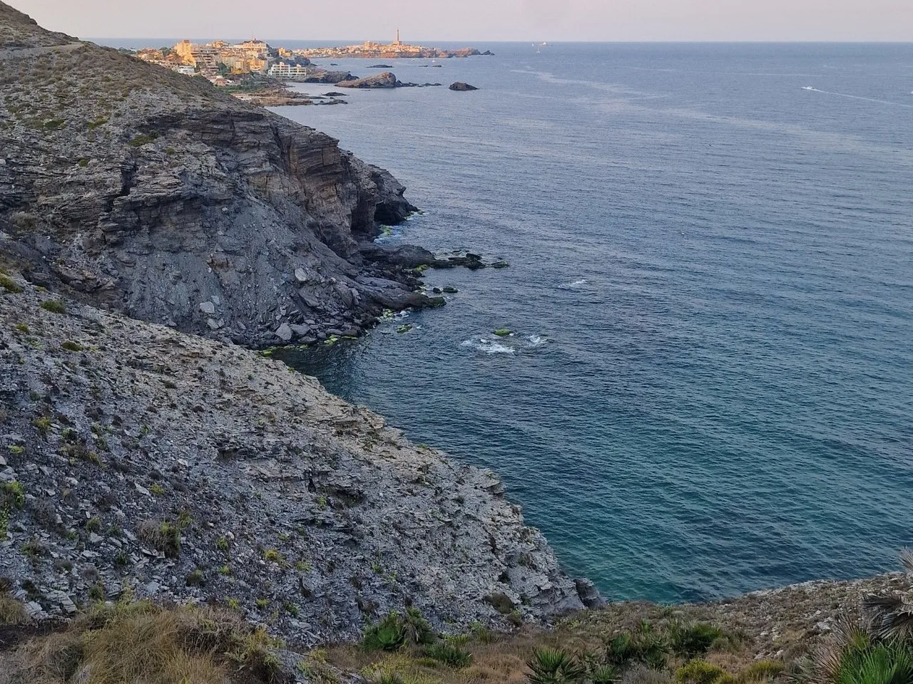
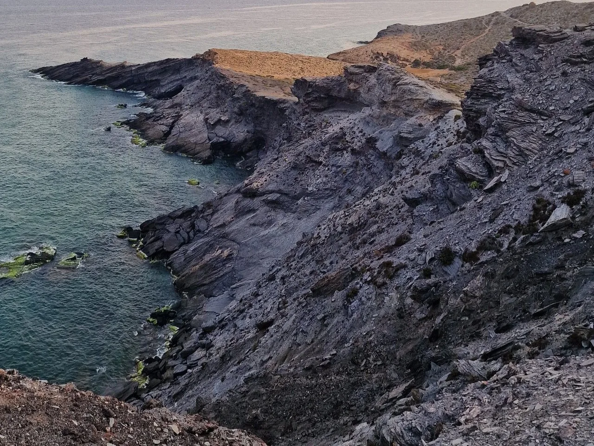

En el extremo de **Cabo de Palos**, justo donde empieza el **Parque Regional de Calblanque**, hay una cala en forma de media luna con **arena fina dorada** y aguas muy tranquilas. Es **Cala Reona**: más recogida que las playas de La Manga y con algo que pocas calas tienen, el **faro de Cabo de Palos** a la vista desde los senderos que la rodean.

Te cuento cómo llegar y qué hacer 👇

En un vistazo<h2>Lo que vas a encontrar</h2>

<b>🏖️</b>Arena dorada

<b>🌊</b>Aguas tranquilas

<b>🗼</b>Vistas al faro

<b>🥾</b>Senderos de costa

<b>🅿️</b>Parking gratis

Antes de ir<h2>Lo básico de Cala Reona</h2>

<h3>📍 Dónde está</h3>
En el extremo <strong>suroeste de Cabo de Palos</strong> (Cartagena), junto a Calblanque.

<h3>📏 Cómo es</h3>
Unos <strong>200 metros</strong> de arena fina, con agua potable y aseos.

<h3>🅿️ Aparcamiento</h3>
Gratuito, pero en verano <strong>se llena pronto</strong>. Llega temprano.

Qué ver<h2>Qué ver en Cala Reona</h2>

<ol class="guide__grid guide__grid--cuenca">
<li class="gcard reveal">
01

<h3>La cala</h3>
Arena fina en forma de <strong>media luna</strong> y agua sin apenas oleaje. Perfecta para ir con niños.

</li>
<li class="gcard reveal">
02

<h3>Las vistas al faro</h3>
Desde los senderos de alrededor se ve el <strong>faro de Cabo de Palos</strong>. Al atardecer, la foto es preciosa.

</li>
<li class="gcard reveal">
03

<h3>La costa de roca</h3>
A los lados de la cala, <strong>rocas oscuras</strong> y pequeñas calitas. El fondo marino es una reserva muy rica.

</li>
<li class="gcard reveal">
04

<h3>La entrada a Calblanque</h3>
Aquí empieza el <strong>Parque Regional de Calblanque</strong>: calas vírgenes sin servicios. Lleva agua.

</li>
</ol>

Cómo llegar<h2>Cómo llegar a Cala Reona</h2>

Desde la autovía <strong>A-37</strong> (Alicante-Cartagena), toma la salida 800 hacia la MU-312, dirección La Manga y Cabo de Palos. Al llegar a Cabo de Palos, en vez de ir hacia el pueblo, sigue hacia el sur. Hay <strong>autobuses</strong> entre Cartagena y La Manga con parada cerca.

<a class="btn guide__mapbtn" href="https://www.google.com/maps/dir/?api=1&destination=37.6264,-0.7066" target="_blank" rel="noopener"><svg class="ico" viewBox="0 0 24 24" width="15" height="15" aria-hidden="true" fill="currentColor"><path d="M12 2a7 7 0 0 0-7 7c0 5.25 7 13 7 13s7-7.75 7-13a7 7 0 0 0-7-7zm0 9.5a2.5 2.5 0 1 1 0-5 2.5 2.5 0 0 1 0 5z"/></svg> Cómo llegar en Google Maps</a>

Muy cerca puedes hacer <a href="/blog/snorkel-cabo-de-palos.html">snorkel en Cabo de Palos</a> o visitar <a href="/blog/cartagena-que-ver.html">Cartagena</a>.

Consejos de Cheno<h2>Para disfrutarla al máximo</h2><ul><li><b>Llega temprano</b> en verano: el parking se llena.</li><li><b>Quédate al atardecer</b> y sube por los senderos para ver el faro.</li><li><b>Lleva gafas de snorkel</b>: el fondo merece la pena.</li><li><b>Respeta Calblanque</b>: no dejes nada y no salgas de los caminos.</li></ul>

<!--actividades-->

<!--faq-->

<h2>¿Te gustan estos planes?</h2>
Sígueme en Instagram como <a href="https://www.instagram.com/chenoaventuras/" target="_blank" rel="noopener">@chenoaventuras</a>: subo escapadas como esta cada semana.
<a class="btn guide__btn" href="/blog.html">Ver más planes en el blog</a>

Información consultada en noviembre de 2026 (Instituto de Turismo de la Región de Murcia). Fotos: Chenoaventuras.

