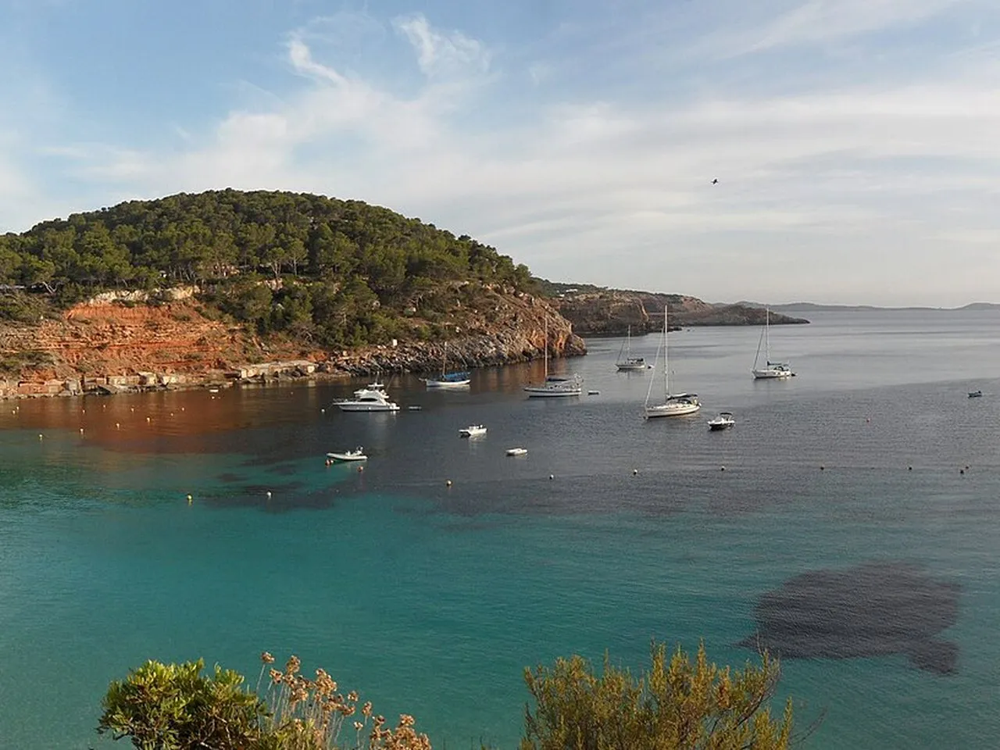
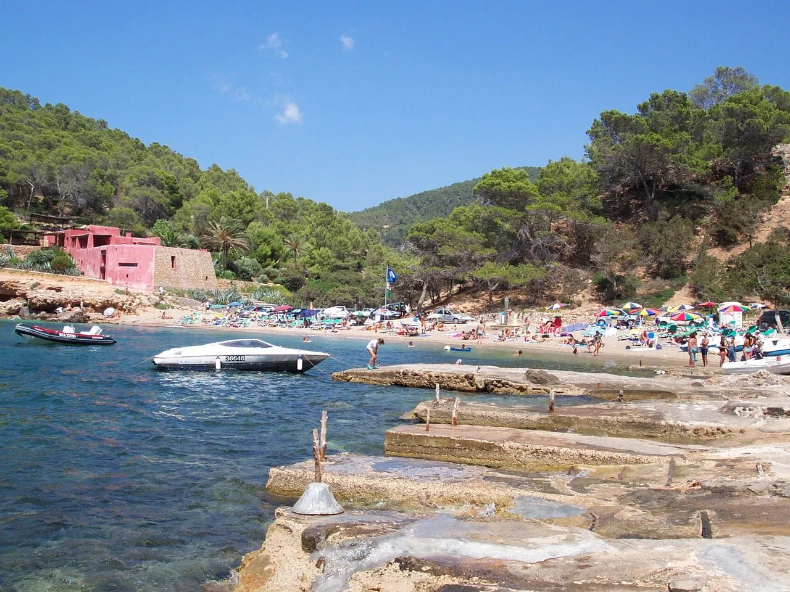
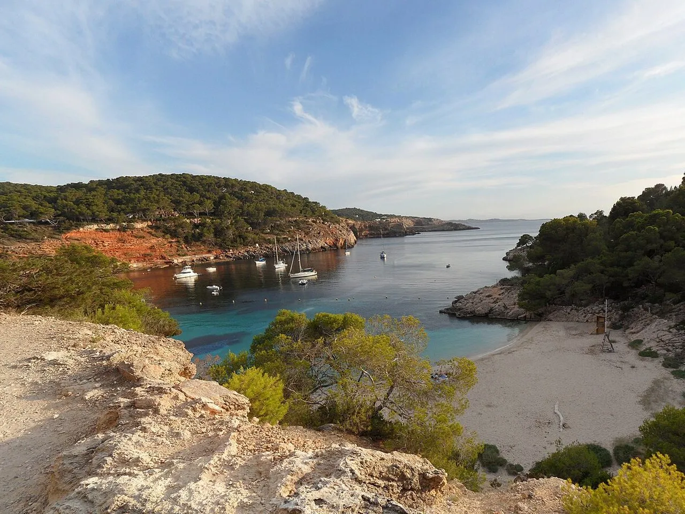
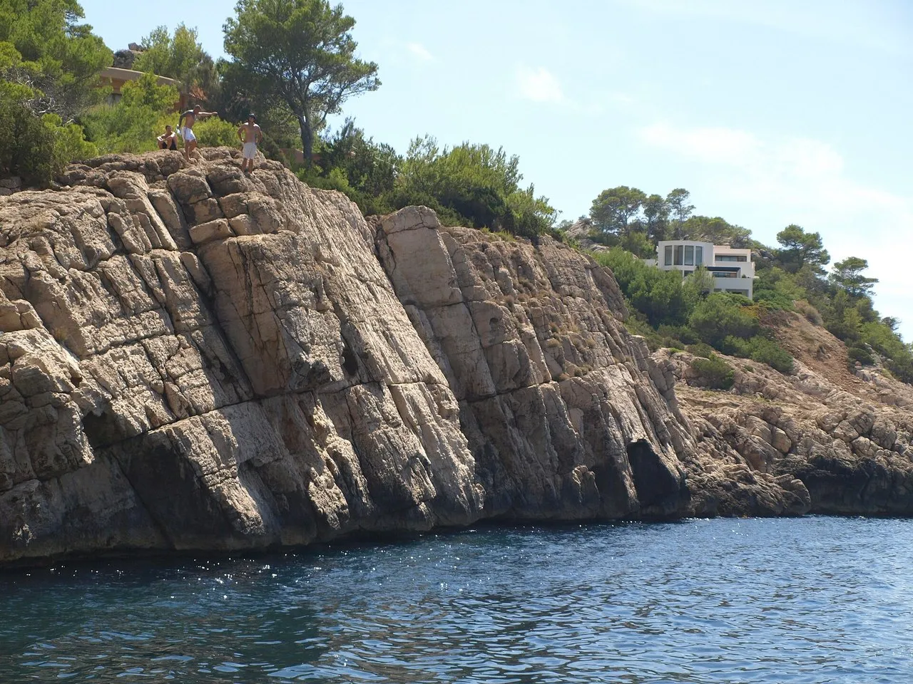
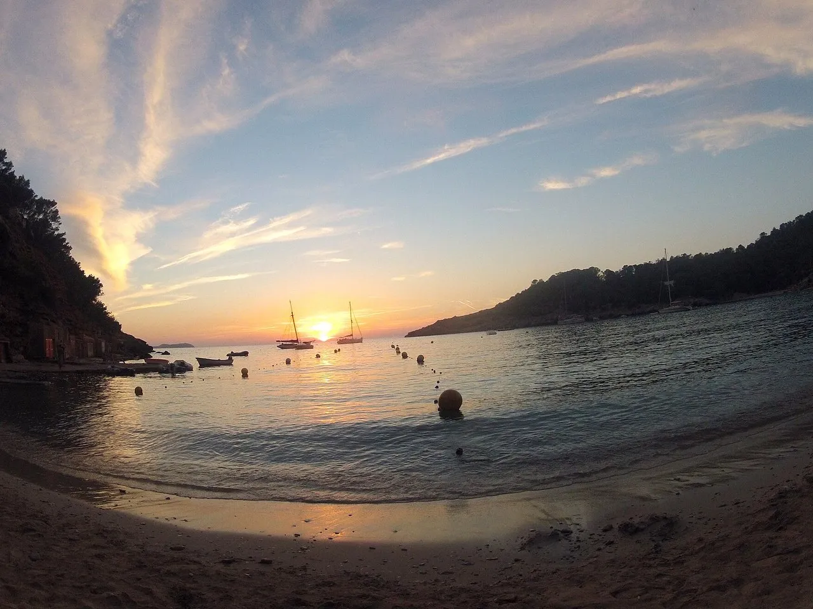

Agua turquesa que se ve desde lo alto de la carretera, un pinar que baja hasta el mar y unas casetas de pescadores de madera sobre las rocas. **Cala Salada** es de las calas más bonitas de **Ibiza**, y a cinco minutos andando tiene a su vecina **Cala Saladeta**, todavía más pequeña.

Te cuento cómo llegar (ojo con el coche en verano), cómo pasar a Saladeta y cuándo ir 👇

En un vistazo<h2>Lo que vas a encontrar</h2>

<b>💧</b>Agua turquesa

<b>🌲</b>Pinar

<b>⛵</b>Casetas de pescadores

<b>🌅</b>Atardecer

<b>🚌</b>Bus y barco

Antes de ir<h2>Lo básico de Cala Salada</h2>

<h3>📍 Dónde está</h3>
En la costa oeste de Ibiza, a pocos kilómetros al norte de <strong>Sant Antoni de Portmany</strong>.

<h3>🚗 Acceso en coche</h3>
En temporada (en 2026, desde el <strong>1 de mayo</strong>) el Ayuntamiento <strong>controla el acceso</strong>, y el parking de la cala tiene solo unas <strong>65 plazas</strong>.

<h3>🚌 Alternativas</h3>
<strong>Bus</strong> desde la estación de Sant Antoni (parada en el parking de Can Coix) o <strong>barco</strong> desde el puerto de Sant Antoni.

<h3>⏰ Cuándo ir</h3>
A primera hora o al <strong>atardecer</strong>. En junio y septiembre el agua está buena y hay menos gente.

Qué ver<h2>Qué ver en Cala Salada y Saladeta</h2>

<ol class="guide__grid guide__grid--cuenca">
<li class="gcard reveal">
01

<h3>La bahía turquesa</h3>
Desde lo alto del camino ya se ve el color del agua y los barcos fondeados en la bahía. El fondo de arena y roca la hace perfecta para el <strong>snorkel</strong>.

</li>
<li class="gcard reveal">
02

<h3>Las casetas de pescadores</h3>
Junto a la playa están los <strong>varaderos</strong> tradicionales, donde los pescadores guardaban las barcas, y unas rocas planas que se usan como solárium.

</li>
<li class="gcard reveal">
03

<h3>Cala Saladeta</h3>
La pequeña, a unos minutos andando por el lado norte: arena clara, agua muy transparente y ningún servicio.

</li>
<li class="gcard reveal">
04

<h3>Las rocas del camino</h3>
Entre las dos calas, paredes de roca que caen al agua. Ve con calzado cómodo y cuidado: la roca resbala.

</li>
<li class="gcard reveal">
05

<h3>El atardecer</h3>
La cala mira al oeste: en verano el sol se pone sobre el mar. Una alternativa más tranquila al ambiente del paseo de Sant Antoni.

</li>
</ol>

<!--actividades-->

Cómo llegar<h2>Cómo llegar a Cala Salada</h2>

<h3>🚌 En autobús</h3>
Línea regular desde la <strong>estación de Sant Antoni</strong>, con parada en el parking de <strong>Can Coix</strong>. Consulta horarios en Ibiza Bus.

<h3>⛵ En barco</h3>
La forma más cómoda en verano: el <a href="https://www.civitatis.com/es/san-antonio-abad/barco-cala-salada-saladeta/?aid=110968" target="_blank" rel="noopener sponsored">barco a Cala Salada y Saladeta</a> sale del puerto de Sant Antoni y te deja en la cala.

<h3>🚗 En coche</h3>
El último tramo es una <strong>carretera estrecha y con curvas</strong>. En temporada, si el parking está lleno no se puede bajar.

<h3>🚶 A pie</h3>
Desde el parking de Can Coix se baja andando por la carretera hasta la cala.

<a class="btn guide__mapbtn" href="https://www.google.com/maps/dir/?api=1&destination=Cala+Salada+Ibiza" target="_blank" rel="noopener"><svg class="ico" viewBox="0 0 24 24" width="15" height="15" aria-hidden="true" fill="currentColor"><path d="M12 2a7 7 0 0 0-7 7c0 5.25 7 13 7 13s7-7.75 7-13a7 7 0 0 0-7-7zm0 9.5a2.5 2.5 0 1 1 0-5 2.5 2.5 0 0 1 0 5z"/></svg> Cómo llegar a Cala Salada</a>

Consejos de Cheno<h2>Para disfrutarla al máximo</h2><ul><li><b>Olvídate del coche en verano</b>: bus o barco y te ahorras el agobio.</li><li><b>Gafas de snorkel</b>: las rocas de los lados están llenas de peces.</li><li><b>Agua y comida</b> si vas a Saladeta: no hay servicios.</li><li><b>Quédate al atardecer</b> o vuelve en el <a href="https://www.civitatis.com/es/san-antonio-abad/paseo-barco-atardecer/?aid=110968" target="_blank" rel="noopener sponsored">paseo en barco al atardecer</a> desde Sant Antoni.</li><li><b>Más Ibiza:</b> <a href="/blog/cala-comte-ibiza.html">Cala Comte</a>, <a href="/blog/es-vedra-ibiza.html">Es Vedrà</a> y la <a href="/blog/ibiza-que-ver.html">guía de qué ver en Ibiza</a>.</li></ul>

<!--faq-->

<h2>¿Te gustan estos planes?</h2>
Sígueme en Instagram como <a href="https://www.instagram.com/chenoaventuras/" target="_blank" rel="noopener">@chenoaventuras</a>: subo escapadas como esta cada semana.
<a class="btn guide__btn" href="/blog.html">Ver más planes en el blog</a>

Información consultada en noviembre de 2026 (control de acceso: Ayuntamiento de Sant Antoni, según la prensa local). Las condiciones cambian cada temporada: confírmalas antes de ir. Fotos de Wikimedia Commons: <a href="https://commons.wikimedia.org/wiki/File:Ibiza_Spain_(2663965500).jpg" target="_blank" rel="noopener">Philip Larson</a> (CC BY-SA 2.0) · <a href="https://commons.wikimedia.org/wiki/File:Eivissa_-_Cala_Salada.jpg" target="_blank" rel="noopener">Enrique Ayesta Perojo</a> (CC BY-SA 4.0) · <a href="https://commons.wikimedia.org/wiki/File:Cala_Salada,_near_Sant_Antoni.jpg" target="_blank" rel="noopener">Coniferous</a> (CC BY 3.0) · <a href="https://commons.wikimedia.org/wiki/File:Eivissa_-_Cala_Saladeta.jpg" target="_blank" rel="noopener">Enrique Ayesta Perojo</a> (CC BY-SA 4.0) · <a href="https://commons.wikimedia.org/wiki/File:Cala_salada.JPG" target="_blank" rel="noopener">Kelly.ibiza</a> (CC BY-SA 3.0) · <a href="https://commons.wikimedia.org/wiki/File:Puesta_de_Sol_en_Cala_Salada.jpg" target="_blank" rel="noopener">Aabrilru</a> (CC BY-SA 4.0).

