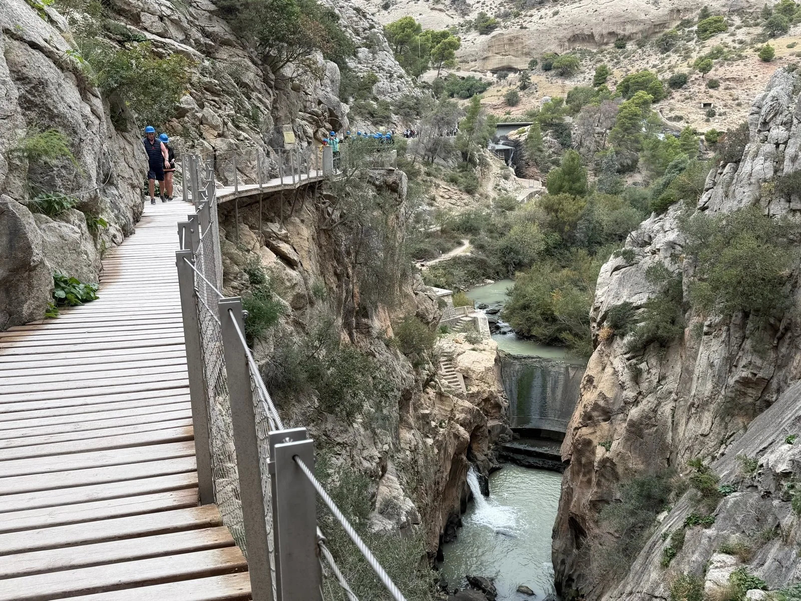
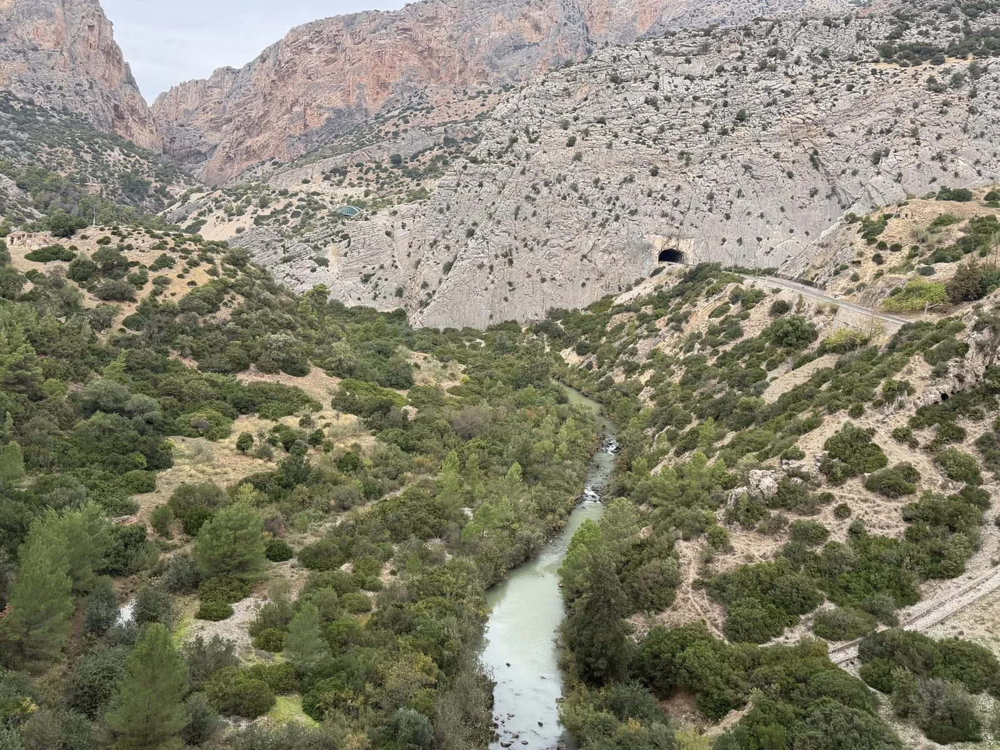
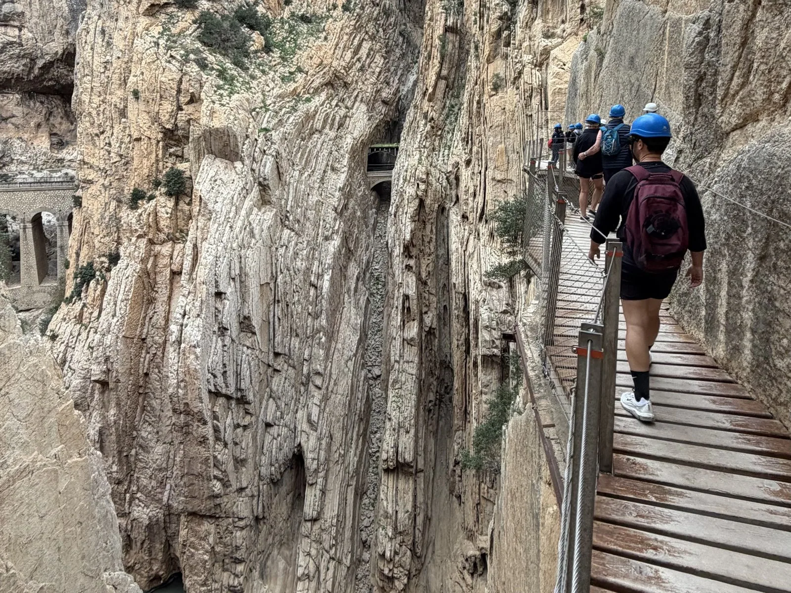
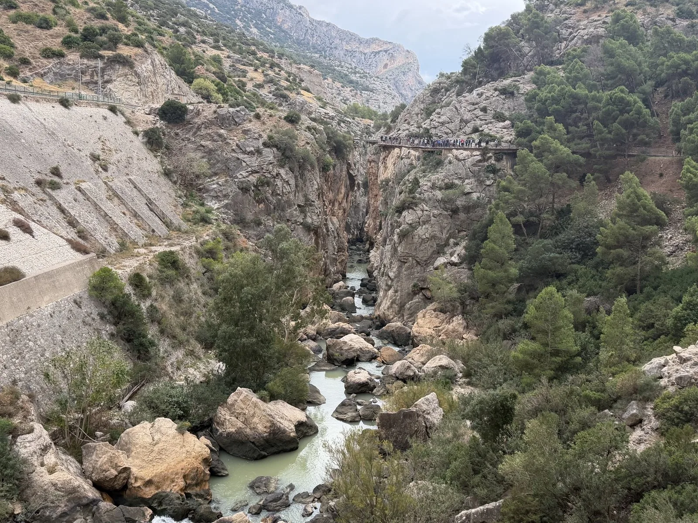
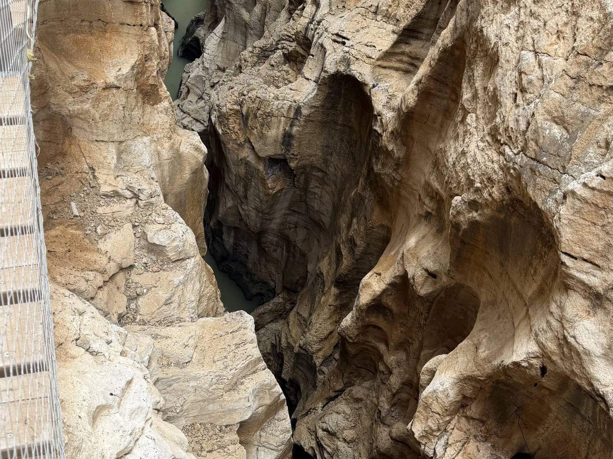
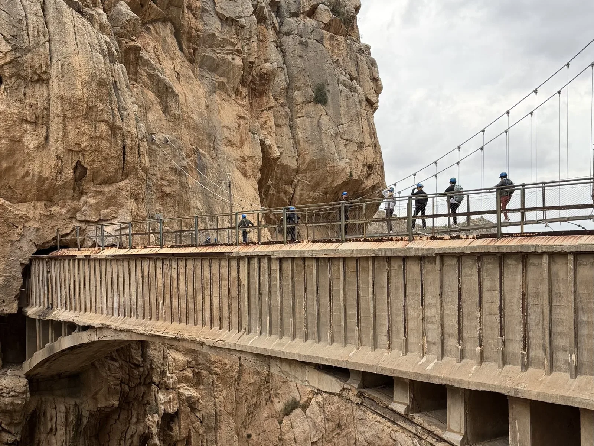
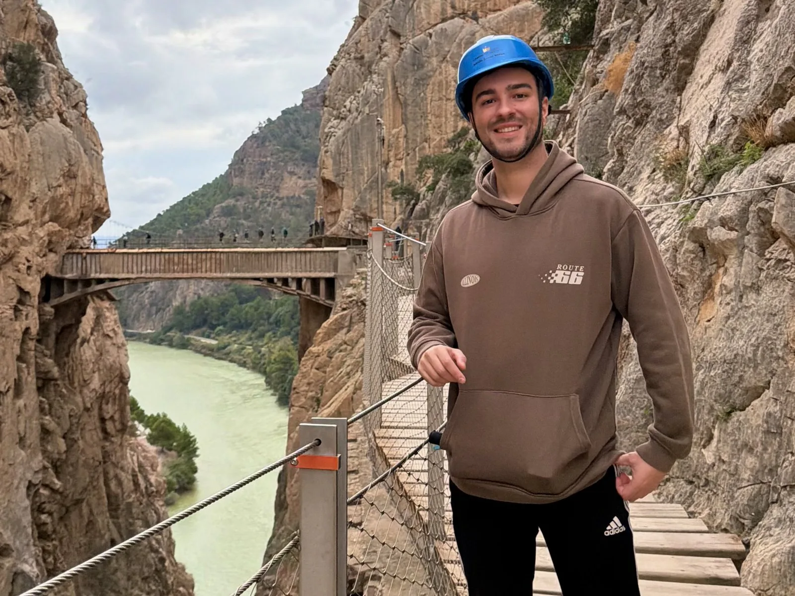
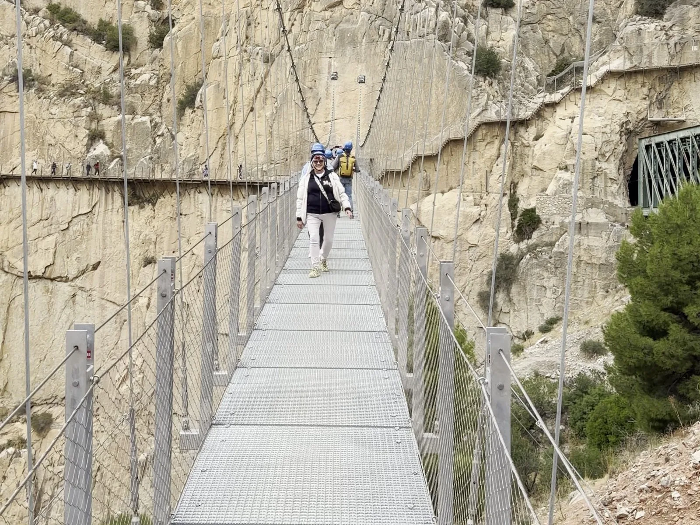
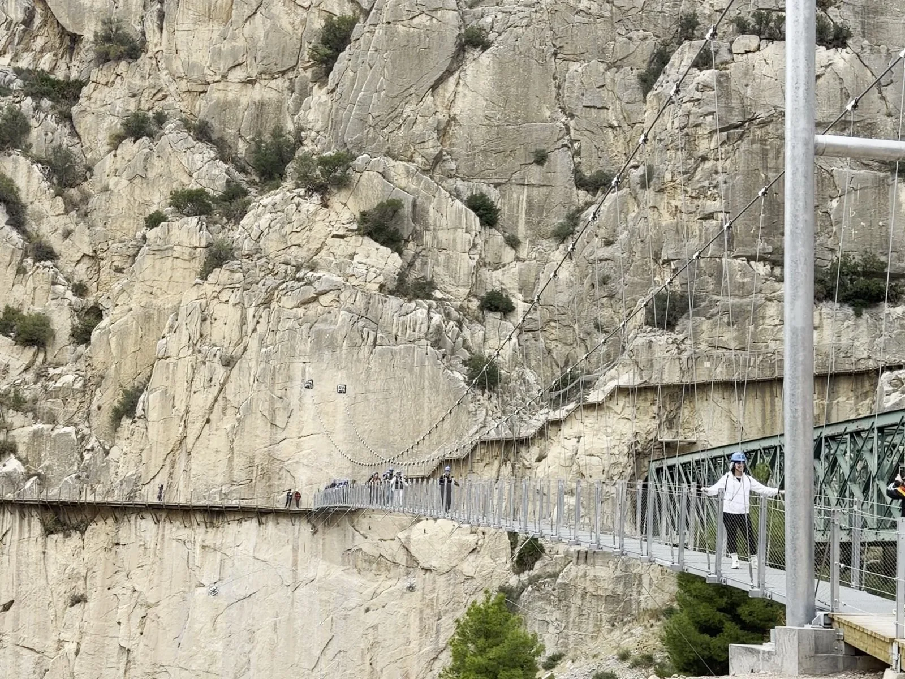
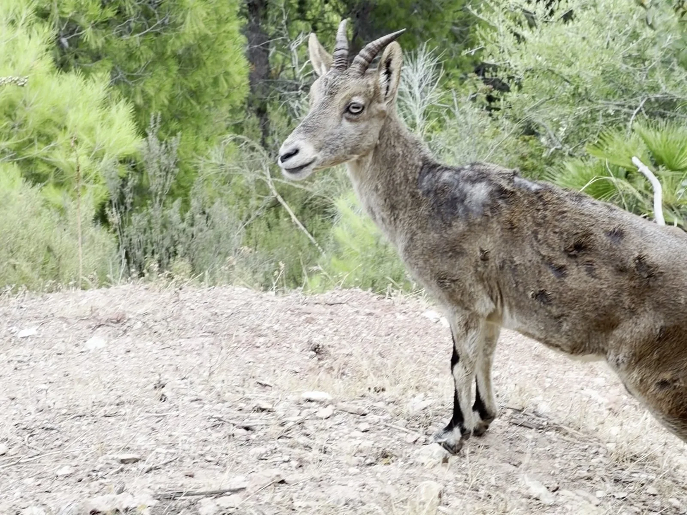

Durante años tuvo fama de ser **el camino más peligroso del mundo**. Hoy el **Caminito del Rey** es una pasarela segura colgada en las paredes del Desfiladero de los Gaitanes, en Málaga, a unos 100 metros sobre el río Guadalhorce. Y sigue siendo una de esas experiencias que te dejan con la boca abierta en cada curva. Desde junio de 2026 tiene además <strong>el puente colgante más largo de España</strong>: 110 metros sobre el vacío en el tramo final.

Lo hice en noviembre de 2026 y todas las fotos de este post son de ese día. Aquí te cuento cuánto cuestan las entradas y cómo reservarlas, el recorrido tramo a tramo, el puente nuevo, las normas que más gente se salta y cómo llegar 👇

En un vistazo<h2>Lo que vas a encontrar</h2>

<b>🎟️</b>Entradas

<b>🥾</b>8 km de recorrido

<b>🌉</b>Pasarelas

<b>🏞️</b>Desfiladero

<b>🦅</b>Vistas al vacío

<b>🌉</b>Puente colgante de 110 m

Antes de ir<h2>Caminito del Rey: precio y horario</h2>

<h3>🎟️ Entradas</h3>
Se compran en la <strong>web oficial</strong> (máximo 10 por compra) o en la taquilla del acceso norte, solo si quedan plazas. Se ponen a la venta <strong>por temporadas</strong> (en noviembre de 2026 ya se pueden comprar hasta el <strong>2 de mayo de 2027</strong>) y en primavera y fines de semana se agotan: <strong>reserva con antelación</strong>. El centro de visitantes no vende entradas.

<ul class="guide__prices"><li>Entrada general<b>10 €</b></li><li>Visita guiada oficial<b>18 €</b></li><li>Bus lanzadera (i/v)<b>2,50 €</b></li><li>Parking<b>2 €/día</b></li></ul>

<h3>🕒 Horario</h3>
Se entra desde las <strong>9:00</strong> y el último pase es entre las <strong>14:50 y las 17:20</strong>, según la temporada. Si cierran por mal tiempo, puedes cambiar la entrada de día desde tu espacio personal.

<h3>🥾 La ruta</h3>
<strong>8 km lineales</strong> y en <strong>un solo sentido</strong>, de norte (Ardales) a sur (El Chorro). Cuenta con <strong>3-4 horas</strong> en total, accesos incluidos. Edad mínima: <strong>8 años</strong>. Tienes que estar en el acceso norte <strong>30 minutos antes</strong> de tu hora.

Un poco de historia<h2>Por qué se llama «del Rey»</h2>

Se construyó entre <strong>1901 y 1905</strong> porque la <strong>Sociedad Hidroeléctrica del Chorro</strong>, dueña de los saltos de agua de Gaitanejo y El Chorro, necesitaba un paso entre los dos para sus operarios, los materiales y la vigilancia del canal. Era un camino de apenas <strong>un metro de ancho</strong>, colgado de las paredes a unos 100 metros del río, que empezaba junto a las vías del tren.

En <strong>1921</strong>, el rey <strong>Alfonso XIII</strong> lo cruzó para inaugurar la presa del Conde del Guadalhorce, y desde entonces todo el mundo empezó a llamarlo «el Caminito del Rey». Con los años se fue deteriorando hasta volverse casi impracticable, y ganó la fama de camino más peligroso del mundo. Tras una gran restauración, se reabrió al público en <strong>2015</strong> con pasarelas nuevas, y en <strong>2026</strong> estrenó un puente colgante de 110 metros.
<ol class="guide__timeline"><li><b>1901-1905</b>Se construye el camino para la central hidroeléctrica</li><li><b>1921</b>Alfonso XIII lo cruza y le da nombre</li><li><b>Fines del s. XX</b>Abandono: se convierte en «el camino más peligroso del mundo»</li><li><b>2015</b>Reabre restaurado y seguro</li><li><b>2026</b>Se estrena el puente colgante de 110 m</li></ol>
<h3>👀 Mira hacia abajo</h3>
En muchos tramos, por debajo de las pasarelas nuevas aún se ve <strong>el camino original</strong>, roto y colgando sobre el vacío. Es la mejor forma de entender por qué tenía tan mala fama.

El recorrido<h2>Qué vas a ver en el Caminito del Rey</h2>
El camino pasa por dos desfiladeros y un valle entre ellos. Estos son los tramos que más impresionan.

<ol class="guide__grid guide__grid--cuenca">
<li class="gcard reveal">
01

<h3>Desfiladero de Gaitanejo</h3>
El primer cañón: las pasarelas empiezan pegadas a la roca, con el río verde turquesa allá abajo.

</li>
<li class="gcard reveal">
02

<h3>El Valle del Hoyo</h3>
Un respiro entre los dos desfiladeros: un valle abierto, con pinos y vistas a la sierra.

</li>
<li class="gcard reveal">
03

<h3>Pegado a la roca</h3>
Las pasarelas van clavadas a la pared, con el río y las rocas muy abajo. Por debajo, en algunos tramos, se ve el camino original, el de la fama de peligroso.

</li>
<li class="gcard reveal">
04

<h3>El río Guadalhorce</h3>
El agua ha ido tallando la roca durante millones de años hasta abrir el desfiladero.

</li>
<li class="gcard reveal">
05

<h3>Desfiladero de los Gaitanes</h3>
El tramo final y el más espectacular: paredes de más de 300 metros y, en algunos puntos, menos de 10 de ancho.

</li>
<li class="gcard reveal">
06

<h3>El puente de los Gaitanes</h3>
La foto clásica del Caminito: una pasarela colgante cruza el desfiladero junto al acueducto del canal de la central, con el vacío debajo.

</li>
<li class="gcard reveal">
07

<h3>Con casco y sin prisa</h3>
El casco es obligatorio en todo el recorrido. Para cada poco a mirar: el río cambia de color en cada tramo.

</li>
</ol>

Novedad 2026<h2>El puente colgante más largo de España</h2>

El <strong>9 de junio de 2026</strong> se inauguró en el Caminito del Rey un puente colgante de <strong>110 metros</strong>, el más largo de España de su tipo, y al día siguiente se abrió a los visitantes. Está en el <strong>tramo final</strong>, justo antes de la zona del puente de hierro del tren y el túnel de El Chorro.

<ol class="guide__grid guide__grid--cuenca">
<li class="gcard reveal">
01

<h3>Sobre el puente</h3>
El suelo es de rejilla metálica: ves el vacío bajo tus pies durante los 110 metros.

</li>
<li class="gcard reveal">
02

<h3>Junto al puente del tren</h3>
Desde fuera se ve cómo cuelga de la pared del desfiladero, al lado del puente de hierro verde del ferrocarril.

</li>
</ol>
<ul class="checklist" style="margin:0 0 1rem;"><li><strong>Medidas:</strong> 110 m de largo, hasta <strong>50 m de altura</strong> sobre el terreno y 1,2 m de paso, con suelo metálico de rejilla y barandillas de cable con malla.</li><li><strong>Por qué se hizo:</strong> un estudio geológico de las universidades de Granada y Jaén recomendó una alternativa más segura para la bajada final. El puente evita casi <strong>un kilómetro de descenso</strong> por terreno empinado.</li><li><strong>Dentro del recorrido:</strong> es una alternativa para la bajada final; el sendero de siempre sigue abierto.</li><li><strong>Coste:</strong> 1,5 millones de euros, pagados con lo que recauda el propio Caminito. La obra incluye 300 m de sendero nuevo, cámaras y una caseta de control.</li></ul>

Paso a paso<h2>El recorrido, tramo a tramo</h2>
Es lineal y de bajada, de norte a sur: empieza en Ardales y acaba en El Chorro (Álora).

<ul class="checklist" style="margin:0 0 1rem;"><li><strong>Acceso a pie (20-50 min):</strong> desde el restaurante El Kiosko, junto al embalse del Conde de Guadalhorce, por el <strong>túnel</strong> (1,5 km, unos 20-25 minutos) o por la <strong>senda de Gaitanejo</strong> (2,7 km, unos 50 minutos).</li><li><strong>Caseta de control:</strong> junto a la central de Gaitanejo te validan la entrada y te dan el casco.</li><li><strong>Desfiladero de Gaitanejo:</strong> el primer cañón, con las primeras pasarelas.</li><li><strong>El Soto y el Tajo de las Palomas:</strong> el segundo cañón.</li><li><strong>Valle del Hoyo:</strong> un tramo abierto de sendero entre pinos.</li><li><strong>Desfiladero de los Gaitanes:</strong> el más espectacular, con el puente sobre el acueducto y el puente colgante nuevo.</li><li><strong>Bajada a El Chorro (2,1 km):</strong> devuelves el casco y a 300 m está la parada del bus lanzadera.</li></ul>

Entre la entrada y la salida de las pasarelas hay <strong>2.955 metros</strong>: 1.550 de pasarela y 1.405 de sendero o pista. Con los accesos, son unos <strong>8 km</strong> y entre <strong>3 y 4 horas</strong>.

Naturaleza<h2>Un cañón de 300 metros</h2>

El <strong>Desfiladero de los Gaitanes</strong> lo ha excavado el río Guadalhorce en <strong>calizas y dolomías del Jurásico</strong>. Tiene paredes de más de <strong>300 metros</strong> y, en algunos puntos, menos de <strong>10 metros</strong> de ancho. Fíjate en las capas de roca casi verticales y en las cuevas colgadas en las paredes: hay una veintena. En las areniscas del Mioceno de la zona se han encontrado incluso <strong>restos fósiles de ballenas</strong>.

Mira al cielo: es fácil ver <strong>buitres leonados</strong>, y viven también alimoches y águilas reales. Y atento a los lados del sendero: hay <strong>cabras montesas</strong>, que a veces se dejan ver muy cerca, como esta que nos cruzamos nosotros.

Normas<h2>Lo que no te dejan hacer</h2>
Las normas son estrictas y las revisan en la entrada. Las de 2026 son estas:

<ul class="checklist" style="margin:0 0 1rem;"><li><strong>Niños:</strong> prohibido a menores de 8 años. De 8 a 18 años, siempre con un adulto y con su <strong>DNI o pasaporte</strong>. Tampoco se puede llevar a nadie en brazos por las pasarelas.</li><li><strong>Calzado:</strong> tiene que ir bien sujeto al pie, también por detrás. Con chanclas o tacones no entras.</li><li><strong>Bultos:</strong> nada de mochilas grandes, bolsos voluminosos ni cascos de moto.</li><li><strong>Prohibidos:</strong> bastones, muletas, sillas de ruedas, carritos, palos selfie y paraguas (si llueve, chubasquero).</li><li><strong>Mascotas:</strong> no se permiten.</li><li><strong>Arneses:</strong> no se pueden enganchar a la línea de vida de las pasarelas.</li></ul>

<!--actividades-->

<!--cuando-->

Cuándo ir<h2>Mejor época y qué llevar</h2>

<ul class="checklist" style="margin:0 0 1rem;"><li><strong>Época:</strong> primavera y otoño: en pleno verano hay mucho sol y poca sombra en el desfiladero.</li><li><strong>Qué llevar:</strong> calzado cómodo cerrado, al menos 1,5 litros de agua por persona, algo para picar como barritas, y gorra; el casco te lo dan en la entrada.</li><li><strong>Evita:</strong> ir a mediodía en julio y agosto, y llegar justo a la hora de tu pase: se entra con control de horario.</li></ul>

Cómo llegar<h2>Cómo llegar al Caminito del Rey</h2>

Está a <strong>menos de 60 km de Málaga</strong>. Por carretera se va por la <strong>A-357</strong> hasta el cruce de Ardales y luego por la <strong>MA-5403</strong>. También hay <strong>tren regional</strong> de Renfe hasta la estación de <strong>El Chorro</strong>, que es donde termina la ruta.

Lo más cómodo es dejar el coche en el <strong>parking del Centro de Recepción de Visitantes</strong> (2 €/día; llega al menos una hora antes). Puedes reservar la plaza al comprar la entrada. Desde allí, el <strong>bus lanzadera</strong> (2,50 €) te lleva en 15-20 minutos hasta El Kiosko, junto al inicio. Si lo pagas al subir, es <strong>solo en efectivo</strong>. Funciona de <strong>7:40 a 20:00</strong> y el billete vale para todo el día, así que al terminar vuelves al coche con él.

También hay un <strong>parking municipal en Ardales (P1)</strong>, cerca de los túneles, por 2 €.

<strong>Sin coche:</strong> la forma más cómoda es una <a href="https://www.civitatis.com/es/malaga/excursion-caminito-rey/?aid=110968" target="_blank" rel="noopener sponsored">excursión al Caminito del Rey desde Málaga</a>: te llevan y te traen, y no tienes que preocuparte del parking ni del bus lanzadera.

Del parking a la entrada norte hay dos accesos a pie: un <strong>túnel de 1,5 km</strong> (unos 20 minutos) o la <strong>senda de Gaitanejo, de 2,7 km</strong> (unos 50 minutos).

<a class="btn guide__mapbtn" href="https://www.google.com/maps/dir/?api=1&destination=36.91456538493755,-4.8071835875446105" target="_blank" rel="noopener"><svg class="ico" viewBox="0 0 24 24" width="15" height="15" aria-hidden="true" fill="currentColor"><path d="M12 2a7 7 0 0 0-7 7c0 5.25 7 13 7 13s7-7.75 7-13a7 7 0 0 0-7-7zm0 9.5a2.5 2.5 0 1 1 0-5 2.5 2.5 0 0 1 0 5z"/></svg> Cómo llegar en Google Maps</a><a class="btn guide__mapbtn btn--ghost" href="https://www.caminitodelrey.info/es/entradas/comprar" target="_blank" rel="noopener"><svg class="ico" viewBox="0 0 24 24" width="15" height="15" aria-hidden="true" fill="none" stroke="currentColor" stroke-width="2" stroke-linecap="round" stroke-linejoin="round"><path d="M7 3v3M17 3v3M4 9h16M5 5h14a1 1 0 0 1 1 1v13a1 1 0 0 1-1 1H5a1 1 0 0 1-1-1V6a1 1 0 0 1 1-1z"/></svg> Comprar entradas oficiales</a>

Consejos de Cheno<h2>Para disfrutarlo al máximo</h2><ul><li><b>Reserva pronto</b>: los fines de semana y en primavera se agotan las entradas.</li><li><b>Calzado de montaña</b>: es obligatorio llevar calzado bien sujeto al pie: con chanclas no te dejan pasar.</li><li><b>Sin palo selfie ni mochila grande</b>: están prohibidos, igual que paraguas, bastones y carritos.</li><li><b>Mira el tiempo</b>: con viento fuerte o lluvia pueden cerrarlo; si pasa, cambias la entrada de día.</li><li><b>Llega con margen</b>: hay que estar en el acceso norte 30 minutos antes, y desde El Kiosko son al menos 20-25 minutos andando.</li><li><b>No te pierdas el puente nuevo</b>: está al final, cuando ya piensas que se ha acabado.</li></ul>

🪨 <strong>Muy cerca:</strong> el <a href="/blog/torcal-de-antequera.html">Torcal de Antequera</a>.

<!--faq-->

<h2>¿Te gustan estos planes?</h2>
Sígueme en Instagram como <a href="https://www.instagram.com/chenoaventuras/" target="_blank" rel="noopener">@chenoaventuras</a>: subo escapadas como esta cada semana.
<a class="btn guide__btn" href="/blog.html">Ver más planes en el blog</a>

Datos consultados en noviembre de 2026 en la web oficial del Caminito del Rey y en sus normas de uso (decreto de la Diputación de Málaga de mayo de 2026); lo del puente colgante, en El Español y Telecinco; pueden cambiar, así que confírmalos antes de ir. Fotos de @chenoaventuras (noviembre de 2026).

