Cantabria tiene **mar y montaña a menos de una hora**: la elegante Santander, los acantilados de la Costa Quebrada, los elefantes de Cabárceno, las cuevas de Altamira y El Soplao, la villa de Santillana y los Picos de Europa con Potes y Fuente Dé. Este es el **itinerario de 5 días en coche**, **día por día**, con qué ver, curiosidades, dónde comer y **actividades para reservar**.

En un vistazo<h2>Lo que vas a encontrar</h2>

<b>🏖️</b>Santander

<b>🌊</b>Costa Quebrada

<b>🦁</b>Cabárceno

<b>🎨</b>Altamira

<b>🏘️</b>Santillana

Antes de salir<h2>Cómo organizar los 5 días</h2>

Cantabria es pequeña pero con curvas: cuenta con más tiempo del que marque el mapa y confirma los tiempos en Google Maps. Lo ideal es dormir <strong>tres noches en Santander o alrededores</strong> (días 1-3) y <strong>dos en la zona de Potes o San Vicente</strong> (días 4-5). Reserva con antelación las cuevas (Altamira, El Soplao y Puente Viesgo tienen aforo limitado) y mira siempre el tiempo: si llueve, cambia las playas por las cuevas. Tienes también la <a href='/blog/guia-cantabria.html'>guía de Cantabria en PDF</a> gratis para llevarla en el móvil.

Día 1<h2>Santander y la Costa Quebrada</h2>

Empieza por <a href='/blog/santander-que-ver.html'>Santander</a>: el <strong>Palacio de la Magdalena</strong> en su península, las playas del Sardinero, el <strong>Centro Botín</strong>, el Paseo de Pereda y la catedral, y el faro de Cabo Mayor. Es una ciudad que se reconstruyó tras el incendio de 1941. Para comer, pide <strong>rabas</strong> (calamares fritos) en alguna terraza del centro. Para conocer el palacio y la ciudad, hay una <a href="https://www.civitatis.com/es/santander/visita-guiada-palacio-magdalena/?aid=110968" target="_blank" rel="noopener sponsored">visita guiada por el Parque y el Palacio de la Magdalena</a>, un <a href="https://www.civitatis.com/es/santander/free-tour-santander/?aid=110968" target="_blank" rel="noopener sponsored">free tour por Santander</a> y un <a href="https://www.civitatis.com/es/santander/paseo-barco-bahia-santander/?aid=110968" target="_blank" rel="noopener sponsored">paseo en barco por la bahía</a>.

Por la tarde, la <a href='/blog/costa-quebrada-urros-de-liencres.html'>Costa Quebrada</a>, geoparque mundial de la UNESCO: los Urros de Liencres, la playa de la Arnía, Portío y las dunas de Liencres. Ve al atardecer, con luz suave.

<ol class="guide__grid guide__grid--cuenca">
<li class="gcard reveal">
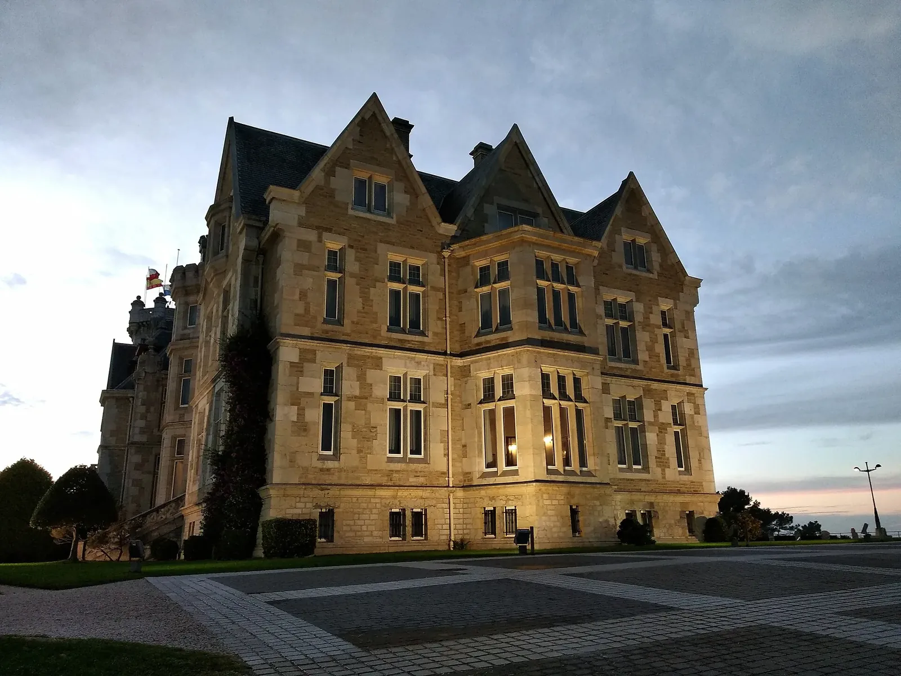01

<h3>Santander</h3>
El <strong>Palacio de la Magdalena</strong>, el Sardinero, el Centro Botín y el faro de Cabo Mayor. Pide rabas en una terraza.

</li>
<li class="gcard reveal">
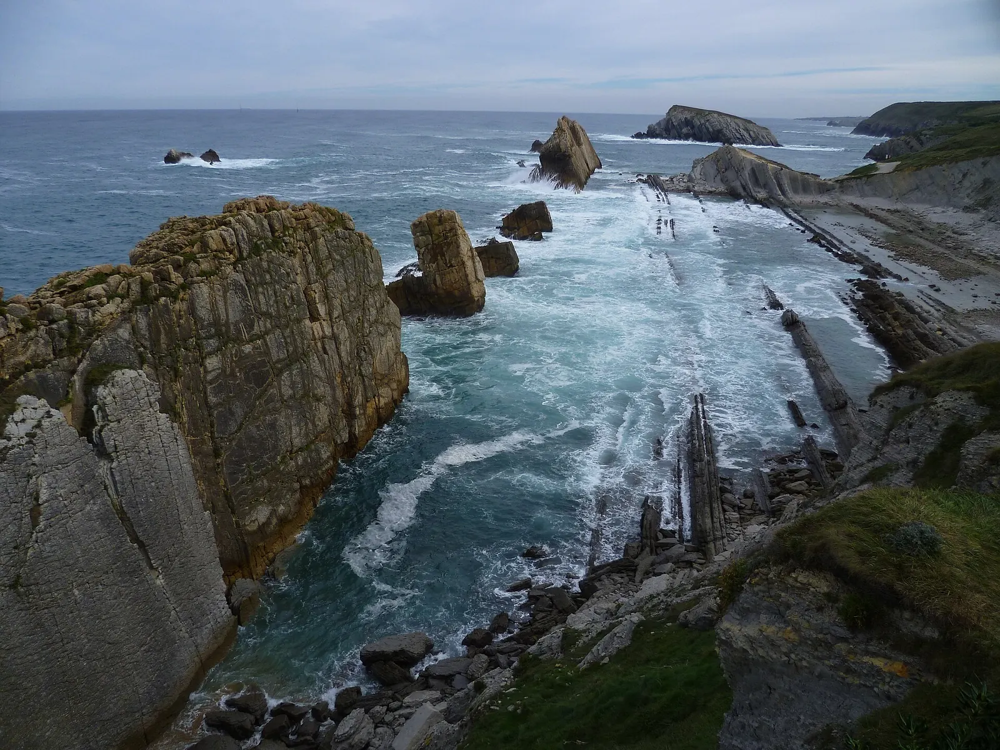02

<h3>Costa Quebrada</h3>
Geoparque mundial de la UNESCO: los <strong>Urros de Liencres</strong>, la Arnía y las dunas. Ve al atardecer.

</li>
</ol>

🎟️ Actividades para reservar
<ul class="actbox" style="margin-bottom:2rem"><li><a href="https://www.civitatis.com/es/santander/visita-guiada-palacio-magdalena/?aid=110968" target="_blank" rel="sponsored noopener">CivitatisVisita guiada por el Parque y el Palacio de la MagdalenaVer &rarr;</a></li><li><a href="https://www.civitatis.com/es/santander/free-tour-santander/?aid=110968" target="_blank" rel="sponsored noopener">CivitatisFree tour por SantanderVer &rarr;</a></li><li><a href="https://www.civitatis.com/es/santander/paseo-barco-bahia-santander/?aid=110968" target="_blank" rel="sponsored noopener">CivitatisPaseo en barco por la bahía de SantanderVer &rarr;</a></li></ul>

Día 2<h2>Cabárceno y Liérganes</h2>

Dedica el día al <a href='/blog/parque-de-cabarceno.html'>Parque de Cabárceno</a>, un parque de animales en una antigua mina (hay telecabina). Calcula medio día o más; compra la entrada con antelación y mira horarios. Hay una <a href="https://www.civitatis.com/es/santander/excursion-cabarceno/?aid=110968" target="_blank" rel="noopener sponsored">excursión a Cabárceno</a>. De vuelta, para en <a href='/blog/lierganes-hombre-pez.html'>Liérganes</a>, el pueblo del Hombre Pez: la historia de Francisco de la Vega, que desapareció en 1674 y apareció en Cádiz, con el Puente Mayor y su casco histórico.

<ol class="guide__grid guide__grid--cuenca">
<li class="gcard reveal">
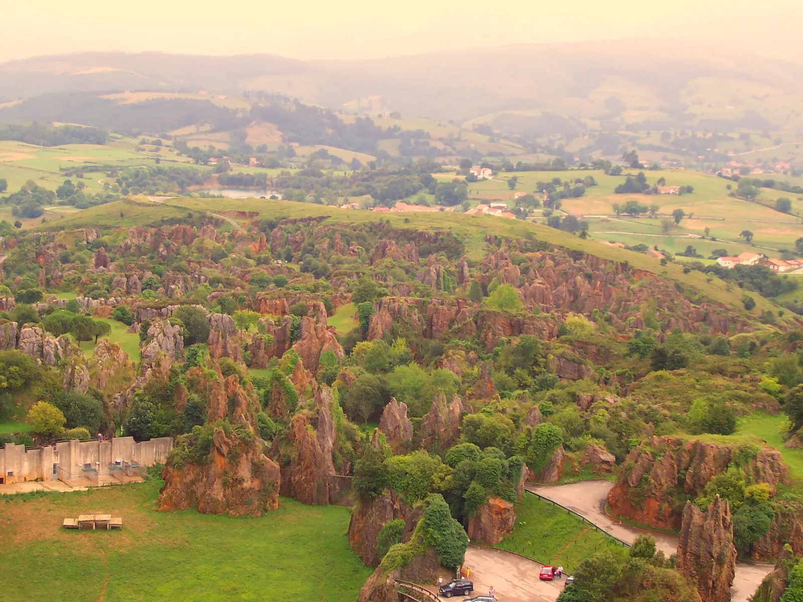03

<h3>Cabárceno</h3>
Un parque de animales en una <strong>antigua mina</strong>, con telecabina. Calcula medio día o más.

</li>
<li class="gcard reveal">
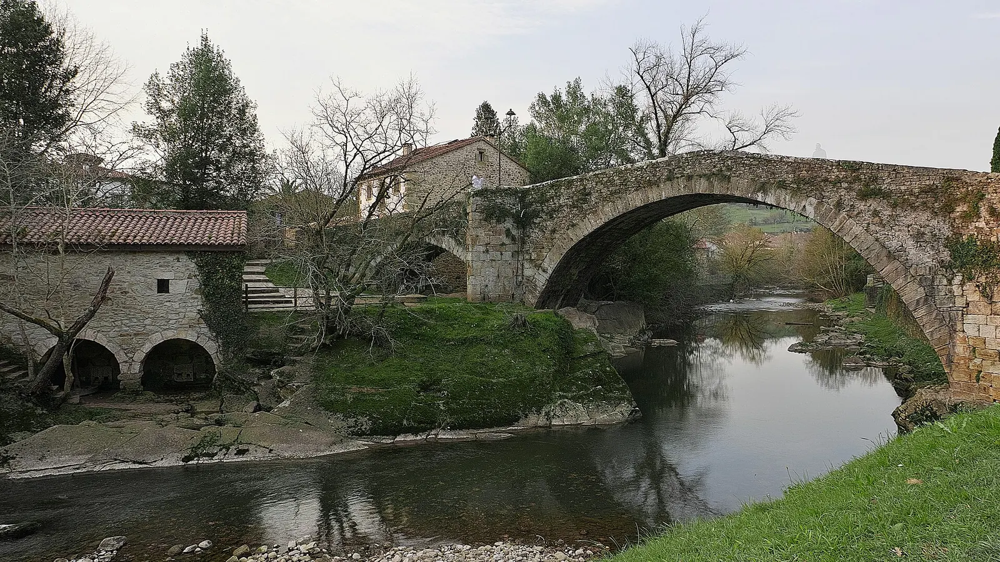04

<h3>Liérganes</h3>
El pueblo del <strong>Hombre Pez</strong>, con el Puente Mayor y un casco histórico muy bonito.

</li>
</ol>

🎟️ Actividades para reservar
<ul class="actbox" style="margin-bottom:2rem"><li><a href="https://www.civitatis.com/es/santander/excursion-cabarceno/?aid=110968" target="_blank" rel="sponsored noopener">CivitatisExcursión a CabárcenoVer &rarr;</a></li></ul>

Día 3<h2>Santillana, Altamira y Comillas</h2>

Visita <a href='/blog/santillana-del-mar-que-ver.html'>Santillana del Mar</a>, la villa de las tres mentiras (ni es santa, ni es llana, ni tiene mar), con colegiata románica y casonas de piedra. A 2 km está la <a href='/blog/cueva-de-altamira-neocueva.html'>Neocueva de Altamira</a>, la réplica exacta de la cueva original, con museo. Hay un <a href="https://www.civitatis.com/es/santillana-del-mar/free-tour-santillana-del-mar/?aid=110968" target="_blank" rel="noopener sponsored">free tour por Santillana del Mar</a> y una <a href="https://www.civitatis.com/es/santillana-del-mar/visita-guiada-altamira/?aid=110968" target="_blank" rel="noopener sponsored">visita guiada por la Neocueva y el Museo de Altamira</a>. Por la tarde, <a href='/blog/comillas-que-ver.html'>Comillas</a>: el <strong>Capricho de Gaudí</strong>, el Palacio de Sobrellano, el cementerio y la Universidad Pontificia. Puedes comprar las <a href="https://www.civitatis.com/es/comillas/entrada-capricho-gaudi/?aid=110968" target="_blank" rel="noopener sponsored">entradas al Capricho de Gaudí</a> o hacer una <a href="https://www.civitatis.com/es/comillas/visita-guiada-comillas-capricho-gaudi/?aid=110968" target="_blank" rel="noopener sponsored">visita guiada por Comillas</a>.

<ol class="guide__grid guide__grid--cuenca">
<li class="gcard reveal">
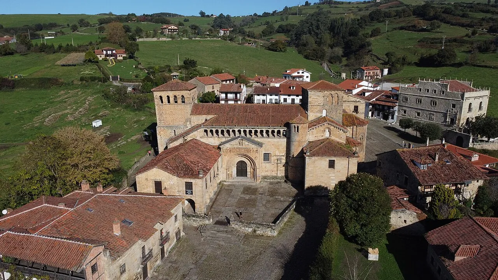05

<h3>Santillana del Mar</h3>
La villa de las tres mentiras: <strong>ni santa, ni llana, ni tiene mar</strong>. Colegiata románica y casonas de piedra.

</li>
<li class="gcard reveal">
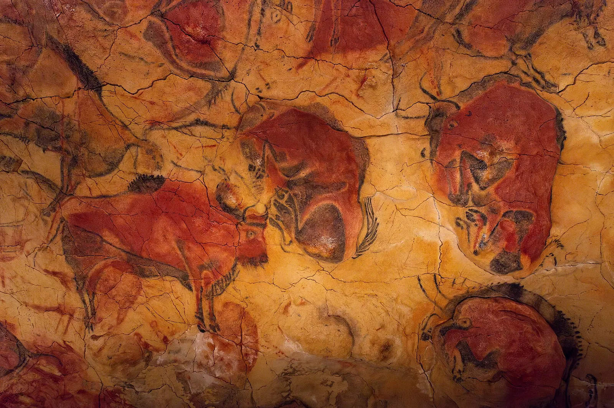06

<h3>Neocueva de Altamira</h3>
A 2 km de Santillana: la <strong>réplica exacta</strong> de la cueva original, con museo.

</li>
<li class="gcard reveal">
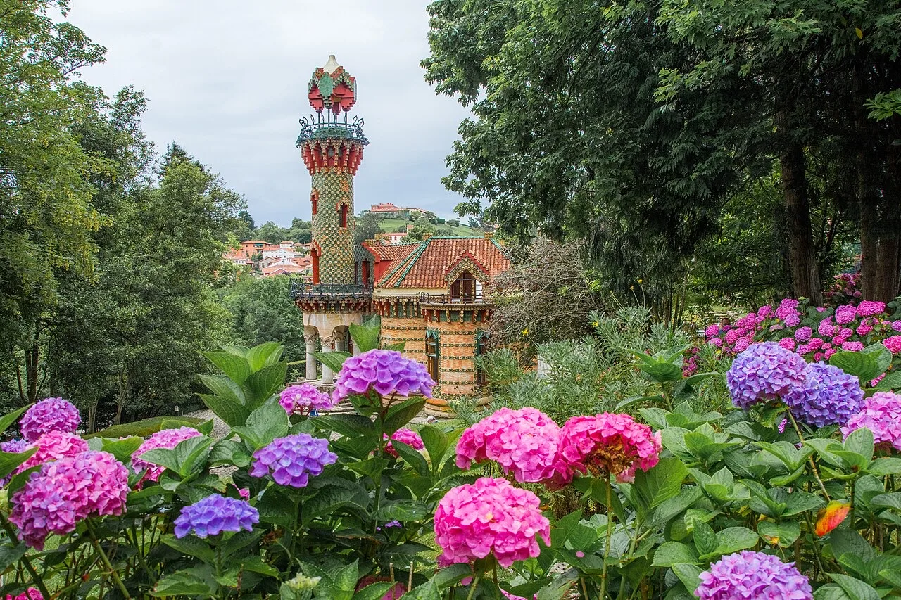07

<h3>Comillas</h3>
El <strong>Capricho de Gaudí</strong>, el Palacio de Sobrellano y su cementerio, entre otras joyas.

</li>
</ol>

🎟️ Actividades para reservar
<ul class="actbox" style="margin-bottom:2rem"><li><a href="https://www.civitatis.com/es/santander/excursion-altamira-santillana-del-mar/?aid=110968" target="_blank" rel="sponsored noopener">CivitatisExcursión a Altamira y Santillana del MarVer &rarr;</a></li><li><a href="https://www.civitatis.com/es/santillana-del-mar/free-tour-santillana-del-mar/?aid=110968" target="_blank" rel="sponsored noopener">CivitatisFree tour por Santillana del MarVer &rarr;</a></li><li><a href="https://www.civitatis.com/es/santillana-del-mar/visita-guiada-altamira/?aid=110968" target="_blank" rel="sponsored noopener">CivitatisVisita guiada por la Neocueva y Museo de AltamiraVer &rarr;</a></li><li><a href="https://www.civitatis.com/es/comillas/entrada-capricho-gaudi/?aid=110968" target="_blank" rel="sponsored noopener">CivitatisEntradas al Capricho de Gaudí con audioguíaVer &rarr;</a></li><li><a href="https://www.civitatis.com/es/comillas/visita-guiada-comillas-capricho-gaudi/?aid=110968" target="_blank" rel="sponsored noopener">CivitatisVisita guiada por Comillas y el Capricho de GaudíVer &rarr;</a></li></ul>

Día 4<h2>San Vicente de la Barquera, El Soplao y las secuoyas</h2>

<a href='/blog/san-vicente-de-la-barquera.html'>San Vicente de la Barquera</a> tiene el Puente de la Maza, el castillo del Rey, Santa María de los Ángeles y playas; desde aquí se saca «la mejor foto de Cantabria» con los Picos de Europa nevados. Come pescado y marisco en el puerto. Después, la cueva de <a href='/blog/cueva-el-soplao.html'>El Soplao</a>, con helictitas imposibles y un tren minero (hay visita turística y de aventura con casco y frontal; reserva), y el <a href='/blog/bosque-de-secuoyas-cabezon-de-la-sal.html'>bosque de secuoyas del Monte Cabezón</a>: 848 secuoyas de más de 35 metros plantadas en 1940. Hay una <a href="https://www.civitatis.com/es/santander/san-vicente-barquera-bosque-secuoyas/?aid=110968" target="_blank" rel="noopener sponsored">excursión a San Vicente de la Barquera y el Bosque de Secuoyas</a> y otra a la <a href="https://www.civitatis.com/es/santander/excursion-cueva-soplao/?aid=110968" target="_blank" rel="noopener sponsored">Cueva del Soplao</a>.

<ol class="guide__grid guide__grid--cuenca">
<li class="gcard reveal">
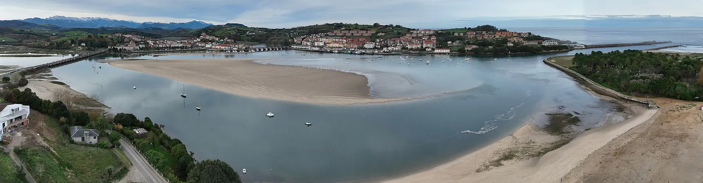08

<h3>San Vicente de la Barquera</h3>
El Puente de la Maza y <strong>la mejor foto de Cantabria</strong>, con los Picos de Europa nevados detrás.

</li>
<li class="gcard reveal">
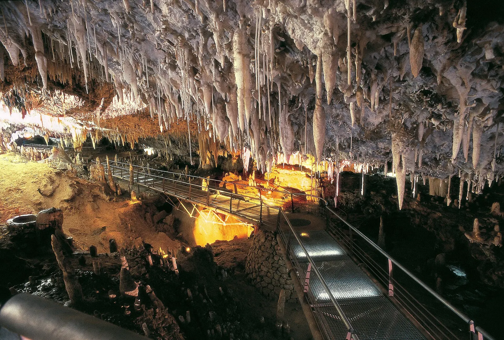09

<h3>El Soplao</h3>
Una cueva con <strong>helictitas imposibles</strong> y un tren minero. Reserva la visita.

</li>
<li class="gcard reveal">
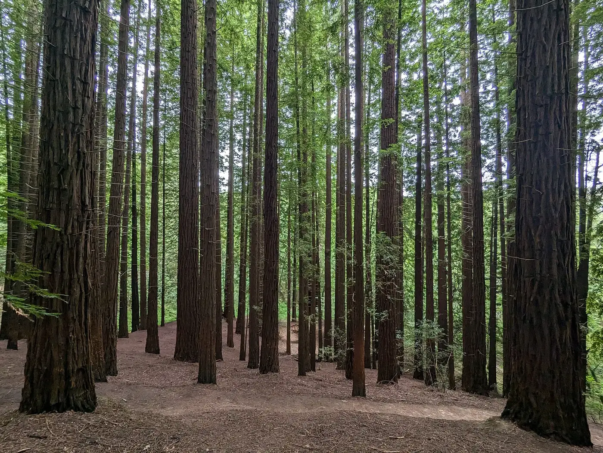10

<h3>Bosque de secuoyas</h3>
En el Monte Cabezón: un bosque de <strong>secuoyas gigantes</strong> que parece de otro continente.

</li>
</ol>

🎟️ Actividades para reservar
<ul class="actbox" style="margin-bottom:2rem"><li><a href="https://www.civitatis.com/es/santander/san-vicente-barquera-bosque-secuoyas/?aid=110968" target="_blank" rel="sponsored noopener">CivitatisExcursión a San Vicente de la Barquera + Bosque de SecuoyasVer &rarr;</a></li><li><a href="https://www.civitatis.com/es/santander/excursion-cueva-soplao/?aid=110968" target="_blank" rel="sponsored noopener">CivitatisExcursión a la Cueva del Soplao en grupo reducidoVer &rarr;</a></li></ul>

Día 5<h2>Picos de Europa: La Hermida, Potes y Fuente Dé</h2>

Entra en Liébana por el <a href='/blog/desfiladero-de-la-hermida.html'>Desfiladero de La Hermida</a>, el más largo de España, con 21 km de cañón junto al río Deva (mirador de Santa Catalina, balneario de aguas termales y Santa María de Lebeña). En <a href='/blog/potes-santo-toribio-de-liebana.html'>Potes</a> verás la villa de los puentes y las torres y, cerca, el Monasterio de Santo Toribio de Liébana, que guarda el mayor trozo conservado de la cruz de Cristo. Termina con el <a href='/blog/teleferico-fuente-de.html'>teleférico de Fuente Dé</a>, que sube 753 metros en un solo tramo, el más largo de Europa de un tramo; arriba hay rutas desde el Mirador del Cable. Come cocido lebaniego u orujo. Hay una <a href="https://www.civitatis.com/es/santander/excursion-picos-europa/?aid=110968" target="_blank" rel="noopener sponsored">excursión a los Picos de Europa: Potes, Santo Toribio y Fuente Dé</a> y una <a href="https://www.civitatis.com/es/potes/visita-guiada-potes/?aid=110968" target="_blank" rel="noopener sponsored">visita guiada por Potes</a>.

<ol class="guide__grid guide__grid--cuenca">
<li class="gcard reveal">
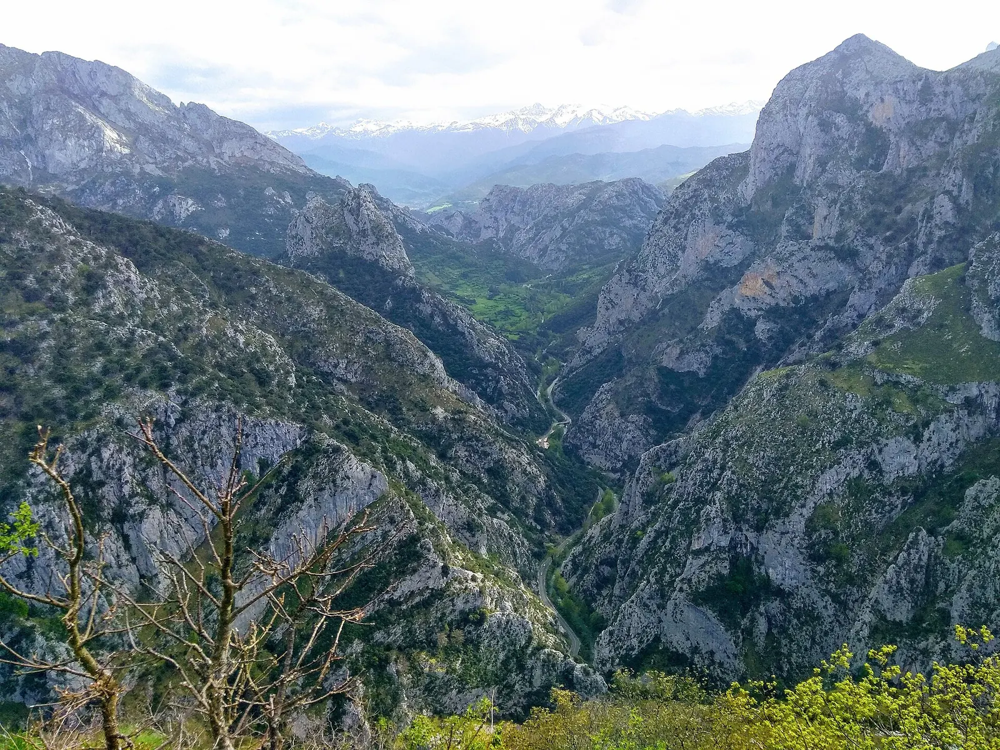11

<h3>Desfiladero de La Hermida</h3>
El más largo de España: <strong>21 km de cañón</strong> junto al río Deva.

</li>
<li class="gcard reveal">
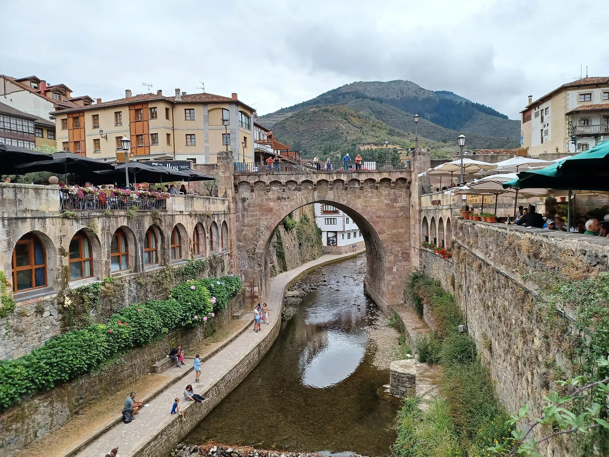12

<h3>Potes</h3>
La villa de los puentes y las torres. Cerca, <strong>Santo Toribio de Liébana</strong>.

</li>
<li class="gcard reveal">
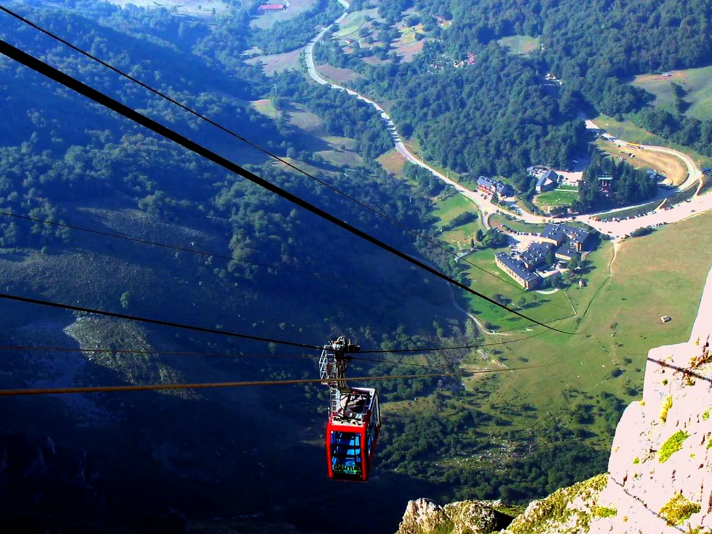13

<h3>Fuente Dé</h3>
Un teleférico que sube <strong>753 metros</strong> hasta el corazón de los Picos de Europa.

</li>
</ol>

🎟️ Actividades para reservar
<ul class="actbox" style="margin-bottom:2rem"><li><a href="https://www.civitatis.com/es/santander/excursion-picos-europa/?aid=110968" target="_blank" rel="sponsored noopener">CivitatisExcursión a los Picos de Europa: Potes, Santo Toribio y Fuente DéVer &rarr;</a></li><li><a href="https://www.civitatis.com/es/potes/visita-guiada-potes/?aid=110968" target="_blank" rel="sponsored noopener">CivitatisVisita guiada por PotesVer &rarr;</a></li></ul>

Si cambias el plan<h2>Más ideas</h2>

Con más tiempo: las cuevas de <a href='/blog/cuevas-de-puente-viesgo.html'>Puente Viesgo</a>, el <a href='/blog/faro-del-caballo-santona.html'>Faro del Caballo de Santoña</a> (763 escalones), <a href='/blog/castro-urdiales-que-ver.html'>Castro Urdiales</a>, <a href='/blog/barcena-mayor-que-ver.html'>Bárcena Mayor</a> y el <a href='/blog/laberinto-de-villapresente.html'>laberinto de Villapresente</a>.

🎟️ Actividades para reservar
<ul class="actbox" style="margin-bottom:2rem"><li><a href="https://www.civitatis.com/es/santona/visita-fabrica-anchoas-degustacion/?aid=110968" target="_blank" rel="sponsored noopener">CivitatisVisita a una fábrica de anchoas con degustación en SantoñaVer &rarr;</a></li><li><a href="https://www.civitatis.com/es/santona/paseo-barco-costa-santona/?aid=110968" target="_blank" rel="sponsored noopener">CivitatisPaseo en barco desde Santoña hasta el Faro del CaballoVer &rarr;</a></li><li><a href="https://www.civitatis.com/es/castro-urdiales/visita-guiada-castro-urdiales/?aid=110968" target="_blank" rel="sponsored noopener">CivitatisVisita guiada por Castro UrdialesVer &rarr;</a></li></ul>

Cómo llegar<h2>Cómo llegar</h2>

<strong>En coche:</strong> desde Madrid, Santander está a unas 4 horas por autovía (aprox.); desde Bilbao, a poco más de una hora.

<strong>En avión o tren:</strong> hay aeropuerto en Santander y tren desde Madrid; para recorrer Cantabria necesitas coche.

<a class="btn guide__mapbtn" href="https://www.google.com/maps/dir/?api=1&destination=Santander" target="_blank" rel="noopener"><svg class="ico" viewBox="0 0 24 24" width="15" height="15" aria-hidden="true" fill="currentColor"><path d="M12 2a7 7 0 0 0-7 7c0 5.25 7 13 7 13s7-7.75 7-13a7 7 0 0 0-7-7zm0 9.5a2.5 2.5 0 1 1 0-5 2.5 2.5 0 0 1 0 5z"/></svg> Cómo llegar en Google Maps</a>

Consejos de Cheno<h2>Cantabria en 5 días</h2><ul><li><b>Día 1</b>: Santander, Palacio de la Magdalena y Costa Quebrada al atardecer.</li><li><b>Día 2</b>: Parque de Cabárceno y Liérganes.</li><li><b>Día 3</b>: Santillana del Mar, Altamira y Comillas.</li><li><b>Día 4</b>: San Vicente de la Barquera, El Soplao y el bosque de secuoyas.</li><li><b>Día 5</b>: La Hermida, Potes, Santo Toribio y Fuente Dé.</li></ul>

<!--faq-->

<h2>¿Te gustan estos planes?</h2>
Sígueme en Instagram como <a href="https://www.instagram.com/chenoaventuras/" target="_blank" rel="noopener">@chenoaventuras</a>: subo escapadas como esta cada semana.
<a class="btn guide__btn" href="/blog.html">Ver más planes en el blog</a>

Información consultada en octubre de 2026. Los precios, horarios y accesos cambian: consúltalos en las webs oficiales. Las fotos proceden de Wikimedia Commons y de fotos propias; los créditos de cada una están en el artículo de cada lugar enlazado.

