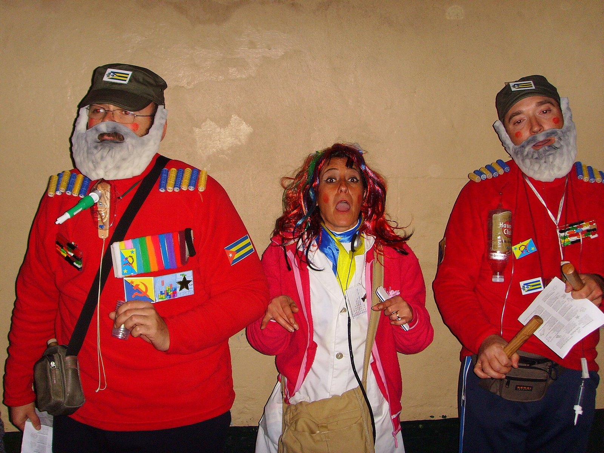
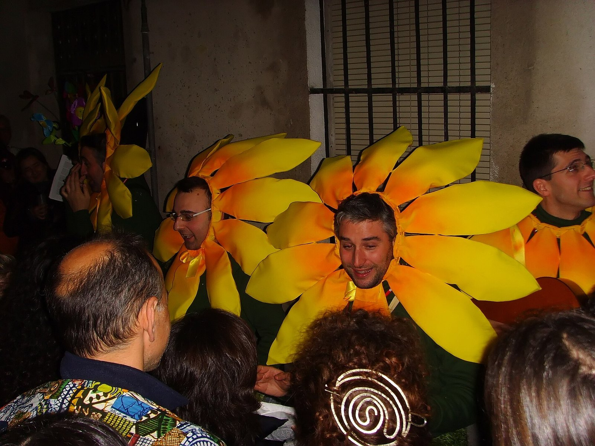
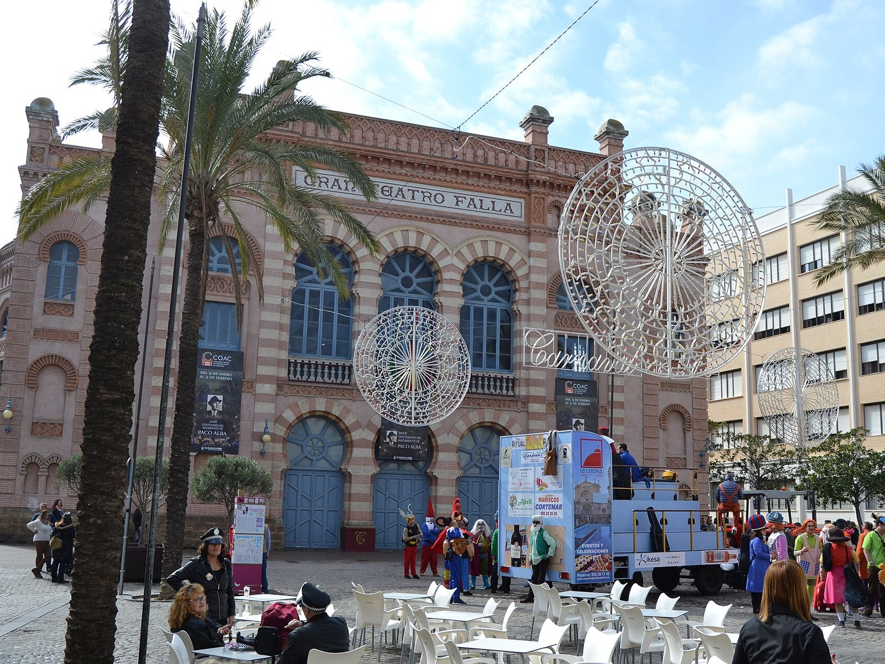
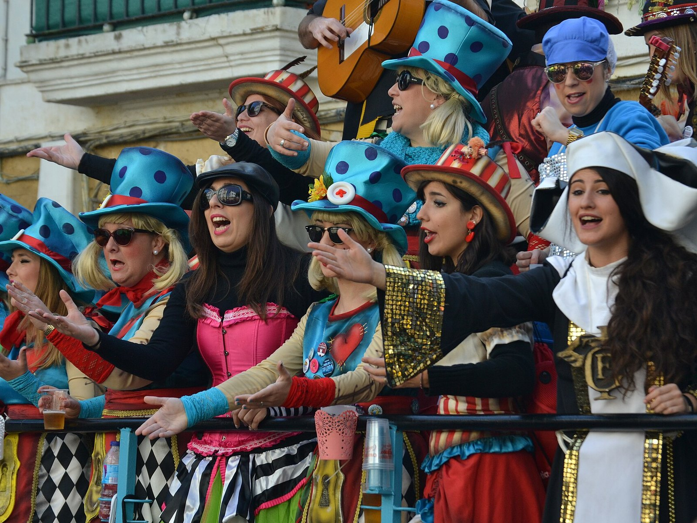
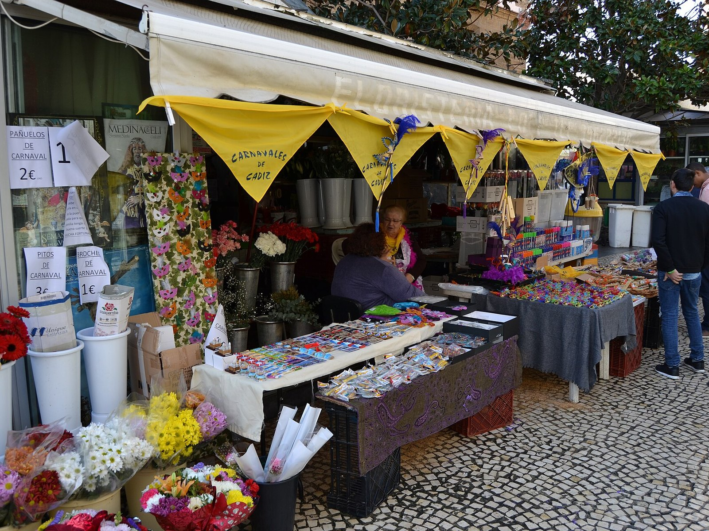

En febrero, **Cádiz** entera se disfraza. Durante diez días, cientos de agrupaciones cantan por las calles letras que se burlan de todo: de los políticos, del tiempo, de los vecinos y hasta de ellos mismos. El **Carnaval de Cádiz** es una fiesta de Interés Turístico Internacional y uno de los más famosos del mundo, pero lo que lo hace único no son las carrozas: es el **ingenio de sus coplas**.

Te cuento las fechas de 2027, cómo funciona el famoso concurso del Falla y cómo vivirlo en la calle sin gastar un euro 👇

En un vistazo<h2>Lo que vas a encontrar</h2>

<b>🎭</b>Disfraces

<b>🎶</b>Chirigotas y comparsas

<b>🏛️</b>Concurso del Falla

<b>🆓</b>Calle gratis

<b>📅</b>4-14 feb 2027

Fechas 2027<h2>Calendario del Carnaval de Cádiz 2027</h2>
Las fechas del concurso las ha publicado el Ayuntamiento de Cádiz.

<ol class="guide__timeline">
<li><b>8-21 ene</b>Preliminares del concurso en el Falla</li>
<li><b>24-29 ene</b>Cuartos de final</li>
<li><b>1-3 feb</b>Semifinales</li>
<li><b>5 feb</b>Gran Final del COAC</li>
<li><b>4-14 feb</b>Carnaval en la calle</li>
</ol>

Para entenderlo<h2>Qué vas a ver en el Carnaval</h2>
En el concurso compiten cuatro tipos de agrupaciones: chirigotas, comparsas, coros y cuartetos (tres o cuatro personas que hacen parodias con humor teatral).

<ol class="guide__grid guide__grid--cuenca">
<li class="gcard reveal">
01

<h3>Chirigotas</h3>
El <strong>humor</strong> del carnaval: letras pícaras y con mucha guasa, disfraces divertidos y críticas a la actualidad. Son las que más se escuchan en la calle.

</li>
<li class="gcard reveal">
02

<h3>Comparsas</h3>
La parte <strong>poética</strong>: voces cuidadas, guitarras y letras sobre Cádiz, el amor o temas sociales. Sus pasodobles ponen la piel de gallina.

</li>
<li class="gcard reveal">
03

<h3>Coros</h3>
Las agrupaciones más grandes, con orquesta de guitarras, bandurrias y laúdes. En la calle cantan <strong>subidos en bateas</strong>, unas plataformas con ruedas.

</li>
<li class="gcard reveal">
04

<h3>El carrusel de coros</h3>
Las bateas recorren el centro y se paran en las plazas para cantar tangos. Es uno de los momentos más bonitos del carnaval, y es gratis.

</li>
<li class="gcard reveal">
05

<h3>Los libretos</h3>
Junto al <strong>Mercado Central</strong> hay puestos que venden los libretos con las letras de las agrupaciones. Llévate uno para seguir las coplas.

</li>
<li class="gcard reveal">
06

<h3>El Gran Teatro Falla</h3>
El teatro neomudéjar donde se celebra el concurso oficial (COAC). La final se retransmite por televisión y la siguen miles de personas.

</li>
</ol>

En la calle<h2>Cómo vivirlo sin entrada</h2>

<ul class="checklist" style="margin:0 0 1rem;"><li><strong>Dónde escuchar agrupaciones:</strong> las plazas y calles del casco antiguo, sobre todo alrededor del <strong>Mercado Central</strong>, la Plaza de la Catedral, el Mentidero y el barrio de La Viña.</li><li><strong>El primer fin de semana</strong> es el más multitudinario: hay ambiente en toda la ciudad, pero también mucha gente.</li><li><strong>Entre semana</strong>, las agrupaciones siguen cantando y se escuchan mucho mejor.</li><li><strong>Las «ilegales»:</strong> grupos de amigos que no se presentan al concurso y solo cantan en la calle. Muchos gaditanos dicen que lo mejor del carnaval está aquí.</li><li><strong>Disfrázate:</strong> en Cádiz casi todo el mundo va disfrazado, y vale cualquier cosa con gracia.</li></ul>

<h3>🎟️ Entradas del Falla</h3>
Las entradas para el concurso se venden por fases y se agotan en minutos, sobre todo las de semifinales y la final. Si no consigues, en Cádiz se sigue en directo por la radio y la televisión en bares y casas.

<!--actividades-->

Cómo llegar<h2>Cómo llegar a Cádiz en Carnaval</h2>

Lo mejor es ir en <strong>tren</strong>: la estación está en pleno centro y en Carnaval hay más trenes de Cercanías desde Jerez, El Puerto de Santa María y San Fernando. En coche, aparcar es casi imposible esos días: deja el coche fuera y entra en tren o en autobús.

<a class="btn guide__mapbtn" href="https://www.google.com/maps/dir/?api=1&destination=36.5326,-6.2994" target="_blank" rel="noopener"><svg class="ico" viewBox="0 0 24 24" width="15" height="15" aria-hidden="true" fill="currentColor"><path d="M12 2a7 7 0 0 0-7 7c0 5.25 7 13 7 13s7-7.75 7-13a7 7 0 0 0-7-7zm0 9.5a2.5 2.5 0 1 1 0-5 2.5 2.5 0 0 1 0 5z"/></svg> Cómo llegar en Google Maps</a>

Aprovecha para ver la ciudad con calma: tienes todo en mi guía de <a href="/blog/cadiz-que-ver.html">qué ver en Cádiz</a>. Y si vas en coche, acércate a la playa de <a href="/blog/bolonia-baelo-claudia-duna.html">Bolonia</a> o a los pueblos blancos como <a href="/blog/setenil-de-las-bodegas-que-ver.html">Setenil de las Bodegas</a>.

Consejos de Cheno<h2>Para disfrutarlo al máximo</h2><ul><li><b>Reserva alojamiento ya</b>: para el primer fin de semana se agota con meses de antelación.</li><li><b>Escucha la letra</b>: la gracia está en las coplas, así que acércate a las agrupaciones.</li><li><b>Lleva efectivo</b>: los bares se llenan y siempre hay algún puesto que solo acepta billetes.</li><li><b>Prueba los erizos y las tortillitas de camarones</b>: son típicos de estas fechas.</li><li><b>Cuidado con el botellón</b>: el Ayuntamiento endurece las normas cada año, así que consulta qué está permitido.</li></ul>

<!--faq-->

<h2>¿Te gustan estos planes?</h2>
Sígueme en Instagram como <a href="https://www.instagram.com/chenoaventuras/" target="_blank" rel="noopener">@chenoaventuras</a>: subo escapadas como esta cada semana.
<a class="btn guide__btn" href="/blog.html">Ver más planes en el blog</a>

Fechas del COAC 2027 publicadas por el Ayuntamiento de Cádiz (junio de 2026) y recogidas por la prensa andaluza; información consultada en noviembre de 2026. El programa de la calle puede cambiar: confírmalo en la web del Ayuntamiento antes de ir. Fotos de Wikimedia Commons: <a href="https://commons.wikimedia.org/wiki/File:Carrusel_de_Coros_en_Plaza_del_Mentidero_(38510887230).jpg" target="_blank" rel="noopener">Emilio J. Rodríguez Posada</a> (CC BY-SA 2.0) · <a href="https://commons.wikimedia.org/wiki/File:Carnaval_de_C%C3%A1diz_2018_(40274618972).jpg" target="_blank" rel="noopener">Emilio J. Rodríguez Posada</a> (CC BY-SA 2.0) · <a href="https://commons.wikimedia.org/wiki/File:Carnaval_de_C%C3%A1diz.jpg" target="_blank" rel="noopener">Balbo</a> (CC BY-SA 3.0) · <a href="https://commons.wikimedia.org/wiki/File:Carnaval_de_C%C3%A1diz_chirigota.jpg" target="_blank" rel="noopener">Balbo</a> (CC BY-SA 3.0) · <a href="https://commons.wikimedia.org/wiki/File:Carnaval_de_C%C3%A1diz_2018_(40319936511).jpg" target="_blank" rel="noopener">Emilio J. Rodríguez Posada</a> (CC BY-SA 2.0) · <a href="https://commons.wikimedia.org/wiki/File:Teatro_falla_2019An002.jpg" target="_blank" rel="noopener">Anual</a> (CC BY-SA 4.0).

