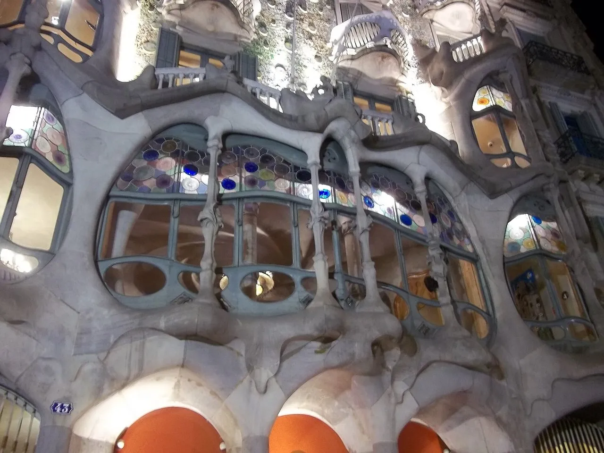
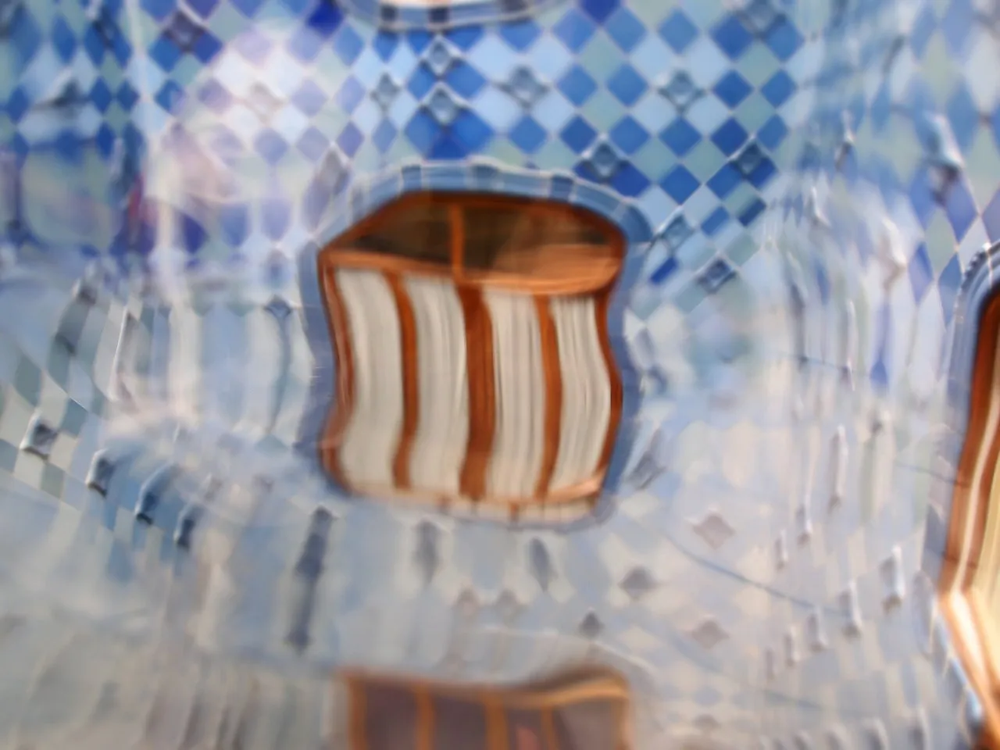
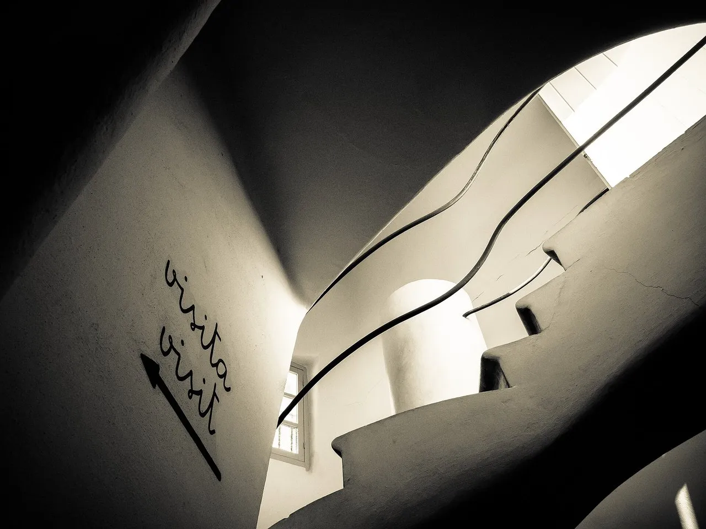
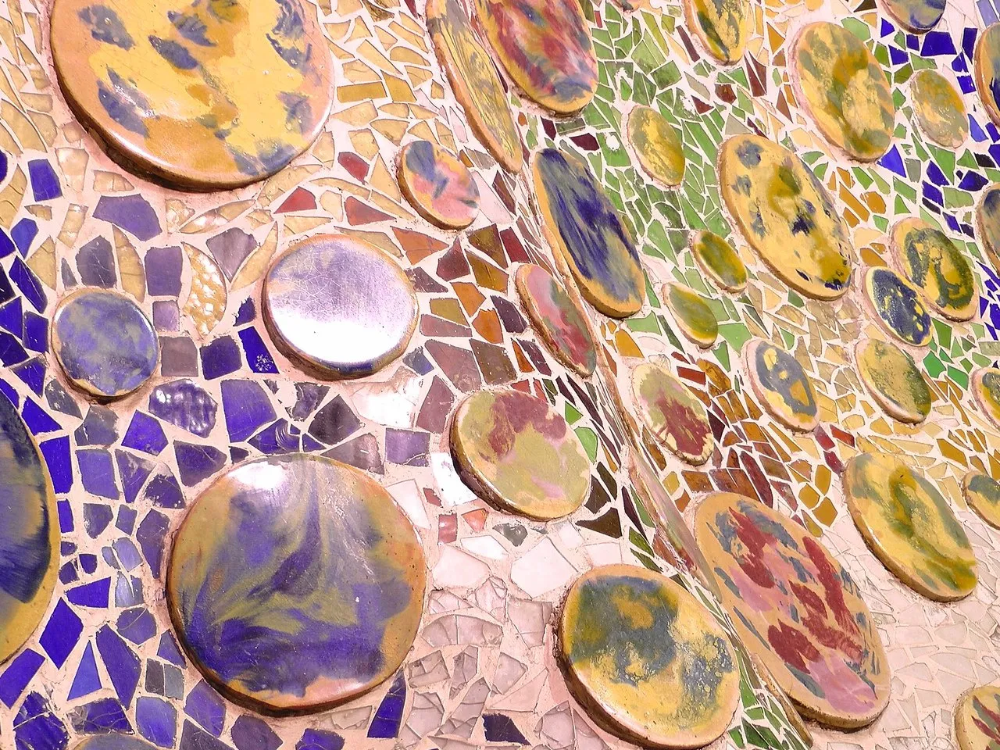
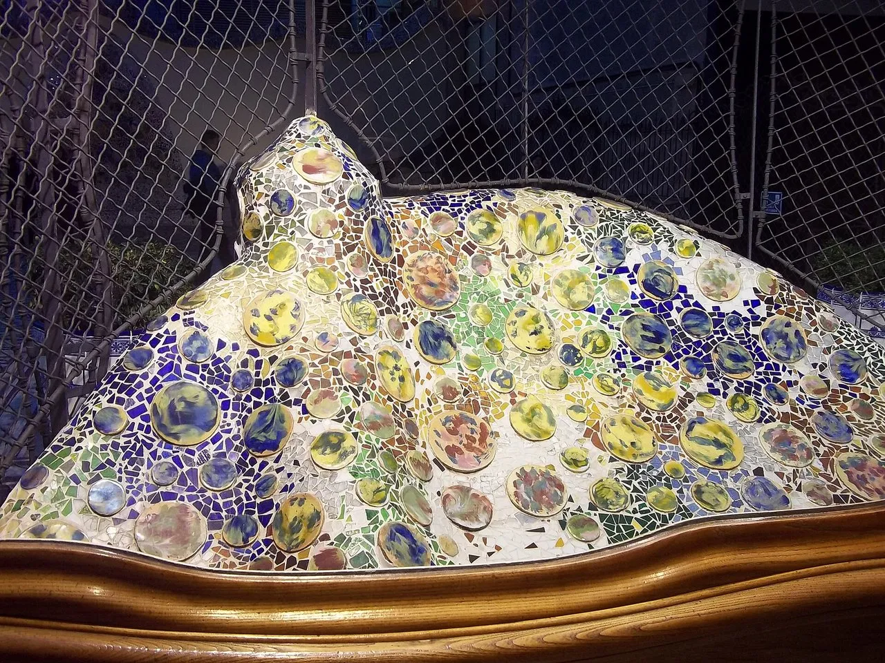
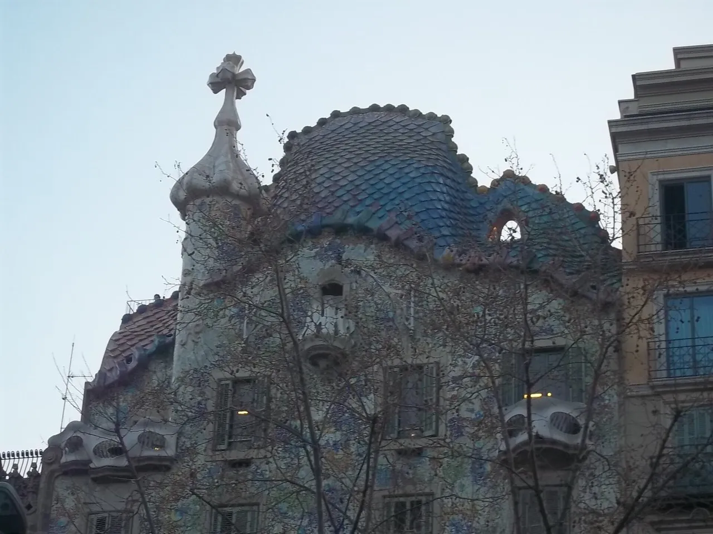

Una fachada que parece hecha de huesos y escamas, balcones con forma de máscara y un tejado que imita el lomo de un dragón. La **Casa Batlló**, en pleno **paseo de Gràcia**, es una de las obras más fantásticas de **Gaudí**, y por dentro sorprende todavía más.

Te cuento cuánto cuestan las entradas, el horario, la visita nocturna y qué ver 👇

En un vistazo<h2>Lo que vas a encontrar</h2>

<b>🐉</b>Tejado del dragón

<b>💙</b>Patio de luces

<b>🎧</b>Audioguía incluida

<b>🌙</b>Visita nocturna

<b>👶</b>Niños gratis

Antes de ir<h2>Lo básico de la Casa Batlló</h2>

<h3>🎟️ Precio</h3>
Visita general <strong>desde 29 €</strong>; nocturna <strong>desde 39 €</strong>. Niños de 0 a 12 años, <strong>gratis</strong>.

<h3>🕙 Horario</h3>
Todos los días, de unas <strong>9:00 a 22:30</strong>. Última admisión, 21:30.

<h3>⏱️ Duración</h3>
Unos <strong>75 minutos</strong>, con audioguía en 15 idiomas y tableta con realidad aumentada.

<h3>💡 Ahorra</h3>
Comprando con antelación hay descuentos de hasta <strong>16 € por persona</strong>, según la web oficial.

Qué ver<h2>Qué ver en la Casa Batlló</h2>

<ol class="guide__grid guide__grid--cuenca">
<li class="gcard reveal">
01

<h3>La fachada</h3>
Columnas que parecen huesos, balcones como máscaras y un mosaico que cambia de color con la luz. De noche, iluminada, es otra.

</li>
<li class="gcard reveal">
02

<h3>El patio de luces</h3>
Azulejos azules más oscuros arriba y más claros abajo, para que la luz llegue igual a todas las plantas. Una de las ideas más geniales de Gaudí.

</li>
<li class="gcard reveal">
03

<h3>El desván</h3>
Pasillos blancos de arcos curvos que recuerdan la caja torácica de un animal.

</li>
<li class="gcard reveal">
04

<h3>El trencadís</h3>
Fragmentos de cerámica y discos de colores cubren chimeneas y superficies: la técnica que Gaudí convirtió en su firma.

</li>
<li class="gcard reveal">
05

<h3>La azotea</h3>
Chimeneas de mosaico y el lomo del dragón muy de cerca. Algunas entradas, como «Be the First», la incluyen expresamente.

</li>
<li class="gcard reveal">
06

<h3>El tejado del dragón</h3>
Las tejas de cerámica imitan escamas, y la torre con la cruz se interpreta como la lanza de Sant Jordi clavada en el dragón.

</li>
</ol>

<!--actividades-->

Entradas<h2>Tipos de entrada a la Casa Batlló</h2>

<h3>🏠 Visita general</h3>
<strong>Desde 29 €</strong>, 1 h 15. Entradas de 9:00 a 18:15. Niños gratis; 2x1 para residentes en España.

<h3>🌙 Una Noche de Invierno</h3>
<strong>Desde 39 €</strong>, entradas de 18:30 a 20:15, hasta el 10 de enero.

<h3>🖼️ Con exposición</h3>
Visita + exposición Gaudí-Miró-Gomis (con la sala inmersiva Gaudí Cube): <strong>desde 37 €</strong>.

<h3>🌅 Be the First</h3>
<strong>45 €</strong>, a las 8:30, antes que nadie y con azotea. Solo online.

Si prefieres tenerlo resuelto, compra la <a href="https://www.civitatis.com/es/barcelona/entrada-casa-batllo/?aid=110968" target="_blank" rel="noopener sponsored">entrada a la Casa Batlló</a> o una <a href="https://www.civitatis.com/es/barcelona/visita-guiada-casa-batllo/?aid=110968" target="_blank" rel="noopener sponsored">visita guiada</a>. Y si vas a ver varias obras de Gaudí, hay una <a href="https://www.civitatis.com/es/barcelona/sagrada-familia-parque-guell-batllo/?aid=110968" target="_blank" rel="noopener sponsored">entrada combinada con la Sagrada Familia, el Park Güell y La Pedrera</a>.

La historia<h2>Una casa reinventada</h2>

Entre <strong>1904 y 1906</strong>, el empresario <strong>Josep Batlló</strong> encargó a Gaudí reformar un edificio del paseo de Gràcia y le dio total libertad creativa. Gaudí lo transformó por completo: fachada, interiores, patio y tejado. Hoy es <strong>Patrimonio Mundial</strong> dentro de las obras de Antoni Gaudí.

Consejos de Cheno<h2>Para disfrutarla al máximo</h2><ul><li><b>Compra con antelación</b>: es más barato y evitas colas.</li><li><b>Ve a primera hora o de noche</b>: a mediodía hay mucha gente.</li><li><b>Mira la fachada desde la acera de enfrente</b>: así se entiende el dragón.</li><li><b>Combínala con</b> <a href="/blog/sagrada-familia.html">la Sagrada Familia</a>, el <a href="/blog/park-guell.html">Park Güell</a> y, en diciembre, la <a href="/blog/navidad-en-barcelona.html">Navidad en Barcelona</a>.</li></ul>

🗿 <strong>A cinco minutos:</strong> <a href="/blog/la-pedrera-casa-mila.html">La Pedrera (Casa Milà)</a>, con su azotea de guerreros.

<!--faq-->

<h2>¿Te gustan estos planes?</h2>
Sígueme en Instagram como <a href="https://www.instagram.com/chenoaventuras/" target="_blank" rel="noopener">@chenoaventuras</a>: subo escapadas como esta cada semana.
<a class="btn guide__btn" href="/blog.html">Ver más planes en el blog</a>

Información consultada en noviembre de 2026 en la web oficial de la Casa Batlló (horarios, tipos de entrada y precios). Fotos de Wikimedia Commons: <a href="https://commons.wikimedia.org/wiki/File:Casa_Batll%C3%B3_01.jpg" target="_blank" rel="noopener">Bernard Gagnon</a> (CC BY-SA 3.0) · <a href="https://commons.wikimedia.org/wiki/File:Casa_Batll%C3%B3,_Barcelona_58.jpg" target="_blank" rel="noopener">Simon Burchell</a> (CC BY-SA 4.0) · <a href="https://commons.wikimedia.org/wiki/File:Patio_de_Luces,_Casa_Batllo.JPG" target="_blank" rel="noopener">Davidh820</a> (CC BY-SA 3.0 es) · <a href="https://commons.wikimedia.org/wiki/File:Barcelona_Spain_Interior-view-in-Casa_Batll%C3%B3-01.jpg" target="_blank" rel="noopener">CEphoto, Uwe Aranas</a> (CC BY-SA 3.0) · <a href="https://commons.wikimedia.org/wiki/File:Roof_of_Casa_Batll%C3%B3_Barcelona_1.JPG" target="_blank" rel="noopener">Steven Lek</a> (CC BY-SA 4.0) · <a href="https://commons.wikimedia.org/wiki/File:Casa_Batll%C3%B3,_Barcelona_27.jpg" target="_blank" rel="noopener">Simon Burchell</a> (CC BY-SA 4.0) · <a href="https://commons.wikimedia.org/wiki/File:Casa_Batll%C3%B3,_Barcelona_03.jpg" target="_blank" rel="noopener">Simon Burchell</a> (CC BY-SA 4.0).

