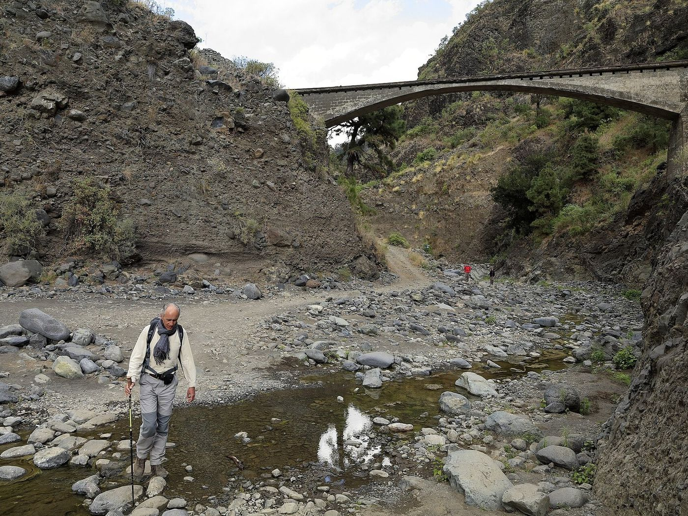
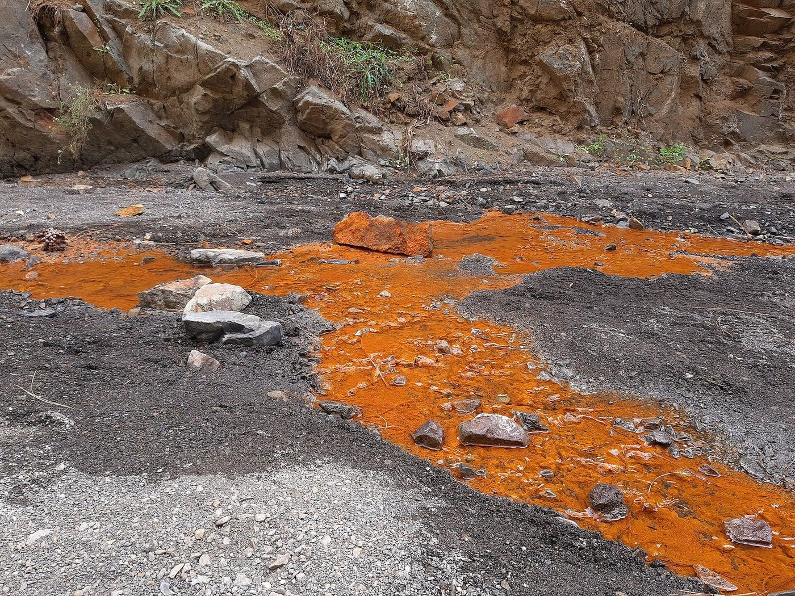
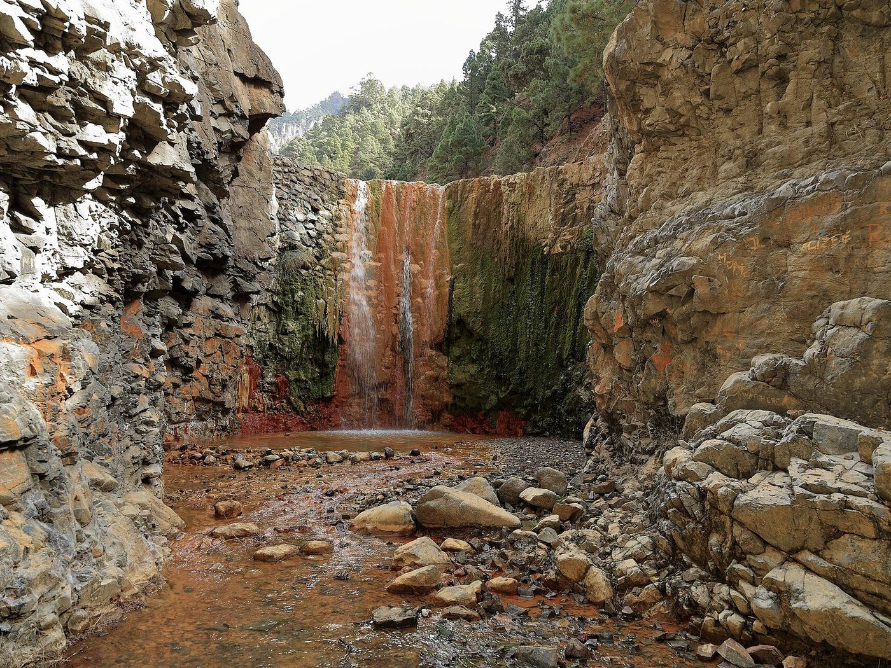
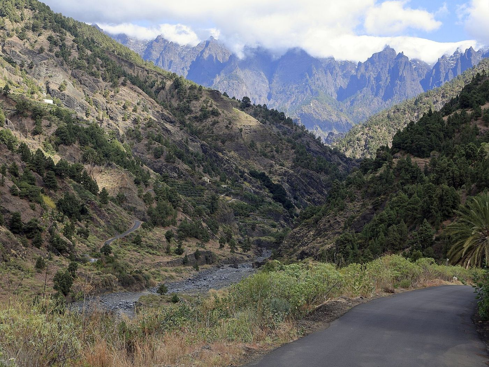

Una pared de roca teñida de naranja, verde y amarillo por la que cae un hilo de agua en pleno corazón de la **Caldera de Taburiente**. La **Cascada de Colores** es una de las rutas más bonitas de **La Palma**, y se llega caminando por el cauce de un barranco.

Te cuento cómo es la ruta, cuánto dura, qué riesgos tiene y cómo saber si está abierta 👇

En un vistazo<h2>Lo que vas a encontrar</h2>

<b>🌈</b>Cascada de colores

<b>🥾</b>Ruta por el barranco

<b>🏞️</b>Parque Nacional

<b>💧</b>Vadeos del arroyo

<b>⚠️</b>Cuidado con las crecidas

Antes de ir<h2>Lo básico de la ruta</h2>

<h3>📏 La ruta</h3>
Unos <strong>11 km ida y vuelta</strong> y unas <strong>4 horas</strong>, con poco desnivel.

<h3>⚠️ El tiempo</h3>
Con <strong>lluvia</strong> el barranco crece y el camino se cierra. Mira el aviso.

<h3>🥾 Lleva</h3>
<strong>Calzado que pueda mojarse</strong>, agua y comida: no hay servicios.

El porqué<h2>Por qué es de colores</h2>

El agua que baja por esta pared arrastra minerales disueltos, sobre todo <strong>óxidos de hierro</strong>, que al depositarse tiñen la roca de naranja y rojo. Donde la humedad es constante crecen además musgos y algas verdes, y de ahí el conjunto de colores. Es un fenómeno natural dentro de la <strong>Caldera de Taburiente</strong>, un cráter erosionado de unos 8 km de diámetro que es Parque Nacional.

La ruta<h2>Cómo es el camino</h2>

<ol class="guide__grid guide__grid--cuenca">
<li class="gcard reveal">
01

<h3>El barranco de las Angustias</h3>
El camino remonta el cauce de este barranco, entre paredes de roca que se estrechan poco a poco. Es llano, pero con piedras sueltas.

</li>
<li class="gcard reveal">
02

<h3>Los vadeos</h3>
El arroyo se cruza varias veces, a veces saltando de piedra en piedra y otras mojándote los pies. Con calzado adecuado es parte de la gracia.

</li>
<li class="gcard reveal">
03

<h3>El arroyo rojizo</h3>
Cerca de la cascada, el cauce se tiñe de naranja por los minerales del agua. Un aviso de que ya estás llegando.

</li>
<li class="gcard reveal">
04

<h3>La cascada</h3>
Un hilo de agua cae por una pared naranja, verde y amarilla. Hay que mirarla de lejos y sin pisar la zona húmeda.

</li>
<li class="gcard reveal">
05

<h3>Las vistas del valle</h3>
Al volver, el barranco se abre y se ve el valle de Aridane y el mar al fondo.

</li>
</ol>

Seguridad<h2>Cuándo no ir</h2>

El principal riesgo del barranco son las <strong>crecidas repentinas</strong>: en el fondo, un chaparrón arriba puede convertir el arroyo en una riada. Por eso el Cabildo planteó en 2026 un <strong>protocolo de apertura y cierre</strong> del sendero según el tiempo. Mira la previsión el día antes, no entres si hay aviso de lluvia y confirma en la web del Parque Nacional que el recorrido está abierto, porque algunos tramos han estado cerrados temporalmente.

Cómo llegar<h2>Cómo llegar a la Cascada de Colores</h2>

<strong>Dónde empieza:</strong> en el barranco de las Angustias, junto a Los Llanos de Aridane, en el oeste de La Palma. Consulta el punto de salida y el aparcamiento en la web del Parque Nacional.

<strong>Antes de ir:</strong> comprueba el estado del sendero y la previsión meteorológica, y lleva agua y comida suficientes. No hay bares ni fuentes en el camino.

<strong>Con guía:</strong> si prefieres no organizarte, hay <a href="https://www.civitatis.com/es/los-llanos-de-aridane/senderismo-caldera-taburiente/?aid=110968" target="_blank" rel="noopener sponsored">senderismo guiado por la Caldera de Taburiente</a>.

<a class="btn guide__mapbtn" href="https://www.google.com/maps/search/?api=1&query=Barranco%20de%20las%20Angustias%2C%20Los%20Llanos%20de%20Aridane%2C%20La%20Palma" target="_blank" rel="noopener"><svg class="ico" viewBox="0 0 24 24" width="15" height="15" aria-hidden="true" fill="currentColor"><path d="M12 2a7 7 0 0 0-7 7c0 5.25 7 13 7 13s7-7.75 7-13a7 7 0 0 0-7-7zm0 9.5a2.5 2.5 0 1 1 0-5 2.5 2.5 0 0 1 0 5z"/></svg> Cómo llegar en Google Maps</a>

Para ver la Caldera desde arriba, mira el <a href="/blog/caldera-de-taburiente.html">post de la Caldera de Taburiente</a>. Y para el resto de la isla, <a href="/blog/que-hacer-en-la-palma.html">qué hacer en La Palma</a>.

Consejos de Cheno<h2>Para disfrutarlo al máximo</h2><ul><li><b>Sal temprano:</b> así evitas el calor y las prisas al volver.</li><li><b>Mira la previsión</b> antes de entrar en el barranco.</li><li><b>Lleva calzado que se pueda mojar</b> y una muda seca en la mochila.</li><li><b>No bebas el agua del arroyo:</b> lleva la tuya.</li><li><b>No salgas del camino</b> ni pises la pared de la cascada.</li></ul>

<h2>¿Te gustan estos planes?</h2>
Sígueme en Instagram como <a href="https://www.instagram.com/chenoaventuras/" target="_blank" rel="noopener">@chenoaventuras</a>: subo escapadas como esta cada semana.
<a class="btn guide__btn" href="/blog.html">Ver más planes en el blog</a>

Información consultada en noviembre de 2026. Los accesos, cierres y permisos cambian a menudo: consúltalos en las webs oficiales del Cabildo de La Palma y del Parque Nacional antes de ir. Fotos de Wikimedia Commons: <a href="https://commons.wikimedia.org/wiki/File:Cascada_colorada_(30629868671).jpg" target="_blank" rel="noopener">Rolf Dietrich Brecher from Germany</a> (CC BY-SA 2.0) · <a href="https://commons.wikimedia.org/wiki/File:I08_810_Cascada_colorada.jpg" target="_blank" rel="noopener">Falk2</a> (CC BY-SA 4.0) · <a href="https://commons.wikimedia.org/wiki/File:Barranco_de_las_Angustias_(La_Palma,_Canarias,_Espa%C3%B1a)_01.JPG" target="_blank" rel="noopener">Tanja Freibott</a> (CC BY-SA 3.0 es) · <a href="https://commons.wikimedia.org/wiki/File:Red-coloured_creed_from_Cascada_de_los_Colores,_La_Palma.jpg" target="_blank" rel="noopener">Gerda Arendt</a> (CC0) · <a href="https://commons.wikimedia.org/wiki/File:I08_706_Barranco_de_las_Angustias.jpg" target="_blank" rel="noopener">Falk2</a> (CC BY-SA 4.0) · <a href="https://commons.wikimedia.org/wiki/File:I08_795_Barranco_de_las_Ang%C3%BAstias.jpg" target="_blank" rel="noopener">Falk2</a> (CC BY-SA 4.0).

