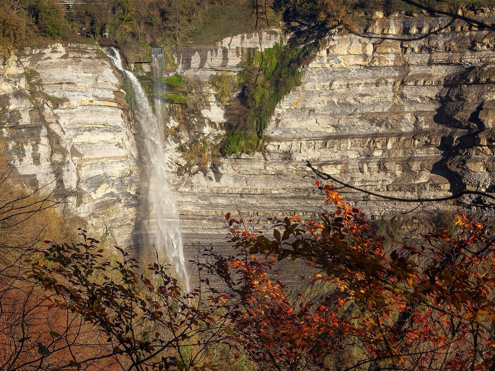
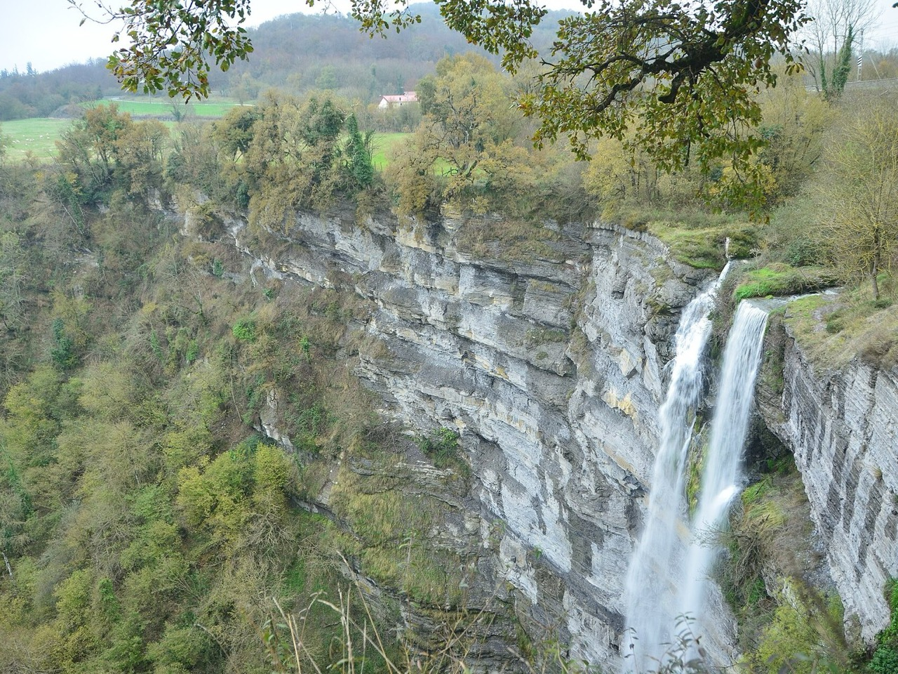
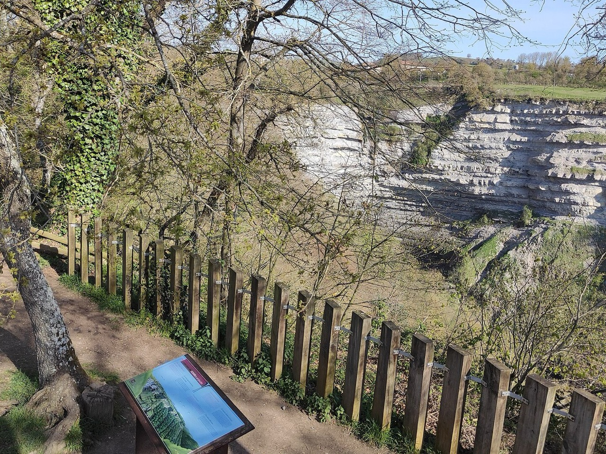
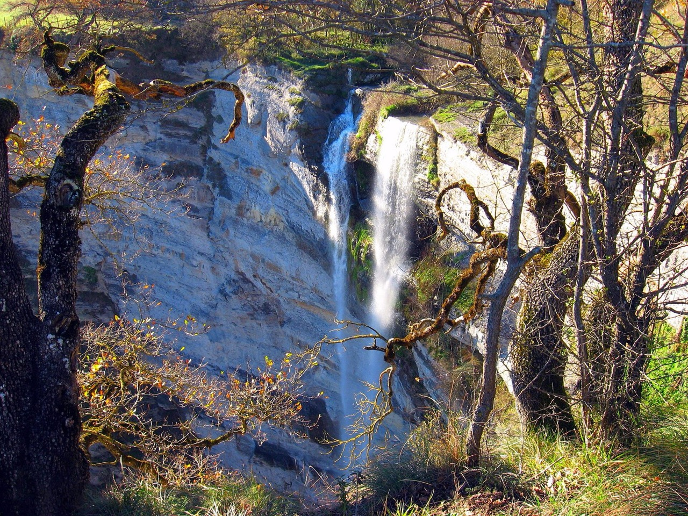

A media hora de Vitoria, junto al pequeño pueblo de **Goiuri**, el arroyo **Oyardo** llega al borde de un cañón y se lanza al vacío. Son **más de 100 metros** de caída entre paredes de roca, una de las **cascadas más altas del País Vasco**. Y lo mejor: el mirador está a un paseo corto del coche. Ahora, en otoño e invierno, es cuando lleva más agua.

Te cuento qué ver 👇

En un vistazo<h2>Lo que vas a encontrar</h2>

<b>💦</b>Más de 100 m

<b>🪨</b>Cañón de roca

<b>👀</b>Mirador gratis

<b>🚶</b>Paseo corto

<b>🍂</b>Mejor con lluvia

Antes de ir<h2>Lo básico de Gujuli</h2>

<h3>📍 Dónde está</h3>
En <strong>Urkabustaiz</strong> (Álava), junto al pueblo de Goiuri, a unos 30 minutos de Vitoria.

<h3>🚶 Paseo</h3>
Menos de un kilómetro, <strong>llano</strong>, desde el aparcamiento al mirador.

<h3>🆓 Precio</h3>
<strong>Gratis</strong> y sin horario. En verano casi no tiene agua.

Qué ver<h2>Qué ver en la cascada de Gujuli</h2>

<ol class="guide__grid guide__grid--cuenca">
<li class="gcard reveal">
01

<h3>La cascada</h3>
Un chorro que cae <strong>más de 100 metros</strong> por una pared de roca a capas. Con lluvia, el ruido se oye desde lejos.

</li>
<li class="gcard reveal">
02

<h3>El cañón</h3>
El arroyo ha excavado un <strong>barranco de más de 100 metros</strong>. Desde arriba se ven las capas de roca.

</li>
<li class="gcard reveal">
03

<h3>El mirador</h3>
Barandilla de madera y <strong>paneles informativos</strong>. Es el mejor punto para la foto.

</li>
<li class="gcard reveal">
04

<h3>El bosque</h3>
El camino pasa entre <strong>robles y hayas</strong>. En otoño, los colores son preciosos.

</li>
</ol>

Cómo llegar<h2>Cómo llegar a la cascada de Gujuli</h2>

Desde <strong>Vitoria</strong>, toma la carretera hacia <strong>Orduña</strong> (A-2521). Antes de llegar a Goiuri verás un cartel con el aparcamiento del mirador. Desde allí, un paseo corto y llano. Unos 30 minutos en coche desde Vitoria; desde Bilbao, alrededor de 40.

<a class="btn guide__mapbtn" href="https://www.google.com/maps/dir/?api=1&destination=42.983,-2.914" target="_blank" rel="noopener"><svg class="ico" viewBox="0 0 24 24" width="15" height="15" aria-hidden="true" fill="currentColor"><path d="M12 2a7 7 0 0 0-7 7c0 5.25 7 13 7 13s7-7.75 7-13a7 7 0 0 0-7-7zm0 9.5a2.5 2.5 0 1 1 0-5 2.5 2.5 0 0 1 0 5z"/></svg> Cómo llegar en Google Maps</a>

Combínala con <a href="/blog/vitoria-gasteiz-que-ver.html">Vitoria</a>, el <a href="/blog/valle-salado-anana.html">Valle Salado de Añana</a> o el <a href="/blog/parque-natural-valderejo.html">Parque Natural de Valderejo</a>.

Consejos de Cheno<h2>Para disfrutarlo al máximo</h2><ul><li><b>Ve después de llover</b> la cascada cambia muchísimo.</li><li><b>No pases de la barandilla</b> el borde del cañón es muy peligroso.</li><li><b>Lleva calzado cómodo</b> el camino puede tener barro.</li></ul>

<!--actividades-->

<!--faq-->

<h2>¿Te gustan estos planes?</h2>
Sígueme en Instagram como <a href="https://www.instagram.com/chenoaventuras/" target="_blank" rel="noopener">@chenoaventuras</a>: subo escapadas como esta cada semana.
<a class="btn guide__btn" href="/blog.html">Ver más planes en el blog</a>

Información consultada en noviembre de 2026 (guías de turismo de Álava y Diario Deia). Los horarios y precios cambian: confírmalos antes de ir. Fotos de Wikimedia Commons: <a href="https://commons.wikimedia.org/wiki/File:Goiuriko_ur-jauzia._Cascada_de_Goiuri._-_14409199238.jpg" target="_blank" rel="noopener">Uraren Euskal Agentzia. Agencia Vasca del Agua.</a> (CC BY 2.0), <a href="https://commons.wikimedia.org/wiki/File:Goiuri_waterfall.jpg" target="_blank" rel="noopener">jokin.lacalle</a> (CC BY 2.0), <a href="https://commons.wikimedia.org/wiki/File:Goiuriko_ur-jauzia._Cascada_de_Goiuri._-_14572775056.jpg" target="_blank" rel="noopener">Uraren Euskal Agentzia. Agencia Vasca del Agua.</a> (CC BY 2.0), <a href="https://commons.wikimedia.org/wiki/File:Mirador_de_la_cascada_de_Goiuri.jpg" target="_blank" rel="noopener">Julen Iturbe-Ormaetxe</a> (CC BY-SA 2.0), <a href="https://commons.wikimedia.org/wiki/File:Salto_Gujuli_o_Goiuri.jpg" target="_blank" rel="noopener">Gonzopowers</a> (CC BY 2.0).

