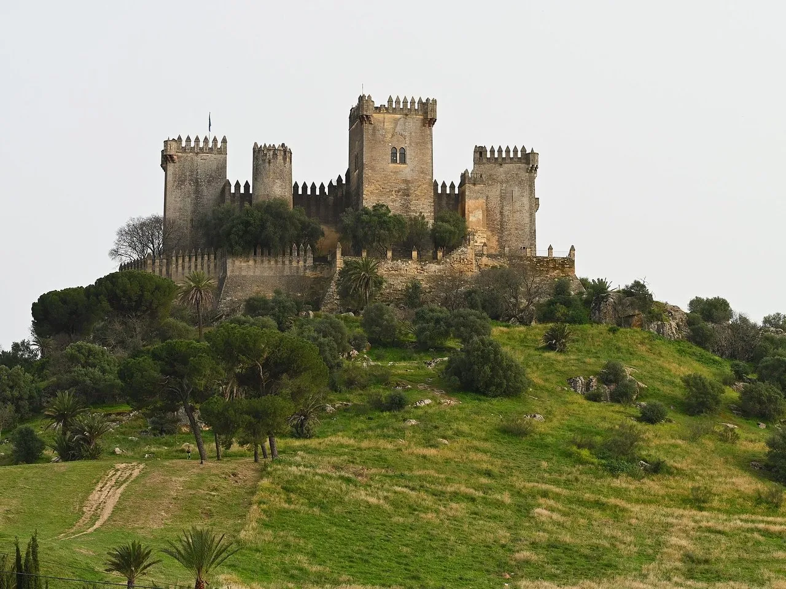
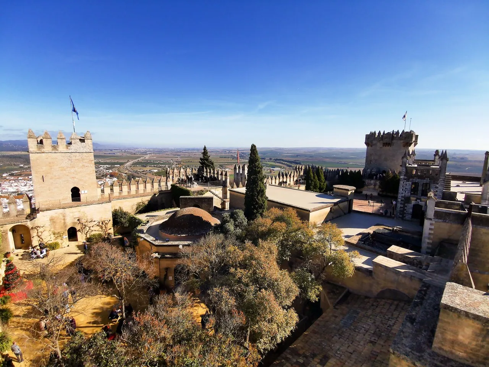
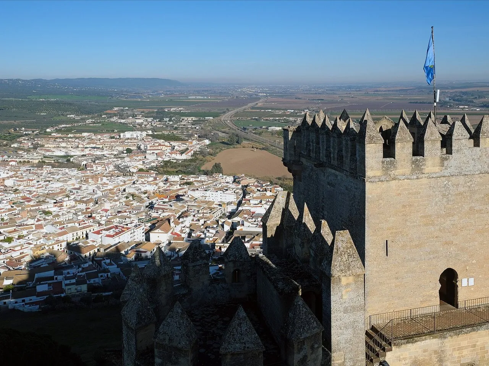
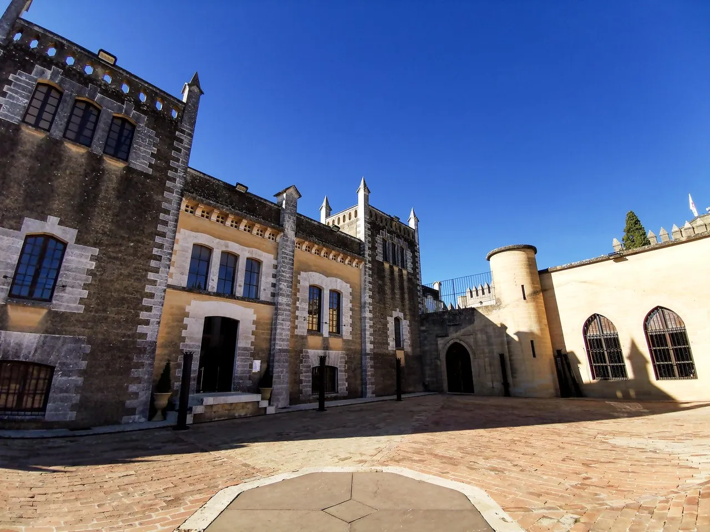
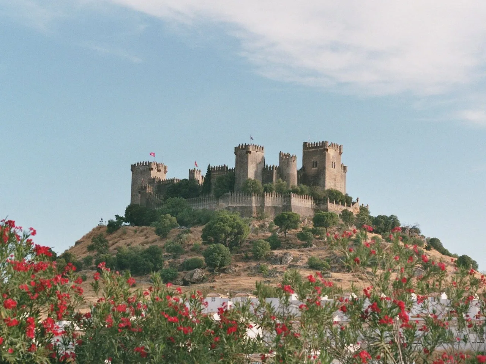
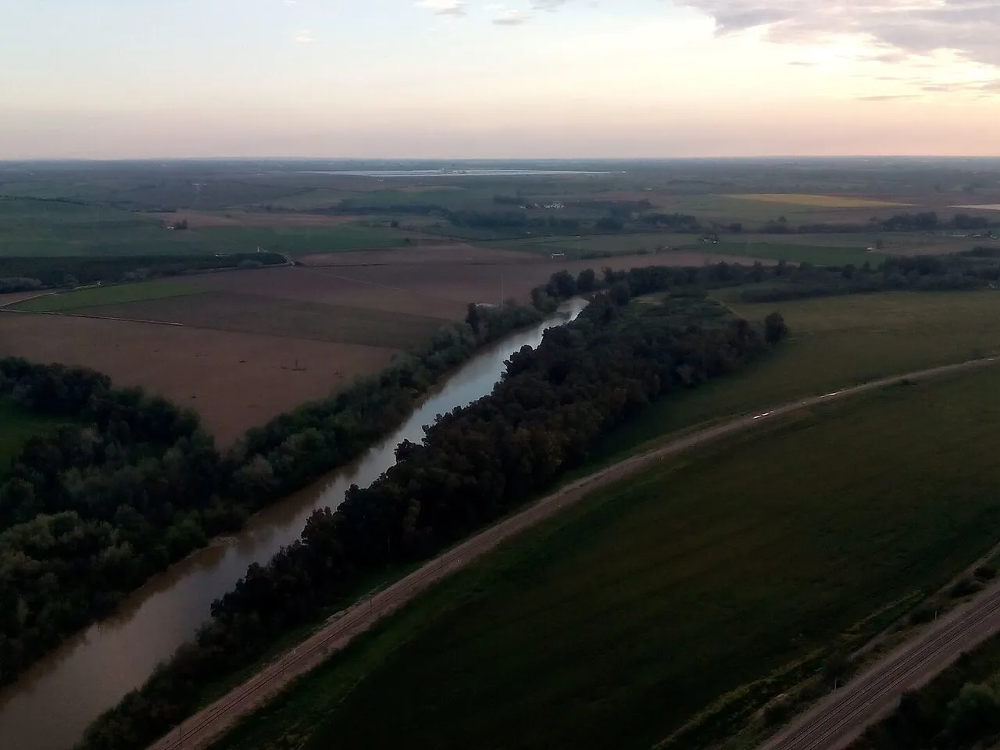

Un castillo con almenas y torres que parece sacado de un cuento, en lo alto de un cerro sobre el **Guadalquivir**. El **castillo de Almodóvar del Río** tiene más de **13 siglos** de historia, está tan bien conservado que lo eligieron para **Altojardín** en **Juego de Tronos**, y está a media hora de **Córdoba**.

Te cuento sus horarios, qué ver dentro y cómo llegar 👇

En un vistazo<h2>Lo que vas a encontrar</h2>

<b>🏰</b>Castillo del siglo VIII

<b>🐉</b>Juego de Tronos

<b>🗼</b>Torres y almenas

<b>⛓️</b>Mazmorras

<b>🌄</b>Vistas al Guadalquivir

Antes de ir<h2>Lo básico del castillo de Almodóvar</h2>

<h3>📍 Dónde está</h3>
En el cerro de <strong>El Redondo</strong>, sobre el pueblo de Almodóvar del Río, a unos <strong>25 km de Córdoba</strong>.

<h3>🕚 Horario de invierno</h3>
De octubre a marzo: de lunes a viernes, <strong>11:00-14:30 y 16:00-19:00</strong>; fines de semana y festivos, <strong>11:00-19:00</strong>. Última entrada, una hora antes.

<h3>🎟️ Entradas</h3>
Se compran en taquilla o con la <a href="https://www.civitatis.com/es/almodovar-del-rio/entrada-castillo-almodovar-rio/?aid=110968" target="_blank" rel="noopener sponsored">entrada online</a>, que incluye todas las estancias y los jardines.

<h3>⏱️ Tiempo</h3>
Entre una hora y hora y media por libre. La <strong>visita guiada</strong> dura hora y media.

Qué ver<h2>Qué ver en el castillo de Almodóvar del Río</h2>

<ol class="guide__grid guide__grid--cuenca">
<li class="gcard reveal">
01

<h3>El castillo desde abajo</h3>
La mejor foto es desde la carretera de subida: las torres asomando sobre el cerro de El Redondo, con el pueblo blanco a sus pies.

</li>
<li class="gcard reveal">
02

<h3>El patio de armas y las murallas</h3>
Se recorren las murallas y el <strong>patio de armas</strong>, con paneles, maquetas y proyecciones que cuentan quién vivió aquí y qué batallas se libraron.

</li>
<li class="gcard reveal">
03

<h3>Las torres</h3>
La del <strong>Homenaje</strong>, la de la <strong>Escuela</strong>, la <strong>Redonda</strong>, la <strong>Pequeña</strong> y la de la <strong>Escucha</strong>. Desde arriba se ve todo el pueblo y el valle.

</li>
<li class="gcard reveal">
04

<h3>Las estancias y las mazmorras</h3>
Dentro, las salas restauradas y las <strong>mazmorras</strong>, ligadas a la leyenda de <strong>Pedro I el Cruel</strong> y sus presos.

</li>
<li class="gcard reveal">
05

<h3>El Altojardín de Juego de Tronos</h3>
Aquí se rodaron las escenas de <strong>Altojardín</strong>, el castillo de los Tyrell. Con la <a href="https://www.civitatis.com/es/almodovar-del-rio/visita-guiada-castillo-almodovar-rio/?aid=110968" target="_blank" rel="noopener sponsored">visita guiada</a> te enseñan dónde se rodó cada escena (y también «Camelot»).

</li>
<li class="gcard reveal">
06

<h3>Las vistas del valle</h3>
Desde las almenas se entiende por qué este cerro era tan estratégico: domina el <strong>valle del Guadalquivir</strong> en kilómetros a la redonda.

</li>
</ol>

<!--actividades-->

La historia<h2>Trece siglos de historia</h2>

El castillo nació como <strong>fortaleza andalusí</strong> en el siglo VIII, hacia el año <strong>740</strong>, y fue cambiando de manos entre musulmanes y cristianos. Tras la conquista cristiana tuvo relación con las <strong>órdenes de Calatrava y Santiago</strong> y, según la tradición, <strong>Pedro I el Cruel</strong> usó sus mazmorras. Con los siglos quedó en ruinas, hasta que una gran <strong>restauración a principios del siglo XX</strong> le devolvió el aspecto que tiene hoy, por eso parece tan entero.

Horarios<h2>Horario del castillo por temporadas</h2>

<h3>❄️ Enero-marzo y octubre-diciembre</h3>
Lunes a viernes, 11:00-14:30 y 16:00-19:00. Fines de semana y festivos, 11:00-19:00.

<h3>🌸 Abril, mayo y septiembre</h3>
Lunes a viernes, 11:00-14:30 y 16:00-20:00. Fines de semana y festivos, 11:00-20:00.

<h3>☀️ Junio, julio y 1-15 de agosto</h3>
Lunes a viernes, 9:00-15:30. Fines de semana y festivos, 11:00-20:00.

<h3>🌅 16-31 de agosto</h3>
Lunes a viernes, 11:00-14:30 y 16:00-20:00. Fines de semana y festivos, 11:00-20:00.

Cómo llegar<h2>Cómo llegar al castillo</h2>

Desde <strong>Córdoba</strong>, unos 25 km por la <strong>A-431</strong> hacia el oeste (25-30 minutos). En el pueblo, sigue las indicaciones: una carretera sube hasta cerca de la entrada del castillo. También se puede subir andando desde el casco urbano, con bastante cuesta.

<a class="btn guide__mapbtn" href="https://www.google.com/maps/dir/?api=1&destination=Castillo+de+Almod%C3%B3var+del+R%C3%ADo" target="_blank" rel="noopener"><svg class="ico" viewBox="0 0 24 24" width="15" height="15" aria-hidden="true" fill="currentColor"><path d="M12 2a7 7 0 0 0-7 7c0 5.25 7 13 7 13s7-7.75 7-13a7 7 0 0 0-7-7zm0 9.5a2.5 2.5 0 1 1 0-5 2.5 2.5 0 0 1 0 5z"/></svg> Cómo llegar al castillo</a>

Plan de Cheno<h2>Medio día desde Córdoba</h2><ul><li><b>Mañana:</b> castillo de Almodóvar a primera hora (abre a las 11:00).</li><li><b>Mediodía:</b> comida en el pueblo.</li><li><b>Tarde:</b> de vuelta, para en <a href="/blog/medina-azahara.html">Medina Azahara</a>, que queda de camino, con una <a href="https://www.civitatis.com/es/cordoba/visita-guiada-medina-azahara/?aid=110968" target="_blank" rel="noopener sponsored">visita guiada</a>.</li><li><b>Noche:</b> en <a href="/blog/cordoba-que-ver.html">Córdoba</a>, paseo por la Judería y la <a href="/blog/mezquita-de-cordoba.html">Mezquita</a>.</li></ul>

<!--faq-->

<h2>¿Te gustan estos planes?</h2>
Sígueme en Instagram como <a href="https://www.instagram.com/chenoaventuras/" target="_blank" rel="noopener">@chenoaventuras</a>: subo escapadas como esta cada semana.
<a class="btn guide__btn" href="/blog.html">Ver más planes en el blog</a>

Información consultada en noviembre de 2026 (horarios y contenido de la visita: fichas de la entrada y la visita guiada del castillo en Civitatis). Confirma horarios antes de ir. Fotos de Wikimedia Commons: <a href="https://commons.wikimedia.org/wiki/File:Almodovar_del_Rio_Castle.jpg" target="_blank" rel="noopener">Phillip Capper</a> (CC BY 2.0) · <a href="https://commons.wikimedia.org/wiki/File:Castle_of_Almod%C3%B3var_del_R%C3%ADo_kz01.jpg" target="_blank" rel="noopener">Krzysztof Ziarnek, Kenraiz</a> (CC BY-SA 4.0) · <a href="https://commons.wikimedia.org/wiki/File:Castillo_de_Almod%C3%B3var_del_R%C3%ADo,_vista_superior_02.png" target="_blank" rel="noopener">Javi.cavi</a> (CC BY-SA 4.0) · <a href="https://commons.wikimedia.org/wiki/File:Castillo_Almodovar_del_Rio_2.jpg" target="_blank" rel="noopener">kallerna</a> (CC BY-SA 4.0) · <a href="https://commons.wikimedia.org/wiki/File:Castillo_de_Almod%C3%B3var_del_R%C3%ADo,_plaza_interior.png" target="_blank" rel="noopener">Javi.cavi</a> (CC BY-SA 4.0) · <a href="https://commons.wikimedia.org/wiki/File:Castillo_de_Almod%C3%B3var_del_R%C3%ADo_2009.jpg" target="_blank" rel="noopener">Rabe!</a> (CC BY-SA 3.0) · <a href="https://commons.wikimedia.org/wiki/File:Almod%C3%B3var_del_R%C3%ADo_(C%C3%B3rdoba)._(27370808025).jpg" target="_blank" rel="noopener">Daniel GB</a> (CC BY 2.0).

