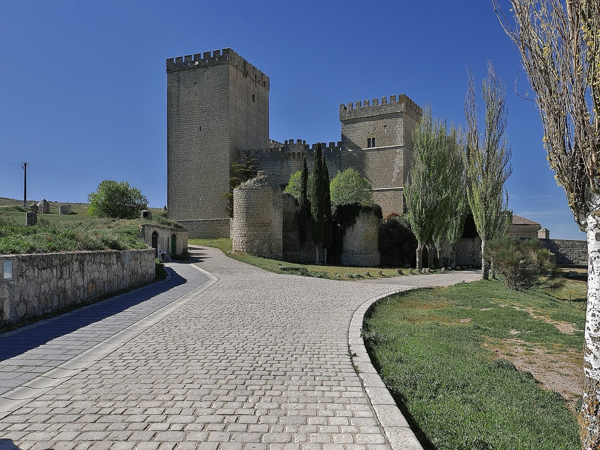
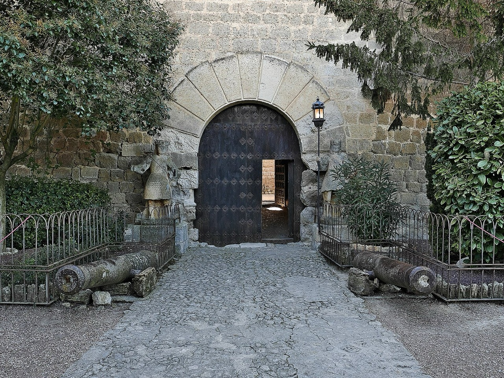
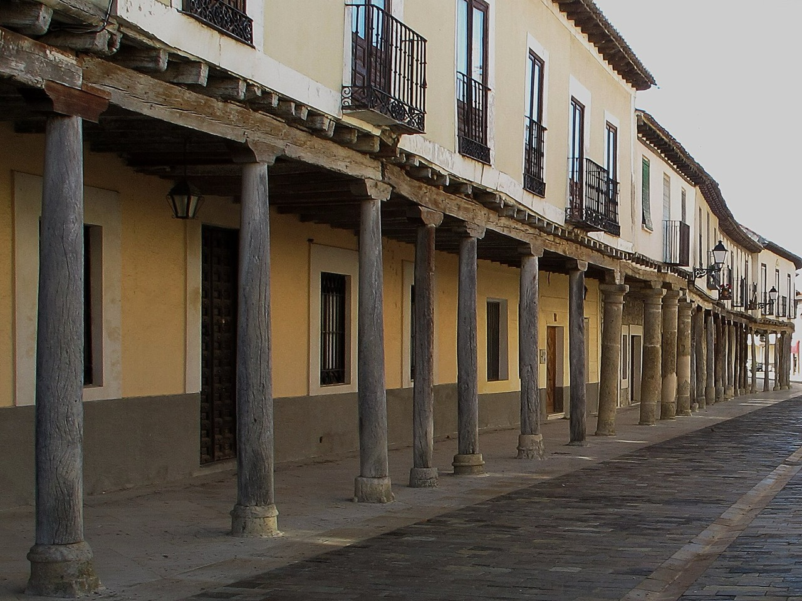
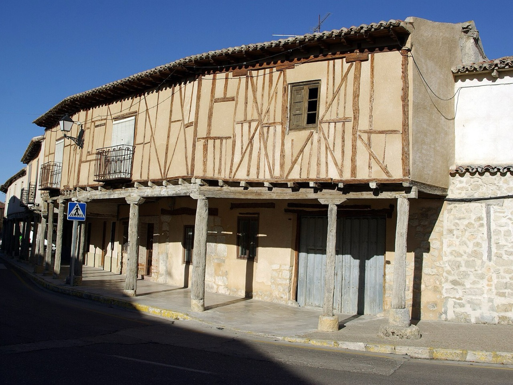
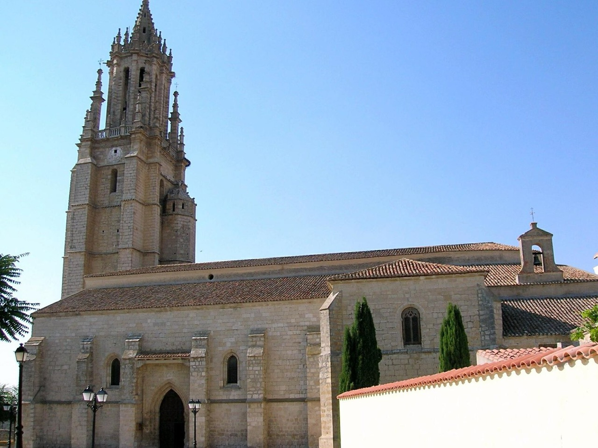

En mitad de la llanura de **Tierra de Campos** aparece un castillo de torres y almenas que parece sacado de un cuento. Es el **castillo de Ampudia**, del **siglo XV**, y lo mejor es que por dentro guarda una colección enorme de arte y antigüedades. Abajo, el pueblo tiene unas calles con **soportales de madera** que son de lo más bonito de Castilla.

Te cuento qué ver 👇

En un vistazo<h2>Lo que vas a encontrar</h2>

<b>🏰</b>Castillo del XV

<b>🏺</b>Colección Fontaneda

<b>🪵</b>Soportales

<b>⛪</b>Giralda de Campos

<b>🌾</b>Tierra de Campos

Antes de ir<h2>Lo básico de Ampudia</h2>

<h3>📍 Dónde está</h3>
En el sur de <strong>Palencia</strong>, a unos 25 km de Valladolid y de Palencia.

<h3>⏱️ Tiempo</h3>
Medio día: <strong>una hora y media</strong> para el castillo y otro rato para el pueblo.

<h3>🎟️ Visita</h3>
El castillo se visita <strong>por libre</strong>, con entrada. El horario cambia según la temporada.

Qué ver<h2>Qué ver en Ampudia</h2>

<ol class="guide__grid guide__grid--cuenca">
<li class="gcard reveal">
01

<h3>El castillo</h3>
Torres almenadas, foso y una <strong>torre del homenaje</strong> que se ve desde lejos. Es Monumento Nacional desde 1931.

</li>
<li class="gcard reveal">
02

<h3>La colección Fontaneda</h3>
Eugenio Fontaneda compró el castillo en 1960 y lo llenó de <strong>arqueología, arte sacro, juguetes</strong> y objetos antiguos.

</li>
<li class="gcard reveal">
03

<h3>La calle Corredera</h3>
Una calle larguísima de <strong>soportales con columnas de madera y piedra</strong>. Pasear por aquí es volver atrás en el tiempo.

</li>
<li class="gcard reveal">
04

<h3>Las casas de entramado</h3>
Casas de <strong>madera y adobe</strong> con soportales, típicas de Tierra de Campos.

</li>
<li class="gcard reveal">
05

<h3>La Giralda de Campos</h3>
La torre de la <strong>colegiata de San Miguel</strong> es tan alta y esbelta que la llaman así. Se ve desde kilómetros.

</li>
</ol>

Cómo llegar<h2>Cómo llegar a Ampudia</h2>

En coche, a unos <strong>30 minutos de Valladolid</strong> y de <strong>Palencia</strong>. Desde Madrid, unas dos horas y media. En el pueblo se aparca sin problema.

<a class="btn guide__mapbtn" href="https://www.google.com/maps/dir/?api=1&destination=41.9168,-4.7806" target="_blank" rel="noopener"><svg class="ico" viewBox="0 0 24 24" width="15" height="15" aria-hidden="true" fill="currentColor"><path d="M12 2a7 7 0 0 0-7 7c0 5.25 7 13 7 13s7-7.75 7-13a7 7 0 0 0-7-7zm0 9.5a2.5 2.5 0 1 1 0-5 2.5 2.5 0 0 1 0 5z"/></svg> Cómo llegar en Google Maps</a>

Por la zona tienes <a href="/blog/palencia-que-ver.html">Palencia</a>, la <a href="/blog/villa-romana-la-olmeda.html">villa romana de La Olmeda</a> y, ya en Valladolid, el <a href="/blog/medina-del-campo-castillo-mota.html">castillo de la Mota</a> y el <a href="/blog/parque-mudejar-olmedo.html">Parque del Mudéjar de Olmedo</a>.

Consejos de Cheno<h2>Para disfrutarlo al máximo</h2><ul><li><b>Mira el horario del castillo</b> antes de ir: cambia en invierno y verano.</li><li><b>Pasea los soportales</b> con calma: es lo más fotogénico del pueblo.</li><li><b>Fíjate en el horizonte</b> la torre de la colegiata se ve desde la carretera.</li></ul>

<!--actividades-->

<!--faq-->

<h2>¿Te gustan estos planes?</h2>
Sígueme en Instagram como <a href="https://www.instagram.com/chenoaventuras/" target="_blank" rel="noopener">@chenoaventuras</a>: subo escapadas como esta cada semana.
<a class="btn guide__btn" href="/blog.html">Ver más planes en el blog</a>

Información consultada en noviembre de 2026 (Turismo de Castilla y León). Los horarios y precios cambian: confírmalos antes de ir. Fotos de Wikimedia Commons: <a href="https://commons.wikimedia.org/wiki/File:Castillo_de_Ampudia_1.jpg" target="_blank" rel="noopener">Gabriel Agíou-Dimitríou</a> (CC BY-SA 4.0), <a href="https://commons.wikimedia.org/wiki/File:Torre_del_Homenaje,_Castillo_de_Ampudia.jpg" target="_blank" rel="noopener">Jl FilpoC</a> (CC BY-SA 4.0), <a href="https://commons.wikimedia.org/wiki/File:Puerta_del_Castillo_de_Ampudia.jpg" target="_blank" rel="noopener">Jl FilpoC</a> (CC BY-SA 4.0), <a href="https://commons.wikimedia.org/wiki/File:Soportales_de_la_calle_Corredera_......_Ampudia_(Palencia)_(14381197130).jpg" target="_blank" rel="noopener">jacilluch</a> (CC BY-SA 2.0), <a href="https://commons.wikimedia.org/wiki/File:Ampudia_02_by-dpc.jpg" target="_blank" rel="noopener">David Perez</a> (CC BY 3.0), <a href="https://commons.wikimedia.org/wiki/File:Ampudia_-_Colegiata_de_San_Miguel_06.jpg" target="_blank" rel="noopener">Zarateman</a> (CC0).

