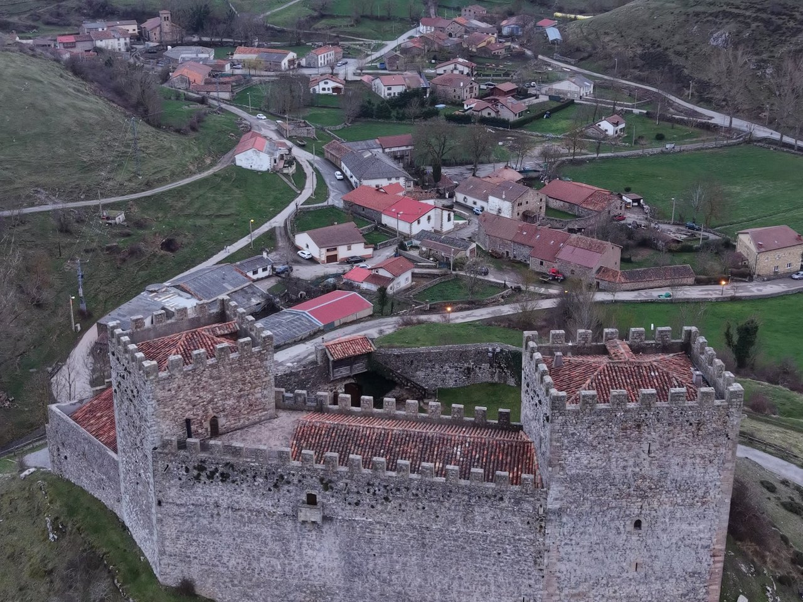
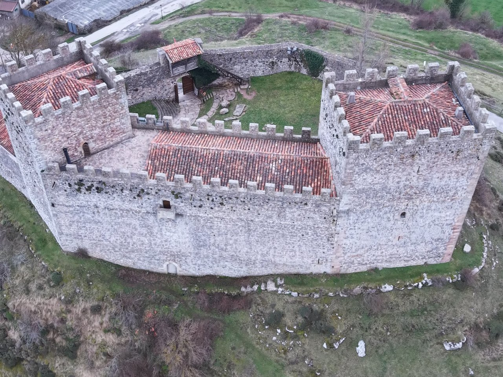
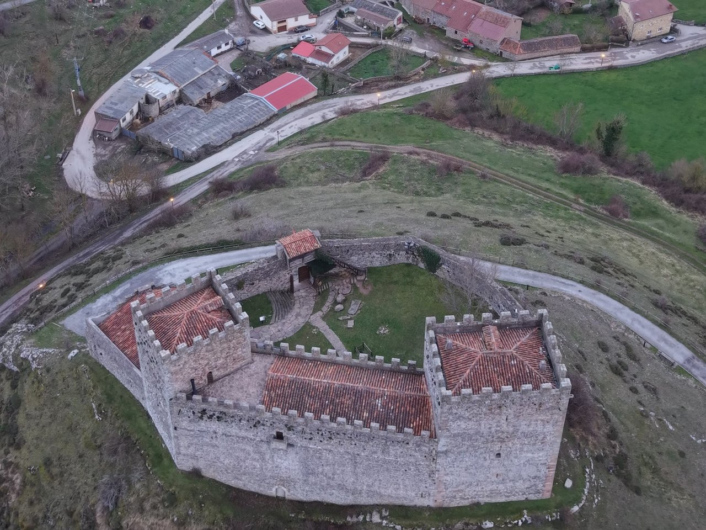
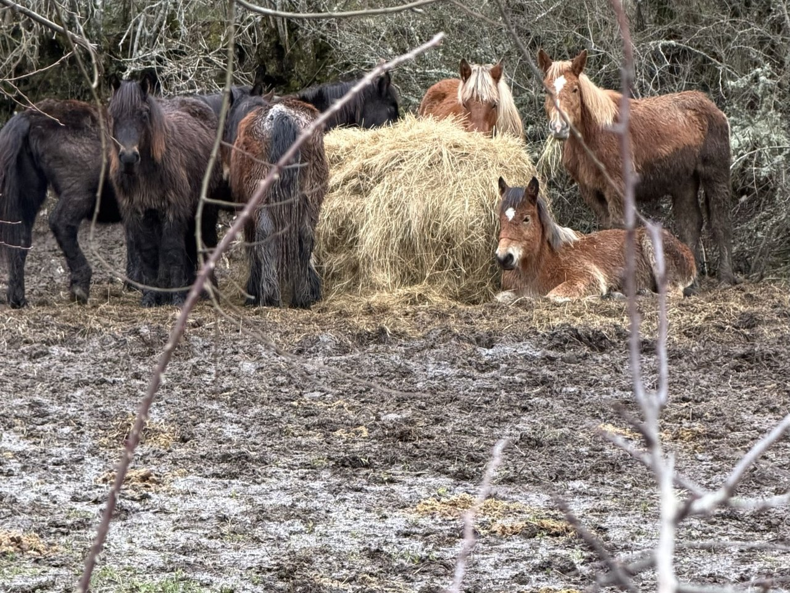

En el sur de Cantabria, donde los valles verdes ya se parecen a Castilla, un **castillo de torres almenadas** corona un cerro sobre el pueblo de **Argüeso**. Vigilaba el antiguo camino entre la costa y la meseta. Al lado tienes un poblado cántabro reconstruido y, en invierno, la nieve de **Alto Campoo** a pocos kilómetros.

Te cuento qué ver 👇

En un vistazo<h2>Lo que vas a encontrar</h2>

<b>🏰</b>Castillo medieval

<b>🛖</b>Poblado cántabro

<b>🐴</b>Caballos sueltos

<b>⛷️</b>Alto Campoo cerca

<b>🏞️</b>Valle de Campoo

Antes de ir<h2>Lo básico de Argüeso</h2>

<h3>📍 Dónde está</h3>
En la <strong>Hermandad de Campoo de Suso</strong>, a unos 20 minutos de Reinosa.

<h3>⏱️ Tiempo</h3>
Entre <strong>1 y 1,5 horas</strong> para el castillo y su entorno. Medio día si sumas el poblado.

<h3>🎟️ Visitas</h3>
El interior abre en fechas concretas, a veces con <strong>visitas teatralizadas</strong>. Confirma antes de ir.

Qué ver<h2>Qué ver en Argüeso</h2>

<ol class="guide__grid guide__grid--cuenca">
<li class="gcard reveal">
01

<h3>El castillo</h3>
Dos <strong>torres almenadas</strong> unidas por murallas sobre un cerro a 979 metros. Perteneció a la familia <strong>Mendoza</strong>.

</li>
<li class="gcard reveal">
02

<h3>Las murallas</h3>
El recinto encierra un patio entre las torres. Controlaba el paso entre la costa y <strong>Castilla</strong> por el valle del Saja.

</li>
<li class="gcard reveal">
03

<h3>El pueblo de Argüeso</h3>
Casas de piedra y tejados rojos a los pies del cerro, rodeadas de <strong>prados y montaña</strong>.

</li>
<li class="gcard reveal">
04

<h3>El valle de Campoo</h3>
Caballos y vacas pastando por todas partes. Es la Cantabria de <strong>montaña</strong>, muy distinta a la costa.

</li>
</ol>

Cerca<h2>Qué combinar con el castillo</h2>

<ul class="checklist" style="margin:0 0 1rem;"><li><strong>Poblado Cántabro</strong>: una reconstrucción de un poblado de los antiguos cántabros, junto al castillo. Se visita con guía.</li><li><strong>Alto Campoo</strong>: la estación de esquí de Cantabria, muy cerca de Argüeso. En invierno, plan perfecto.</li><li><strong><a href="/blog/nacimiento-del-ebro-fontibre.html">El Nacimiento del Ebro</a></strong>, en Fontibre, y <a href="/blog/maquina-leche-reinosa-cantabria.html">Reinosa</a>.</li></ul>

Cómo llegar<h2>Cómo llegar a Argüeso</h2>

En coche, desde <strong>Reinosa</strong>, unos 20 minutos, por la carretera que sube a Alto Campoo. Desde <strong>Santander</strong>, alrededor de una hora y cuarto por la A-67. Hay aparcamiento junto al castillo. En invierno, lleva cadenas si ha nevado.

<a class="btn guide__mapbtn" href="https://www.google.com/maps/dir/?api=1&destination=43.0105,-4.2372" target="_blank" rel="noopener"><svg class="ico" viewBox="0 0 24 24" width="15" height="15" aria-hidden="true" fill="currentColor"><path d="M12 2a7 7 0 0 0-7 7c0 5.25 7 13 7 13s7-7.75 7-13a7 7 0 0 0-7-7zm0 9.5a2.5 2.5 0 1 1 0-5 2.5 2.5 0 0 1 0 5z"/></svg> Cómo llegar en Google Maps</a>

Si vas por la zona, en mi guía de <a href="/blog/cantabria-en-5-dias.html">Cantabria en 5 días</a> tienes más planes.

Consejos de Cheno<h2>Para disfrutarlo al máximo</h2><ul><li><b>Sube al atardecer</b>: la luz sobre las torres es preciosa.</li><li><b>Abrígate</b>: Campoo es de lo más frío de Cantabria.</li><li><b>Respeta al ganado</b>: los caballos y vacas andan sueltos.</li></ul>

<!--actividades-->

<!--faq-->

<h2>¿Te gustan estos planes?</h2>
Sígueme en Instagram como <a href="https://www.instagram.com/chenoaventuras/" target="_blank" rel="noopener">@chenoaventuras</a>: subo escapadas como esta cada semana.
<a class="btn guide__btn" href="/blog.html">Ver más planes en el blog</a>

Información consultada en noviembre de 2026. Los horarios de visita del castillo cambian según la temporada. Fotos: Chenoaventuras.

