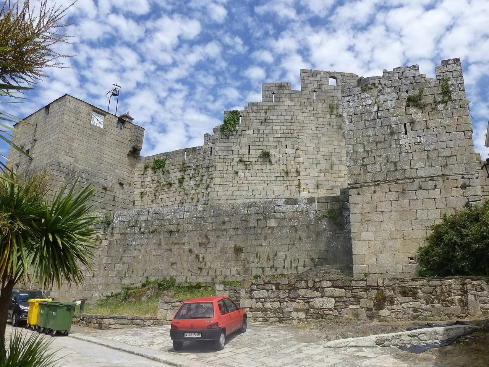
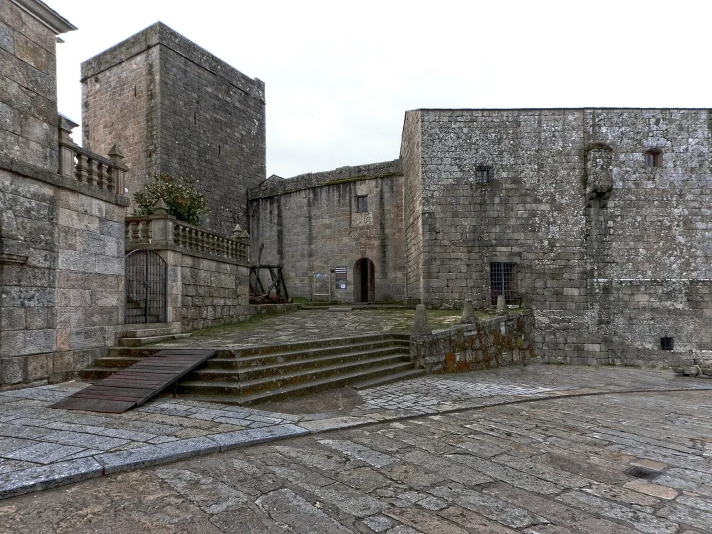
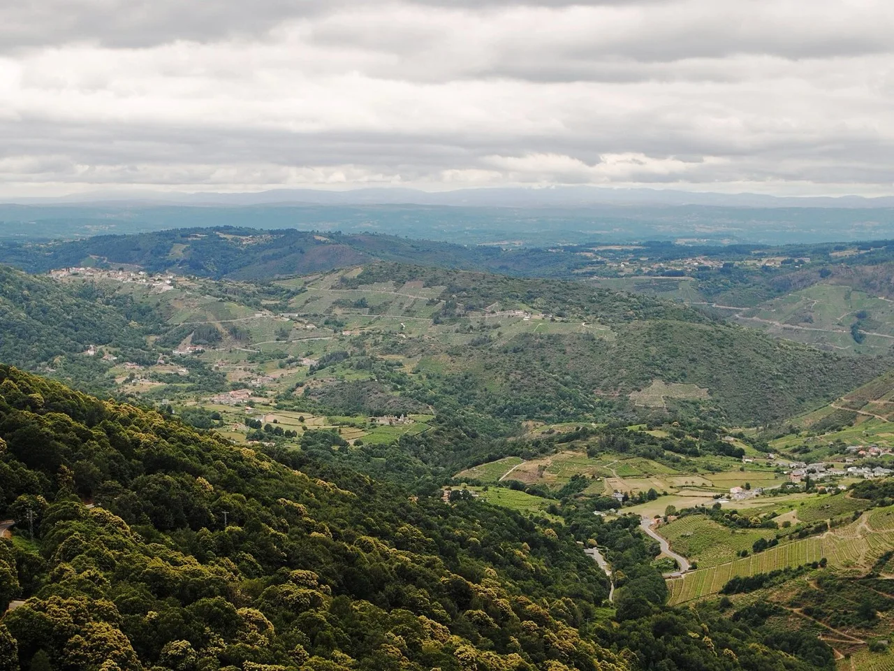
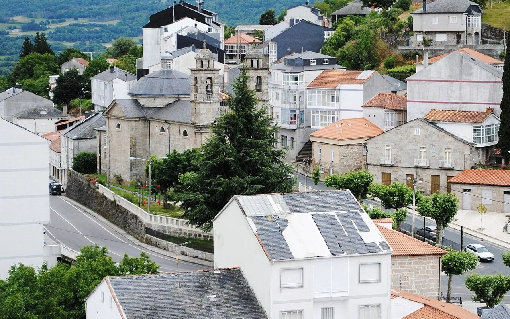
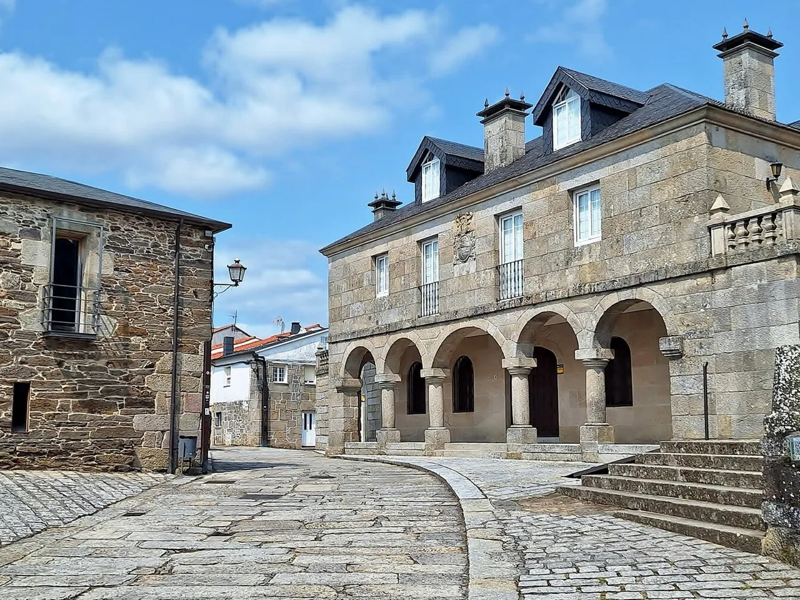

En lo alto de un monte de la **Ribeira Sacra**, entre valles verdes y viñedos, un **castillo del siglo XIV** corona un pueblo de calles de piedra. Es **Castro Caldelas**, en Ourense, y es la puerta perfecta a los **Cañones del Sil**. Desde su torre ves media Galicia interior.

Te cuento qué ver 👇

En un vistazo<h2>Lo que vas a encontrar</h2>

<b>🏰</b>Castillo del XIV

<b>🗼</b>Torre del homenaje

<b>🪨</b>Calles de piedra

<b>🏞️</b>Ribeira Sacra

<b>🚤</b>Cañones del Sil

Antes de ir<h2>Lo básico de Castro Caldelas</h2>

<h3>📍 Dónde está</h3>
En la <strong>Ribeira Sacra</strong>, a unos 50 minutos de Ourense.

<h3>⏱️ Tiempo</h3>
Unas <strong>dos horas</strong> para el pueblo y el castillo. Un día si sumas el barco.

<h3>🎟️ Castillo</h3>
Entrada de <strong>2 €</strong> según la guía oficial de horarios. Confirma antes de ir.

Qué ver<h2>Qué ver en Castro Caldelas</h2>

<ol class="guide__grid guide__grid--cuenca">
<li class="gcard reveal">
01

<h3>El castillo</h3>
Del <strong>siglo XIV</strong>, en la parte alta del pueblo. Dentro hay un museo etnográfico y la oficina de turismo.

</li>
<li class="gcard reveal">
02

<h3>La torre y la muralla</h3>
Sube a la <strong>torre del homenaje</strong> y recorre la muralla. Las vistas son lo mejor de la visita.

</li>
<li class="gcard reveal">
03

<h3>Las vistas</h3>
Desde arriba ves los <strong>valles de la Ribeira Sacra</strong>, con montes, bosques y viñedos.

</li>
<li class="gcard reveal">
04

<h3>El pueblo</h3>
Casas de <strong>granito y pizarra</strong> que bajan por la ladera desde el castillo.

</li>
<li class="gcard reveal">
05

<h3>Las plazas</h3>
Plazas empedradas con casas de piedra y soportales. Busca también la <strong>Torre del Reloj</strong>.

</li>
</ol>

Cómo llegar<h2>Cómo llegar a Castro Caldelas</h2>

En coche, a unos <strong>50 minutos de Ourense</strong> y una hora de <strong>Monforte de Lemos</strong>. Las carreteras de la Ribeira Sacra tienen muchas curvas: tómatelo con calma.

<a class="btn guide__mapbtn" href="https://www.google.com/maps/dir/?api=1&destination=42.3756,-7.4153" target="_blank" rel="noopener"><svg class="ico" viewBox="0 0 24 24" width="15" height="15" aria-hidden="true" fill="currentColor"><path d="M12 2a7 7 0 0 0-7 7c0 5.25 7 13 7 13s7-7.75 7-13a7 7 0 0 0-7-7zm0 9.5a2.5 2.5 0 1 1 0-5 2.5 2.5 0 0 1 0 5z"/></svg> Cómo llegar en Google Maps</a>

Muy cerca tienes los <a href="/blog/canon-del-sil.html">Cañones del Sil</a>. Y por la provincia, <a href="/blog/ourense-que-ver.html">Ourense</a> y <a href="/blog/ribadavia-que-ver.html">Ribadavia</a>.

Consejos de Cheno<h2>Para disfrutarlo al máximo</h2><ul><li><b>Combínalo con el barco</b> por los Cañones del Sil: sale desde la zona de Castro Caldelas.</li><li><b>Sube a la torre</b> con buen tiempo: las vistas lo valen.</li><li><b>Aparca a la entrada</b> en temporada alta, en el área de autocaravanas.</li></ul>

<!--actividades-->

<!--faq-->

<h2>¿Te gustan estos planes?</h2>
Sígueme en Instagram como <a href="https://www.instagram.com/chenoaventuras/" target="_blank" rel="noopener">@chenoaventuras</a>: subo escapadas como esta cada semana.
<a class="btn guide__btn" href="/blog.html">Ver más planes en el blog</a>

Información consultada en noviembre de 2026 (guía de horarios de Monforte y la Ribeira Sacra y Turismo de Galicia). Los horarios y precios cambian: confírmalos antes de ir. Fotos de Wikimedia Commons: <a href="https://commons.wikimedia.org/wiki/File:Castro_Caldelas_dende_o_castelo.JPG" target="_blank" rel="noopener">HombreDHojalata</a> (CC BY-SA 3.0), <a href="https://commons.wikimedia.org/wiki/File:Castro_Caldelas._Castillo_1.JPG" target="_blank" rel="noopener">Txo</a> (CC BY-SA 3.0), <a href="https://commons.wikimedia.org/wiki/File:Castillo_de_Castro_Caldelas.jpg" target="_blank" rel="noopener">Antonio Costa</a> (CC BY-SA 3.0 es), <a href="https://commons.wikimedia.org/wiki/File:50-Castro_Caldelas_%E2%80%94_Praza_da_Torre,_Castro_Caldelas_(Ourense).jpg" target="_blank" rel="noopener">feelSacra</a> (CC BY-SA 4.0), <a href="https://commons.wikimedia.org/wiki/File:Castro_Caldelas,_vista_dende_o_castelo.JPG" target="_blank" rel="noopener">HombreDHojalata</a> (CC BY-SA 3.0).

