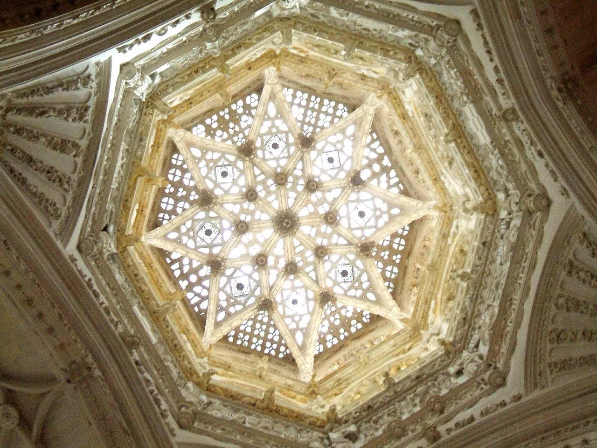
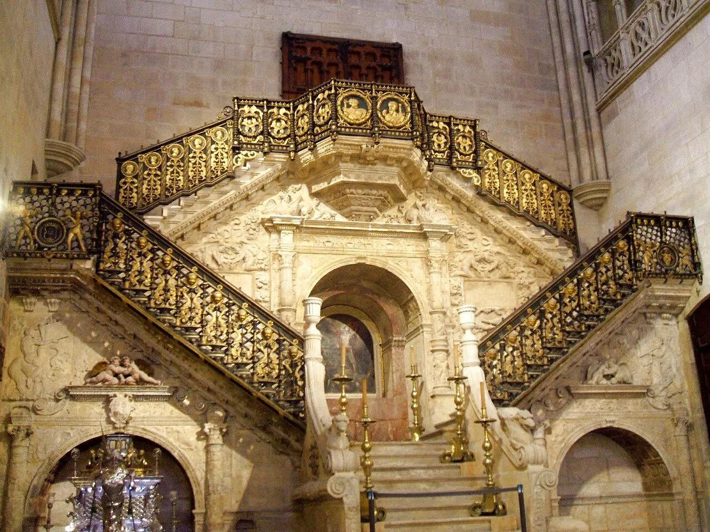
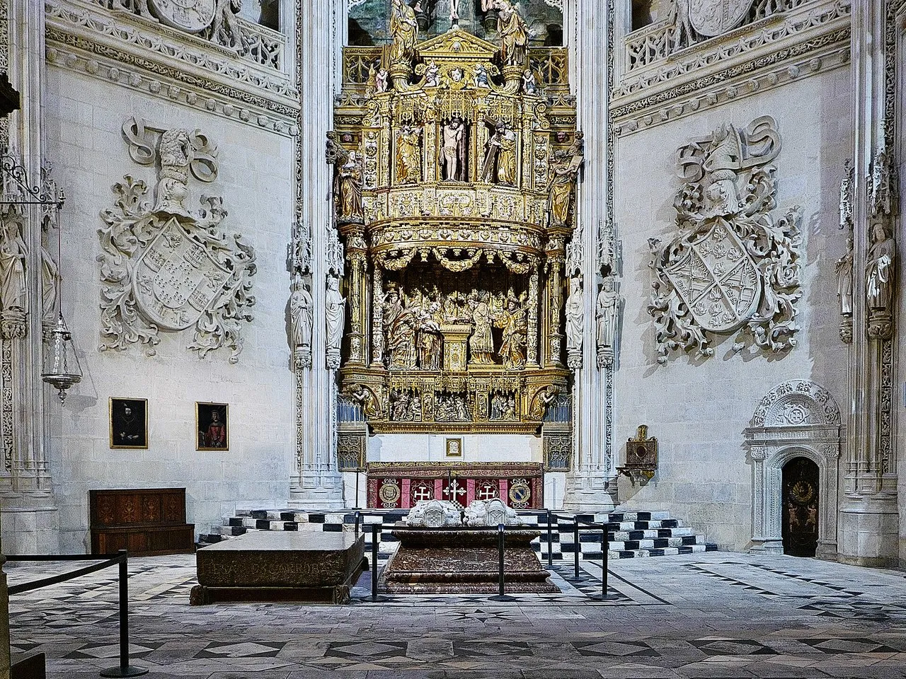
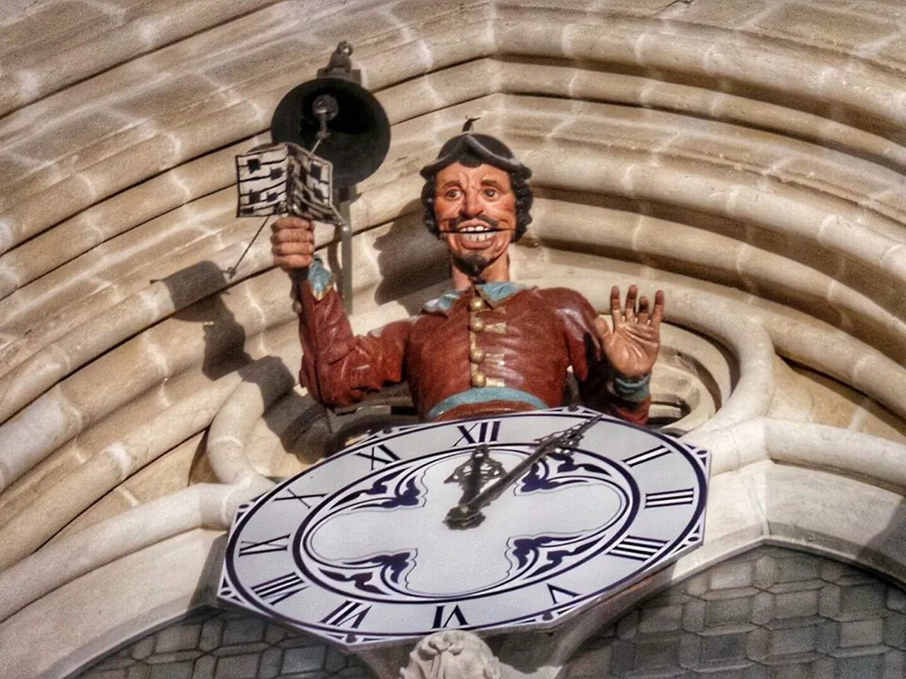
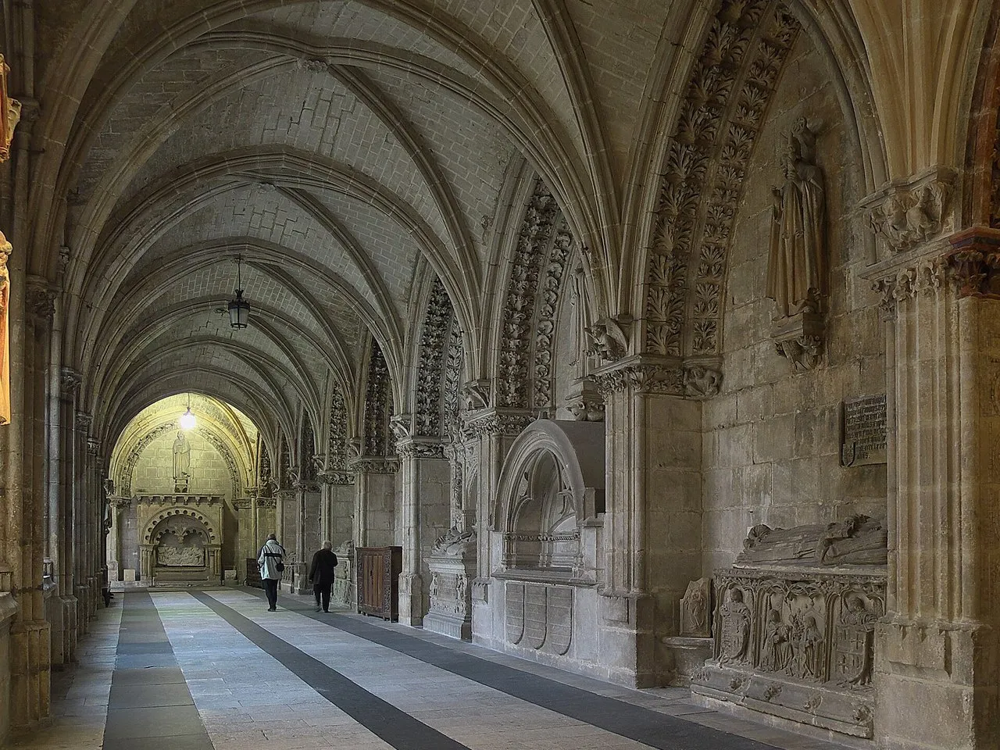
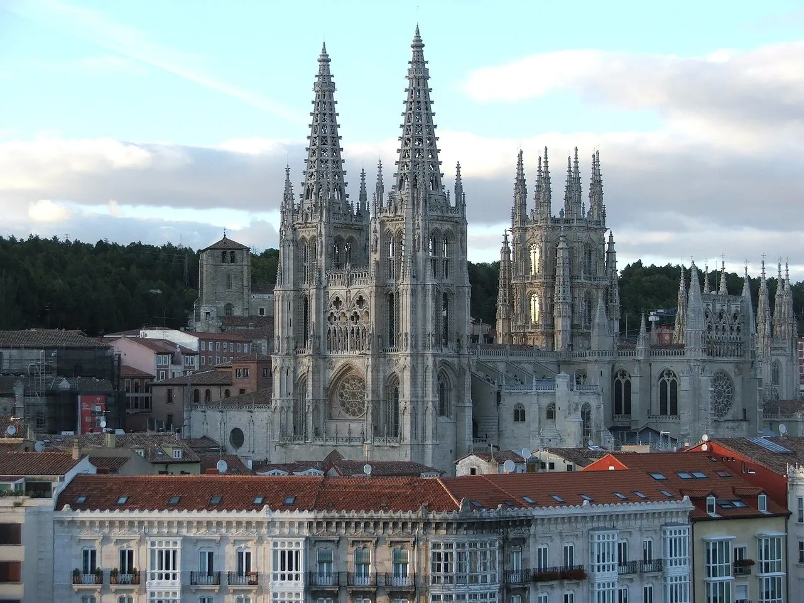

Agujas góticas que parecen de encaje, un cimborrio en forma de estrella y el Cid enterrado bajo él. La **Catedral de Burgos** es Patrimonio de la Humanidad desde **1984** y una de las grandes joyas del gótico en Europa. Y si vas un **martes por la mañana**, entras gratis.

Te cuento cuánto cuesta, cuándo no pagar, el horario y qué no te puedes perder dentro 👇

En un vistazo<h2>Lo que vas a encontrar</h2>

<b>⛪</b>Gótico Patrimonio Mundial

<b>🎟️</b>Entrada 11 €

<b>🆓</b>Gratis martes mañana

<b>⚔️</b>Tumba del Cid

<b>🌙</b>Visita nocturna Stella

Antes de ir<h2>Lo básico de la catedral</h2>

<h3>🎟️ Precio</h3>
General <strong>11 €</strong>; reducidas de 10, 6, 5 y 3 €. Menores de 8 años, gratis (en taquilla).

<h3>🆓 Gratis</h3>
<strong>Martes de 9:30 a 11:25</strong>, solo en taquilla y hasta las 11:15. Sin reserva previa.

<h3>🕙 Horario</h3>
Invierno (1 nov-18 mar) <strong>9:30-18:00</strong>; verano (19 mar-31 oct) <strong>9:30-18:30</strong>.

<h3>🚪 Entrada</h3>
Por la <strong>Puerta del Sarmental</strong>, en la plaza del Rey San Fernando.

Precios<h2>Entradas de la Catedral de Burgos</h2>

<ul class="guide__prices"><li><strong>General:</strong> 11 €</li><li><strong>10 €:</strong> mayores de 65 años y grupos de hasta 10 personas</li><li><strong>6 €:</strong> peregrinos con credencial</li><li><strong>5 €:</strong> personas con discapacidad, familia numerosa, desempleados y estudiantes de 19 a 27 años</li><li><strong>3 €:</strong> de 8 a 18 años</li><li><strong>Gratis:</strong> de 0 a 7 años (solo en taquilla)</li><li><strong>Radioguía:</strong> 1 €; la <strong>guía multimedia</strong> es gratis con la app oficial</li></ul>
Las reducidas se acreditan con el documento oficial en taquilla el mismo día. Si prefieres que te lo cuenten, la <a href="https://www.civitatis.com/es/burgos/visita-guiada-catedral-burgos/?aid=110968" target="_blank" rel="noopener sponsored">visita guiada por la catedral</a> recorre lo más importante con un guía en español.

Qué ver<h2>Lo que no te puedes perder dentro</h2>

<ol class="guide__grid guide__grid--cuenca">
<li class="gcard reveal">
01

<h3>El cimborrio y la tumba del Cid</h3>
Mira hacia arriba en el crucero: la bóveda calada en forma de estrella deja pasar la luz. Justo debajo, en el suelo, están enterrados <strong>el Cid y doña Jimena</strong>.

</li>
<li class="gcard reveal">
02

<h3>La Escalera Dorada</h3>
Obra renacentista de <strong>Diego de Siloé</strong>, con barandillas doradas. Salva el desnivel con la puerta de la Coronería, que da a la calle de arriba.

</li>
<li class="gcard reveal">
03

<h3>La capilla del Condestable</h3>
Casi una catedral dentro de la catedral, con su propia bóveda estrellada, enormes escudos de piedra y los sepulcros de los Condestables de Castilla.

</li>
<li class="gcard reveal">
04

<h3>El Papamoscas</h3>
Un muñeco de madera en lo alto de la nave que <strong>abre la boca y toca la campana</strong> al dar las horas. Ponte debajo a en punto y verás a todo el mundo mirando hacia arriba.

</li>
<li class="gcard reveal">
05

<h3>El claustro</h3>
Galerías góticas con sepulcros y esculturas. Desde aquí se pasa a las salas con orfebrería, pinturas y tapices del museo catedralicio.

</li>
<li class="gcard reveal">
06

<h3>Las agujas por fuera</h3>
Da la vuelta entera: la fachada de Santa María con sus dos torres, la puerta del Sarmental y la vista desde el <strong>mirador del Castillo</strong>, con las agujas sobre los tejados.

</li>
</ol>

<!--actividades-->

De noche<h2>Stella, la visita nocturna</h2>

Al caer la tarde, la catedral se recorre con luces, proyecciones y música original. <strong>Stella</strong> dura unos <strong>60 minutos</strong> y pasa por la capilla de la Presentación, la de Santa Ana, la Escalera Dorada, la capilla de los Condestables, el retablo mayor y la nave central, y termina bajo el cimborrio.

Durante el recorrido suena una <strong>salve del siglo XV</strong> rescatada del archivo de la catedral. Las entradas se compran en la web oficial (catedraldeburgos.es), que anuncia una promoción hasta abril.

Consejos de Cheno<h2>Para disfrutarlo al máximo</h2><ul><li><b>Si vas gratis el martes</b>, llega pronto: la taquilla solo da entradas gratuitas hasta las 11:15.</li><li><b>Descarga la app oficial</b> antes de entrar: la guía multimedia es gratis.</li><li><b>Fotos sin flash</b> ni trípode, y respeta a quien esté rezando.</li><li><b>Ponte bajo el Papamoscas</b> a una hora en punto.</li><li><b>Sigue por la provincia</b>: <a href="/blog/covarrubias-que-ver.html">Covarrubias</a>, <a href="/blog/lerma-que-ver.html">Lerma</a>, <a href="/blog/orbaneja-del-castillo.html">Orbaneja del Castillo</a> o <a href="/blog/merindades-burgos-que-ver.html">Las Merindades</a>.</li></ul>

<!--faq-->

<h2>¿Te gustan estos planes?</h2>
Sígueme en Instagram como <a href="https://www.instagram.com/chenoaventuras/" target="_blank" rel="noopener">@chenoaventuras</a>: subo escapadas como esta cada semana.
<a class="btn guide__btn" href="/blog.html">Ver más planes en el blog</a>

Precios, horarios, acceso gratuito, normas y visita Stella consultados en noviembre de 2026 en la web oficial de la Catedral de Burgos (catedraldeburgos.es). Fotos de Wikimedia Commons: <a href="https://commons.wikimedia.org/wiki/File:Fachada_Sur_-_Catedral_de_Burgos_-_Burgos_01.jpg" target="_blank" rel="noopener">Javier Perez Montes</a> (CC BY-SA 4.0) · <a href="https://commons.wikimedia.org/wiki/File:Burgos_-_Catedral_072_-_Cimborrio.jpg" target="_blank" rel="noopener">Zarateman</a> (CC0) · <a href="https://commons.wikimedia.org/wiki/File:Burgos_-_Catedral_046_-_Escalera_Dorada.jpg" target="_blank" rel="noopener">Zarateman</a> (CC0) · <a href="https://commons.wikimedia.org/wiki/File:Capilla_del_Condestable_(Catedral_de_Burgos).jpg" target="_blank" rel="noopener">Jl FilpoC</a> (CC BY-SA 4.0) · <a href="https://commons.wikimedia.org/wiki/File:La_Catedral_de_Burgos_y_su_interior_(_05_-_octubre_-_2015)_-_21907908600.jpg" target="_blank" rel="noopener">El Coleccionista de Instantes</a> (CC BY-SA 2.0) · <a href="https://commons.wikimedia.org/wiki/File:Catedral_de_Burgos._Claustro_alto.jpg" target="_blank" rel="noopener">Jose Luis Filpo Cabana</a> (CC BY 3.0) · <a href="https://commons.wikimedia.org/wiki/File:Catedral_de_Burgos_II.jpg" target="_blank" rel="noopener">Camino del Cid</a> (CC BY-SA 3.0).

