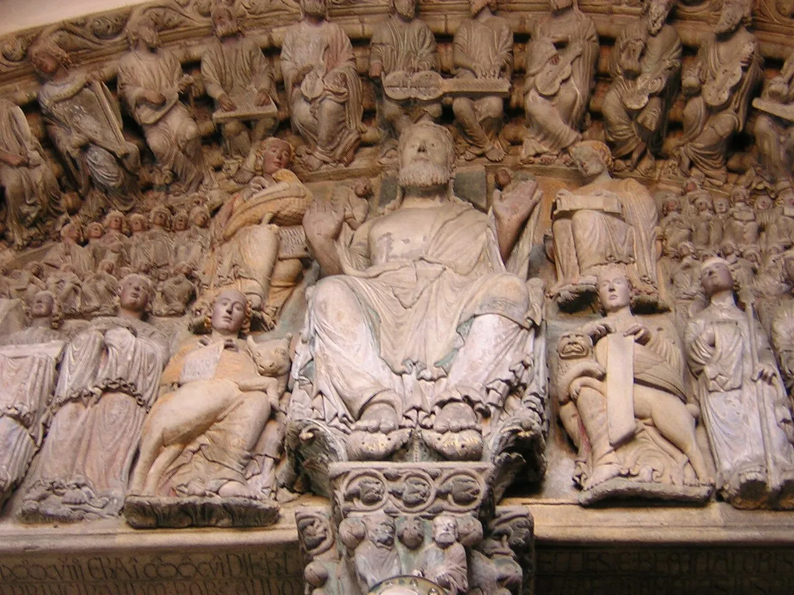
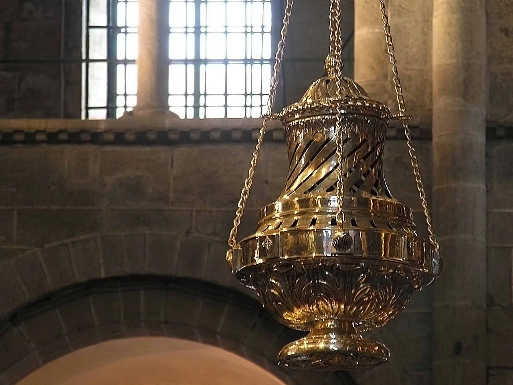
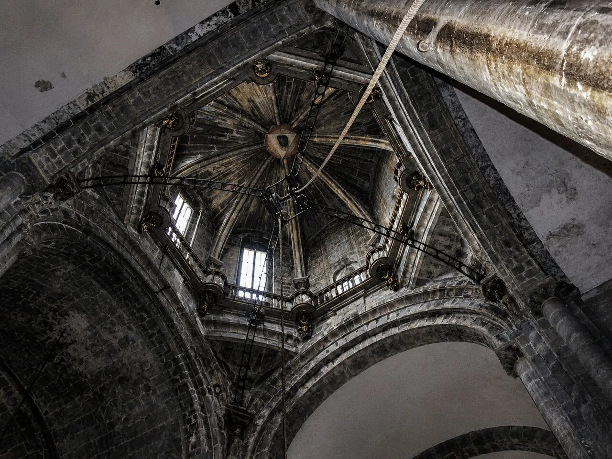
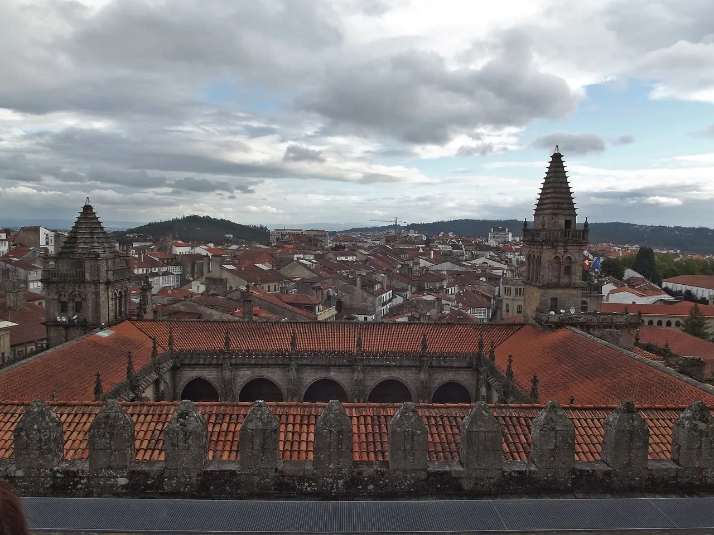
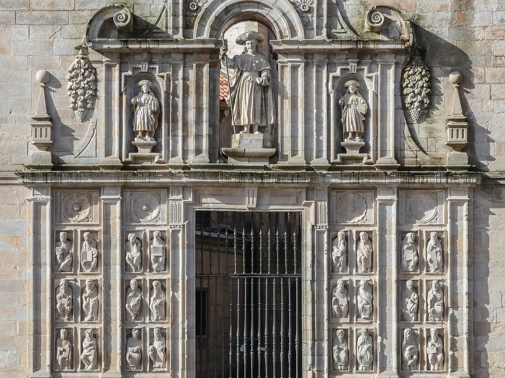
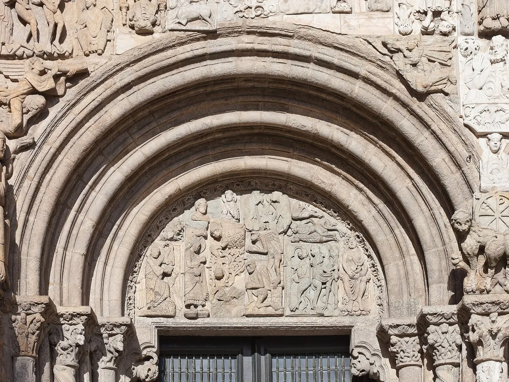

Torres barrocas sobre la plaza del Obradoiro, un pórtico románico que parece tallado ayer y un incensario gigante que vuela de lado a lado de la nave. La **Catedral de Santiago de Compostela** es la meta del Camino y uno de los grandes monumentos de Europa. Y entrar es **gratis**.

Te cuento el horario, qué se paga, el botafumeiro y los cambios por obras de este año 👇

En un vistazo<h2>Lo que vas a encontrar</h2>

<b>⛪</b>Entrada gratis

<b>🗿</b>Pórtico de la Gloria

<b>🔥</b>Botafumeiro

<b>🏠</b>Visita a las cubiertas

<b>🥾</b>Meta del Camino

Antes de ir<h2>Lo básico de la Catedral de Santiago</h2>

<h3>⛪ Catedral</h3>
<strong>Gratis</strong>, todos los días de <strong>7:00 a 21:00</strong>, entrando por la Puerta de Platerías. Sin mochilas.

<h3>🏛️ Museo + Pórtico</h3>
<strong>23 €</strong> (reducida 19 €), de 10:00 a 20:00. Incluye el Pórtico de la Gloria con audioguía y el Palacio de Gelmírez.

<h3>🏠 Cubiertas</h3>
Visita guiada por los tejados, <strong>15 €</strong> (reducida 12 €), unos 60 minutos.

<h3>⚠️ Obras 2026</h3>
Misas del peregrino trasladadas a <strong>San Agustín</strong> y <strong>botafumeiro parado</strong> por restauración, según la web oficial.

Qué ver<h2>Qué ver en la Catedral de Santiago</h2>

<ol class="guide__grid guide__grid--cuenca">
<li class="gcard reveal">
01

<h3>El Pórtico de la Gloria</h3>
La gran obra del románico, con sus figuras talladas en piedra. Se visita en grupos reducidos, con hora asignada y unos 25 minutos de estancia. No se pueden hacer fotos.

</li>
<li class="gcard reveal">
02

<h3>El botafumeiro</h3>
El famoso incensario que vuela sobre el crucero en las grandes fiestas. <strong>Ahora está parado por restauración</strong>, según la catedral.

</li>
<li class="gcard reveal">
03

<h3>El interior y el abrazo al Apóstol</h3>
Bajo el cimborrio está el altar mayor, donde los peregrinos suben por las escaleras de la girola para abrazar la imagen de Santiago.

</li>
<li class="gcard reveal">
04

<h3>Las cubiertas</h3>
Caminar por los tejados de piedra con Santiago a tus pies: 140 escalones y unos 72 m de altura en la Torre de la Carraca.

</li>
<li class="gcard reveal">
05

<h3>La Puerta Santa</h3>
En la plaza de la Quintana, la puerta que solo se abre en los Años Santos Jacobeos.

</li>
<li class="gcard reveal">
06

<h3>La puerta de Platerías</h3>
La portada románica por la que se entra hoy a la catedral, en la plaza del mismo nombre.

</li>
</ol>

<!--actividades-->

Misas<h2>La misa del peregrino y el botafumeiro</h2>

<h3>🕢 7:30</h3>
Misa del peregrino en la <strong>Capilla de la Comunión</strong>, dentro de la catedral.

<h3>⛪ 9:30, 12:00 y 19:30</h3>
Temporalmente en la <strong>iglesia de San Agustín</strong>, por las obras del altar mayor.

<h3>🔥 Botafumeiro</h3>
En las grandes solemnidades del calendario litúrgico. Ahora, parado por restauración: confírmalo en la web oficial.

<h3>🚫 Durante las misas</h3>
No se hace visita turística ni se accede al Pórtico.

Consejos de Cheno<h2>Para disfrutarla al máximo</h2><ul><li><b>Reserva el Pórtico y las cubiertas</b> con antelación: van por grupos con hora.</li><li><b>Deja la mochila</b> en el alojamiento o en una consigna.</li><li><b>Visita guiada</b> si quieres entender todo: la <a href="https://www.civitatis.com/es/santiago-de-compostela/visita-guiada-museo-catedral-santiago/?aid=110968" target="_blank" rel="noopener sponsored">visita guiada por la catedral</a> o la <a href="https://www.civitatis.com/es/santiago-de-compostela/audioguia-catedral-santiago/?aid=110968" target="_blank" rel="noopener sponsored">audioguía</a>.</li><li><b>Combínala con</b> <a href="/blog/santiago-de-compostela-que-ver.html">qué ver en Santiago</a> y una excursión al <a href="/blog/cabo-fisterra.html">Cabo de Fisterra</a>.</li></ul>

<!--faq-->

<h2>¿Te gustan estos planes?</h2>
Sígueme en Instagram como <a href="https://www.instagram.com/chenoaventuras/" target="_blank" rel="noopener">@chenoaventuras</a>: subo escapadas como esta cada semana.
<a class="btn guide__btn" href="/blog.html">Ver más planes en el blog</a>

Información consultada en noviembre de 2026 en la web oficial de la Catedral de Santiago y su web de visitas. Los avisos por obras pueden cambiar: confírmalos antes de ir. Fotos de Wikimedia Commons: <a href="https://commons.wikimedia.org/wiki/File:2010-Catedral_de_Santiago_de_Compostela-Galicia_(Spain)_3.jpg" target="_blank" rel="noopener">Luis Miguel Bugallo Sánchez</a> (CC BY-SA 3.0) · <a href="https://commons.wikimedia.org/wiki/File:Pantocrator_del_p%C3%B3rtico_de_la_Gloria_en_Santiago_de_Compostela.jpg" target="_blank" rel="noopener">pedronchi</a> (CC BY 2.0) · <a href="https://commons.wikimedia.org/wiki/File:Santiago_Catedral_Botafumeiro.jpg" target="_blank" rel="noopener">Luis Miguel Bugallo Sánchez</a> (CC BY-SA 3.0) · <a href="https://commons.wikimedia.org/wiki/File:2007_Cathedral_of_Santiago_de_Compostela_(interior)_(4).jpg" target="_blank" rel="noopener">Chris06</a> (CC BY-SA 4.0) · <a href="https://commons.wikimedia.org/wiki/File:Cubiertas_catedral_Santiago_(7983279462).jpg" target="_blank" rel="noopener">amaianos</a> (CC BY 2.0) · <a href="https://commons.wikimedia.org/wiki/File:2026._Porta_Santa_exterior._Catedral_de_Santiago_de_Compostela._Galiza-2.jpg" target="_blank" rel="noopener">Luis Miguel Bugallo Sánchez</a> (CC BY-SA 4.0) · <a href="https://commons.wikimedia.org/wiki/File:Praza_de_prater%C3%ADas._Catedral_de_Santiago_de_Compostela._01-2011-2.jpg" target="_blank" rel="noopener">Luis Miguel Bugallo Sánchez</a> (CC BY 3.0).

