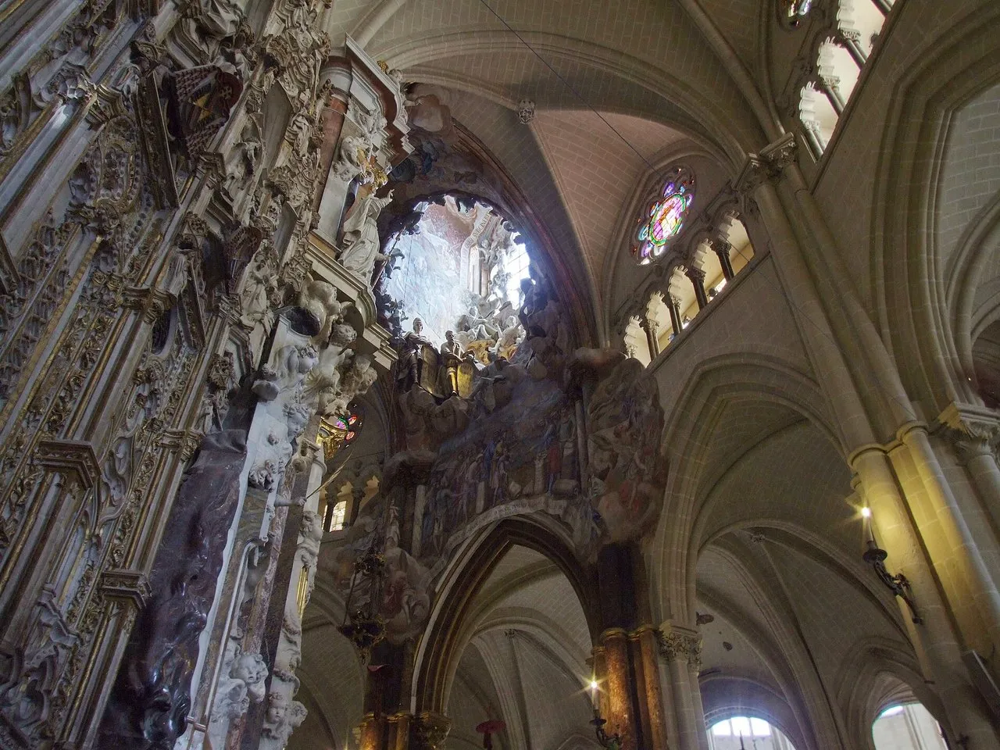
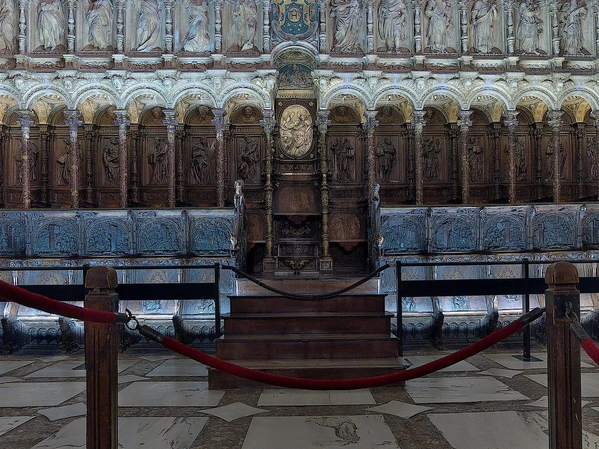
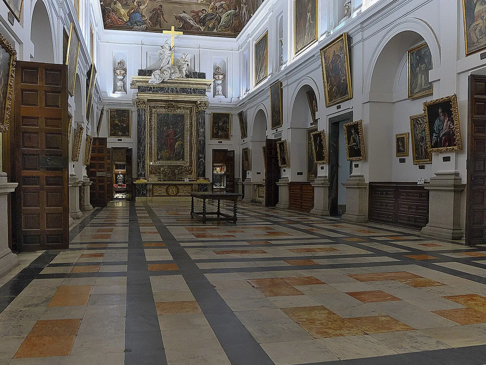
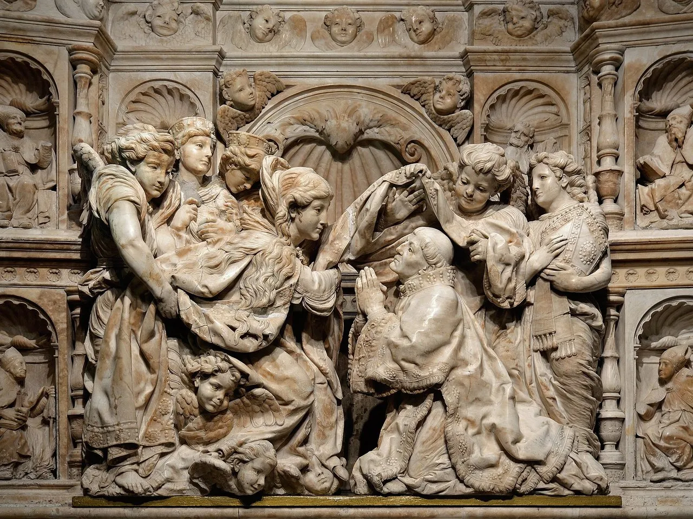
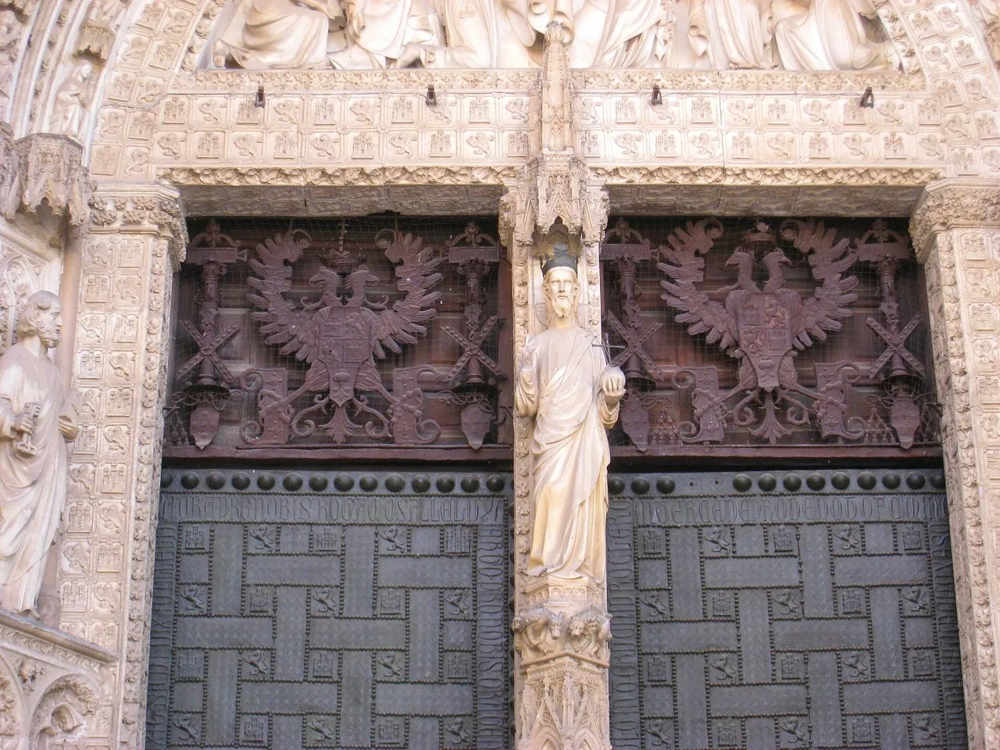

Una de las catedrales góticas más grandes de España, con un retablo por el que entra la luz del cielo, un coro tallado como un encaje y una sacristía llena de obras de **El Greco**. La **Catedral Primada de Toledo** es imprescindible en cualquier visita a la ciudad.

Te cuento cuánto cuesta, quién entra gratis, el horario y qué no perderte 👇

En un vistazo<h2>Lo que vas a encontrar</h2>

<b>☀️</b>El Transparente

<b>🎨</b>El Greco y Goya

<b>🪑</b>Coro tallado

<b>🏆</b>Custodia de Arfe

<b>🌙</b>Lumina de noche

Antes de ir<h2>Lo básico de la Catedral de Toledo</h2>

<h3>🎟️ Precio</h3>
<strong>12 €</strong> la básica, <strong>8 €</strong> reducida, <strong>6 €</strong> de 8 a 14 años. Menores de 8, gratis.

<h3>🕙 Horario</h3>
Lunes a sábado, <strong>10:00-18:30</strong>; domingos, <strong>14:00-18:30</strong>. Acceso hasta 30 minutos antes.

<h3>🚪 Entrada</h3>
Por la <strong>Puerta Llana</strong> (calle Cardenal Cisneros). Entradas online o en la tienda de enfrente.

<h3>📵 Normas</h3>
<strong>No se permiten fotos</strong> dentro, ni comida o bebida. No se puede volver a entrar con la misma entrada.

Qué ver<h2>Qué ver en la Catedral de Toledo</h2>

<ol class="guide__grid guide__grid--cuenca">
<li class="gcard reveal">
01

<h3>El Transparente</h3>
El retablo barroco de <strong>Narciso Tomé</strong>, detrás del altar mayor: una abertura en la bóveda deja entrar la luz sobre las esculturas.

</li>
<li class="gcard reveal">
02

<h3>El coro</h3>
La sillería de <strong>Berruguete y Vigarny</strong>, tallada en madera y alabastro con cientos de figuras.

</li>
<li class="gcard reveal">
03

<h3>La sacristía y la pinacoteca</h3>
Guarda las obras más importantes de <strong>El Greco</strong> de la catedral, y la pinacoteca suma cuadros de Goya, Rafael, Tiziano o Caravaggio.

</li>
<li class="gcard reveal">
04

<h3>Claustro, sala capitular y relieves</h3>
La visita completa incluye el claustro y la impresionante sala capitular, y por toda la catedral hay relieves de piedra finísimos.

</li>
<li class="gcard reveal">
05

<h3>Las portadas</h3>
Por fuera, fíjate en la <strong>Puerta del Perdón</strong>, en la fachada principal. Dentro está también la <strong>Custodia de Enrique de Arfe</strong>.

</li>
</ol>

<!--actividades-->

Horarios especiales<h2>Días con horario distinto</h2>

<h3>🎄 Navidad</h3>
24 y 31 de diciembre, <strong>10:00-14:00</strong>. Cerrada el <strong>25 de diciembre</strong> y el <strong>1 de enero</strong>.

<h3>📅 Solo tarde (14:00-18:30)</h3>
6 y 23 de enero, 1 de noviembre, 8 de diciembre y algunos días de Semana Santa.

<h3>⛪ Celebraciones</h3>
Puede cerrar a la visita cuando hay alguna celebración, con aviso previo.

<h3>🌙 Lumina</h3>
Experiencia nocturna aparte: <strong>24,90 €</strong>, o <strong>33 €</strong> con la entrada básica.

Consejos de Cheno<h2>Para disfrutarla al máximo</h2><ul><li><b>Ve con tiempo</b>: es enorme y cada sala merece pararse.</li><li><b>Con guía se entiende mejor</b>: hay una <a href="https://www.civitatis.com/es/toledo/visita-guiada-catedral-toledo/?aid=110968" target="_blank" rel="noopener sponsored">visita guiada por la catedral</a> o el <a href="https://www.civitatis.com/es/toledo/tour-toledo-tres-culturas-monumentos/?aid=110968" target="_blank" rel="noopener sponsored">tour de las 3 culturas con catedral</a>.</li><li><b>Los domingos solo abre por la tarde</b> para la visita.</li><li><b>Combínala con</b> <a href="/blog/toledo-que-ver.html">qué ver en Toledo</a> y el <a href="/blog/puy-du-fou-toledo.html">Puy du Fou</a>.</li></ul>

<!--faq-->

<h2>¿Te gustan estos planes?</h2>
Sígueme en Instagram como <a href="https://www.instagram.com/chenoaventuras/" target="_blank" rel="noopener">@chenoaventuras</a>: subo escapadas como esta cada semana.
<a class="btn guide__btn" href="/blog.html">Ver más planes en el blog</a>

Información consultada en noviembre de 2026 en la web oficial de la Catedral Primada de Toledo. Fotos de Wikimedia Commons: <a href="https://commons.wikimedia.org/wiki/File:Toledo_Cathedral,_from_Plaza_del_Ayuntamiento.jpg" target="_blank" rel="noopener">Nikthestunned</a> (CC BY-SA 3.0) · <a href="https://commons.wikimedia.org/wiki/File:Transparente_de_la_Catedral_de_Toledo,_Espa%C3%B1a.jpg" target="_blank" rel="noopener">Querubín Saldaña Sánchez</a> (CC BY-SA 3.0) · <a href="https://commons.wikimedia.org/wiki/File:Catedral_de_Toledo._Coro_Bajo.jpg" target="_blank" rel="noopener">José Luis Filpo Cabana</a> (CC BY 3.0) · <a href="https://commons.wikimedia.org/wiki/File:Sacrist%C3%ADa_Mayor._Catedral_de_Toledo.jpg" target="_blank" rel="noopener">José Luis Filpo Cabana</a> (CC BY 3.0) · <a href="https://commons.wikimedia.org/wiki/File:Toledo_-_Catedral_de_Santa_Maria_int_03.jpg" target="_blank" rel="noopener">Selbymay</a> (CC BY-SA 3.0) · <a href="https://commons.wikimedia.org/wiki/File:Puerta_del_Perd%C3%B3n_(Catedral_de_Toledo)_-_view_2.JPG" target="_blank" rel="noopener">Daderot</a> (dominio público).

