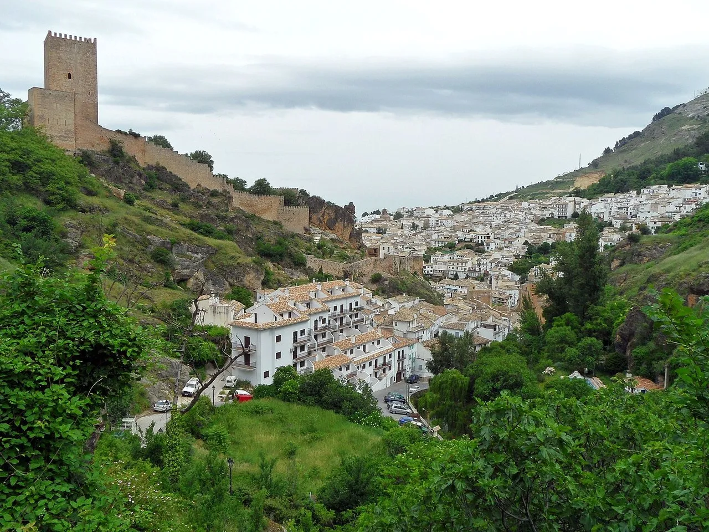
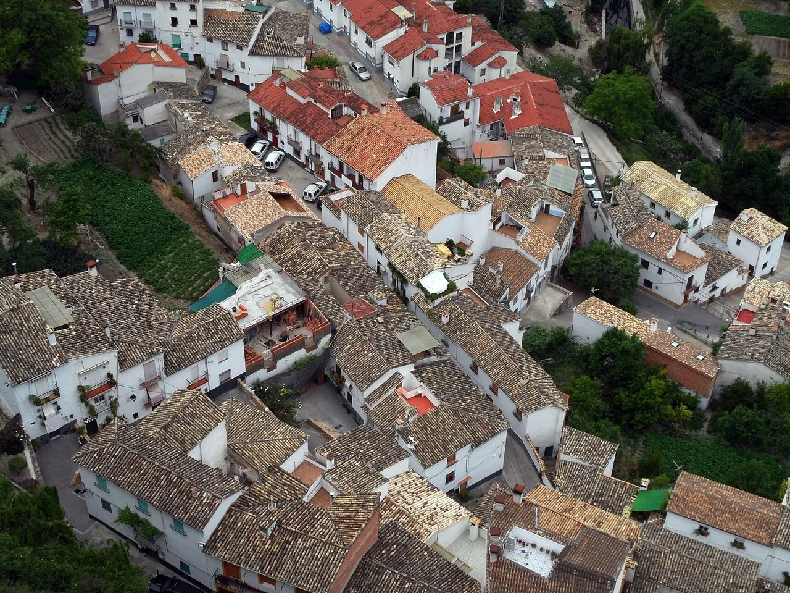
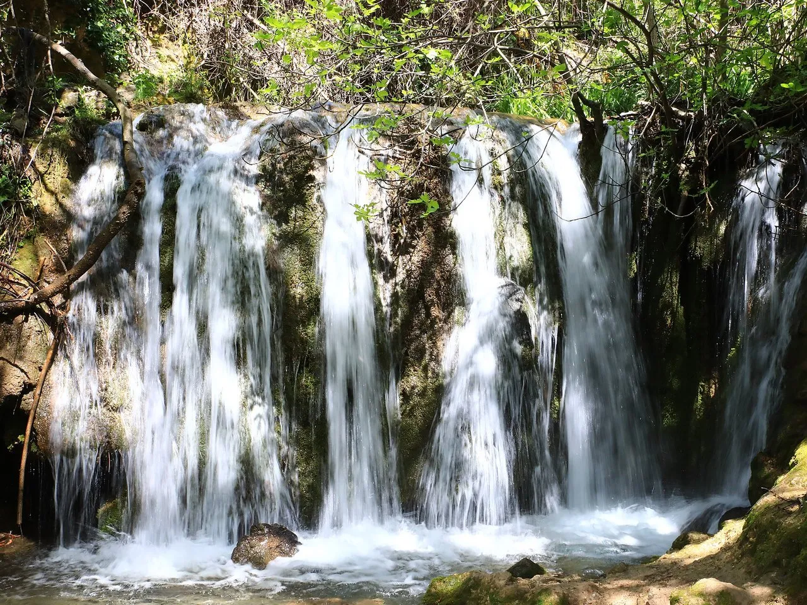
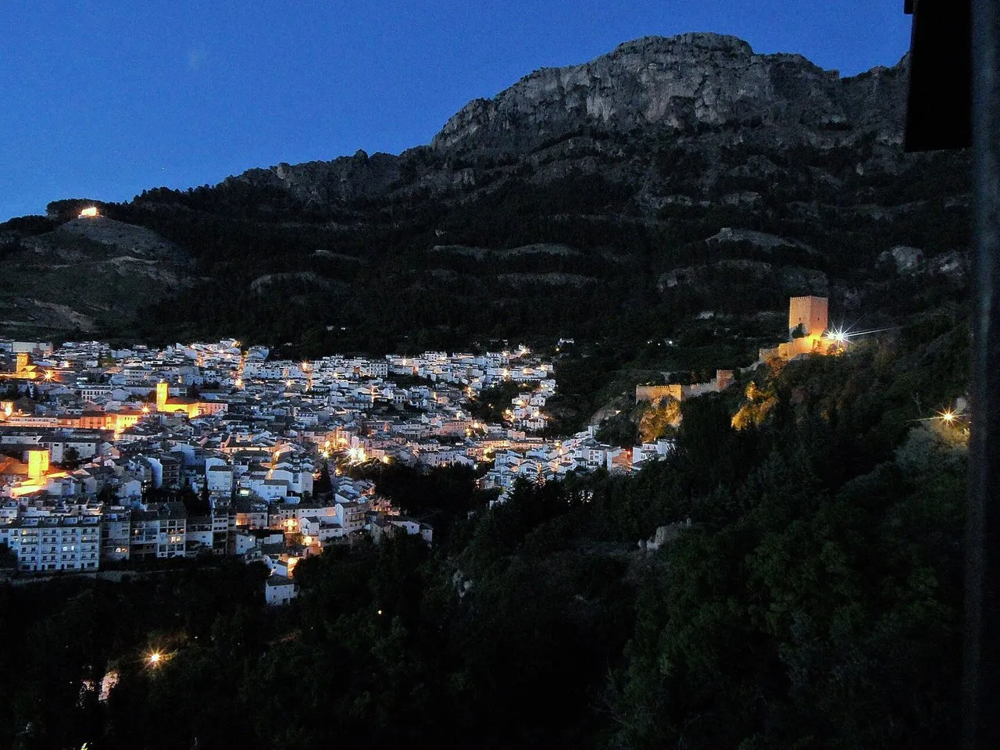

Casas blancas apiñadas en la ladera, un castillo con su torre vigilando desde arriba y la sierra justo detrás. **Cazorla** es la puerta de entrada al mayor espacio protegido de España, pero el pueblo en sí merece una visita sin prisas: su **casco antiguo es Bien de Interés Cultural** y este año compite por ser el **pueblo de la Navidad de Ferrero Rocher**.

Te cuento qué ver en el pueblo 👇 (y si buscas rutas, aquí tienes la guía de la [Sierra de Cazorla](/blog/sierra-de-cazorla.html)).

En un vistazo<h2>Lo que vas a encontrar</h2>

<b>🏰</b>Castillo de la Yedra

<b>⛪</b>Ruinas de Santa María

<b>🏘️</b>Casco BIC

<b>🫒</b>Aceite de oliva

<b>🎄</b>Candidato Ferrero 2026

Antes de ir<h2>Lo básico de Cazorla</h2>

<h3>📍 Dónde está</h3>
En el este de la provincia de <strong>Jaén</strong>, a una hora en coche de la capital.

<h3>⏱️ Tiempo</h3>
<strong>Medio día</strong> para el pueblo; añade la sierra para un fin de semana.

<h3>🏰 Museo</h3>
En el castillo de la Yedra. Tel. <strong>953 101 402</strong> para confirmar el horario.

<h3>🎭 Otoño</h3>
<strong>Festival Internacional de Teatro</strong>, del 15 de octubre al 15 de diciembre de 2026.

Qué ver<h2>Qué ver en el pueblo de Cazorla</h2>

<ol class="guide__grid guide__grid--cuenca">
<li class="gcard reveal">
01

<h3>El castillo de la Yedra</h3>
También llamado de las Cuatro Esquinas, es el gran monumento del pueblo. Dentro está el <strong>Museo de Artes y Costumbres Populares del Alto Guadalquivir</strong>, con armas, tapices y una cocina tradicional recreada.

</li>
<li class="gcard reveal">
02

<h3>El casco antiguo</h3>
Bien de Interés Cultural, con la <strong>plaza de Santa María</strong>, el Ayuntamiento en el antiguo convento de los Mercedarios (siglo XVI) y los palacios de las Cadenas y de la Vicaría.

</li>
<li class="gcard reveal">
03

<h3>El río Cerezuelo</h3>
Pasa bajo el pueblo: las <strong>ruinas de Santa María</strong> se levantaron sobre una bóveda que lo cubre. Siguiendo su cauce hay un sendero con cascadas.

</li>
<li class="gcard reveal">
04

<h3>Cazorla de noche</h3>
Desde los alrededores, el pueblo iluminado bajo la sierra es una postal. Hay un <a href="https://www.civitatis.com/es/cazorla/tour-nocturno-cazorla/?aid=110968" target="_blank" rel="noopener sponsored">tour nocturno</a> por sus calles.

</li>
</ol>

<!--actividades-->

<h3>🎄 Candidato a pueblo Ferrero Rocher</h3>
Cazorla representa a <strong>Andalucía</strong> en el concurso de la Navidad de Ferrero Rocher 2026. Mira cómo va y cómo votar en <a href="/blog/pueblo-navidad-ferrero-rocher-2026.html">el pueblo de la Navidad de Ferrero Rocher</a>.

Consejos de Cheno<h2>Para disfrutarlo al máximo</h2><ul><li><b>Calzado cómodo</b>: el pueblo es todo cuestas.</li><li><b>Llama antes al museo</b> para confirmar el horario.</li><li><b>Prueba el aceite</b> con una <a href="https://www.civitatis.com/es/cazorla/visita-guiada-cazorla-cata-aceite/?aid=110968" target="_blank" rel="noopener sponsored">visita con cata de aceite</a>.</li><li><b>Sigue por la</b> <a href="/blog/sierra-de-cazorla.html">Sierra de Cazorla</a>: la Cerrada del Utrero o el nacimiento del Guadalquivir.</li></ul>

<!--faq-->

<h2>¿Te gustan estos planes?</h2>
Sígueme en Instagram como <a href="https://www.instagram.com/chenoaventuras/" target="_blank" rel="noopener">@chenoaventuras</a>: subo escapadas como esta cada semana.
<a class="btn guide__btn" href="/blog.html">Ver más planes en el blog</a>

Información consultada en noviembre de 2026 en Turespaña (spain.info). Fotos de Wikimedia Commons: <a href="https://commons.wikimedia.org/wiki/File:Cazorla,_en_Ja%C3%A9n_(Espa%C3%B1a).jpg" target="_blank" rel="noopener">Luis Rogelio HM</a> (CC BY-SA 2.0) · <a href="https://commons.wikimedia.org/wiki/File:S02_837_Cazorla,_Castillo_de_la_Yedra.jpg" target="_blank" rel="noopener">Falk2</a> (CC BY-SA 4.0) · <a href="https://commons.wikimedia.org/wiki/File:S02_869_Cazorla.jpg" target="_blank" rel="noopener">Falk2</a> (CC BY-SA 4.0) · <a href="https://commons.wikimedia.org/wiki/File:Cazorla_-_R%C3%ADo_Cerezuelo_-_04.jpg" target="_blank" rel="noopener">Benjamin Smith</a> (CC BY-SA 4.0) · <a href="https://commons.wikimedia.org/wiki/File:S02_960_Cazorla,_Cerro_de_la_Laguna.jpg" target="_blank" rel="noopener">Falk2</a> (CC BY-SA 4.0).

