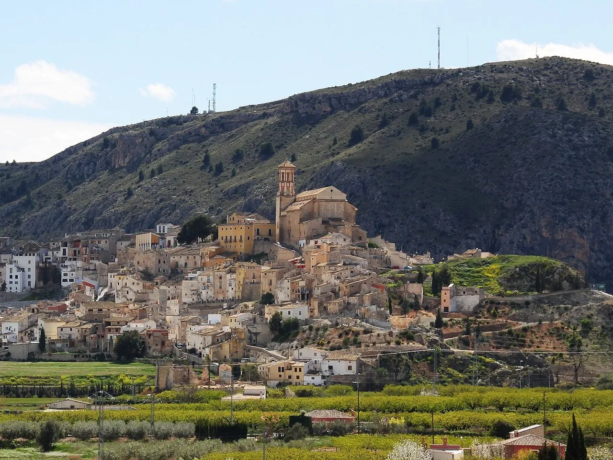
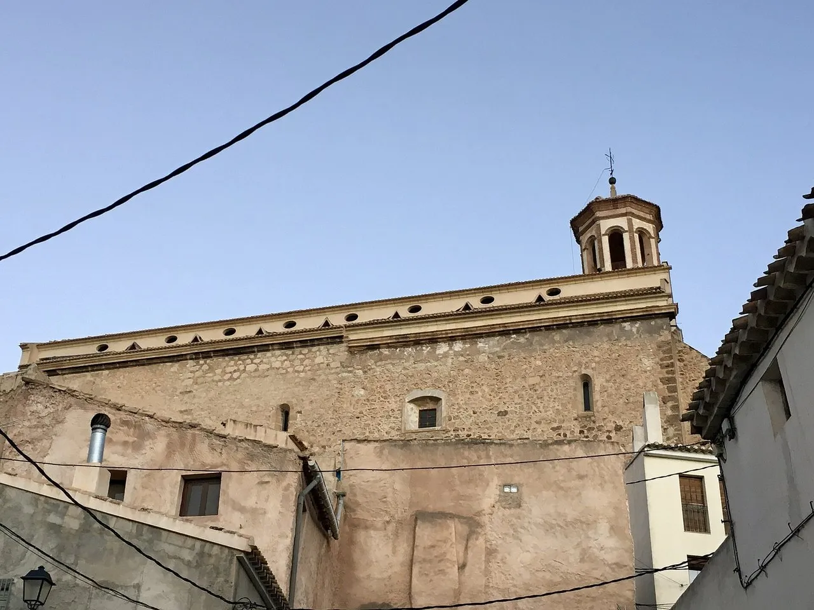
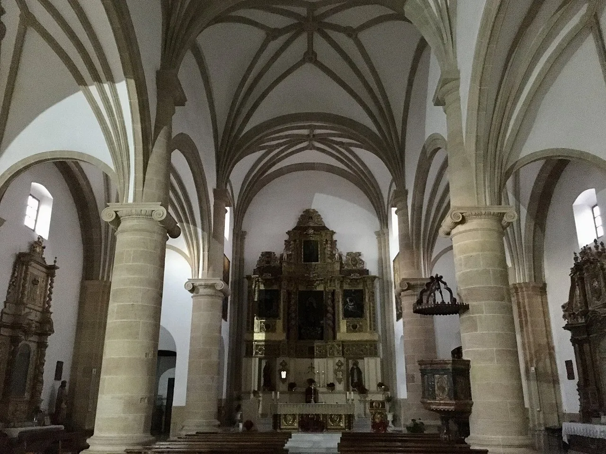
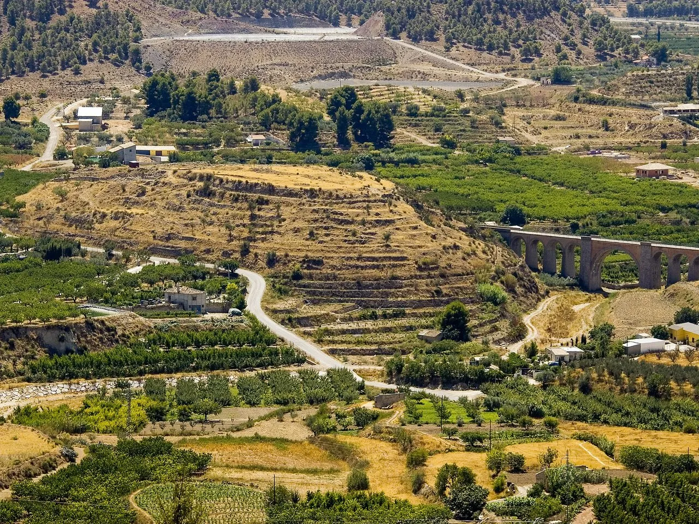

Calles empinadas, casonas con escudos nobiliarios en cada esquina y vistas a la vega del río Argos. **Cehegín**, en el Noroeste de Murcia, tiene uno de los cascos históricos mejor conservados de la región y este año compite por ser el **pueblo de la Navidad de Ferrero Rocher**.

Te cuento qué ver, sus fiestas y cómo llegar 👇

En un vistazo<h2>Lo que vas a encontrar</h2>

<b>🛡️</b>Cien escudos

<b>⛪</b>Iglesias y santuario

<b>🏛️</b>Ruinas de Begastri

<b>🏺</b>Museo Arqueológico

<b>🎄</b>Candidato Ferrero 2026

Antes de ir<h2>Lo básico de Cehegín</h2>

<h3>📍 Dónde está</h3>
En el <strong>Noroeste de la Región de Murcia</strong>, junto a Caravaca de la Cruz.

<h3>⏱️ Tiempo</h3>
<strong>Medio día</strong> para el casco; un día si sumas Begastri y Caravaca.

<h3>🏛️ Begastri</h3>
Visitas guiadas los <strong>fines de semana por la mañana</strong>.

<h3>🧭 Con guía</h3>
La <a href="https://www.civitatis.com/es/cehegin/visita-guiada-cehegin/?aid=110968" target="_blank" rel="noopener sponsored">visita guiada por Cehegín</a> recorre el casco antiguo.

Qué ver<h2>Qué ver en Cehegín</h2>

<ol class="guide__grid guide__grid--cuenca">
<li class="gcard reveal">
01

<h3>El casco antiguo</h3>
Conjunto Histórico-Artístico desde <strong>1982</strong>, con más de <strong>cien escudos</strong> en sus fachadas. En lo alto, la Plaza del Castillo con el <strong>Museo Arqueológico</strong> y el Palacio de Jaspe, hoy ayuntamiento.

</li>
<li class="gcard reveal">
02

<h3>Santa María Magdalena</h3>
La gran iglesia que corona el pueblo y se ve desde toda la vega del río Argos.

</li>
<li class="gcard reveal">
03

<h3>Por dentro de la Magdalena</h3>
Columnas, bóvedas de crucería y retablos dorados: merece la pena entrar si está abierta.

</li>
<li class="gcard reveal">
04

<h3>Begastri</h3>
Ciudad <strong>romana y visigoda</strong> en lo alto de un cabezo, a 2-3 km del pueblo. Visitas guiadas los fines de semana por la mañana.

</li>
</ol>

<!--actividades-->

<h3>🎄 Candidato a pueblo Ferrero Rocher</h3>
Cehegín representa a la <strong>Región de Murcia</strong> en el concurso de la Navidad de Ferrero Rocher 2026. Mira cómo va y cómo votar en <a href="/blog/pueblo-navidad-ferrero-rocher-2026.html">el pueblo de la Navidad de Ferrero Rocher</a>.

Consejos de Cheno<h2>Para disfrutarlo al máximo</h2><ul><li><b>Calzado cómodo</b>: el casco es de cuestas.</li><li><b>Busca los escudos</b> en las fachadas: hay más de cien.</li><li><b>En septiembre</b> (del 8 al 14) son las fiestas de la Virgen de las Maravillas, cuyo santuario está en el pueblo.</li><li><b>Ve en fin de semana</b> para visitar Begastri.</li><li><b>Combínalo con</b> <a href="/blog/caravaca-de-la-cruz.html">Caravaca de la Cruz</a> o el <a href="/blog/rafting-canon-de-almadenes.html">Cañón de Almadenes</a>.</li></ul>

<!--faq-->

<h2>¿Te gustan estos planes?</h2>
Sígueme en Instagram como <a href="https://www.instagram.com/chenoaventuras/" target="_blank" rel="noopener">@chenoaventuras</a>: subo escapadas como esta cada semana.
<a class="btn guide__btn" href="/blog.html">Ver más planes en el blog</a>

Información consultada en noviembre de 2026 en Turismo Región de Murcia. Fotos de Wikimedia Commons: <a href="https://commons.wikimedia.org/wiki/File:Casco_Antiguo_de_Ceheg%C3%ADn,_Murcia.jpg" target="_blank" rel="noopener">Claudia López Oñate</a> (CC BY-SA 3.0) · <a href="https://commons.wikimedia.org/wiki/File:Ceheg%C3%ADn_(Murcia).jpg" target="_blank" rel="noopener">Juanjocehegin1998</a> (CC BY-SA 4.0) · <a href="https://commons.wikimedia.org/wiki/File:Church_of_Santa_Mar%C3%ADa_Magdalena,_Ceheg%C3%ADn.jpg" target="_blank" rel="noopener">PiotrMig</a> (CC BY-SA 4.0) · <a href="https://commons.wikimedia.org/wiki/File:Interior_of_the_Church_of_Santa_Mar%C3%ADa_Magdalena,_Ceheg%C3%ADn.jpg" target="_blank" rel="noopener">PiotrMig</a> (CC BY-SA 4.0) · <a href="https://commons.wikimedia.org/wiki/File:Cabezo_Rodenas_-_Yacimiento_arqueol%C3%B3gico_de_Begastri.jpg" target="_blank" rel="noopener">Antonio Sánchez Corbalán</a> (CC BY-SA 4.0).

