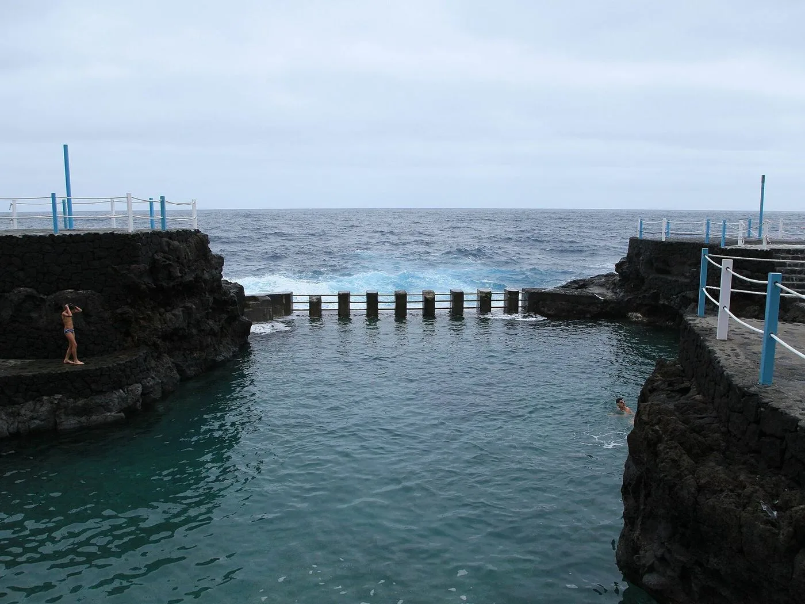
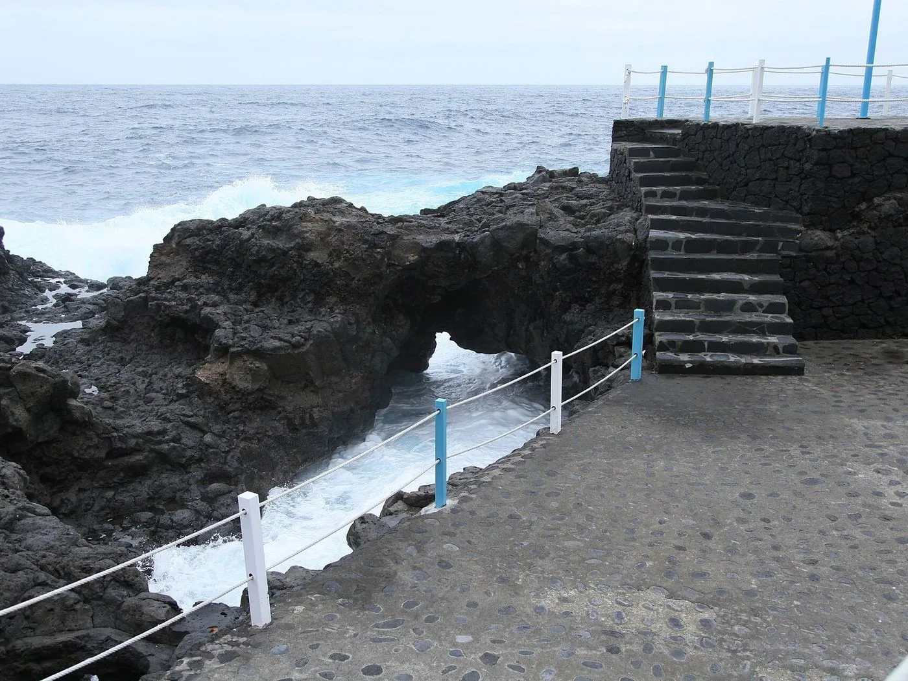
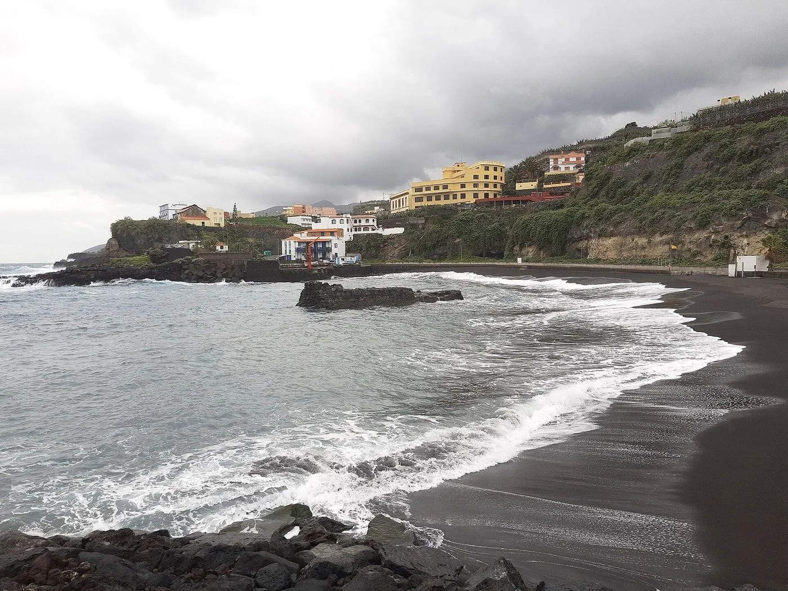
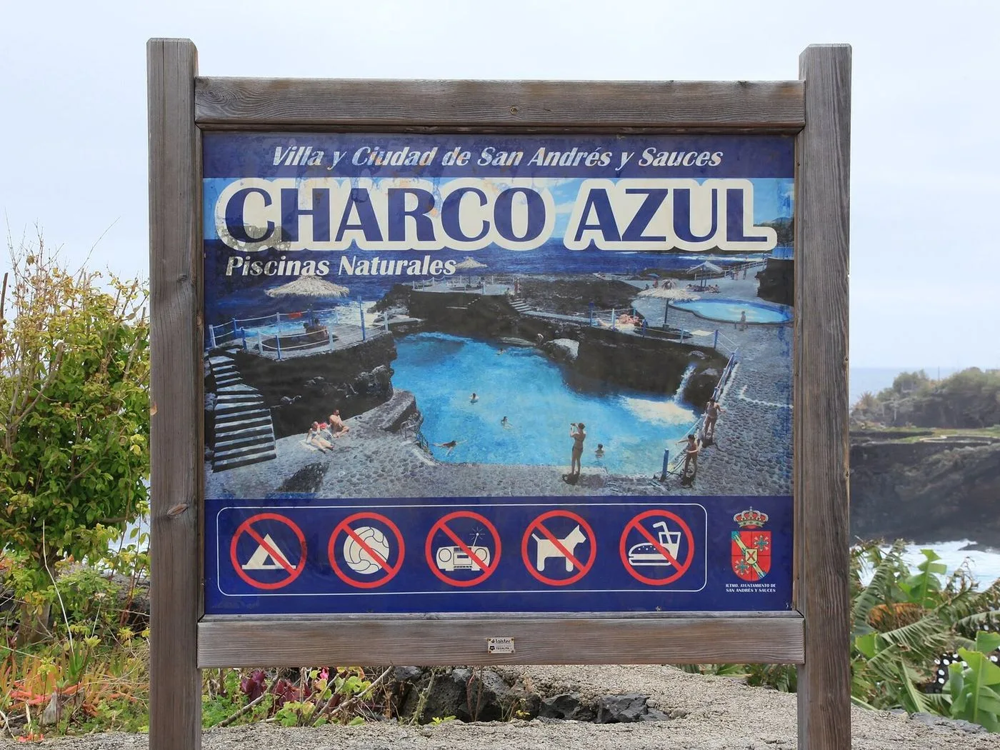
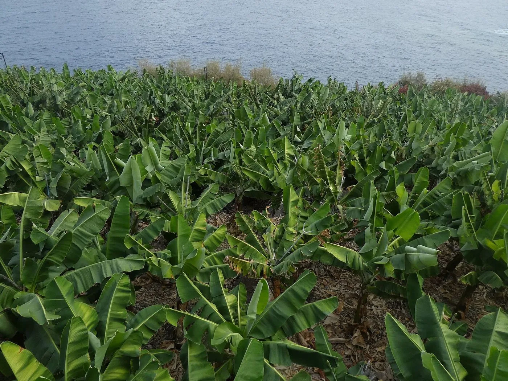

Piscinas de agua de mar encajadas en la lava negra, con el Atlántico rompiendo a pocos metros y plataneras a ambos lados. El **Charco Azul** es el baño más famoso del norte de **La Palma** y uno de esos sitios que parecen sacados de un anuncio.

Te cuento cómo llegar, cuándo bañarte con seguridad y qué ver por los alrededores 👇

En un vistazo<h2>Lo que vas a encontrar</h2>

<b>🌊</b>Piscinas naturales

<b>🌋</b>Lava y arena negra

<b>🍌</b>Plataneras

<b>🌅</b>Costa norte

<b>📸</b>Fotos de acantilado

Antes de ir<h2>Lo básico del Charco Azul</h2>

<h3>📍 Dónde está</h3>
En <strong>San Andrés y Sauces</strong>, costa noreste, junto a las plataneras.

<h3>🚦 Mar</h3>
Con <strong>mar gruesa</strong> el acceso se cierra. Respeta carteles y banderas.

<h3>🩴 Calzado</h3>
Lleva <strong>escarpines</strong>: la roca volcánica es dura y resbala.

El sitio<h2>Piscinas hechas por la lava y el mar</h2>

La costa de San Andrés y Sauces está formada por coladas antiguas que bajaron al mar y se enfriaron en acantilados de roca negra. El mar ha excavado huecos en esa roca, y las <strong>piscinas del Charco Azul</strong> aprovechan esas cuencas, con escalones y cuerdas para entrar y salir. El agua es de mar, renovada con las olas, y por eso su aspecto y su temperatura cambian según el día. En el entorno, las plataneras, el plátano de La Palma, llegan casi hasta el borde del acantilado.

Qué ver<h2>Qué ver en el Charco Azul y alrededores</h2>

<ol class="guide__grid guide__grid--cuenca">
<li class="gcard reveal">
01

<h3>La piscina principal</h3>
Un recinto de roca con escalones y un muro bajo que deja pasar el oleaje. Con el mar en calma es una piscina tranquila; con oleaje, un espectáculo desde fuera.

</li>
<li class="gcard reveal">
02

<h3>El arco de roca</h3>
El mar ha perforado la roca volcánica y ha dejado un arco junto a las escaleras. Ideal para fotos, pero con las olas, mantente a distancia.

</li>
<li class="gcard reveal">
03

<h3>Puerto Espíndola</h3>
A pocos minutos, el pequeño puerto y su playa de arena negra, con las olas rompiendo y el pueblo colgado de la ladera.

</li>
<li class="gcard reveal">
04

<h3>El cartel de normas</h3>
Antes de bajar, lee el cartel: recoge normas (sin alcohol, comida, perros ni música) y avisos para cuando el mar está peligroso.

</li>
<li class="gcard reveal">
05

<h3>Las plataneras</h3>
El paisaje de la zona: plataneras en terrazas sobre el acantilado. En La Palma el plátano es parte de la identidad de la isla.

</li>
</ol>

Cuándo ir<h2>Cuándo bañarte (y cuándo no)</h2>

En verano suele haber más días de mar tranquilo, pero el norte de La Palma recibe mar de fondo en cualquier época. Mira la <strong>previsión de oleaje</strong> la víspera y, al llegar, observa unos minutos cómo rompen las olas. Si el agua entra con fuerza sobre el muro de las piscinas o hay cintas cerrando el paso, no bajes. Un buen plan es ir a primera hora, cuando hay menos gente.

Cómo llegar<h2>Cómo llegar al Charco Azul</h2>

<strong>En coche:</strong> desde Santa Cruz de La Palma, por la <strong>LP-1</strong> hacia el norte hasta San Andrés y Sauces (unos 35-40 minutos), y de ahí hacia la costa, siguiendo los carteles del Charco Azul. Hay aparcamiento cerca.

<strong>A pie:</strong> desde el aparcamiento, unos cinco minutos por un camino cuidado hasta las piscinas.

<strong>Combínalo:</strong> con el <a href="/blog/bosque-de-los-tilos.html">Bosque de Los Tilos</a>, a unos minutos tierra adentro, para un día completo en San Andrés y Sauces.

<a class="btn guide__mapbtn" href="https://www.google.com/maps/search/?api=1&query=Charco%20Azul%2C%20San%20Andr%C3%A9s%20y%20Sauces%2C%20La%20Palma" target="_blank" rel="noopener"><svg class="ico" viewBox="0 0 24 24" width="15" height="15" aria-hidden="true" fill="currentColor"><path d="M12 2a7 7 0 0 0-7 7c0 5.25 7 13 7 13s7-7.75 7-13a7 7 0 0 0-7-7zm0 9.5a2.5 2.5 0 1 1 0-5 2.5 2.5 0 0 1 0 5z"/></svg> Cómo llegar en Google Maps</a>

Más planes de la isla en <a href="/blog/que-hacer-en-la-palma.html">qué hacer en La Palma</a>, junto al cercano <a href="/blog/bosque-de-los-tilos.html">Bosque de Los Tilos</a> y la <a href="/blog/playa-de-nogales-la-palma.html">playa de Nogales</a>.

Consejos de Cheno<h2>Para disfrutarlo al máximo</h2><ul><li><b>Revisa el mar</b> antes de ir: si hay oleaje, déjalo para otro día.</li><li><b>Escarpines:</b> la roca volcánica resbala y corta.</li><li><b>Sin comida ni alcohol</b> dentro del recinto, como indican las normas.</li><li><b>Hazlo temprano:</b> hay menos gente y mejor luz.</li><li><b>Lleva agua:</b> tendrás que ir al pueblo para comer o beber.</li></ul>

<h2>¿Te gustan estos planes?</h2>
Sígueme en Instagram como <a href="https://www.instagram.com/chenoaventuras/" target="_blank" rel="noopener">@chenoaventuras</a>: subo escapadas como esta cada semana.
<a class="btn guide__btn" href="/blog.html">Ver más planes en el blog</a>

Información consultada en noviembre de 2026. Los accesos, horarios y precios cambian: consúltalos en las webs oficiales del Cabildo de La Palma antes de ir. Fotos de Wikimedia Commons: <a href="https://commons.wikimedia.org/wiki/File:Charco_Azul_San_Andr%C3%A9s_2015-12.JPG" target="_blank" rel="noopener">Hans-Peter Balfanz</a> (CC BY-SA 4.0) · <a href="https://commons.wikimedia.org/wiki/File:La_Palma_-_San_Andr%C3%A9s_y_Sauces_-_Calle_El_Melonar_-_Piscinas_naturales_El_Charco_Azul_06_ies.jpg" target="_blank" rel="noopener">Frank Vincentz</a> (CC BY-SA 3.0) · <a href="https://commons.wikimedia.org/wiki/File:La_Palma_-_San_Andr%C3%A9s_y_Sauces_-_Calle_El_Melonar_-_Piscinas_naturales_El_Charco_Azul_10_ies.jpg" target="_blank" rel="noopener">Frank Vincentz</a> (CC BY-SA 3.0) · <a href="https://commons.wikimedia.org/wiki/File:Charco_Azul,_harbour_beach.jpg" target="_blank" rel="noopener">Gerda Arendt</a> (CC BY-SA 4.0) · <a href="https://commons.wikimedia.org/wiki/File:La_Palma_-_San_Andr%C3%A9s_y_Sauces_-_Calle_El_Melonar_-_Piscinas_naturales_El_Charco_Azul_01_ies.jpg" target="_blank" rel="noopener">Frank Vincentz</a> (CC BY-SA 3.0) · <a href="https://commons.wikimedia.org/wiki/File:Bananeto_Charco_Azul.jpg" target="_blank" rel="noopener">Syrio</a> (CC BY-SA 4.0).

