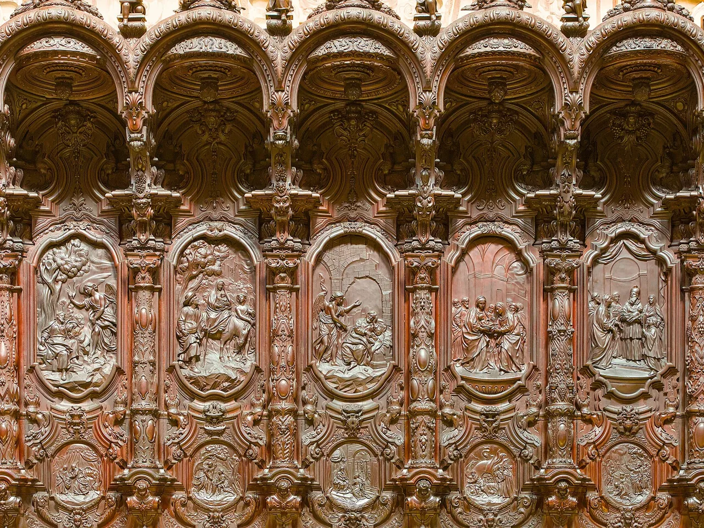
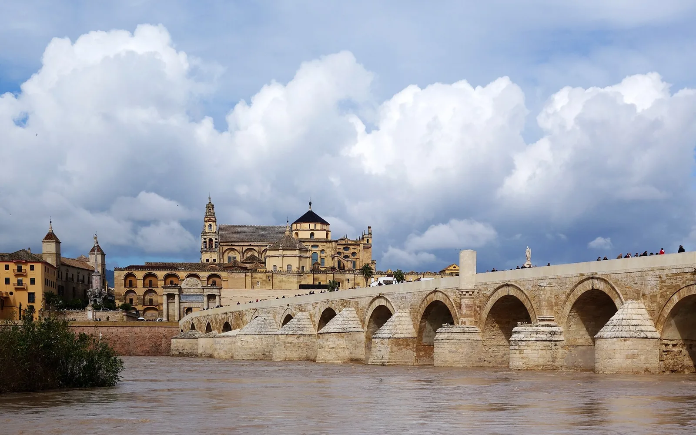
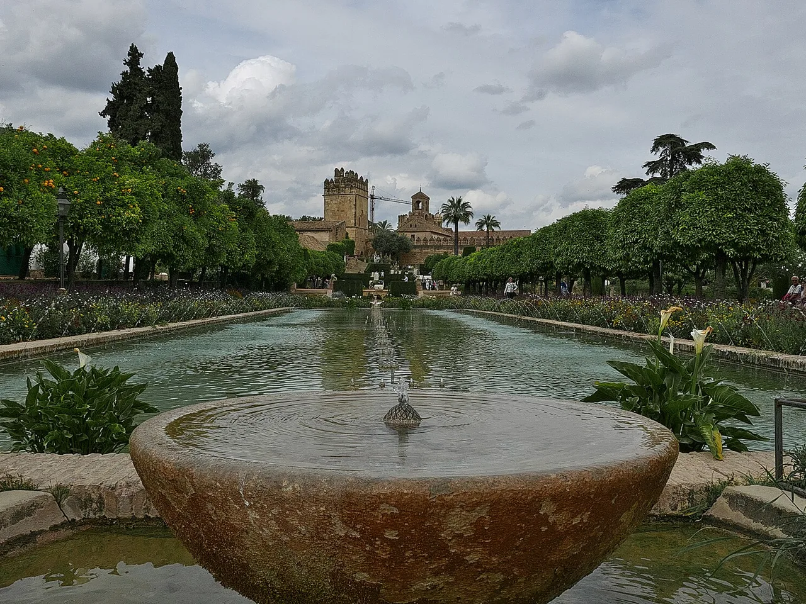
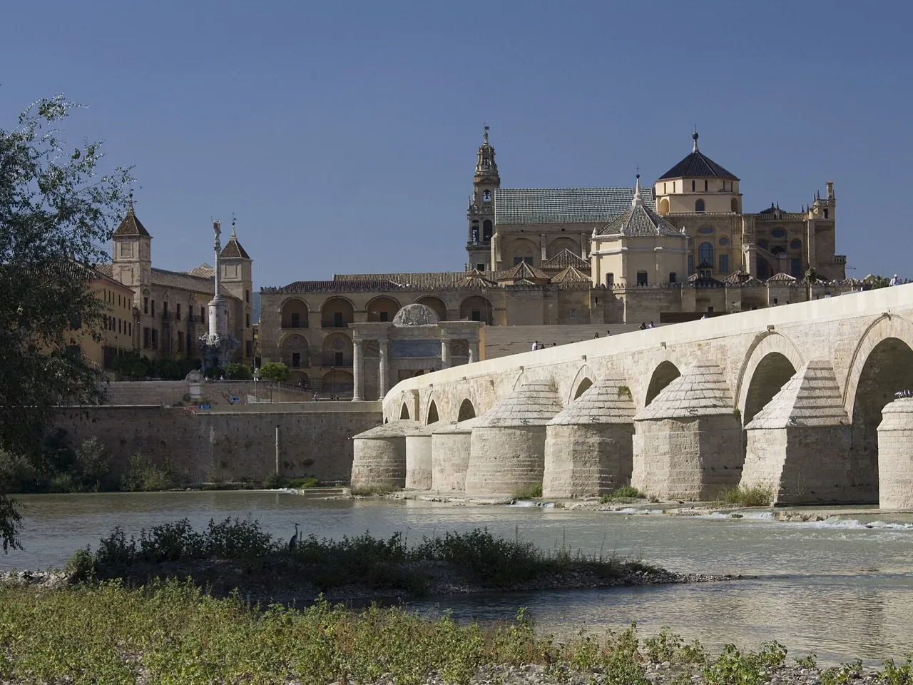

Una **mezquita que es catedral**, un puente romano, una judería de calles estrechas con flores y un palacio califal a las afueras. **Córdoba** es una de las ciudades con más historia de España y se ve bien en **un día** si te centras en el casco histórico. Te lo cuento **por franjas del día**, con qué ver, curiosidades, dónde comer y **actividades para reservar**.

En un vistazo<h2>Lo que vas a encontrar</h2>

<b>🕌</b>Mezquita-Catedral

<b>🏘️</b>Judería

<b>🏰</b>Alcázar

<b>🌉</b>Puente Romano

<b>🍲</b>Salmorejo

Antes de ir<h2>Córdoba: lo básico</h2>

Según la web oficial, la entrada general a la <strong>Mezquita-Catedral</strong> cuesta 15 € (12 € reducida) y el campanario 4 € aparte. De lunes a sábado, de 8:30 a 9:30, hay visita individual gratuita (llega antes de las 9:20; no admite grupos). Confirma horarios y precios antes de ir. Hay AVE desde Madrid en unas 1 h 45 min y desde Sevilla en unos 45 minutos; el casco histórico se recorre a pie. En <strong>mayo</strong>, con la Fiesta de los Patios, la ciudad está llena de flores; en verano hace mucho calor: ve por la mañana o al atardecer.

Mañana<h2>La Mezquita-Catedral</h2>

Empieza por la <strong>Mezquita-Catedral</strong>, el monumento más visitado de Córdoba. Nació como mezquita en época omeya y, tras la conquista cristiana, se construyó una catedral en su interior: el resultado es único, un bosque de columnas y arcos bicolores con una nave renacentista en medio, además del mihrab. Reserva y llega pronto. Para entenderla, hay una <a href="https://www.civitatis.com/es/cordoba/visita-guiada-mezquita-juderia/?aid=110968" target="_blank" rel="noopener sponsored">visita guiada por la Mezquita de Córdoba</a> y una <a href="https://www.civitatis.com/es/cordoba/visita-guiada-mezquita-alcazar/?aid=110968" target="_blank" rel="noopener sponsored">visita guiada por la Mezquita y el Alcázar</a>.

<ol class="guide__grid guide__grid--cuenca">
<li class="gcard reveal">
01

<h3>La Mezquita-Catedral</h3>
Un <strong>bosque de columnas y arcos bicolores</strong> con una catedral renacentista dentro. Reserva y llega pronto.

</li>
<li class="gcard reveal">
02

<h3>La Mezquita desde el río</h3>
Desde el Guadalquivir se ve cómo la catedral asoma <strong>en medio de la mezquita</strong>.

</li>
</ol>

Mediodía<h2>La Judería y los patios</h2>

Pasea por la <strong>Judería</strong>, el barrio histórico de calles estrechas y encaladas, con tiendas, patios y rincones, y por la <strong>Calleja de las Flores</strong>, una calle estrecha llena de macetas con la torre de la Mezquita al fondo. Para comer, prueba el <strong>salmorejo</strong> o el <strong>flamenquín</strong> en alguna taberna del barrio. Si quieres ver los patios, hay una <a href="https://www.civitatis.com/es/cordoba/visita-guiada-patios-cordoba/?aid=110968" target="_blank" rel="noopener sponsored">visita guiada por los Patios de Córdoba</a> y la <a href="https://www.civitatis.com/es/cordoba/visita-patios-palacio-viana/?aid=110968" target="_blank" rel="noopener sponsored">visita al Palacio de Viana y sus patios</a>.

Tarde<h2>El Alcázar de los Reyes Cristianos</h2>

El <strong>Alcázar de los Reyes Cristianos</strong> es una fortaleza con torres, patios y unos jardines muy bonitos, con estanques, fuentes y naranjos; también guarda mosaicos romanos. Reserva el <a href="https://www.civitatis.com/es/cordoba/free-tour-cordoba/?aid=110968" target="_blank" rel="noopener sponsored">free tour por Córdoba</a> para conocer los rincones del casco, o una visita temática por la ciudad.

<ol class="guide__grid guide__grid--cuenca">
<li class="gcard reveal">
03

<h3>Alcázar de los Reyes Cristianos</h3>
Fortaleza con torres, patios y <strong>jardines con estanques</strong>, fuentes y naranjos. También guarda mosaicos romanos.

</li>
</ol>

Atardecer<h2>El Puente Romano y la Torre de la Calahorra</h2>

Cruza el <strong>Puente Romano</strong> al atardecer y mira hacia atrás: la Mezquita, el río y el cielo dorado son la mejor foto de Córdoba. Al otro lado queda la <strong>Torre de la Calahorra</strong>, que alberga el Museo Vivo de al-Ándalus. Por la noche, un <a href="https://www.civitatis.com/es/cordoba/espectaculo-flamenco-patio-juderia/?aid=110968" target="_blank" rel="noopener sponsored">espectáculo flamenco en el Patio de la Judería</a> o un <a href="https://www.civitatis.com/es/cordoba/free-tour-nocturno-cordoba/?aid=110968" target="_blank" rel="noopener sponsored">free tour nocturno por Córdoba</a>.

<ol class="guide__grid guide__grid--cuenca">
<li class="gcard reveal">
04

<h3>El Puente Romano</h3>
Crúzalo al atardecer y mira atrás: la Mezquita, el río y el cielo dorado son <strong>la mejor foto de Córdoba</strong>.

</li>
</ol>

🎟️ Actividades para reservar
<ul class="actbox" style="margin-bottom:2rem"><li><a href="https://www.civitatis.com/es/cordoba/visita-guiada-mezquita-alcazar/?aid=110968" target="_blank" rel="sponsored noopener">CivitatisVisita guiada por la Mezquita y el AlcázarVer &rarr;</a></li><li><a href="https://www.civitatis.com/es/cordoba/visita-guiada-mezquita-juderia/?aid=110968" target="_blank" rel="sponsored noopener">CivitatisVisita guiada por la Mezquita y la JuderíaVer &rarr;</a></li><li><a href="https://www.civitatis.com/es/cordoba/visita-guiada-patios-cordoba/?aid=110968" target="_blank" rel="sponsored noopener">CivitatisVisita guiada por los Patios de CórdobaVer &rarr;</a></li><li><a href="https://www.civitatis.com/es/cordoba/visita-patios-palacio-viana/?aid=110968" target="_blank" rel="sponsored noopener">CivitatisVisita del Palacio de Viana y sus patiosVer &rarr;</a></li><li><a href="https://www.civitatis.com/es/cordoba/free-tour-cordoba/?aid=110968" target="_blank" rel="sponsored noopener">CivitatisFree tour por CórdobaVer &rarr;</a></li><li><a href="https://www.civitatis.com/es/cordoba/espectaculo-flamenco-patio-juderia/?aid=110968" target="_blank" rel="sponsored noopener">CivitatisEspectáculo flamenco en el Patio de la JuderíaVer &rarr;</a></li><li><a href="https://www.civitatis.com/es/cordoba/free-tour-nocturno-cordoba/?aid=110968" target="_blank" rel="sponsored noopener">CivitatisFree tour nocturno por CórdobaVer &rarr;</a></li></ul>

Si tienes un día más<h2>Medina Azahara</h2>

La ciudad palatina del Califato, <strong>Medina Azahara</strong>, es Patrimonio de la Humanidad y queda a unos 8 km (consulta <a href='/blog/medina-azahara.html'>nuestro artículo</a>). Hay una <a href="https://www.civitatis.com/es/cordoba/visita-guiada-medina-azahara/?aid=110968" target="_blank" rel="noopener sponsored">visita guiada por Medina Azahara</a>. Si tienes más días, <a href="/blog/priego-de-cordoba.html">Priego de Córdoba</a> y <a href="/blog/zuheros-que-ver.html">Zuheros</a>, en la Subbética, son dos pueblos preciosos.

🎟️ Actividades para reservar
<ul class="actbox" style="margin-bottom:2rem"><li><a href="https://www.civitatis.com/es/cordoba/visita-guiada-medina-azahara/?aid=110968" target="_blank" rel="sponsored noopener">CivitatisVisita guiada por Medina AzaharaVer &rarr;</a></li></ul>

<!--enr-->

Un poco de historia<h2>Capital de Roma, del califato y de la tolerancia</h2>

Córdoba fue la capital de la provincia romana de la <strong>Bética</strong> y, después, de <strong>al-Ándalus</strong>. En <strong>785</strong> el emir <strong>Abderramán I</strong> empezó la <strong>Mezquita</strong>, que se amplió varias veces. En <strong>929</strong> Abderramán III proclamó el <strong>califato</strong>, y en el siglo X Córdoba fue una de las ciudades más grandes y cultas de Europa, con bibliotecas, científicos y filósofos.

Aquí nacieron dos figuras clave del pensamiento: el filósofo <strong>Averroes</strong> (1126) y el médico y filósofo judío <strong>Maimónides</strong> (1135, según la tradición). Tras la conquista castellana de 1236, la Mezquita se convirtió en catedral, y en el siglo XVI se construyó la nave renacentista en su interior. El Centro Histórico es Patrimonio de la Humanidad desde 1984 (ampliado en 1994).

Cómo llegar<h2>Cómo llegar</h2>

<strong>En tren:</strong> la estación está a unos 20-25 minutos andando de la Mezquita, o a pocos minutos en bus o taxi.

<strong>En coche:</strong> es mejor aparcar a las afueras o en un aparcamiento público y recorrer el casco histórico a pie.

<a class="btn guide__mapbtn" href="https://www.google.com/maps/dir/?api=1&destination=Córdoba" target="_blank" rel="noopener"><svg class="ico" viewBox="0 0 24 24" width="15" height="15" aria-hidden="true" fill="currentColor"><path d="M12 2a7 7 0 0 0-7 7c0 5.25 7 13 7 13s7-7.75 7-13a7 7 0 0 0-7-7zm0 9.5a2.5 2.5 0 1 1 0-5 2.5 2.5 0 0 1 0 5z"/></svg> Cómo llegar en Google Maps</a>

Consejos de Cheno<h2>Córdoba en un día</h2><ul><li><b>Mañana</b>: Mezquita-Catedral, con la entrada reservada.</li><li><b>Mediodía</b>: Judería y Calleja de las Flores, y comida con salmorejo o flamenquín.</li><li><b>Tarde</b>: Alcázar de los Reyes Cristianos y sus jardines.</li><li><b>Atardecer</b>: Puente Romano y Torre de la Calahorra.</li><li><b>Si tienes un día más</b>: Medina Azahara y los patios.</li></ul>

🏰 <strong>A media hora:</strong> el <a href="/blog/castillo-almodovar-del-rio.html">castillo de Almodóvar del Río</a>, el Altojardín de Juego de Tronos.

<!--faq-->

<h2>¿Te gustan estos planes?</h2>
Sígueme en Instagram como <a href="https://www.instagram.com/chenoaventuras/" target="_blank" rel="noopener">@chenoaventuras</a>: subo escapadas como esta cada semana.
<a class="btn guide__btn" href="/blog.html">Ver más planes en el blog</a>

Información consultada en octubre de 2026. Los precios y horarios (incluidas las franjas gratuitas) cambian: consúltalos en las webs oficiales. Fotos de Wikimedia Commons: <a href="https://commons.wikimedia.org/wiki/File:C%C3%B3rdoba_(Spain),_Puente_Romano_and_Mezquita.jpg" target="_blank" rel="noopener">Karl432</a> (CC BY-SA 3.0) · <a href="https://commons.wikimedia.org/wiki/File:C%C3%B3rdoba_-_Mezquita-Catedral_-_Interior_-_07.jpg" target="_blank" rel="noopener">Benjamin Smith</a> (CC BY-SA 4.0) · <a href="https://commons.wikimedia.org/wiki/File:Jardines_del_Alc%C3%A1zar_de_los_Reyes_Cristianos_(C%C3%B3rdoba).jpg" target="_blank" rel="noopener">José Luis Filpo Cabana</a> (CC BY 4.0) · <a href="https://commons.wikimedia.org/wiki/File:C%C3%B3rdoba-Puente_Romano-Arco_de_Felipe_II-Mezquita-20110917.jpg" target="_blank" rel="noopener">Daniel VILLAFRUELA</a> (CC BY-SA 3.0).

