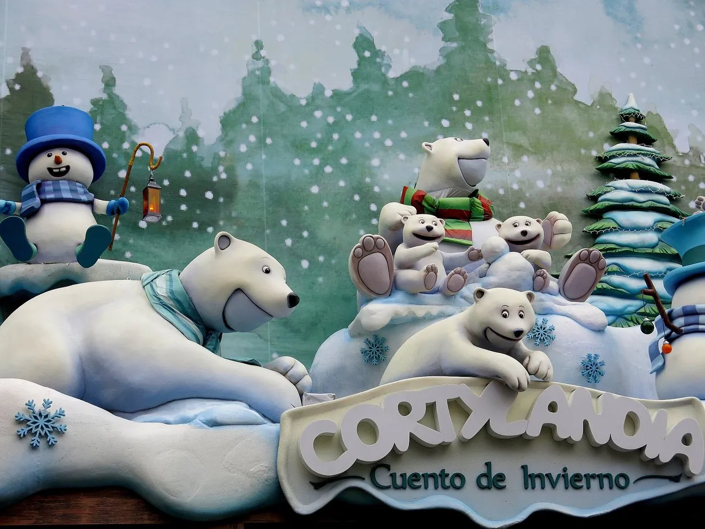
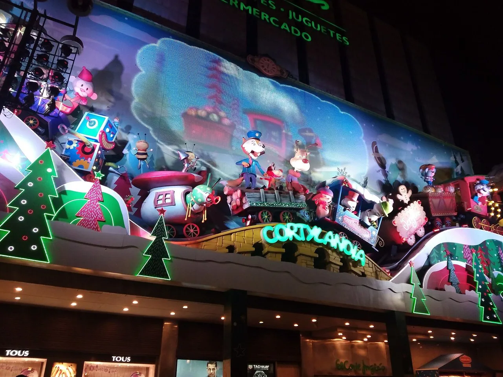
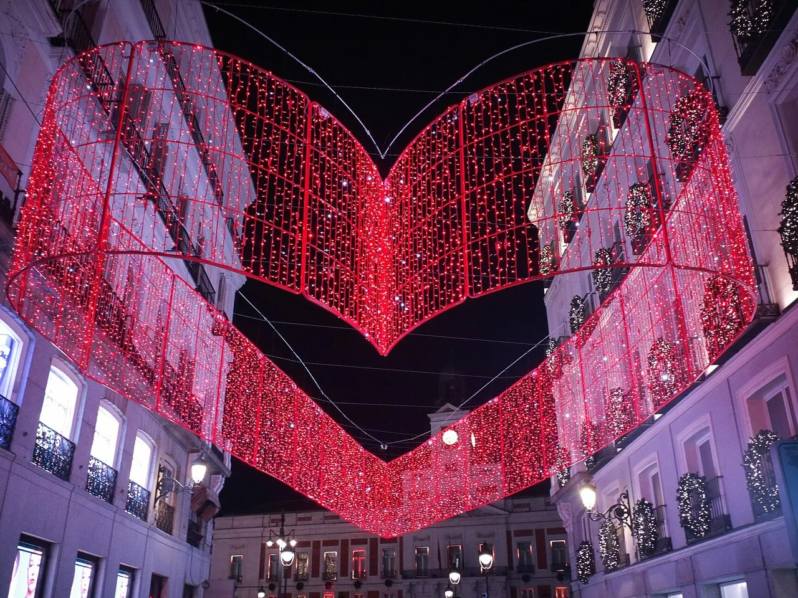
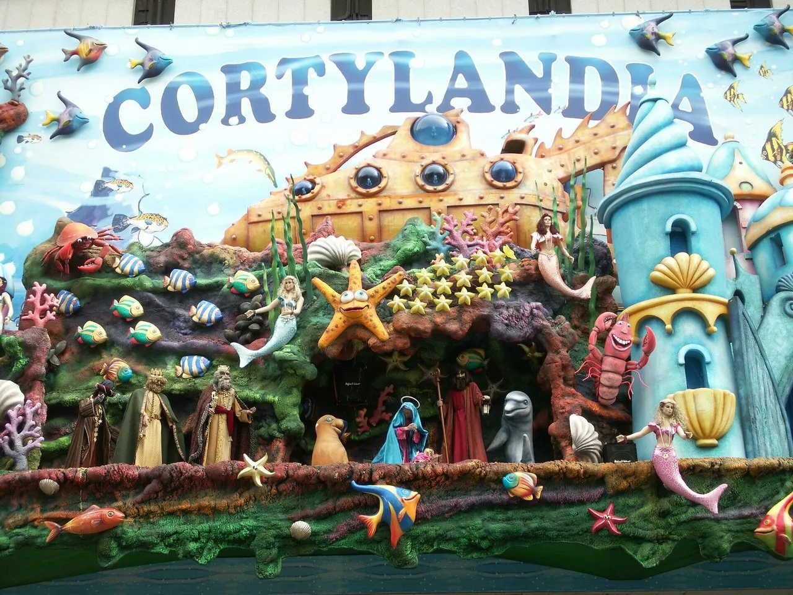

Una estación de esquí con telecabinas, patinadores y un hotel de montaña bajo la luna llena: así es **Cortylandia 2026**, que se llama **«Estación Invernal»**. Se estrenó el **20 de noviembre** en la fachada de El Corte Inglés de Preciados y estará hasta el **5 de enero**. Es gratis y dura unos 11 minutos.

Te cuento los horarios de los pases, los días sin función y cómo verlo sin agobios con niños 👇

En un vistazo<h2>Lo que vas a encontrar</h2>

<b>🎿</b>Estación Invernal

<b>🕛</b>8 pases al día

<b>⏱️</b>11 minutos

<b>🆓</b>Gratis

<b>📅</b>Hasta el 5 de enero

Antes de ir<h2>Lo básico de Cortylandia 2026</h2>

<h3>📅 Cuándo</h3>
Del <strong>20 de noviembre de 2026 al 5 de enero de 2027</strong>.

<h3>📍 Dónde</h3>
Calle del <strong>Maestro Victoria</strong>, en la fachada trasera de El Corte Inglés de Preciados, entre Sol y Callao.

<h3>🕛 Pases</h3>
12:00, 13:00, 14:00 y de <strong>17:00 a 21:00</strong> cada hora (hasta el 28 de noviembre, solo a las 20:00).

<h3>🎟️ Precio</h3>
<strong>Gratis</strong> y sin reserva.

Horarios<h2>Horarios de los pases de Cortylandia 2026</h2>

<ul class="guide__prices"><li><strong>20 al 28 de noviembre:</strong> un solo pase, a las 20:00</li><li><strong>Desde el 29 de noviembre, todos los días:</strong> 12:00, 13:00, 14:00, 17:00, 18:00, 19:00, 20:00 y 21:00</li><li><strong>24 y 31 de diciembre y 5 de enero:</strong> solo por la mañana (12:00, 13:00 y 14:00), según la prensa</li><li><strong>25 de diciembre y 1 de enero:</strong> no hay pases</li></ul>
Cada función dura unos <strong>11 minutos</strong>. Los horarios pueden cambiar: si vas un día clave, confírmalo antes en El Corte Inglés.

Qué vas a ver<h2>«Estación Invernal», el Cortylandia de 2026</h2>

<ol class="guide__grid guide__grid--cuenca">
<li class="gcard reveal">
01

<h3>Una estación de esquí</h3>
Paisaje alpino bajo la <strong>luna llena</strong> y un cielo de Nochebuena: pistas de esquí y snowboard, patinaje sobre hielo y paseos en <strong>telecabina</strong>. <em>Foto: un Cortylandia de invierno de otro año.</em>

</li>
<li class="gcard reveal">
02

<h3>El Gran Hotel Panorámico</h3>
El refugio de montaña que preside el escenario. Hay unos <strong>30 personajes</strong> con más de <strong>50 movimientos</strong> sincronizados, en un decorado de unos 40 metros de ancho y 16 de alto.

</li>
<li class="gcard reveal">
03

<h3>Las luces de Preciados</h3>
Al salir, sube por Preciados hasta <strong>Callao</strong> o baja a <strong>Sol</strong>: son de las calles con más ambiente navideño. Más ideas en mi guía de <a href="/blog/navidad-en-madrid.html">Navidad en Madrid</a>.

</li>
<li class="gcard reveal">
04

<h3>Una tradición desde 1979</h3>
Cada año cambia de historia (en la foto, el de 2006). Según Turismo de Madrid, solo se interrumpió en <strong>2020</strong> por la pandemia, y su canción la conoce medio país.

</li>
</ol>

<!--actividades-->

Consejos de Cheno<h2>Para verlo sin agobios</h2><ul><li><b>Ve por la mañana entre semana</b>: los pases de 12:00 a 14:00 son los más tranquilos.</li><li><b>Llega 15 minutos antes</b>, cuando sale la gente del pase anterior, y ponte en el centro de la calle.</li><li><b>Por la tarde</b>, el de las 17:00 ya es de noche y luce mucho más, pero hay más gente.</li><li><b>Con carrito</b>, mejor sube a los peques a hombros: la calle se llena.</li><li><b>Combínalo</b> con el árbol de Sol, la Plaza Mayor y su mercado, a cinco minutos andando.</li></ul>

🎄 <strong>Más Navidad en España:</strong> <a href="/blog/navidad-en-madrid.html">Madrid</a> · <a href="/blog/magicas-navidades-torrejon.html">Mágicas Navidades de Torrejón</a> · <a href="/blog/navidad-en-barcelona.html">Barcelona</a> · <a href="/blog/navidad-en-valencia.html">Valencia</a> · <a href="/blog/navidad-en-sevilla.html">Sevilla</a> · <a href="/blog/navidad-en-zaragoza.html">Zaragoza</a> · <a href="/blog/navidad-en-malaga.html">Málaga</a> · <a href="/blog/navidad-en-cordoba.html">Córdoba</a> · <a href="/blog/navidad-en-palma.html">Palma</a> · <a href="/blog/luces-navidad-vigo.html">luces de Vigo</a> · <a href="/blog/belen-viviente-buitrago-del-lozoya.html">Belén viviente de Buitrago</a> · <a href="/blog/pueblo-navidad-ferrero-rocher-2026.html">Pueblo Navidad Ferrero Rocher</a>.

<!--faq-->

<h2>¿Te gustan estos planes?</h2>
Sígueme en Instagram como <a href="https://www.instagram.com/chenoaventuras/" target="_blank" rel="noopener">@chenoaventuras</a>: subo escapadas como esta cada semana.
<a class="btn guide__btn" href="/blog.html">Ver más planes en el blog</a>

Fechas, horarios y datos de la edición 2026 publicados por El Corte Inglés y recogidos por la prensa (Time Out Madrid, Libertad Digital, tiempo.com, 18-23 de noviembre de 2026), y ficha de <a href="https://www.esmadrid.com/agenda/cortylandia-el-corte-ingles-preciados-callao" target="_blank" rel="noopener">Turismo de Madrid</a>. Las fotos son de ediciones anteriores de Cortylandia. Fotos de Wikimedia Commons: <a href="https://commons.wikimedia.org/wiki/File:Cortylandia_2013-2014_en_El_Corte_Ingl%C3%A9s_de_Sol_(22_de_noviembre_de_2014,_Madrid).JPG" target="_blank" rel="noopener">Discasto</a> (CC BY-SA 4.0) · <a href="https://commons.wikimedia.org/wiki/File:Madrid,_diciembre_del_17_(25471497698).jpg" target="_blank" rel="noopener">M a n u e l from Valdemoro, Spain</a> (CC BY 2.0) · <a href="https://commons.wikimedia.org/wiki/File:Cortylandia.jpg" target="_blank" rel="noopener">Paa96</a> (CC BY-SA 4.0) · <a href="https://commons.wikimedia.org/wiki/File:Navidad_-_Calle_de_Preciados_-_Madrid_-_01.jpg" target="_blank" rel="noopener">Javier Perez Montes</a> (CC BY-SA 4.0) · <a href="https://commons.wikimedia.org/wiki/File:Cortylandia,_enero_2006.jpg" target="_blank" rel="noopener">Daquella manera</a> (CC0).

