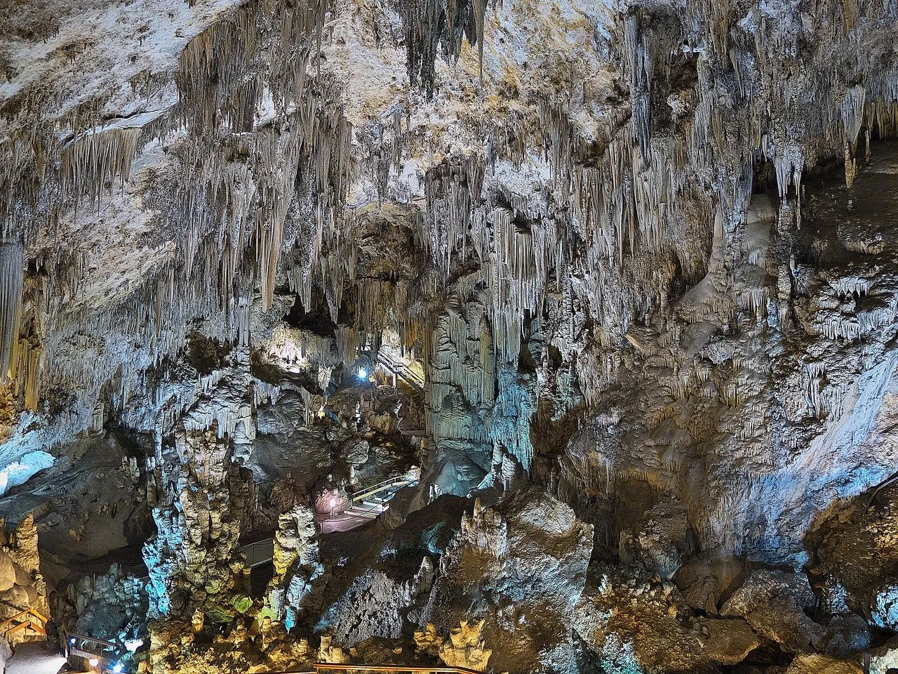
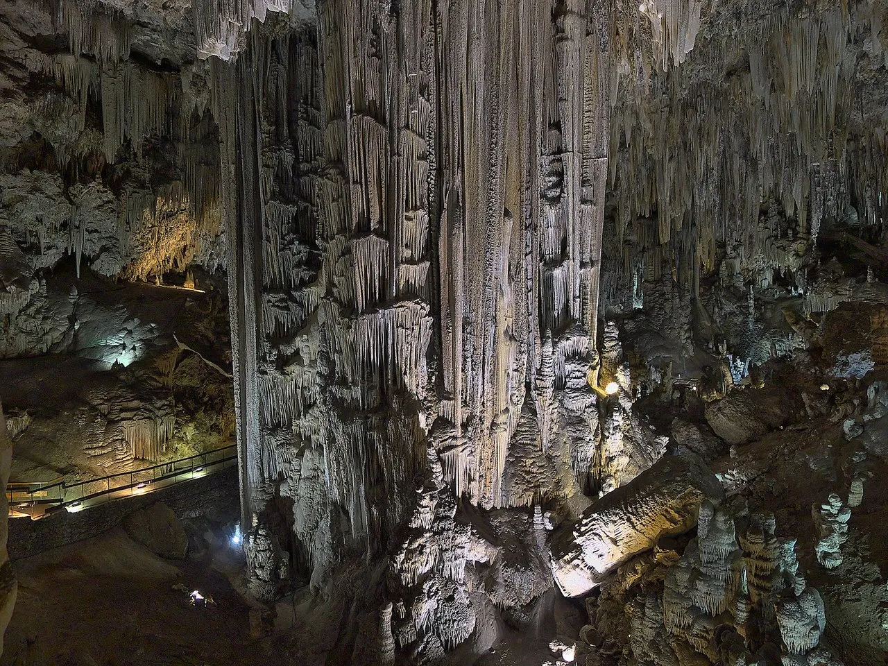
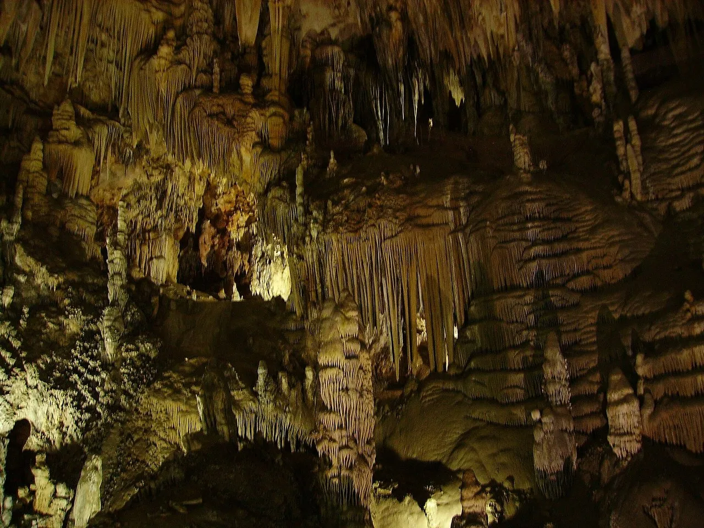
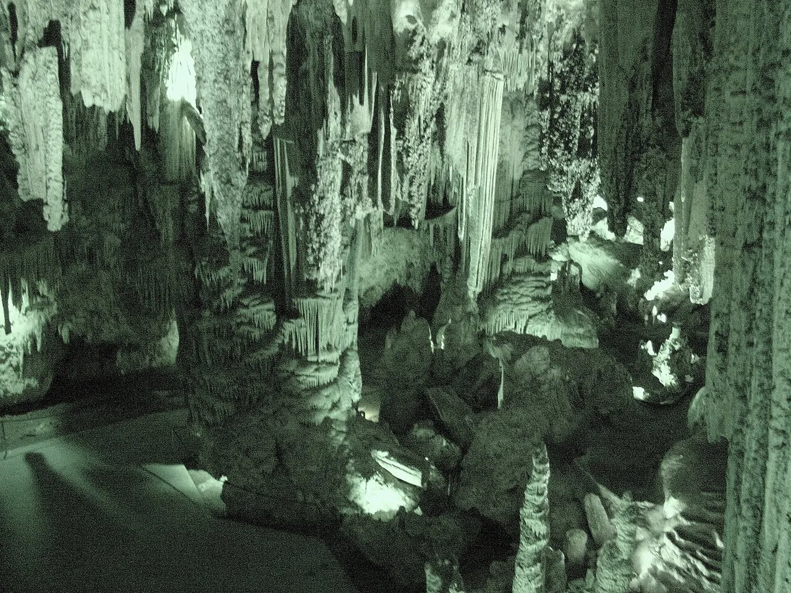
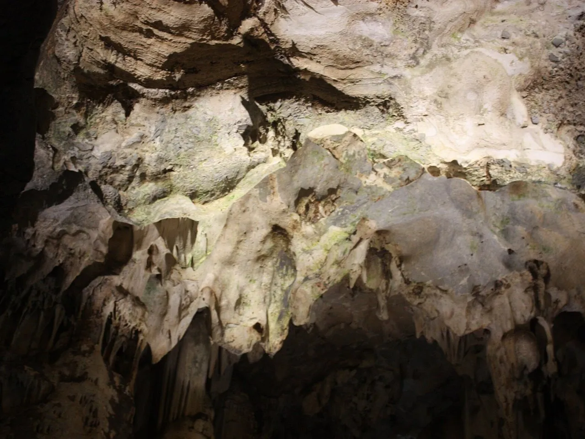
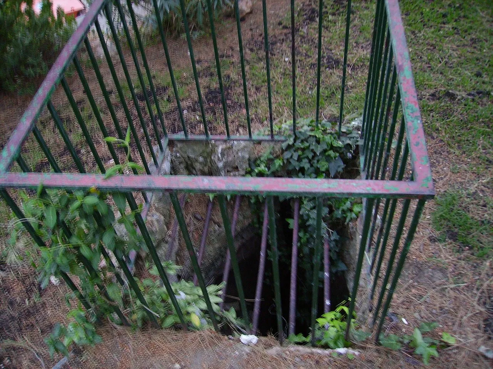

Salas enormes llenas de estalactitas, columnas que van del suelo al techo y casi cinco kilómetros de galerías bajo la sierra. La **Cueva de Nerja**, en **Maro**, es de las cuevas más espectaculares de España, y la descubrieron por casualidad **cinco chicos en 1959**.

Te cuento el horario de 2026, cuánto cuesta, cómo es la visita y cómo llegar 👇

En un vistazo<h2>Lo que vas a encontrar</h2>

<b>🦇</b>Salas gigantes

<b>🎧</b>Audioguía incluida

<b>🏛️</b>Museo de Nerja incluido

<b>🥽</b>Realidad virtual

<b>🅿️</b>Parking propio

Antes de ir<h2>Lo básico de la Cueva de Nerja</h2>

<h3>🕘 Horario 2026</h3>
Casi todo el año, <strong>9:15-16:30</strong> (última entrada 15:30). En verano, Navidad, puentes y Semana Santa, hasta las <strong>17:30</strong>. Cierra el 1 y 6 de enero, 15 de mayo y 25 de diciembre.

<h3>🎟️ Precio</h3>
Desde <strong>16 € online</strong> en la web oficial, con <strong>audioguía</strong>, <strong>Museo de Nerja</strong> (en 10 días) y <strong>Sala de Realidad Virtual</strong>.

<h3>⏱️ Duración</h3>
Unos <strong>45-60 minutos</strong> dentro de la cueva, a tu ritmo.

<h3>📍 Dónde está</h3>
En <strong>Maro</strong>, a unos 3 km de Nerja y 58 km de Málaga.

Qué ver<h2>Cómo es la visita a la Cueva de Nerja</h2>

<ol class="guide__grid guide__grid--cuenca">
<li class="gcard reveal">
01

<h3>Las grandes salas</h3>
El recorrido baja por pasarelas entre salas enormes. La primera impresión, cuando se abre la cueva ante ti, es de lo mejor de la visita.

</li>
<li class="gcard reveal">
02

<h3>Columnas del suelo al techo</h3>
Miles de años de goteo han unido estalactitas y estalagmitas en <strong>columnas gigantes</strong>.

</li>
<li class="gcard reveal">
03

<h3>La Sala de la Cascada</h3>
También llamada del Ballet: aquí se inauguró la cueva en <strong>1960</strong> con un espectáculo de ballet, el origen del <strong>Festival de Música y Danza</strong> que se celebra cada año.

</li>
<li class="gcard reveal">
04

<h3>El recorrido con audioguía</h3>
La audioguía se escucha en tu móvil (descárgala antes). Hay <strong>dos zonas con bancos</strong> para descansar dentro.

</li>
<li class="gcard reveal">
05

<h3>Lo que no se visita</h3>
Las <strong>Galerías Altas</strong> y <strong>Nuevas</strong> no se visitan por conservación, y tampoco las zonas con <strong>arte rupestre</strong>: se ven en la <strong>Sala de Realidad Virtual</strong>.

</li>
<li class="gcard reveal">
06

<h3>Las bocas de la cueva</h3>
La cueva tiene <strong>tres bocas y dos torcas</strong>. Por una abertura estrecha, de donde salían murciélagos, entraron los chicos que la descubrieron.

</li>
</ol>

<!--actividades-->

La historia<h2>Cinco chicos y unos murciélagos</h2>

El <strong>12 de enero de 1959</strong>, cinco chicos (José Luis Barbero, Manuel y Miguel Muñoz, Francisco Navas y José Torres) se colaron por una abertura por la que salían murciélagos. Llegaron a la actual Sala de la Cascada y a la de los Fantasmas, donde encontraron <strong>dos esqueletos</strong>. Avisaron a sus maestros y, en abril, las fotos de José Padial salieron en el Diario Sur.

<h3>🦴 «Pepita»</h3>
En el <strong>Museo de Nerja</strong>, incluido en la entrada, está «Pepita», un esqueleto de hace <strong>más de 9.900 años</strong> hallado en la cueva, y reproducciones de sus pinturas rupestres. La cueva es <strong>Bien de Interés Cultural</strong> desde 2006.

Cómo llegar<h2>Cómo llegar a la Cueva de Nerja</h2>

<h3>🚗 En coche</h3>
Desde Málaga, unos <strong>58 km por la A-7</strong>; desde Granada, unos 91 km. Desde Nerja, 3 km por la N-340 hacia Maro.

<h3>🅿️ Parking</h3>
Propio, de pago por minutos y abierto solo en el horario de la cueva.

<h3>🚌 En autobús</h3>
ALSA desde Málaga hasta «Nerja (Cuevas)», en la misma cueva. Desde Nerja también hay <strong>tren turístico</strong>.

<h3>🧭 Con excursión</h3>
Desde Málaga: <a href="https://www.civitatis.com/es/malaga/tour-frigiliana-cuevas-nerja/?aid=110968" target="_blank" rel="noopener sponsored">excursión a Nerja y Frigiliana</a> o con <a href="https://www.civitatis.com/es/malaga/excursion-nerja-frigiliana-acebuchal/?aid=110968" target="_blank" rel="noopener sponsored">El Acebuchal</a>.

Consejos de Cheno<h2>Para disfrutarla al máximo</h2><ul><li><b>Compra online</b> y elige hora: en verano y puentes hay colas.</li><li><b>Descarga la audioguía</b> antes de entrar.</li><li><b>Calzado cómodo</b>: hay escaleras y el suelo puede estar húmedo.</li><li><b>No te olvides del museo</b>: tienes 10 días para usarlo.</li><li><b>Combínala con</b> <a href="/blog/frigiliana-que-ver.html">Frigiliana</a>, a 15 minutos, y con <a href="/blog/malaga-que-ver.html">Málaga</a>.</li></ul>

<!--faq-->

<h2>¿Te gustan estos planes?</h2>
Sígueme en Instagram como <a href="https://www.instagram.com/chenoaventuras/" target="_blank" rel="noopener">@chenoaventuras</a>: subo escapadas como esta cada semana.
<a class="btn guide__btn" href="/blog.html">Ver más planes en el blog</a>

Información consultada en noviembre de 2026 en la web oficial de la Fundación Cueva de Nerja y su web de venta de entradas. Fotos de Wikimedia Commons: <a href="https://commons.wikimedia.org/wiki/File:Cueva_de_Nerja_2020.jpg" target="_blank" rel="noopener">Fernando</a> (CC BY-SA 4.0) · <a href="https://commons.wikimedia.org/wiki/File:Sala_de_la_Cueva_de_Nerja.jpg" target="_blank" rel="noopener">Jl FilpoC</a> (CC BY-SA 4.0) · <a href="https://commons.wikimedia.org/wiki/File:Cueva_de_Nerja_(Maro)._Nerja.jpg" target="_blank" rel="noopener">José Luis Filpo Cabana</a> (CC BY 3.0) · <a href="https://commons.wikimedia.org/wiki/File:Cueva_de_Nerja_9.jpg" target="_blank" rel="noopener">Luzzyacentillo</a> (CC BY-SA 3.0) · <a href="https://commons.wikimedia.org/wiki/File:Nerja_cave.jpg" target="_blank" rel="noopener">Ped</a> (CC BY-SA 2.5) · <a href="https://commons.wikimedia.org/wiki/File:Nerja,_the_cave-1.jpg" target="_blank" rel="noopener">Dguendel</a> (CC BY 4.0) · <a href="https://commons.wikimedia.org/wiki/File:Cueva_de_Nerja_drain.jpg" target="_blank" rel="noopener">Luzzyacentillo</a> (CC BY-SA 3.0).

