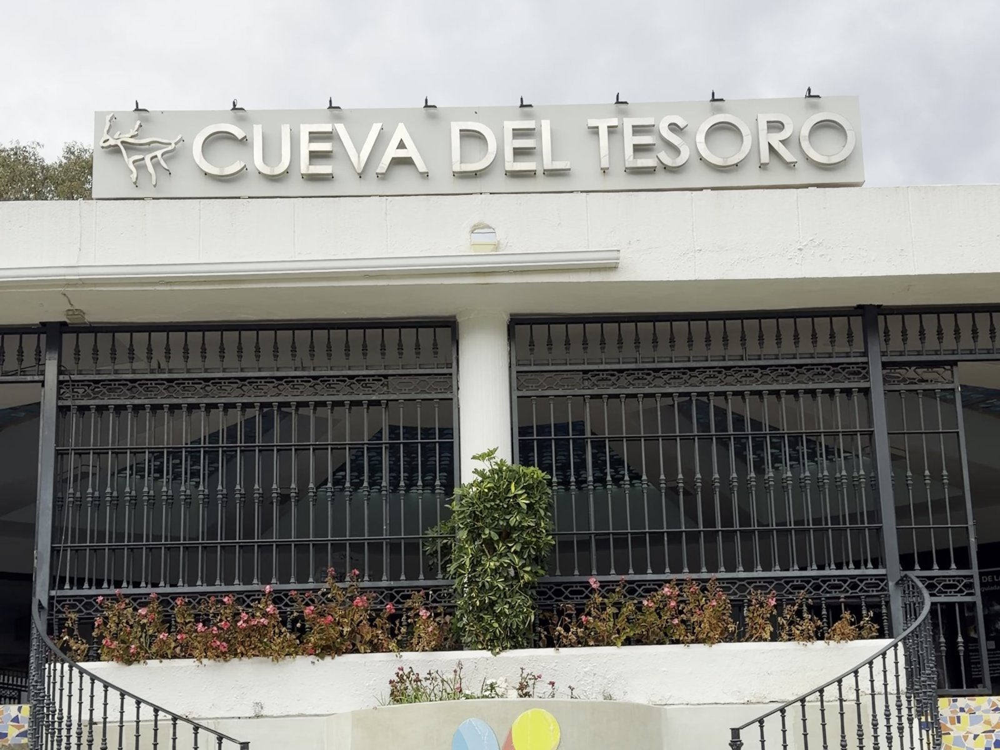
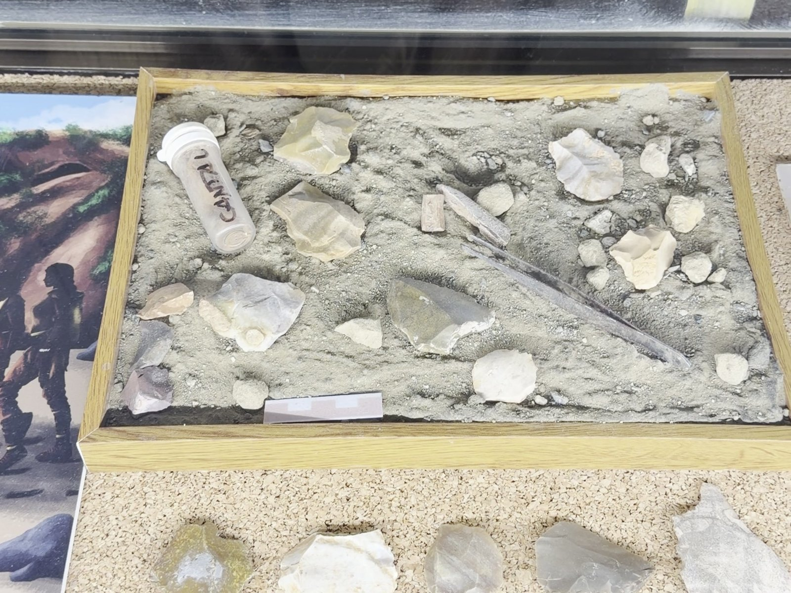
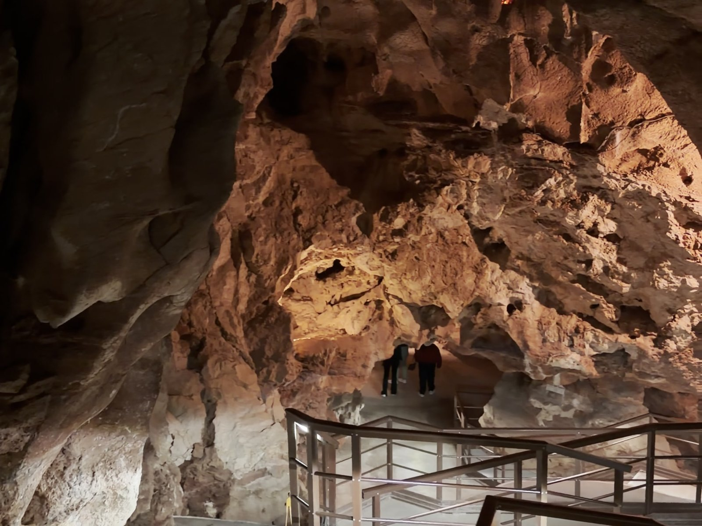
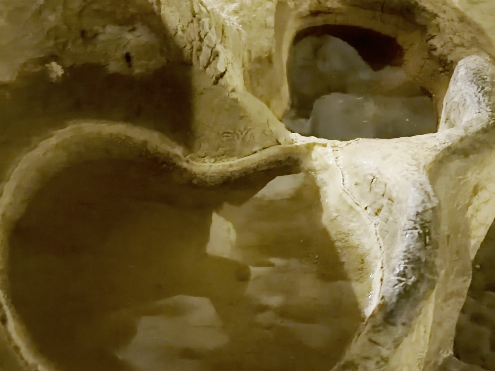
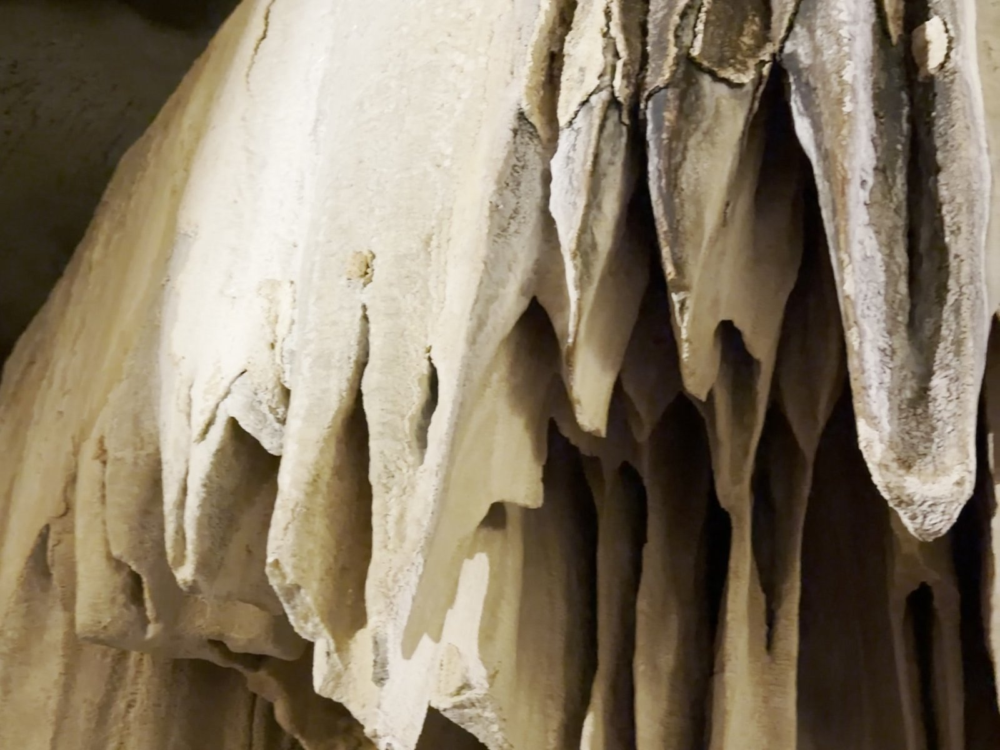
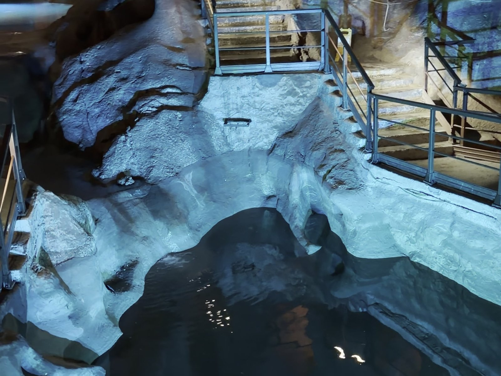
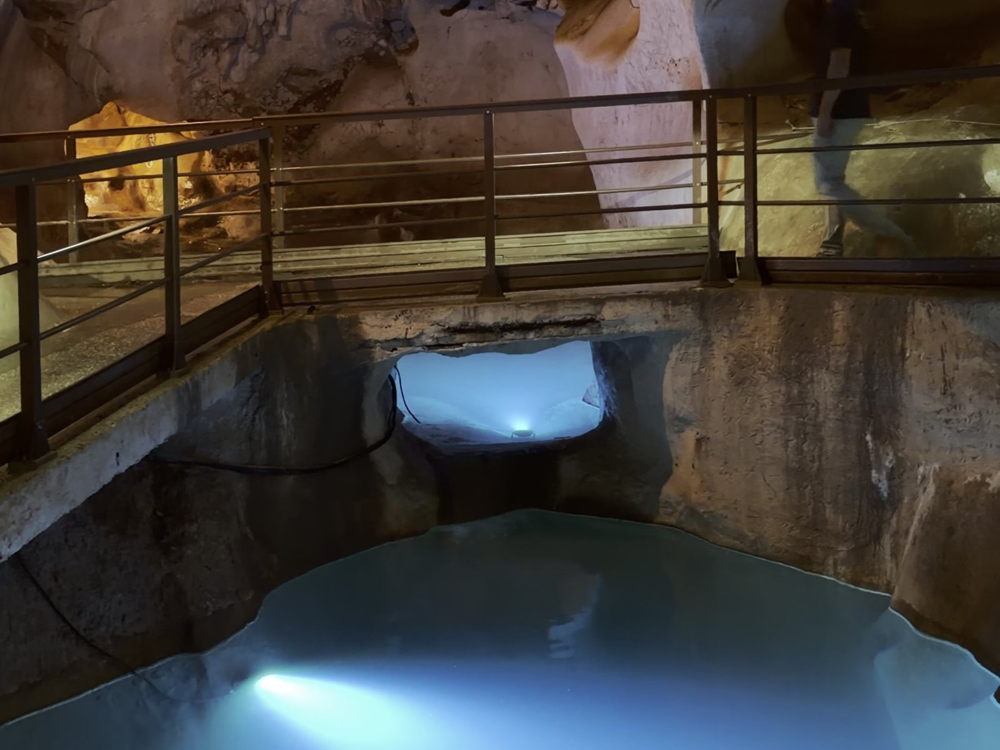
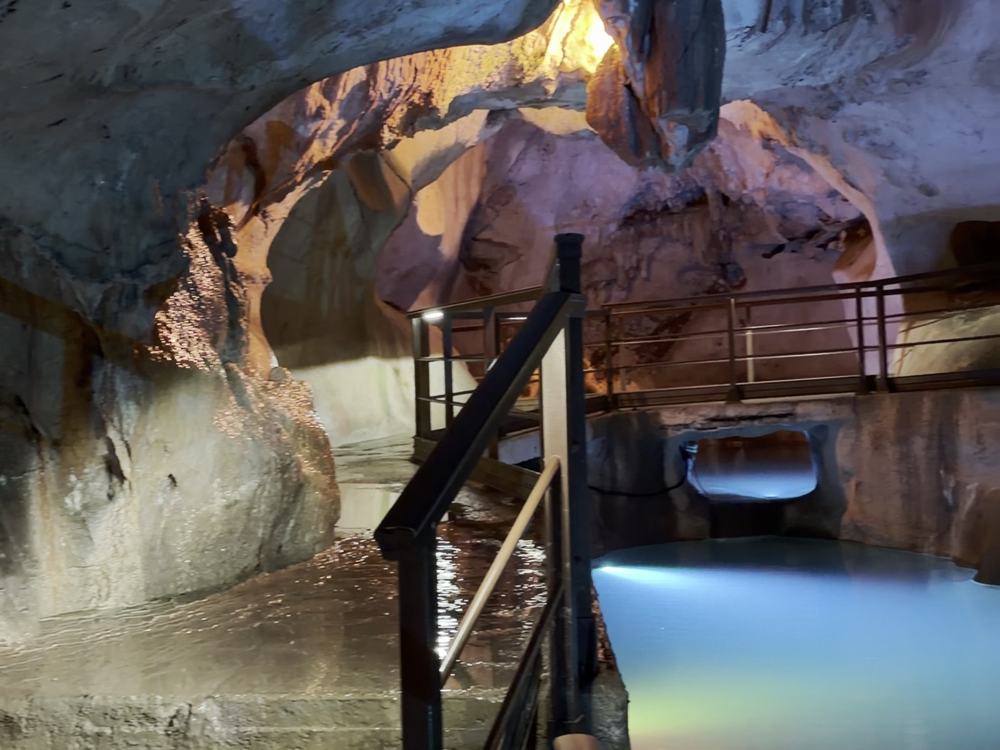

La mayoría de las cuevas se forman cuando el agua de lluvia va disolviendo la roca. La **Cueva del Tesoro** no: se formó **bajo el mar**, y por eso sus paredes parecen esculpidas por las olas. Es una de las **tres cuevas de origen marino** que se conocen en el mundo; las otras dos están en Asia y en Centroamérica. Y encima tiene leyenda: dicen que aquí dentro sigue escondido un tesoro almorávide.

Está en **Rincón de la Victoria**, a 15 minutos de Málaga. Te cuento cómo es por dentro, cuánto cuesta, cómo reservar y la historia del tesoro 👇

En un vistazo<h2>Lo que vas a encontrar</h2>

<b>🌊</b>Origen marino

<b>💰</b>Leyenda del tesoro

<b>💧</b>Lagos interiores

<b>🦴</b>Prehistoria

<b>🎟️</b>4,65 €

Antes de ir<h2>Precio, horario y reserva</h2>

<h3>🎟️ Entradas</h3>
La <strong>reserva es obligatoria</strong>, en la web de turismo de Rincón de la Victoria o por teléfono.

<ul class="guide__prices"><li>Adultos (15-64 años)<b>4,65 €</b></li><li>Niños, mayores y estudiantes<b>2,75 €</b></li><li>Menores de 4 años<b>Gratis</b></li></ul>

<h3>🕒 Horario</h3>
<strong>Octubre a abril:</strong> 10:00-14:00 y 15:00-18:00. <strong>Mayo a septiembre:</strong> 10:30-14:00 y 16:30-20:00. El último pase es una hora antes de cada cierre.

<h3>🆓 Gratis</h3>
De lunes a viernes en la <strong>primera hora</strong> de apertura (con reserva, hasta 25 personas) y el 28 de febrero, el 6 de junio y el 27 de septiembre.

La visita<h2>Qué vas a ver dentro</h2>
La visita es por libre, con una audioguía gratis que escuchas en tu móvil. Lleva auriculares.

<ol class="guide__grid guide__grid--cuenca">
<li class="gcard reveal">
01

<h3>La entrada</h3>
Un edificio con escalones de azulejos en la urbanización del Cantal, en La Cala del Moral. Aquí recoges la entrada.

</li>
<li class="gcard reveal">
02

<h3>La exposición</h3>
Antes de bajar, vitrinas con lo que se ha encontrado en las cuevas del Cantal: cerámica y <strong>lascas de sílex talladas por neandertales</strong> hace entre 60.000 y 40.000 años.

</li>
<li class="gcard reveal">
03

<h3>Las primeras salas</h3>
Se baja en ascensor hasta la primera sala. La luz cambia de color en cada zona y hace que la roca parezca otra.

</li>
<li class="gcard reveal">
04

<h3>La roca tallada por el mar</h3>
Huecos, columnas y paredes redondeadas: son las marcas del agua del mar, que excavó la cueva cuando estaba sumergida.

</li>
<li class="gcard reveal">
05

<h3>Las «banderas»</h3>
Son estalactitas en forma de cortina: crecen cuando el agua gotea por un techo inclinado. Llegaron después, cuando la cueva ya había salido del mar.

</li>
<li class="gcard reveal">
06

<h3>Pasarelas y escaleras</h3>
El recorrido sube y baja por escaleras y pasarelas entre las salas. No es difícil, pero no es apto para sillas de ruedas.

</li>
<li class="gcard reveal">
07

<h3>La Sala del Lago</h3>
La antigua Cueva del Suizo. Hoy forma, junto con la del Higuerón, la gran <strong>Sala de la Virgen</strong>, con lagos de agua turquesa iluminados desde dentro.

</li>
<li class="gcard reveal">
08

<h3>El final del recorrido</h3>
Los lagos son lo más bonito de la visita. Tómate tu tiempo aquí antes de volver a subir.

</li>
</ol>

La leyenda<h2>El tesoro que nadie ha encontrado</h2>

La cueva tiene ese nombre por una leyenda: en el <strong>siglo XII</strong>, huyendo de los almohades, los almorávides habrían escondido aquí un tesoro. Unas versiones hablan del emir <strong>Tasufín ibn Alí</strong> y otras de «cinco reyes almorávides». Nunca ha aparecido.

Muchos lo buscaron. El más famoso fue un suizo, <strong>Antonio de la Nari</strong>, que pasó buena parte de su vida excavando y murió en una explosión dentro de la cueva en <strong>1847</strong>; por eso una de las salas se llamaba la Cueva del Suizo. En el siglo XX, su propietario, <strong>Manuel Laza Palacio</strong>, la estudió durante más de cuarenta años, hasta su muerte en 1988. Defendía que aquí hubo un santuario de <strong>Noctiluca</strong>, una diosa de la luna.

<h3>🕯️ Visitas teatralizadas</h3>
El <strong>último domingo de cada mes</strong>, a las 11:00 y a las 12:30, hay visita teatralizada para grupos de hasta 30 personas. Pregunta al reservar.

Un poco de ciencia<h2>Por qué es tan rara</h2>

La cueva está excavada en un promontorio de roca caliza junto a la costa, el <strong>Cantal</strong>. Las olas y las corrientes la fueron abriendo cuando estaba bajo el agua; luego, los movimientos de la tierra la sacaron del mar. Al principio eran tres cuevas: <strong>El Higuerón</strong>, <strong>El Suizo</strong> y <strong>La Victoria</strong>. En sus galerías se han encontrado restos del Paleolítico y de la Edad del Bronce, y algunas pinturas. La parte más prehistórica está protegida y se visita aparte, con la <strong>Cueva de la Victoria</strong>.

<!--actividades-->

Cómo llegar<h2>Cómo llegar a la Cueva del Tesoro</h2>

Está en la <strong>urbanización del Cantal</strong>, en La Cala del Moral (Rincón de la Victoria), a unos <strong>15 minutos en coche</strong> del centro de Málaga por la A-7 o por la carretera de la costa. Tiene <strong>aparcamiento</strong> propio.

En transporte público, los autobuses interurbanos que van de Málaga a Rincón de la Victoria paran en La Cala del Moral; desde allí hay un paseo cuesta arriba.

<strong>Reserva sin líos:</strong> también puedes sacar la <a href="https://www.civitatis.com/es/rincon-de-la-victoria/entrada-cueva-tesoro/?aid=110968" target="_blank" rel="noopener sponsored">entrada a la Cueva del Tesoro en Civitatis</a>, que cuesta algo más que la oficial.

<a class="btn guide__mapbtn" href="https://www.google.com/maps/dir/?api=1&destination=36.7198,-4.2976" target="_blank" rel="noopener"><svg class="ico" viewBox="0 0 24 24" width="15" height="15" aria-hidden="true" fill="currentColor"><path d="M12 2a7 7 0 0 0-7 7c0 5.25 7 13 7 13s7-7.75 7-13a7 7 0 0 0-7-7zm0 9.5a2.5 2.5 0 1 1 0-5 2.5 2.5 0 0 1 0 5z"/></svg> Cómo llegar en Google Maps</a><a class="btn guide__mapbtn btn--ghost" href="https://entradas.turismoenrincon.es/" target="_blank" rel="noopener"><svg class="ico" viewBox="0 0 24 24" width="15" height="15" aria-hidden="true" fill="none" stroke="currentColor" stroke-width="2" stroke-linecap="round" stroke-linejoin="round"><path d="M7 3v3M17 3v3M4 9h16M5 5h14a1 1 0 0 1 1 1v13a1 1 0 0 1-1 1H5a1 1 0 0 1-1-1V6a1 1 0 0 1 1-1z"/></svg> Reservar entradas oficiales</a>

Combínala en el mismo día con <a href="/blog/malaga-que-ver.html">Málaga</a> y su <a href="/blog/alcazaba-de-malaga.html">Alcazaba</a>, o sigue por la costa hacia <a href="/blog/frigiliana-que-ver.html">Frigiliana</a>.

Consejos de Cheno<h2>Para disfrutarlo al máximo</h2><ul><li><b>Reserva antes</b>: sin reserva no entras.</li><li><b>Auriculares</b>: la audioguía va en tu móvil.</li><li><b>Calzado cerrado</b>: hay escaleras y el suelo puede estar húmedo.</li><li><b>Ve entre semana a primera hora</b>: es gratis si reservas esa franja.</li><li><b>Mira hacia arriba</b>: las formas del techo son las más raras.</li></ul>

<!--faq-->

<h2>¿Te gustan estos planes?</h2>
Sígueme en Instagram como <a href="https://www.instagram.com/chenoaventuras/" target="_blank" rel="noopener">@chenoaventuras</a>: subo escapadas como esta cada semana.
<a class="btn guide__btn" href="/blog.html">Ver más planes en el blog</a>

Precios, horarios y datos de la cueva consultados en noviembre de 2026 en la web de turismo de Rincón de la Victoria; la leyenda y la historia de Laza y De la Nari, en Andalucía.org y Directo al Paladar. Pueden cambiar, así que confírmalos antes de ir. Fotos de @chenoaventuras (noviembre de 2026).

