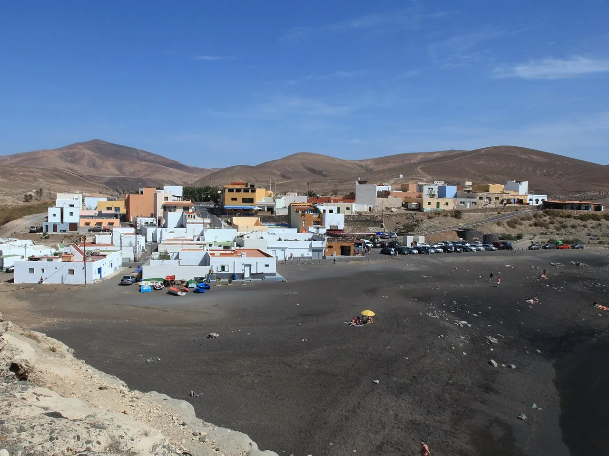
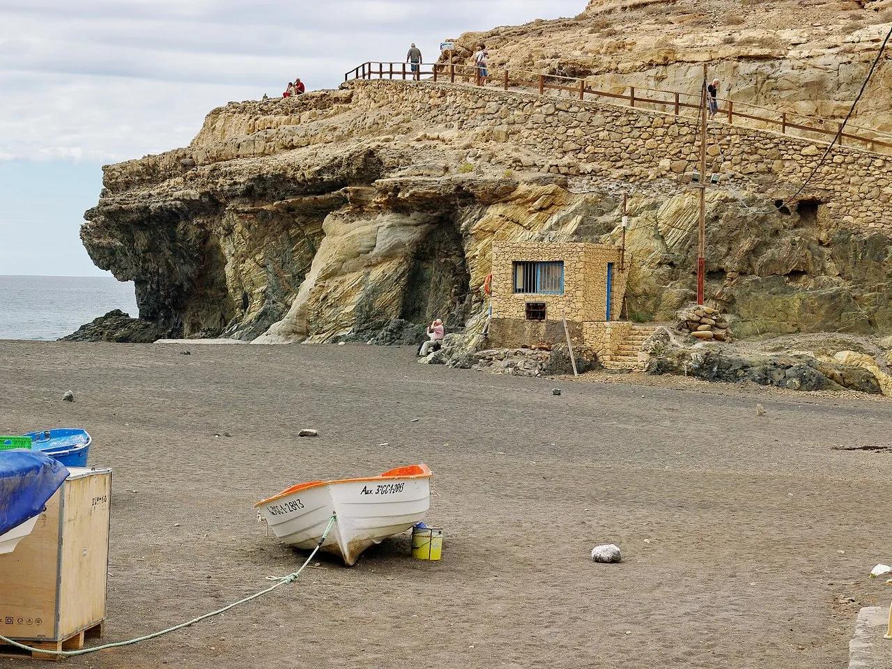
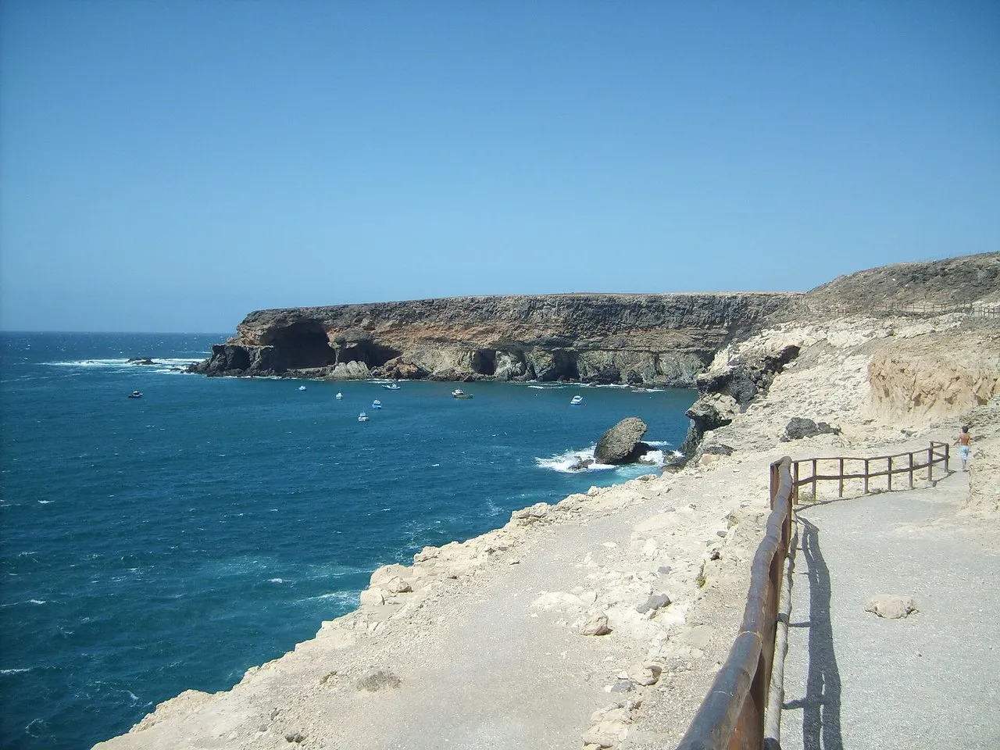
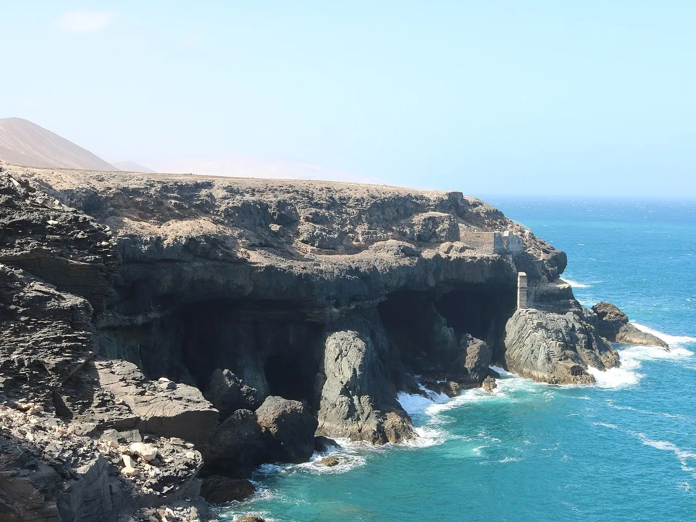
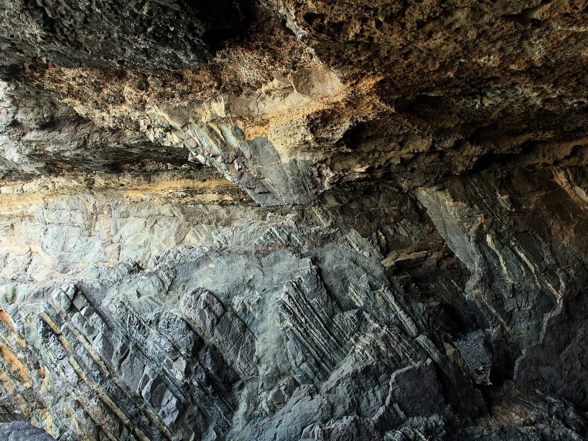
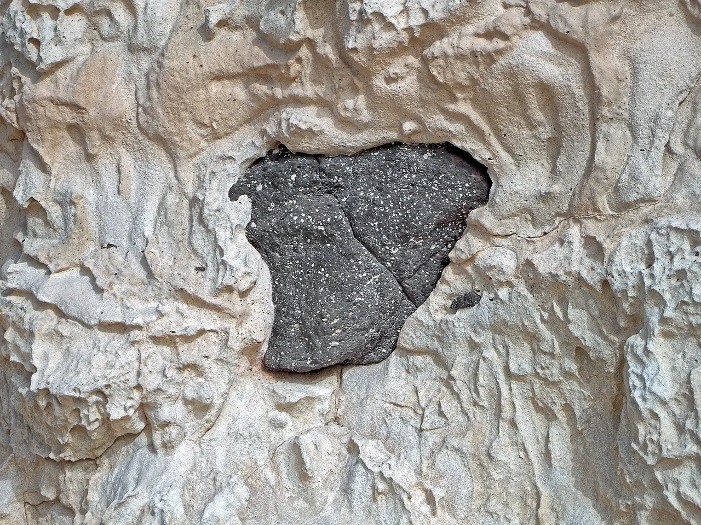

Una playa de arena negra, un pueblito de pescadores y, a cinco minutos andando, unos acantilados llenos de cuevas donde salen a la luz **las rocas más antiguas de Canarias**: fondo de océano de hace más de 100 millones de años. Las **cuevas de Ajuy** son de lo más curioso que puedes ver en **Fuerteventura**.

Te cuento cómo llegar, el sendero y lo que no debes hacer 👇

En un vistazo<h2>Lo que vas a encontrar</h2>

<b>🕳️</b>Cuevas marinas

<b>🪨</b>Rocas de 100 millones de años

<b>🖤</b>Playa de arena negra

<b>🥾</b>Sendero corto

<b>💶</b>Gratis

Antes de ir<h2>Lo básico de las cuevas de Ajuy</h2>

<h3>📍 Dónde está</h3>
En la <strong>costa oeste de Fuerteventura</strong>, en el pueblo de <strong>Ajuy</strong> (municipio de Pájara). Es un <strong>Monumento Natural</strong>.

<h3>💶 Precio</h3>
<strong>Gratis</strong> y sin horario: es un espacio natural abierto.

<h3>⏱️ Tiempo</h3>
Con <strong>una hora</strong> ves el sendero y las cuevas sin prisas; añade un rato para comer pescado en el pueblo.

<h3>⚠️ Ojo con el mar</h3>
Es costa de oleaje: <strong>no bajes a las cuevas con mala mar</strong> y no te salgas del sendero.

Qué ver<h2>Qué ver en las cuevas de Ajuy</h2>

<ol class="guide__grid guide__grid--cuenca">
<li class="gcard reveal">
01

<h3>El pueblo y la playa negra</h3>
Ajuy es un pueblo de pescadores de unas pocas decenas de casas, con una <strong>playa de arena oscura</strong> y restaurantes de pescado fresco.

</li>
<li class="gcard reveal">
02

<h3>La subida desde la playa</h3>
Al final de la playa empieza el camino, con barandilla, que sube al acantilado. Muy cerca hay también una <strong>duna fosilizada</strong>.

</li>
<li class="gcard reveal">
03

<h3>El sendero del acantilado</h3>
Un paseo corto y fácil junto al mar, con vistas a la costa oeste. Por el camino aparecen los antiguos <strong>hornos de cal</strong>.

</li>
<li class="gcard reveal">
04

<h3>Caleta Negra y la cueva grande</h3>
El final del camino: una caleta rodeada de <strong>bocas de cuevas</strong> excavadas por el mar. Unas escaleras bajan hasta la entrada de la más grande.

</li>
<li class="gcard reveal">
05

<h3>Las rocas más antiguas de Canarias</h3>
Esas capas inclinadas son <strong>sedimentos del fondo del océano</strong> del Cretácico, de hace entre <strong>100 y 150 millones de años</strong>: mucho más antiguos que la propia isla.

</li>
<li class="gcard reveal">
06

<h3>Lava dentro de la caliza</h3>
Fíjate en las paredes: hay trozos de <strong>lava oscura</strong> atrapados en la roca clara. Es la mezcla de volcán y mar que explica Fuerteventura.

</li>
</ol>

<!--actividades-->

Cómo llegar<h2>Cómo llegar a las cuevas de Ajuy</h2>

<h3>🚗 En coche</h3>
Hasta el pueblo de <strong>Ajuy</strong>, en el oeste de la isla, por la carretera que baja desde Pájara. Se aparca junto a la playa.

<h3>🥾 A pie</h3>
Desde la playa, el sendero sube por el acantilado hasta Caleta Negra en <strong>unos minutos</strong>. Lleva calzado cerrado: hay escalones y roca resbaladiza.

<h3>🚌 Con excursión</h3>
Si no tienes coche, la <a href="https://www.civitatis.com/es/corralejo/cuevas-ajuy-betancuria-museo-queso/?aid=110968" target="_blank" rel="noopener sponsored">excursión a Ajuy, Betancuria y el Museo del Queso</a> sale desde Corralejo y también desde <a href="https://www.civitatis.com/es/costa-calma/cuevas-ajuy-betancuria-museo-queso/?aid=110968" target="_blank" rel="noopener sponsored">Costa Calma</a>.

<h3>🏖️ Combinado con playa</h3>
Otra opción es la <a href="https://www.civitatis.com/es/corralejo/excursion-cuevas-ajuy-playa-sotavento/?aid=110968" target="_blank" rel="noopener sponsored">excursión a las cuevas de Ajuy y la playa de Sotavento</a>.

<a class="btn guide__mapbtn" href="https://www.google.com/maps/dir/?api=1&destination=Cuevas+de+Ajuy+Fuerteventura" target="_blank" rel="noopener"><svg class="ico" viewBox="0 0 24 24" width="15" height="15" aria-hidden="true" fill="currentColor"><path d="M12 2a7 7 0 0 0-7 7c0 5.25 7 13 7 13s7-7.75 7-13a7 7 0 0 0-7-7zm0 9.5a2.5 2.5 0 1 1 0-5 2.5 2.5 0 0 1 0 5z"/></svg> Cómo llegar a Ajuy</a>

Consejos de Cheno<h2>Para disfrutarlas al máximo</h2><ul><li><b>Ve con buena mar</b>: con oleaje, las escaleras de la cueva grande pueden ser peligrosas.</li><li><b>Mejor a primera hora o al atardecer</b>: menos gente y una luz preciosa sobre el acantilado.</li><li><b>Calzado cerrado</b>: nada de chanclas en el sendero.</li><li><b>Combínalo con</b> <a href="/blog/betancuria-que-ver.html">Betancuria</a>, la antigua capital de la isla, y con la <a href="/blog/fuerteventura-que-ver.html">guía de qué ver en Fuerteventura</a>.</li></ul>

<!--faq-->

<h2>¿Te gustan estos planes?</h2>
Sígueme en Instagram como <a href="https://www.instagram.com/chenoaventuras/" target="_blank" rel="noopener">@chenoaventuras</a>: subo escapadas como esta cada semana.
<a class="btn guide__btn" href="/blog.html">Ver más planes en el blog</a>

Información consultada en noviembre de 2026 (geología y entorno: Turismo de Islas Canarias). Fotos de Wikimedia Commons: <a href="https://commons.wikimedia.org/wiki/File:P%C3%A1jara_-_Ajuy_-_Monumento_Natural_-_Caleta_Negra_02_ies.jpg" target="_blank" rel="noopener">Frank Vincentz</a> (CC BY-SA 3.0) · <a href="https://commons.wikimedia.org/wiki/File:P%C3%A1jara_-_Ajuy_02_ies.jpg" target="_blank" rel="noopener">Frank Vincentz</a> (CC BY-SA 3.0) · <a href="https://commons.wikimedia.org/wiki/File:ES-fuerte-ajuy-aufgang-cn.jpg" target="_blank" rel="noopener">Balou46</a> (CC BY-SA 3.0) · <a href="https://commons.wikimedia.org/wiki/File:Ajuy_-_Caleta_negra_-_01.JPG" target="_blank" rel="noopener">Xosema</a> (CC BY-SA 4.0) · <a href="https://commons.wikimedia.org/wiki/File:P%C3%A1jara_-_Ajuy_-_Monumento_Natural_-_Cuevas_03_ies.jpg" target="_blank" rel="noopener">Frank Vincentz</a> (CC BY-SA 3.0) · <a href="https://commons.wikimedia.org/wiki/File:Caleta_Negra._Cuevas_de_Ajuy.jpg" target="_blank" rel="noopener">Rudolphu</a> (CC BY-SA 4.0) · <a href="https://commons.wikimedia.org/wiki/File:Lava_in_limestone-_Ajuy_-_Fuerteventura.jpg" target="_blank" rel="noopener">H. Zell</a> (CC BY-SA 3.0).

