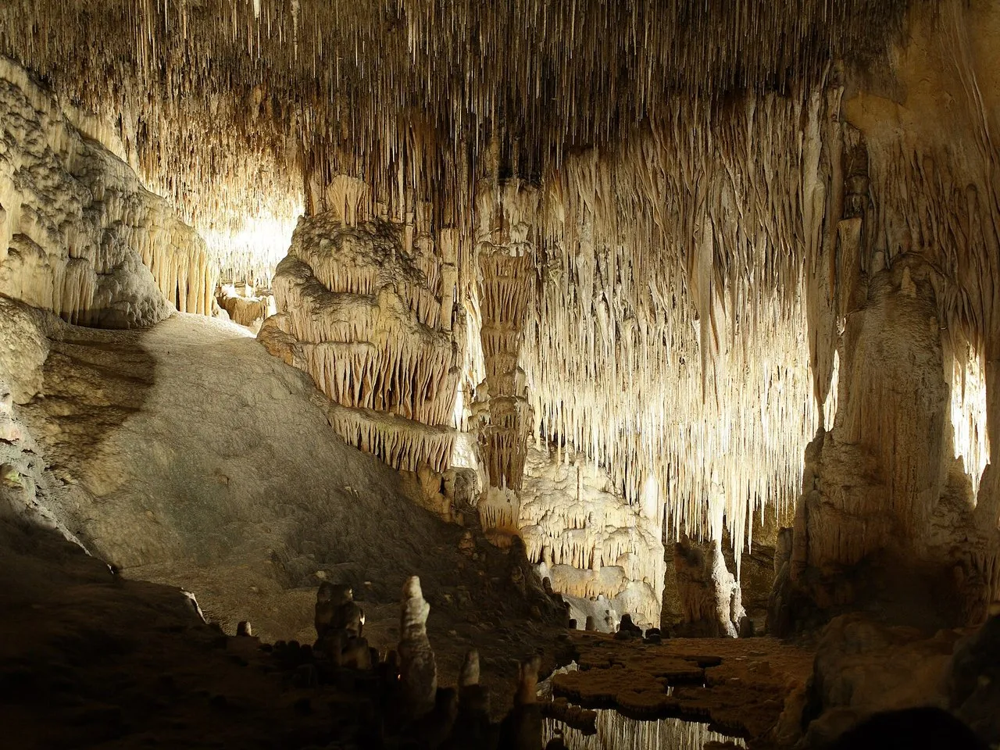
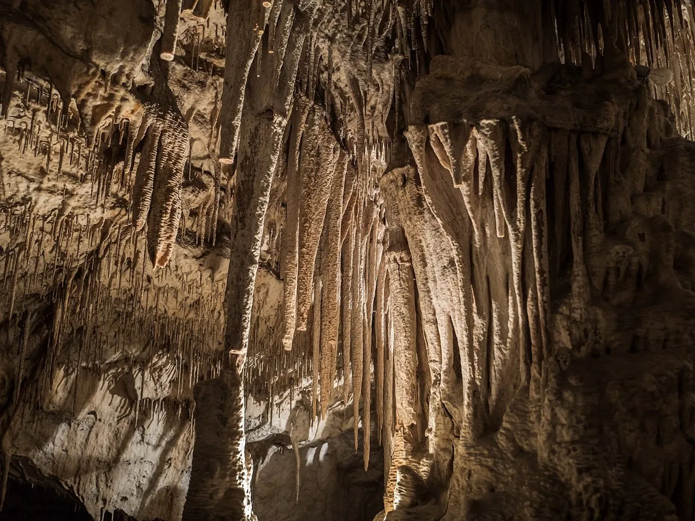
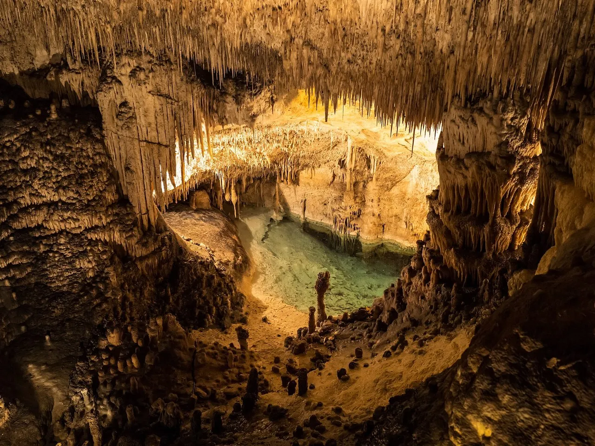
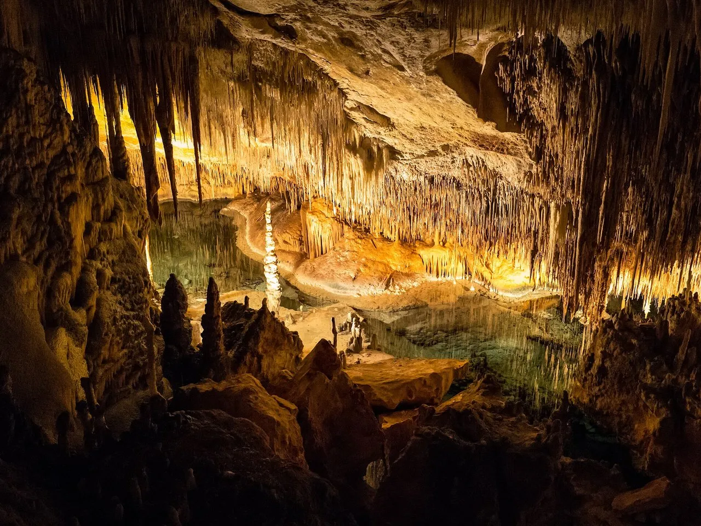
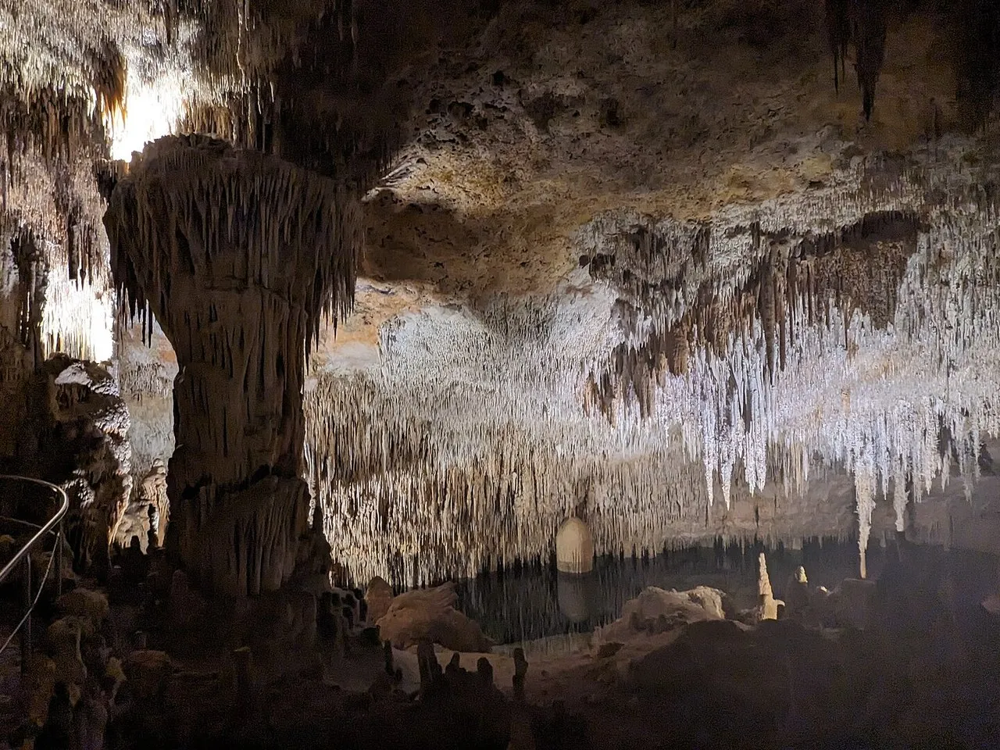
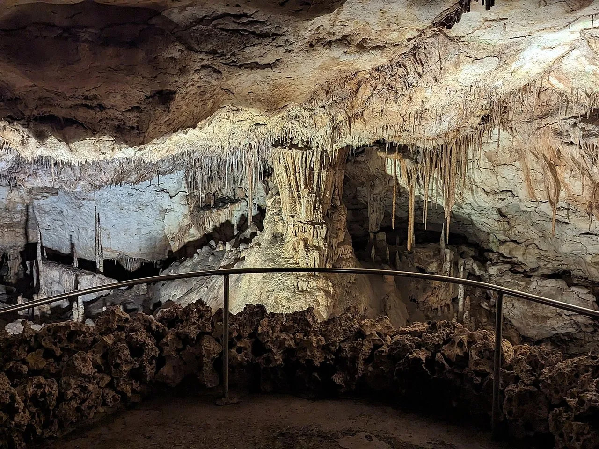

Un kilómetro de galerías llenas de estalactitas, un lago subterráneo de agua transparente y, en mitad de la oscuridad, un cuarteto tocando música clásica. Las **Cuevas del Drach**, en **Porto Cristo**, son la visita más famosa del este de **Mallorca**.

Te cuento cuánto cuestan, los horarios, cómo es el concierto y cómo llegar 👇

En un vistazo<h2>Lo que vas a encontrar</h2>

<b>🦇</b>Galerías de 1,2 km

<b>💧</b>Lago Martel

<b>🎻</b>Concierto en la cueva

<b>🚣</b>Barca incluida

<b>🅿️</b>Parking gratis

Antes de ir<h2>Lo básico de las Cuevas del Drach</h2>

<h3>🎟️ Precio</h3>
Adultos <strong>18,50 € online</strong> (19,50 € en taquilla); niños de 3 a 12, <strong>11,50 €</strong>. Concierto y barca incluidos.

<h3>🕙 Pases en invierno</h3>
Del 1 de noviembre al 15 de marzo: <strong>10:30, 12:00, 14:00 y 15:30</strong>. Cierra el 25 de diciembre y el 1 de enero.

<h3>☀️ Pases en verano</h3>
Del 16 de marzo al 31 de octubre: <strong>10:00, 11:00, 12:00, 14:00, 15:00, 16:00 y 17:00</strong>.

<h3>⏱️ Duración</h3>
Una <strong>hora</strong>. Llega 15 minutos antes: la entrada está a 200 metros del parking.

Qué ver<h2>Cómo es la visita a las Cuevas del Drach</h2>

<ol class="guide__grid guide__grid--cuenca">
<li class="gcard reveal">
01

<h3>Las galerías</h3>
Unos <strong>1.200 metros</strong> de recorrido, hasta <strong>25 metros</strong> de profundidad, entre estalactitas y estalagmitas. Dentro hay entre 17 y 21 °C todo el año.

</li>
<li class="gcard reveal">
02

<h3>Bosques de estalactitas</h3>
Hay techos cubiertos de estalactitas finísimas. Está prohibido tocarlas y salirse del camino.

</li>
<li class="gcard reveal">
03

<h3>Los lagos</h3>
El agua aparece en varios puntos del recorrido, tan quieta y transparente que refleja el techo como un espejo.

</li>
<li class="gcard reveal">
04

<h3>El lago Martel y el concierto</h3>
Uno de los mayores lagos subterráneos del mundo: <strong>117 metros</strong> de largo. Frente a él, un cuarteto toca música clásica unos 10 minutos y después llega el efecto de luz «Amanecer en el lago».

</li>
<li class="gcard reveal">
05

<h3>Columnas gigantes</h3>
Algunas salas tienen <strong>columnas</strong> formadas al unirse estalactitas y estalagmitas. Al final, tras el concierto, puedes <strong>cruzar el lago en barca</strong> o por un puente, sin pagar más.

</li>
<li class="gcard reveal">
06

<h3>El recorrido</h3>
Por caminos con barandilla y escalones. Las visitas son en grupo pero <strong>sin guía</strong>; no es accesible en silla de ruedas.

</li>
</ol>

<!--actividades-->

La historia<h2>Martel y el lago escondido</h2>

Las cuevas se conocían desde la Edad Media, pero fue el espeleólogo francés <strong>Édouard-Alfred Martel</strong> quien, en <strong>1896</strong>, exploró sus galerías con Louis Armand y encontró el gran lago que hoy lleva su nombre. Después se abrió la entrada actual, y el ingeniero <strong>Carles Buïgas</strong>, el de la Fuente Mágica de Montjuïc, diseñó la iluminación. El concierto se ofrece desde <strong>1935</strong>.

Cómo llegar<h2>Cómo llegar a las Cuevas del Drach</h2>

<h3>🚗 En coche</h3>
Hasta <strong>Porto Cristo</strong> (Manacor), en la costa este. Hay <strong>aparcamiento gratuito</strong>.

<h3>🚌 En autobús</h3>
Hay buses públicos desde distintos puntos de la isla (red TIB). También hay parada de taxis en las cuevas.

<h3>⛵ En barco</h3>
El puerto de Porto Cristo está a 15 minutos a pie.

<h3>🧭 Con excursión</h3>
Desde el sur de la isla, la <a href="https://www.civitatis.com/es/palma-mallorca/excursion-cuevas-drach-medio-dia/?aid=110968" target="_blank" rel="noopener sponsored">excursión a las cuevas del Drach con concierto</a> incluye el transporte.

Consejos de Cheno<h2>Para disfrutarlas al máximo</h2><ul><li><b>Compra online</b>: ahorras 1 € por entrada y puedes elegir pase hasta 30 días antes.</li><li><b>No grabes el concierto</b>: está prohibido y te lo recordarán.</li><li><b>Coge la barca</b>: es corto, pero es lo más bonito de la visita.</li><li><b>Si te sabe a poco</b>, muy cerca están las <a href="https://www.civitatis.com/es/porto-cristo/entradas-cuevas-hams/?aid=110968" target="_blank" rel="noopener sponsored">Cuevas dels Hams</a>.</li><li><b>Más Mallorca:</b> <a href="/blog/valldemossa-que-ver.html">Valldemossa</a>, <a href="/blog/sa-calobra.html">Sa Calobra</a> y la <a href="/blog/mallorca-que-ver.html">guía de Mallorca</a>.</li></ul>

<!--faq-->

<h2>¿Te gustan estos planes?</h2>
Sígueme en Instagram como <a href="https://www.instagram.com/chenoaventuras/" target="_blank" rel="noopener">@chenoaventuras</a>: subo escapadas como esta cada semana.
<a class="btn guide__btn" href="/blog.html">Ver más planes en el blog</a>

Información consultada en noviembre de 2026 en la web oficial de las Cuevas del Drach. Fotos de Wikimedia Commons: <a href="https://commons.wikimedia.org/wiki/File:Coves_del_Drac_21.jpg" target="_blank" rel="noopener">Rudolphous</a> (CC BY-SA 4.0) · <a href="https://commons.wikimedia.org/wiki/File:Cueva_del_Drach_Mallorca_03.jpg" target="_blank" rel="noopener">Javier Pérez Montes</a> (CC BY-SA 4.0) · <a href="https://commons.wikimedia.org/wiki/File:Cuevas_del_Drach_(35752895672).jpg" target="_blank" rel="noopener">Sergiy Galyonkin</a> (CC BY-SA 2.0) · <a href="https://commons.wikimedia.org/wiki/File:Cuevas_del_Drach_(35882086116).jpg" target="_blank" rel="noopener">Sergiy Galyonkin</a> · <a href="https://commons.wikimedia.org/wiki/File:Cuevas_del_Drach_(35922692685).jpg" target="_blank" rel="noopener">Sergiy Galyonkin</a> · <a href="https://commons.wikimedia.org/wiki/File:Coves_del_Drac_01.jpg" target="_blank" rel="noopener">Rudolphous</a> (CC BY-SA 4.0) · <a href="https://commons.wikimedia.org/wiki/File:Coves_del_Drac_10.jpg" target="_blank" rel="noopener">Rudolphous</a> (CC BY-SA 4.0).

