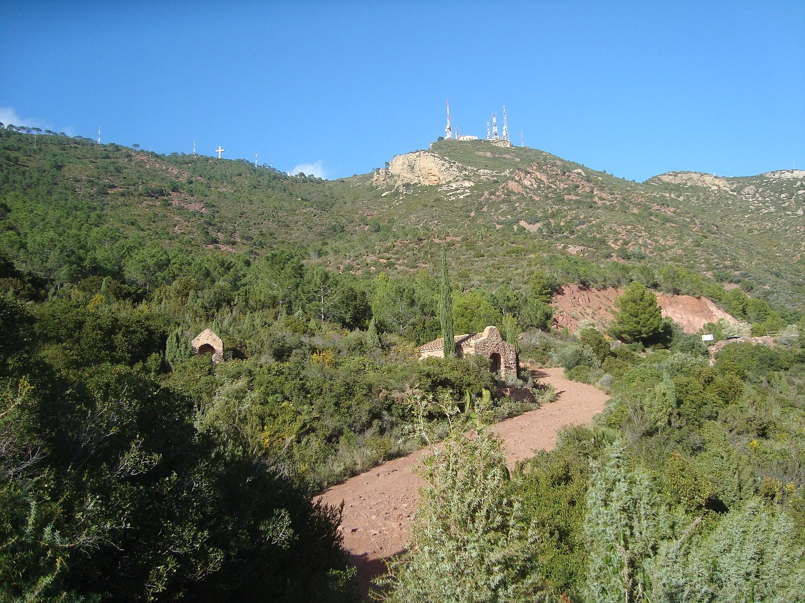
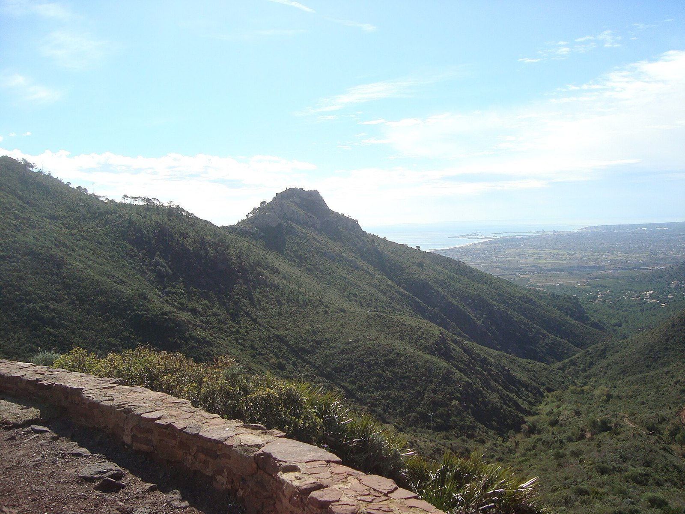
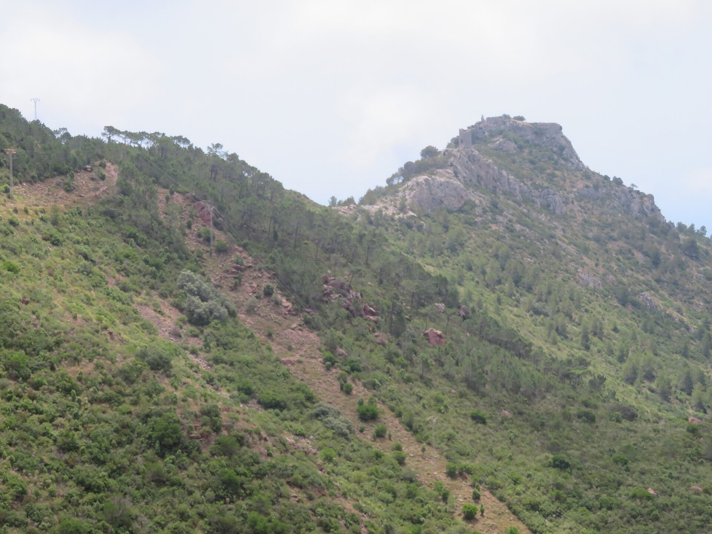
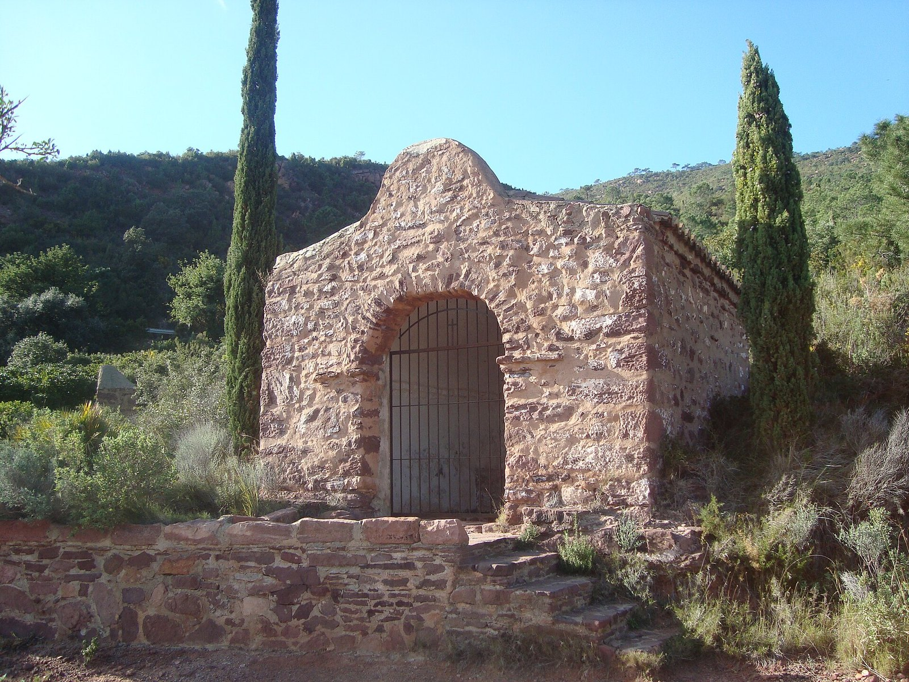
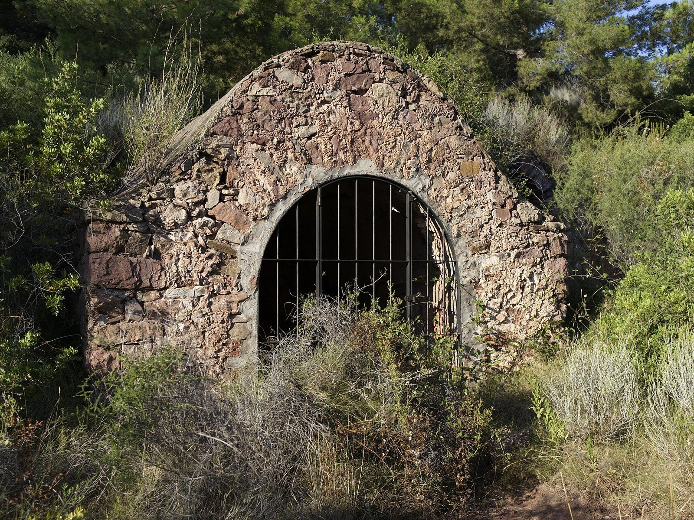
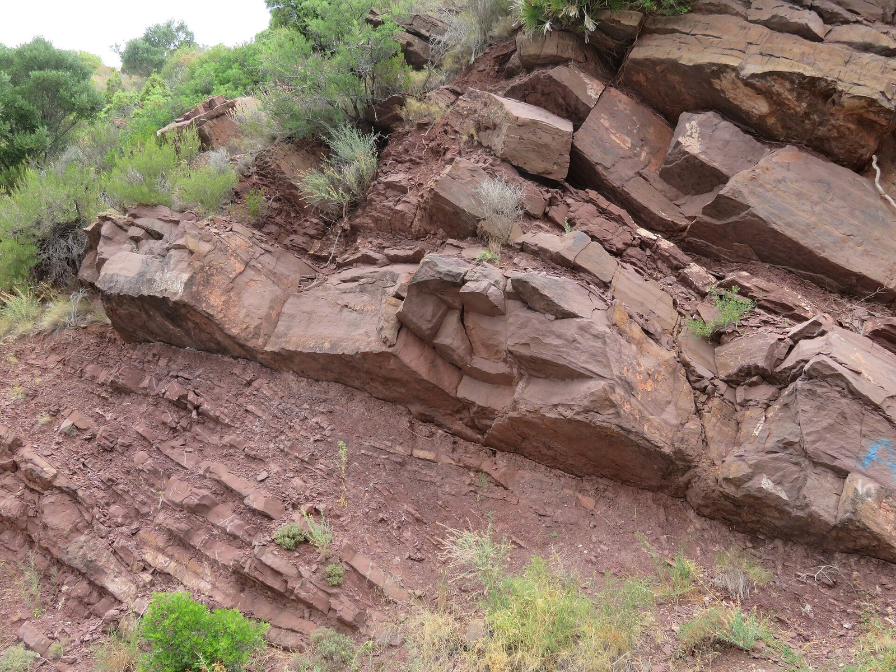

Con ese nombre, cualquiera esperaría arena y dunas. Pero el **Desierto de las Palmas** es lo contrario: un **parque natural de montañas rojas**, pinares y barrancos a un paso de las playas de **Benicàssim**. Los frailes carmelitas eligieron este sitio para retirarse del mundo, y dejaron un monasterio, ermitas escondidas y uno de los mejores miradores del Mediterráneo: el **Bartolo**.

Te cuento qué ver y qué rutas hacer 👇

En un vistazo<h2>Lo que vas a encontrar</h2>

<b>⛰️</b>El Bartolo, 729 m

<b>⛪</b>Monasterio carmelita

<b>🌊</b>Vistas al mar

<b>🥾</b>Rutas

<b>🔴</b>Rocas rojas

Antes de ir<h2>Lo básico del Desierto</h2>

<h3>📍 Dónde está</h3>
Entre <strong>Benicàssim</strong> y Castellón, a 20 minutos de la playa.

<h3>☀️ Cuándo ir</h3>
Otoño, invierno y primavera. En verano hace mucho calor y hay riesgo de incendios.

<h3>💧 Agua</h3>
Lleva agua: en las rutas casi no hay fuentes que se puedan usar.

Qué ver<h2>Qué ver en el Desierto de las Palmas</h2>

<ol class="guide__grid guide__grid--cuenca">
<li class="gcard reveal">
01

<h3>El Bartolo</h3>
La cima del parque, a <strong>729 metros</strong>, con sus antenas. Desde arriba ves toda la costa de Castellón y el Mediterráneo.

</li>
<li class="gcard reveal">
02

<h3>Los miradores</h3>
Desde la carretera y los caminos hay miradores con el mar al fondo. El atardecer aquí es precioso.

</li>
<li class="gcard reveal">
03

<h3>Montornés</h3>
Uno de los picos más reconocibles del parque, con restos de un castillo en lo alto. Su silueta se ve desde Benicàssim.

</li>
<li class="gcard reveal">
04

<h3>Las ermitas</h3>
Los frailes construyeron pequeñas ermitas repartidas por el monte para retirarse a rezar en soledad. Encontrarlas es parte del encanto de las rutas.

</li>
<li class="gcard reveal">
05

<h3>Las fuentes</h3>
Hay una ruta de fuentes antiguas, como la de <strong>San Juan de la Cruz</strong>, cubiertas con pequeñas bóvedas de piedra.

</li>
<li class="gcard reveal">
06

<h3>Las rocas rojas</h3>
El color de la sierra viene del <strong>rodeno</strong>, una arenisca rojiza. Con el sol de la tarde, las montañas parecen encenderse.

</li>
</ol>

Historia<h2>Los carmelitas del Desierto</h2>

A finales del <strong>siglo XVII</strong>, los carmelitas descalzos fundaron aquí su monasterio para vivir apartados. Las lluvias y el paso del tiempo lo dejaron en ruinas, y hoy sus restos se ven entre los pinos, como en la foto de portada. Los frailes construyeron otro <strong>monasterio nuevo</strong>, que sigue habitado y tiene un pequeño museo de arte sacro.

<h3>🌿 ¿Por qué «desierto»?</h3>
Los carmelitas llamaban <strong>«desiertos»</strong> a los lugares solitarios donde se retiraban. Las <strong>«palmas»</strong> son los palmitos, una palmera enana que crece por toda la sierra. Ni arena ni oasis.

Cómo llegar<h2>Cómo llegar al Desierto de las Palmas</h2>

En coche, por la carretera <strong>CV-147</strong>, que sube con curvas desde <strong>Benicàssim</strong> (unos 20 minutos). Desde Castellón, una media hora. El centro de información <strong>La Bartola</strong>, en el km 8, es el mejor sitio para coger mapas de rutas.

<a class="btn guide__mapbtn" href="https://www.google.com/maps/dir/?api=1&destination=40.0806,0.0386" target="_blank" rel="noopener"><svg class="ico" viewBox="0 0 24 24" width="15" height="15" aria-hidden="true" fill="currentColor"><path d="M12 2a7 7 0 0 0-7 7c0 5.25 7 13 7 13s7-7.75 7-13a7 7 0 0 0-7-7zm0 9.5a2.5 2.5 0 1 1 0-5 2.5 2.5 0 0 1 0 5z"/></svg> Cómo llegar en Google Maps</a>

En la provincia tienes también <a href="/blog/vilafames-que-ver.html">Vilafamés</a>, a media hora, <a href="/blog/peniscola-que-ver.html">Peñíscola</a> y <a href="/blog/morella-que-ver.html">Morella</a>.

Consejos de Cheno<h2>Para disfrutarlo al máximo</h2><ul><li><b>Sube al Bartolo andando</b>: unas 2 horas de ida, con las mejores vistas del parque.</li><li><b>Calzado de montaña</b>: hay tramos pedregosos.</li><li><b>Combínalo con la playa</b> de Benicàssim el mismo día.</li><li><b>Mira los avisos de incendio</b> en verano antes de ir.</li></ul>

<!--actividades-->

<!--faq-->

<h2>¿Te gustan estos planes?</h2>
Sígueme en Instagram como <a href="https://www.instagram.com/chenoaventuras/" target="_blank" rel="noopener">@chenoaventuras</a>: subo escapadas como esta cada semana.
<a class="btn guide__btn" href="/blog.html">Ver más planes en el blog</a>

Información consultada en noviembre de 2026 (Turismo de la Comunitat Valenciana y Turismo de Benicàssim). Fotos de Wikimedia Commons: <a href="https://commons.wikimedia.org/wiki/File:Desierto_de_las_Palmas_-_panoramio.jpg" target="_blank" rel="noopener">carlos corzo</a> (CC BY-SA 3.0) · <a href="https://commons.wikimedia.org/wiki/File:Desierto_de_Las_Palmas_(Castell%C3%B3n).jpg" target="_blank" rel="noopener">Juan Emilio Prades Bel</a> (CC BY-SA 4.0) · <a href="https://commons.wikimedia.org/wiki/File:Parque_Natural_del_Desierto_de_Las_Palmas_en_Castell%C3%B3n,_Comunitat_Valenciana.JPG" target="_blank" rel="noopener">Juan Emilio Prades Bel</a> (CC BY-SA 3.0 es) · <a href="https://commons.wikimedia.org/wiki/File:Desierto_de_las_Palmas,_monta%C3%B1a_de_Montorn%C3%A9s_(Benic%C3%A0ssim,_Castell%C3%B3n).jpg" target="_blank" rel="noopener">Juan Emilio Prades Bel</a> (CC BY-SA 4.0) · <a href="https://commons.wikimedia.org/wiki/File:Antro_del_Calvario_Viejo,_Desierto_de_las_Palmas_(Benic%C3%A0ssim).jpg" target="_blank" rel="noopener">Juan Emilio Prades Bel</a> (CC BY-SA 4.0) · <a href="https://commons.wikimedia.org/wiki/File:Fuente_de_San_Juan_de_la_Cruz_del_Desierto_de_las_Palmas.jpg" target="_blank" rel="noopener">JavierMunozF</a> (CC BY 4.0) · <a href="https://commons.wikimedia.org/wiki/File:Desierto_de_las_Palmas,_geolog%C3%ADa,_areniscas_rojizas.jpg" target="_blank" rel="noopener">Juan Emilio Prades Bel</a> (CC BY-SA 4.0).

