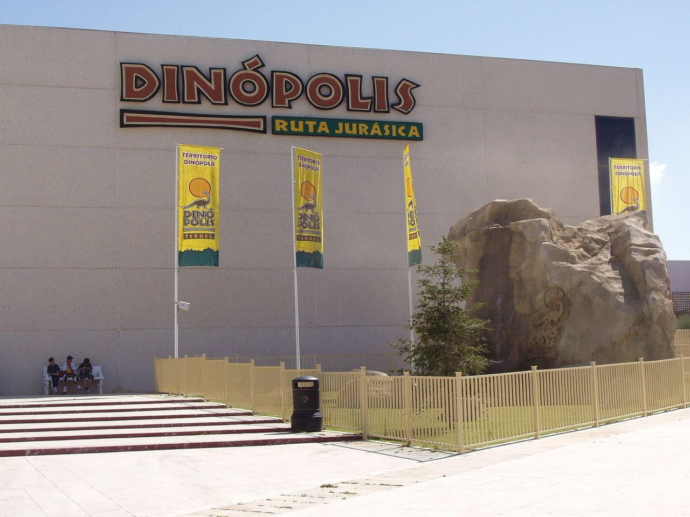
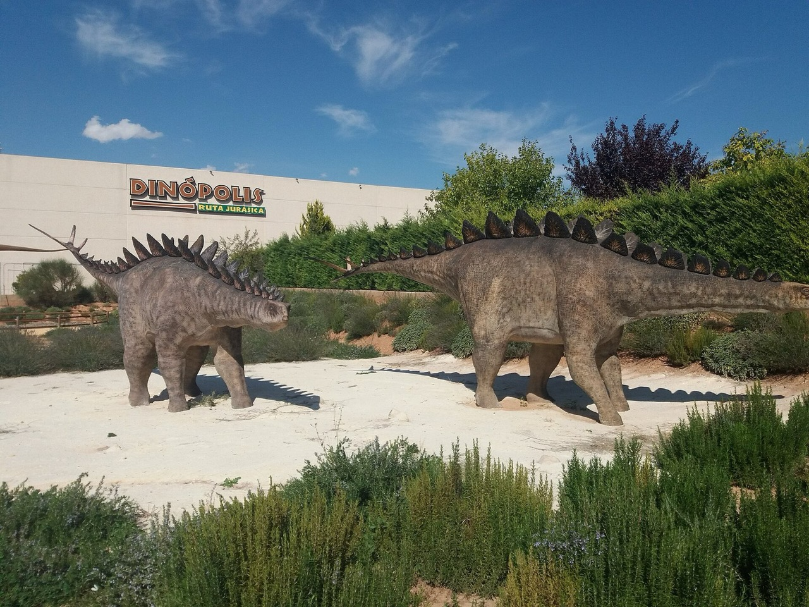
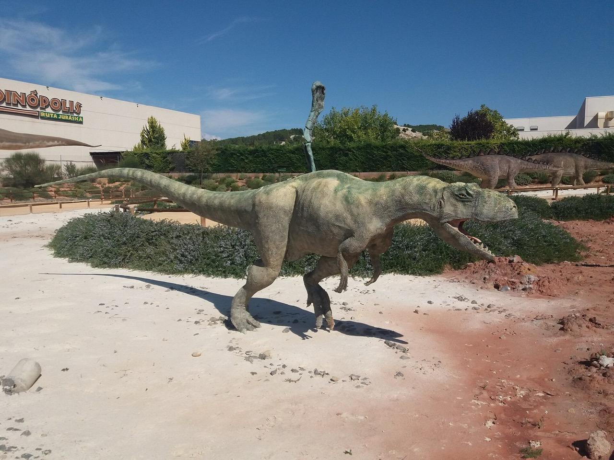
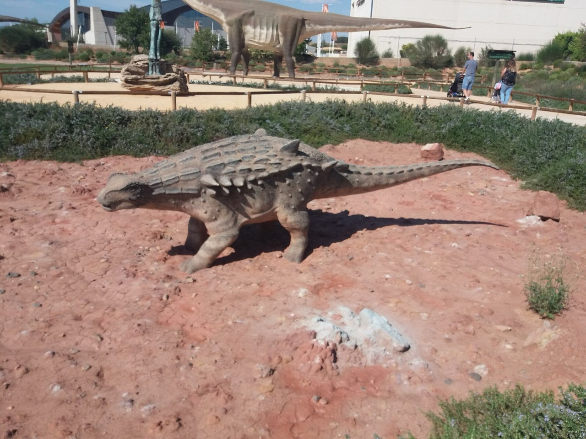
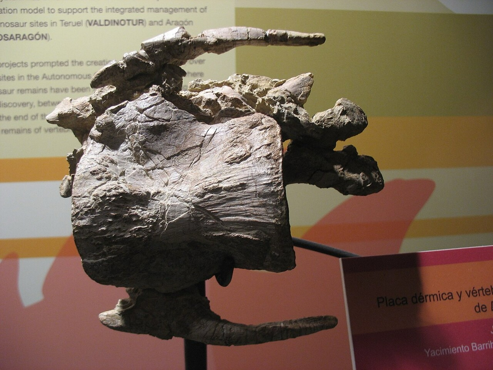

Teruel es una de las provincias de Europa con más **fósiles de dinosaurio**, y en la capital tienen un parque entero dedicado a ellos: **Dinópolis**. Hay un **museo paleontológico** con huesos reales encontrados en la provincia, réplicas a **tamaño real** por los jardines y un **tiranosaurio animatrónico** que impresiona a cualquiera. Es un plan de día completo, sobre todo con niños.

Te cuento qué ver 👇

En un vistazo<h2>Lo que vas a encontrar</h2>

<b>🦖</b>T-rex animatrónico

<b>🦴</b>Fósiles reales

<b>🦕</b>Dinosaurios a tamaño real

<b>🎭</b>Espectáculos

<b>👨‍👩‍👧</b>Plan con niños

Antes de ir<h2>Lo básico de Dinópolis</h2>

<h3>📍 Dónde está</h3>
En las afueras de <strong>Teruel</strong> capital, con aparcamiento propio.

<h3>🎟️ Precio</h3>
Unos <strong>34 € adultos</strong> según las webs de venta; menos para niños y mayores de 60. Menores de 3, gratis.

<h3>📅 Temporada</h3>
Abre por temporadas y <strong>no todos los días</strong> en invierno. Consulta el calendario.

Qué ver<h2>Qué ver en Dinópolis</h2>

<ol class="guide__grid guide__grid--cuenca">
<li class="gcard reveal">
01

<h3>El museo paleontológico</h3>
Salas con <strong>fósiles reales</strong>, muchos encontrados en la provincia de Teruel. Es la parte más «de museo» del parque.

</li>
<li class="gcard reveal">
02

<h3>Los jardines de dinosaurios</h3>
Réplicas a <strong>tamaño real</strong> repartidas por el exterior. Perfectas para las fotos de los peques.

</li>
<li class="gcard reveal">
03

<h3>El T-rex animatrónico</h3>
Una réplica de <strong>Tyrannosaurus rex</strong> que se mueve y ruge. Lo más esperado de la visita.

</li>
<li class="gcard reveal">
04

<h3>Los recorridos y espectáculos</h3>
Atracciones, recorridos y <strong>espectáculos</strong> que cambian según la temporada.

</li>
<li class="gcard reveal">
05

<h3>Los fósiles de Teruel</h3>
Como este hueso de <strong>Dacentrurus</strong>, encontrado en Riodeva (Teruel). Lee los carteles: cada pieza tiene su historia.

</li>
</ol>

<h3>🦕 ¿Por qué en Teruel?</h3>
La provincia de Teruel es uno de los lugares de Europa con más <strong>yacimientos de dinosaurios</strong>. Aquí se han encontrado especies nuevas para la ciencia, como el gran saurópodo <strong>Turiasaurus riodevensis</strong>. Por eso el parque está aquí.

Cómo llegar<h2>Cómo llegar a Dinópolis</h2>

Está en las afueras de <strong>Teruel</strong>, junto a la autovía A-23. Desde Valencia o Zaragoza se llega en unas dos horas. Tiene <strong>aparcamiento</strong> propio.

<a class="btn guide__mapbtn" href="https://www.google.com/maps/dir/?api=1&destination=40.33,-1.098" target="_blank" rel="noopener"><svg class="ico" viewBox="0 0 24 24" width="15" height="15" aria-hidden="true" fill="currentColor"><path d="M12 2a7 7 0 0 0-7 7c0 5.25 7 13 7 13s7-7.75 7-13a7 7 0 0 0-7-7zm0 9.5a2.5 2.5 0 1 1 0-5 2.5 2.5 0 0 1 0 5z"/></svg> Cómo llegar en Google Maps</a>

Aprovecha para ver <a href="/blog/teruel-que-ver.html">Teruel</a> y los <a href="/blog/amantes-de-teruel.html">Amantes</a>, o subir a <a href="/blog/albarracin-que-ver.html">Albarracín</a> y <a href="/blog/rubielos-de-mora.html">Rubielos de Mora</a>.

Consejos de Cheno<h2>Para disfrutarlo al máximo</h2><ul><li><b>Compra la entrada antes</b> y comprueba que ese día abre.</li><li><b>Llega a la apertura</b> para aprovechar el día entero.</li><li><b>Duerme en Teruel</b> y al día siguiente ve a Albarracín.</li></ul>

<!--actividades-->

<!--faq-->

<h2>¿Te gustan estos planes?</h2>
Sígueme en Instagram como <a href="https://www.instagram.com/chenoaventuras/" target="_blank" rel="noopener">@chenoaventuras</a>: subo escapadas como esta cada semana.
<a class="btn guide__btn" href="/blog.html">Ver más planes en el blog</a>

Información consultada en noviembre de 2026 (webs de venta de entradas y Turismo de Aragón). Los horarios y precios cambian: confírmalos antes de ir. Fotos de Wikimedia Commons: <a href="https://commons.wikimedia.org/wiki/File:R%C3%A9plica_dinosaurio_Din%C3%B3polis_2018_(05).jpg" target="_blank" rel="noopener">MiguelAlanCS</a> (CC BY-SA 4.0), <a href="https://commons.wikimedia.org/wiki/File:Din%C3%B3polis_Teruel.jpg" target="_blank" rel="noopener">fernand0</a> (CC BY-SA 2.0), <a href="https://commons.wikimedia.org/wiki/File:R%C3%A9plica_dinosaurio_Din%C3%B3polis_2018.jpg" target="_blank" rel="noopener">MiguelAlanCS</a> (CC BY-SA 4.0), <a href="https://commons.wikimedia.org/wiki/File:R%C3%A9plica_dinosaurio_Din%C3%B3polis_2018_(02).jpg" target="_blank" rel="noopener">MiguelAlanCS</a> (CC BY-SA 4.0), <a href="https://commons.wikimedia.org/wiki/File:R%C3%A9plica_dinosaurio_Din%C3%B3polis_2018_(04).jpg" target="_blank" rel="noopener">MiguelAlanCS</a> (CC BY-SA 4.0), <a href="https://commons.wikimedia.org/wiki/File:Dacentrurus_-_Riodeva,_Teruel,_Spain_-_Din%C3%B3polis_001.JPG" target="_blank" rel="noopener">PePeEfe</a> (CC BY-SA 4.0).

