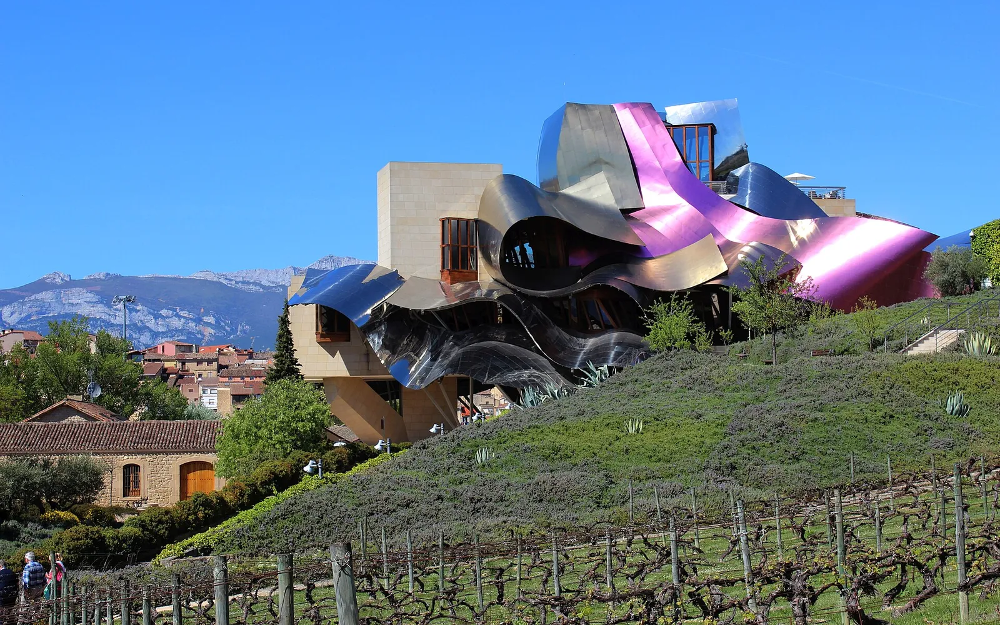
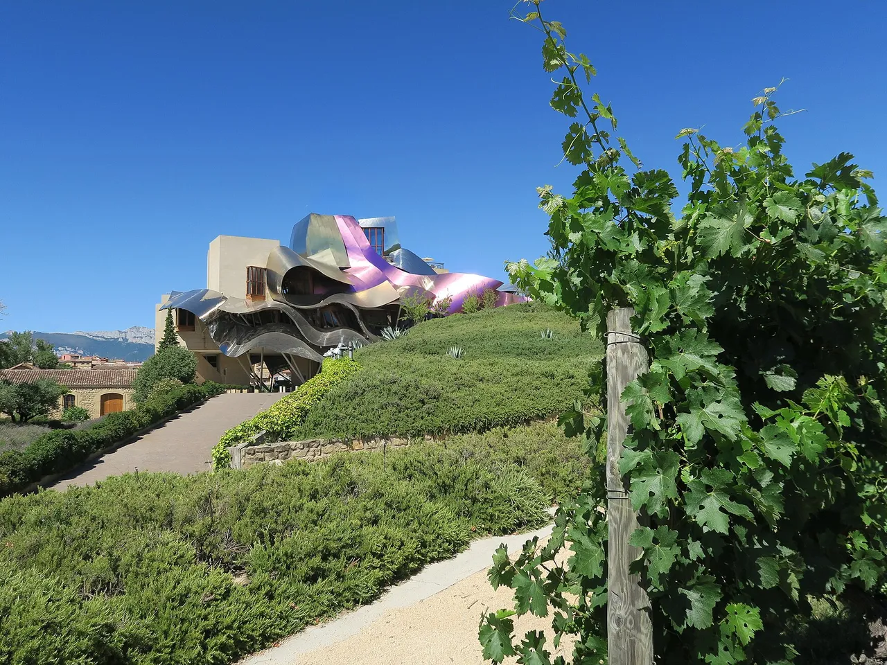
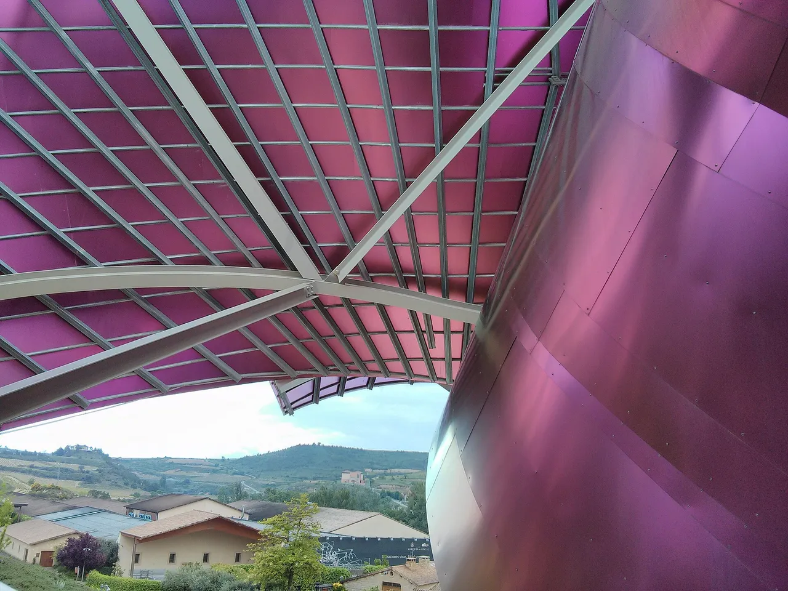
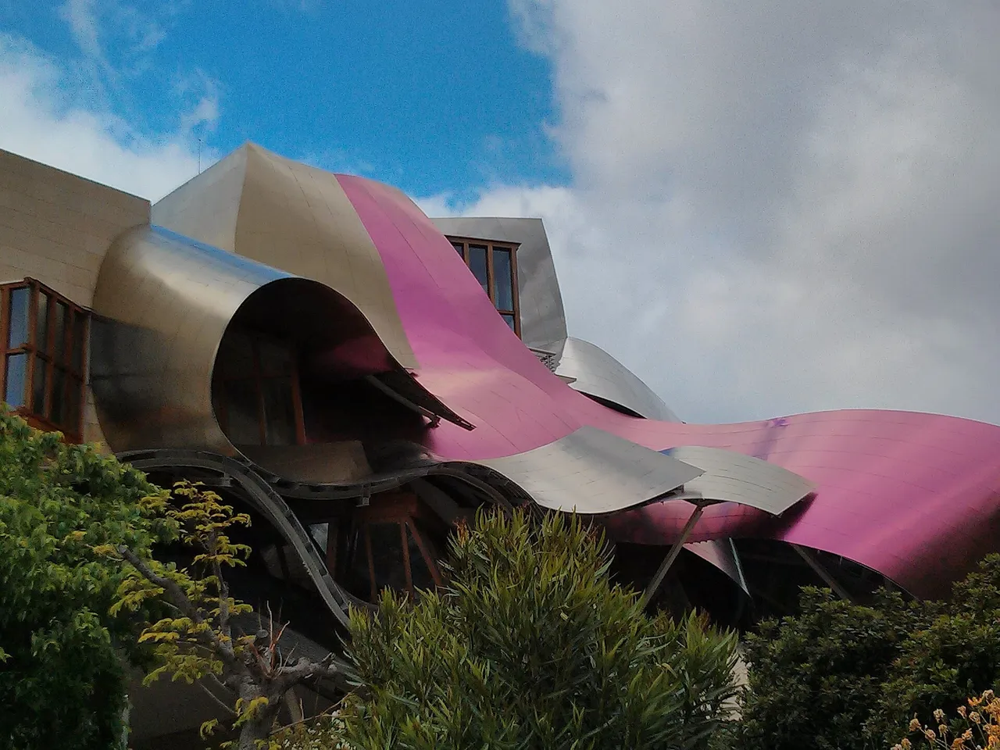
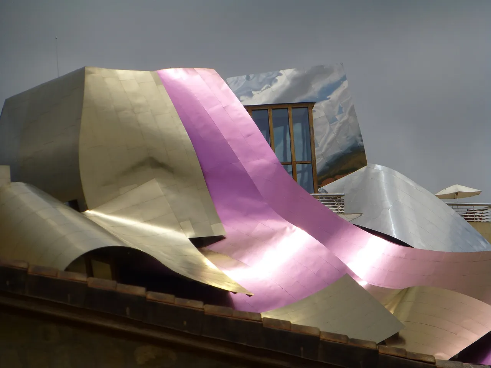
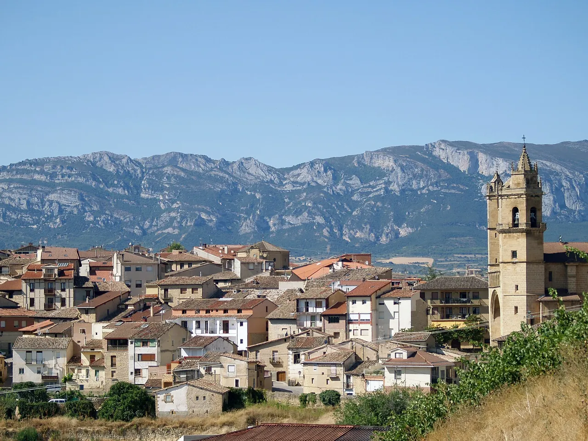
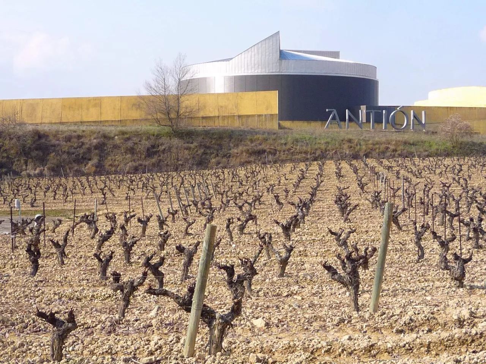
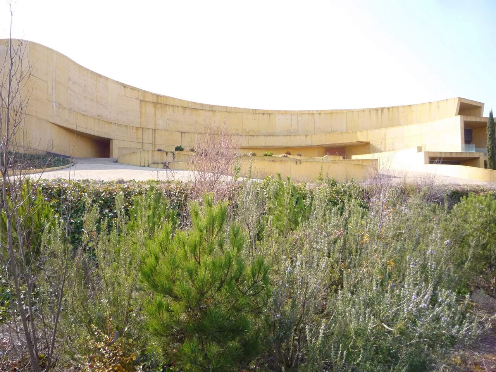

Un **hotel de titanio** diseñado por **Frank Gehry** en mitad de viñedos, una bodega centenaria y un pueblo pequeño de la Rioja Alavesa. **Elciego**, en Álava, es el lugar para ver arquitectura de vanguardia y vino, y se visita bien en **medio día**.

Te cuento qué ver, cómo visitar la bodega y qué más hay cerca 👇

En un vistazo<h2>Lo que vas a encontrar</h2>

<b>🏨</b>Hotel de Gehry

<b>🍷</b>Bodega Marqués de Riscal

<b>🏘️</b>Pueblo

<b>🍇</b>Viñedos

<b>🎟️</b>Visita

Antes de ir<h2>Elciego: lo básico</h2>

<h3>🍷 Visita a la bodega</h3>
La visita básica de Marqués de Riscal dura unos 90 minutos y, según la web oficial, cuesta <strong>30 €</strong> por adulto, con bodega, viñedo y cata de tres vinos; hay otras de 1 h 45 min por 45 € y 60 €. Reserva en la web oficial con antelación.

<h3>🏨 El hotel</h3>
Se puede ver el edificio sin alojarse. Tiene spa, restaurante con estrella Michelin y 61 habitaciones, según las guías.

<h3>🚗 Cómo llegar</h3>
Queda en la Rioja Alavesa, a pocos minutos de Laguardia. Lo cómodo es el coche.

Curiosidades<h2>Láminas de titanio y vino</h2>

El <strong>Hotel Marqués de Riscal</strong> es una obra de <strong>Frank Gehry</strong>, con láminas de metal que cambian de aspecto según la luz, sobre todo al atardecer. Abrió sus puertas el <strong>10 de octubre de 2006</strong>. Junto a él están los edificios históricos del siglo XIX de la bodega, formando la <strong>Ciudad del Vino</strong>.

<h3>🌇 Mi consejo</h3>
Ve al <strong>atardecer</strong>: la luz sobre las láminas de titanio y los viñedos de la Rioja Alavesa es espectacular.

Qué ver<h2>Qué ver en Elciego: los imprescindibles</h2>
Medio día entre arquitectura, bodegas y viñedos.

<ol class="guide__grid guide__grid--cuenca">
<li class="gcard reveal">
01

<h3>El Hotel Marqués de Riscal</h3>
El edificio de Gehry destaca entre viñedos, con láminas de metal de colores.

</li>
<li class="gcard reveal">
02

<h3>Las formas de Gehry</h3>
Curvas y láminas que cambian con la luz del día.

</li>
<li class="gcard reveal">
03

<h3>Detalles del edificio</h3>
Láminas metálicas de colores que reflejan el cielo.

</li>
<li class="gcard reveal">
04

<h3>El hotel y la bodega</h3>
El edificio moderno junto a las bodegas históricas del siglo XIX.

</li>
<li class="gcard reveal">
05

<h3>El hotel y el pueblo</h3>
El contraste entre arquitectura moderna y el pueblo tradicional.

</li>
<li class="gcard reveal">
06

<h3>Elciego</h3>
Un pueblo pequeño con iglesia, rodeado de viñedos.

</li>
<li class="gcard reveal">
07

<h3>Viñedos y bodegas</h3>
Los viñedos rodean el pueblo, con bodegas de arquitectura moderna entre las cepas.

</li>
<li class="gcard reveal">
08

<h3>Bodegas modernas</h3>
Otra bodega de arquitectura contemporánea en Elciego.

</li>
</ol>

Más paradas<h2>Otros lugares con encanto</h2>

<ul class="checklist" style="margin:0 0 1rem;"><li><strong>Bodega Marqués de Riscal:</strong> visita guiada con cava centenaria y cata.</li><li><strong>Spa de vinoterapia:</strong> en el hotel (confirma condiciones).</li><li><strong>Cerca:</strong> <a href="/blog/laguardia-que-ver.html">Laguardia</a>, <a href="/blog/valle-salado-anana.html">el Valle Salado de Añana</a> y <a href="/blog/vitoria-gasteiz-que-ver.html">Vitoria-Gasteiz</a>.</li></ul>

<!--enr-->

Enoturismo<h2>Bodegas en Elciego que puedes visitar</h2>
Seis bodegas con dirección en el propio Elciego, según la Ruta del Vino de Rioja Alavesa. Todas piden <strong>reserva previa</strong>.

Elciego tiene algo más de mil habitantes y, aun así, es uno de los pueblos con más bodegas de la <strong>Rioja Alavesa</strong>: el término municipal está cubierto de viñedos entre la sierra de Toloño y el Ebro.

<h3>🍷 Marqués de Riscal</h3>
Fundada en Elciego en <strong>1858</strong>, es una de las bodegas históricas de Rioja y la del hotel de Gehry. Según su web, la visita básica dura <strong>90 minutos</strong> y cuesta <strong>30 €</strong> (calados, viñedo, cata de tres vinos y picoteo); hay visitas más completas de 45 y 60 €, y una combinada con el Valle Salado de Añana. Abre todos los días.

<h3>🍷 Bodegas Valdelana</h3>
Bodega familiar con calados de los <strong>siglos XV y XVI</strong>, una <strong>Bodega Museo</strong> y el <strong>Jardín de las Variedades</strong>, con distintas uvas plantadas. Abre de lunes a domingo y tiene experiencias gastronómicas y alojamiento.

<h3>🍷 Bodegas Murua</h3>
A la salida del pueblo, en la carretera de Laguardia. Visitas a bodega y viñedo de martes a sábado, en grupos pequeños (hasta 12 personas).

<h3>🍷 Pago de Larrea</h3>
En la carretera de Cenicero. Visita a bodega y viñedo, wine bar y experiencias gastronómicas, de martes a sábado por la mañana (más horario en julio y agosto).

<h3>🍷 Luberri Monje Amestoy</h3>
Bodega familiar fundada en <strong>1995</strong>, con visita y cata de lunes a viernes.

<h3>🍷 Viña Salceda</h3>
Fundada en Elciego en <strong>1969</strong>, junto al Ebro; desde 1998 pertenece al grupo Chivite. Consulta en su web las visitas disponibles.

¿No quieres conducir entre bodegas? Hay un <a href="https://www.civitatis.com/es/laguardia/tour-laguardia-visita-bodega-cata/?aid=110968" target="_blank" rel="noopener sponsored">tour por Laguardia con visita a una bodega y cata</a>, y a 10 minutos de Elciego puedes visitar las <a href="https://www.civitatis.com/es/laguardia/visita-bodegas-campillo/?aid=110968" target="_blank" rel="noopener sponsored">bodegas Campillo</a> o una <a href="https://www.civitatis.com/es/laguardia/visita-bodegas-1808-casa-garabitero/?aid=110968" target="_blank" rel="noopener sponsored">bodega subterránea en el casco de Laguardia</a>.

Si quieres encadenar varias, la <strong>Ruta del Vino de Rioja Alavesa</strong> reúne bodegas, restaurantes y alojamientos de la comarca, y Laguardia y Samaniego quedan a pocos minutos.

El pueblo<h2>Qué ver en el casco de Elciego</h2>

Más allá del titanio, merece la pena pasear por el pueblo: la <strong>iglesia parroquial de San Andrés</strong>, que domina el caserío; la <strong>ermita de la Virgen de la Plaza</strong>, un capricho barroco del siglo XVII en la plaza Mayor; y las calles con <strong>casas de piedra blasonadas</strong>. Si vas a principios de septiembre, coincidirás con las <strong>fiestas de la Virgen de la Plaza</strong> (en torno al 8 de septiembre), con danzas tradicionales al son de gaiteros y tamboril.

Cómo llegar<h2>Cómo llegar</h2>

<strong>En coche:</strong> Elciego queda en la Rioja Alavesa, a pocos minutos de Laguardia. Hay aparcamiento cerca del hotel.

<strong>Consejo:</strong> reserva la bodega con antelación y no conduzcas si vas a catar vino.

<strong>Con cata guiada:</strong> en Laguardia, a pocos minutos, hay un <a href="https://www.civitatis.com/es/laguardia/tour-laguardia-visita-bodega-cata/?aid=110968" target="_blank" rel="noopener sponsored">tour por el pueblo con visita a una bodega y cata</a>.

<a class="btn guide__mapbtn" href="https://www.google.com/maps/dir/?api=1&destination=Elciego, Álava" target="_blank" rel="noopener"><svg class="ico" viewBox="0 0 24 24" width="15" height="15" aria-hidden="true" fill="currentColor"><path d="M12 2a7 7 0 0 0-7 7c0 5.25 7 13 7 13s7-7.75 7-13a7 7 0 0 0-7-7zm0 9.5a2.5 2.5 0 1 1 0-5 2.5 2.5 0 0 1 0 5z"/></svg> Cómo llegar en Google Maps</a>

Consejos de Cheno<h2>Elciego en medio día</h2><ul><li><b>Mañana</b>: Visita guiada a la bodega Marqués de Riscal.</li><li><b>Mediodía</b>: Comida en la zona con vinos de Rioja.</li><li><b>Tarde</b>: Paseo por Elciego y fotos del hotel.</li><li><b>Atardecer</b>: Luz sobre el edificio de Gehry.</li><li><b>Si tienes más días</b>: Laguardia y Vitoria-Gasteiz.</li></ul>

<!--faq-->

<h2>¿Te gustan estos planes?</h2>
Sígueme en Instagram como <a href="https://www.instagram.com/chenoaventuras/" target="_blank" rel="noopener">@chenoaventuras</a>: subo escapadas como esta cada semana.
<a class="btn guide__btn" href="/blog.html">Ver más planes en el blog</a>

Información consultada en octubre y noviembre de 2026 (bodegas: Ruta del Vino de Rioja Alavesa y webs oficiales). Los precios, horarios y accesos cambian: consúltalos en las webs oficiales. Fotos de Wikimedia Commons: <a href="https://commons.wikimedia.org/wiki/File:Elciego_-_Marqu%C3%A9s_de_Riscal_Hotel_RK01.jpg" target="_blank" rel="noopener">Roderich Kahn</a> (CC BY-SA 4.0) · <a href="https://commons.wikimedia.org/wiki/File:Hotel_Marqu%C3%A9s_de_Riscal_(2016).jpg" target="_blank" rel="noopener">Gotanero</a> (CC BY-SA 4.0) · <a href="https://commons.wikimedia.org/wiki/File:Marqu%C3%A9s_de_Riscal_Hotela.jpg" target="_blank" rel="noopener">Makeip</a> (CC BY-SA 4.0) · <a href="https://commons.wikimedia.org/wiki/File:Marqu%C3%A9s_De_Riscal_Hotela_2.jpg" target="_blank" rel="noopener">Makeip</a> (CC BY-SA 4.0) · <a href="https://commons.wikimedia.org/wiki/File:Marqu%C3%A9s_De_Riscal_Hotela_4.jpg" target="_blank" rel="noopener">Makeip</a> (CC BY-SA 4.0) · <a href="https://commons.wikimedia.org/wiki/File:Eltziego.jpg" target="_blank" rel="noopener">Imamon</a> (Dominio público) · <a href="https://commons.wikimedia.org/wiki/File:Elciego_-_Bodegas_Anti%C3%B3n_09.jpg" target="_blank" rel="noopener">Zarateman</a> (CC0) · <a href="https://commons.wikimedia.org/wiki/File:Elciego_-_Bodegas_Anti%C3%B3n_07.jpg" target="_blank" rel="noopener">Zarateman</a> (CC0).

