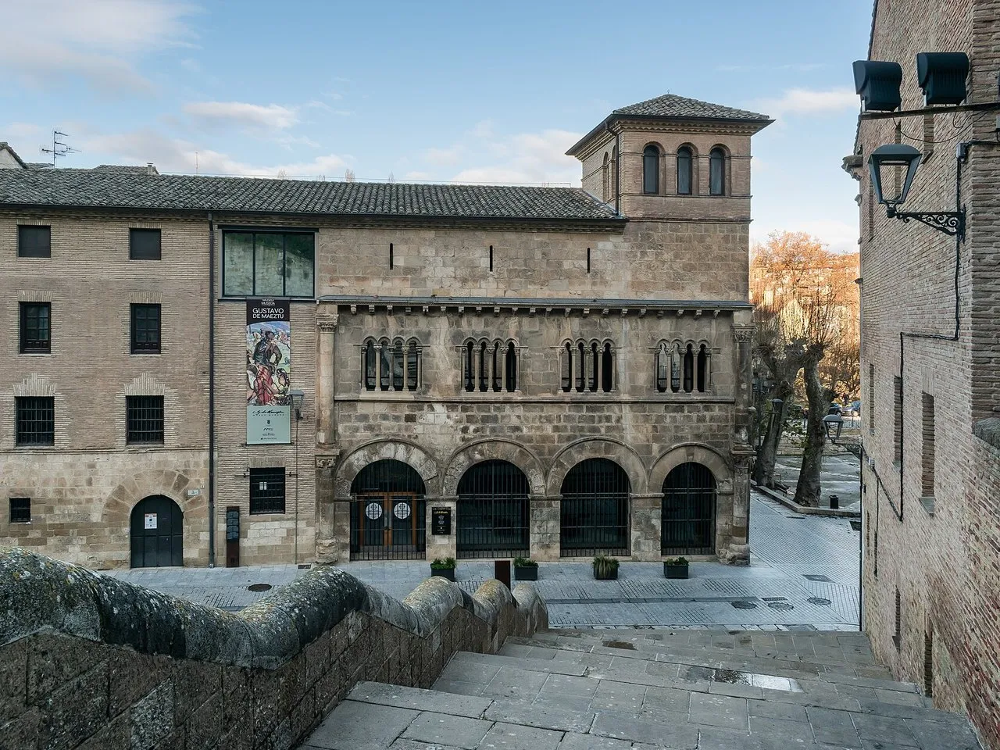
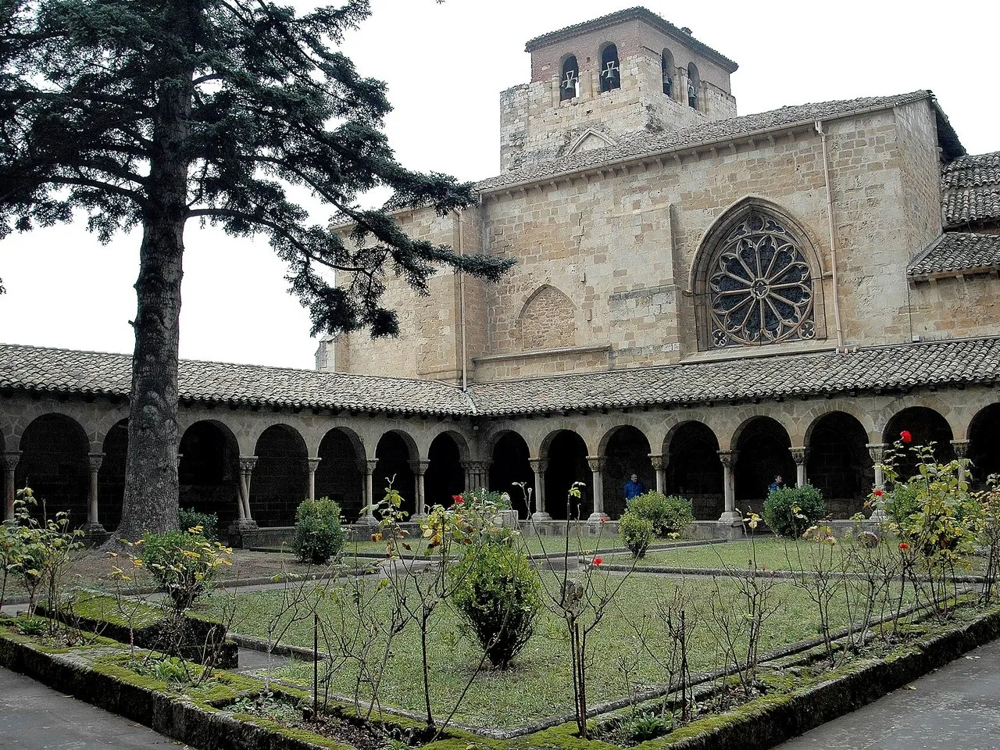
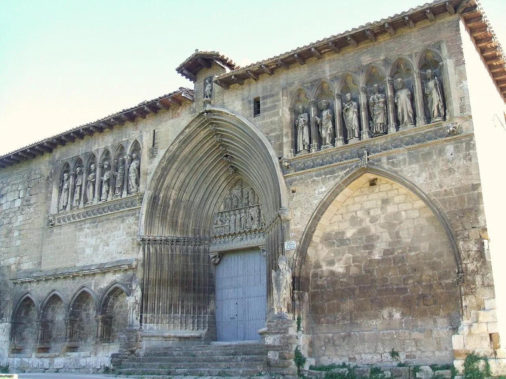
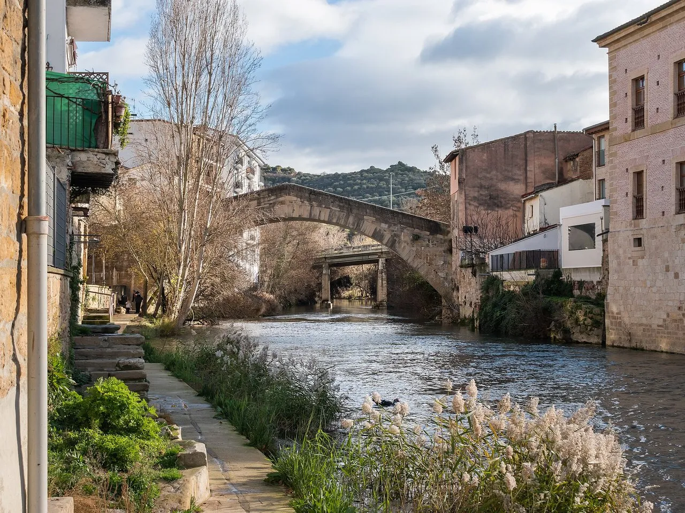
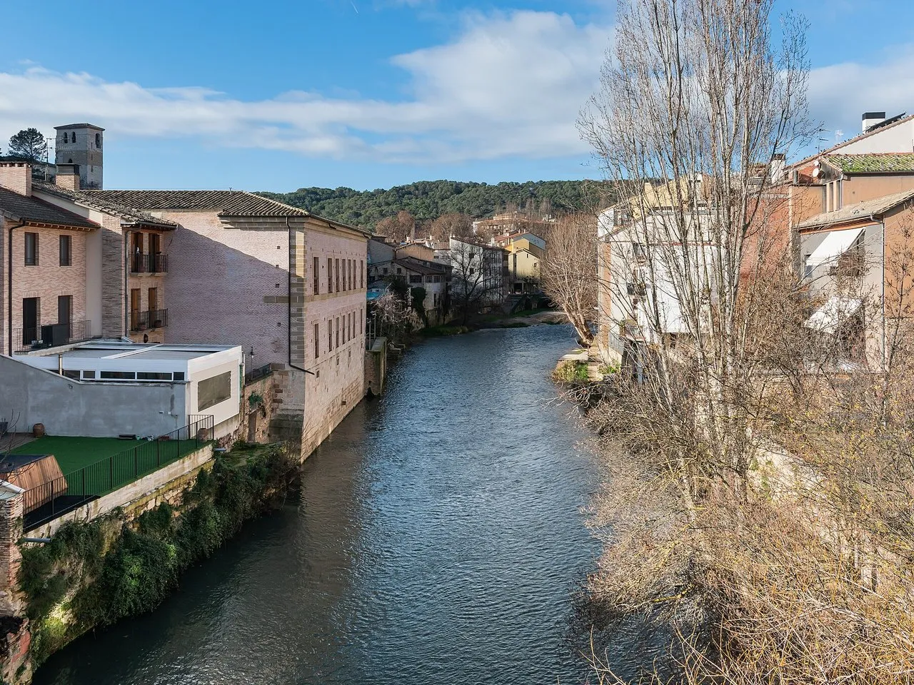

Palacios románicos, iglesias con portadas de encaje de piedra, un puente en lomo de asno sobre el río Ega y peregrinos con mochila por la calle de la Rúa. **Estella-Lizarra**, en Navarra, guarda tanto patrimonio medieval que la llaman el **«Toledo del Norte»**, y este año compite por ser el **pueblo de la Navidad de Ferrero Rocher**.

Te cuento qué ver, su historia y cómo llegar 👇

En un vistazo<h2>Lo que vas a encontrar</h2>

<b>🏰</b>Palacio románico

<b>⛪</b>Iglesias medievales

<b>🥾</b>Camino de Santiago

<b>🌉</b>Puentes sobre el Ega

<b>🎄</b>Candidato Ferrero 2026

Antes de ir<h2>Lo básico de Estella</h2>

<h3>📍 Dónde está</h3>
En la <strong>Tierra Estella</strong>, a unos 44 km de Pamplona y 47 km de Logroño.

<h3>⏱️ Tiempo</h3>
<strong>Medio día</strong> para el casco; un día si subes al Puy y visitas una bodega.

<h3>🥾 Camino</h3>
Final de etapa del <strong>Camino Francés</strong>, a 22 km de Puente la Reina.

<h3>🎪 Esta semana</h3>
<strong>Ferias de San Andrés</strong>, del 27 al 30 de noviembre de 2026.

Qué ver<h2>Qué ver en Estella-Lizarra</h2>

<ol class="guide__grid guide__grid--cuenca">
<li class="gcard reveal">
01

<h3>Palacio de los Reyes de Navarra</h3>
Uno de los pocos edificios <strong>románicos civiles</strong> que quedan en España (siglo XII). Monumento Nacional desde 1931, hoy es el <strong>Museo Gustavo de Maeztu</strong>.

</li>
<li class="gcard reveal">
02

<h3>San Pedro de la Rúa</h3>
Justo enfrente del palacio, en lo alto de una escalinata. Su <strong>claustro del siglo XII</strong> tiene capiteles esculpidos con escenas bíblicas.

</li>
<li class="gcard reveal">
03

<h3>El Santo Sepulcro</h3>
Lo primero que ven los peregrinos al entrar. Su <strong>portada gótica del siglo XIV</strong> es una de las más fotografiadas del Camino.

</li>
<li class="gcard reveal">
04

<h3>El puente de la Cárcel</h3>
Un puente en <strong>lomo de asno</strong> sobre el río Ega que une los barrios a ambos lados, por el que pasa el Camino de Santiago.

</li>
<li class="gcard reveal">
05

<h3>San Miguel y la Basílica del Puy</h3>
La iglesia de <strong>San Miguel</strong>, con su gran portada románica, y la Basílica del Puy, en un alto con vistas sobre la ciudad y el Ega.

</li>
</ol>

<!--actividades-->

Historia<h2>Una ciudad nacida del Camino</h2>

Estella nació en <strong>1090</strong>, cuando el rey <strong>Sancho Ramírez</strong> le concedió fuero para atraer a comerciantes y peregrinos francos. El Camino de Santiago la llenó de iglesias, hospitales y palacios, y en <strong>1483</strong> recibió el título de ciudad. De ahí le viene el apodo de «Toledo del Norte».

<h3>🎄 Candidato a pueblo Ferrero Rocher</h3>
Estella-Lizarra representa a <strong>Navarra</strong> en el concurso de la Navidad de Ferrero Rocher 2026. Mira cómo va y cómo votar en <a href="/blog/pueblo-navidad-ferrero-rocher-2026.html">el pueblo de la Navidad de Ferrero Rocher</a>.

Cómo llegar<h2>Cómo llegar a Estella-Lizarra</h2>

<h3>🚗 En coche</h3>
Por la <strong>A-12</strong>, la autovía del Camino, entre Pamplona y Logroño.

<h3>🚌 En autobús</h3>
Hay líneas desde <strong>Pamplona</strong> y <strong>Logroño</strong>.

<h3>🥾 Andando</h3>
Etapa del Camino Francés desde <strong>Puente la Reina</strong> (22 km).

<h3>🍷 Con bodega</h3>
Haz la <a href="https://www.civitatis.com/es/estella/visita-bodegas-arinzano/?aid=110968" target="_blank" rel="noopener sponsored">visita a las Bodegas Arínzano</a>, junto a Estella.

Consejos de Cheno<h2>Para disfrutarlo al máximo</h2><ul><li><b>Empieza por la Rúa</b>: palacio, San Pedro y Santo Sepulcro están a pocos pasos.</li><li><b>Sube al Puy</b> para ver la ciudad desde arriba.</li><li><b>Ve a finales de noviembre</b> para las Ferias de San Andrés.</li><li><b>Combínalo con</b> <a href="/blog/pamplona-que-ver.html">Pamplona</a> u <a href="/blog/olite-que-ver.html">Olite</a>.</li></ul>

<!--faq-->

<h2>¿Te gustan estos planes?</h2>
Sígueme en Instagram como <a href="https://www.instagram.com/chenoaventuras/" target="_blank" rel="noopener">@chenoaventuras</a>: subo escapadas como esta cada semana.
<a class="btn guide__btn" href="/blog.html">Ver más planes en el blog</a>

Información consultada en noviembre de 2026 en las webs de turismo de Estella-Lizarra y de Navarra. Fotos de Wikimedia Commons: <a href="https://commons.wikimedia.org/wiki/File:View_of_Estella-Lizarra_(2).jpg" target="_blank" rel="noopener">Krzysztof Golik</a> (CC BY-SA 4.0) · <a href="https://commons.wikimedia.org/wiki/File:Palacio_de_los_Reyes_de_Navarra_in_Estella-Lizarra_(5).jpg" target="_blank" rel="noopener">Krzysztof Golik</a> · <a href="https://commons.wikimedia.org/wiki/File:Estella._Claustro_de_San_Pedro_de_la_Rua.jpg" target="_blank" rel="noopener">Taitacimu</a> (CC BY-SA 3.0 es) · <a href="https://commons.wikimedia.org/wiki/File:Estella_-_Iglesia_Santo_Sepulcro_01.JPG" target="_blank" rel="noopener">Zarateman</a> (CC0) · <a href="https://commons.wikimedia.org/wiki/File:Puente_de_la_Carcel_in_Estella-Lizarra_(1).jpg" target="_blank" rel="noopener">Krzysztof Golik</a> · <a href="https://commons.wikimedia.org/wiki/File:Ega_river_in_Estella-Lizarra_(2).jpg" target="_blank" rel="noopener">Krzysztof Golik</a> (CC BY-SA 4.0).

