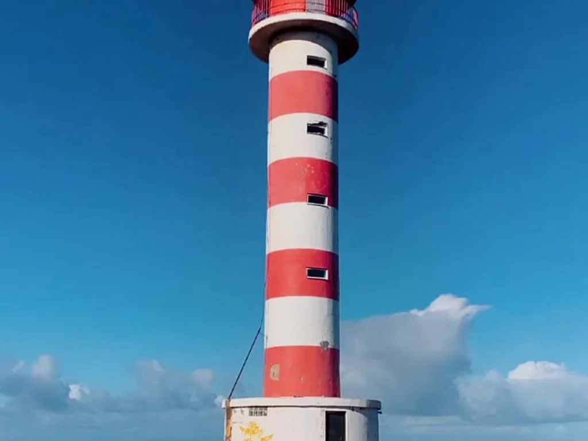
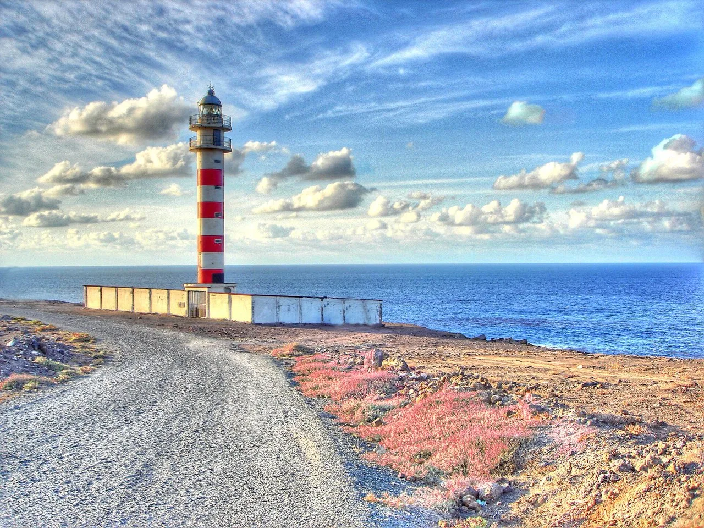
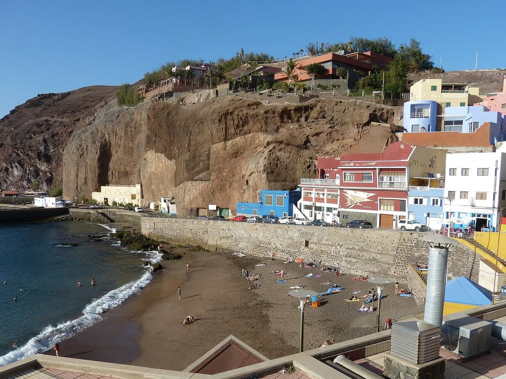
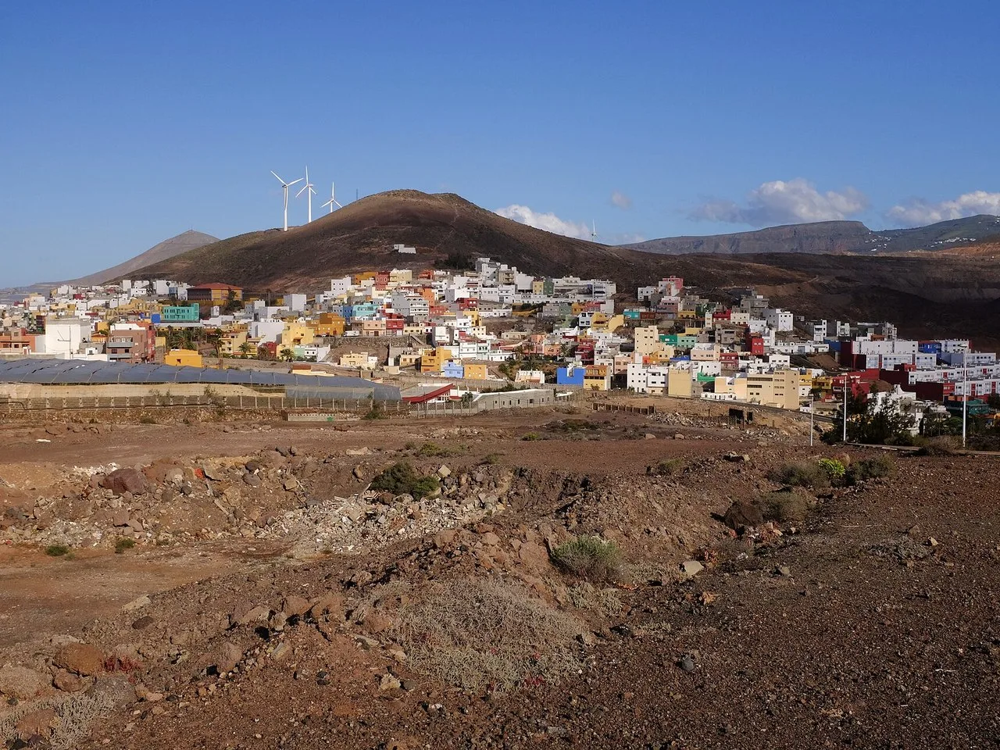
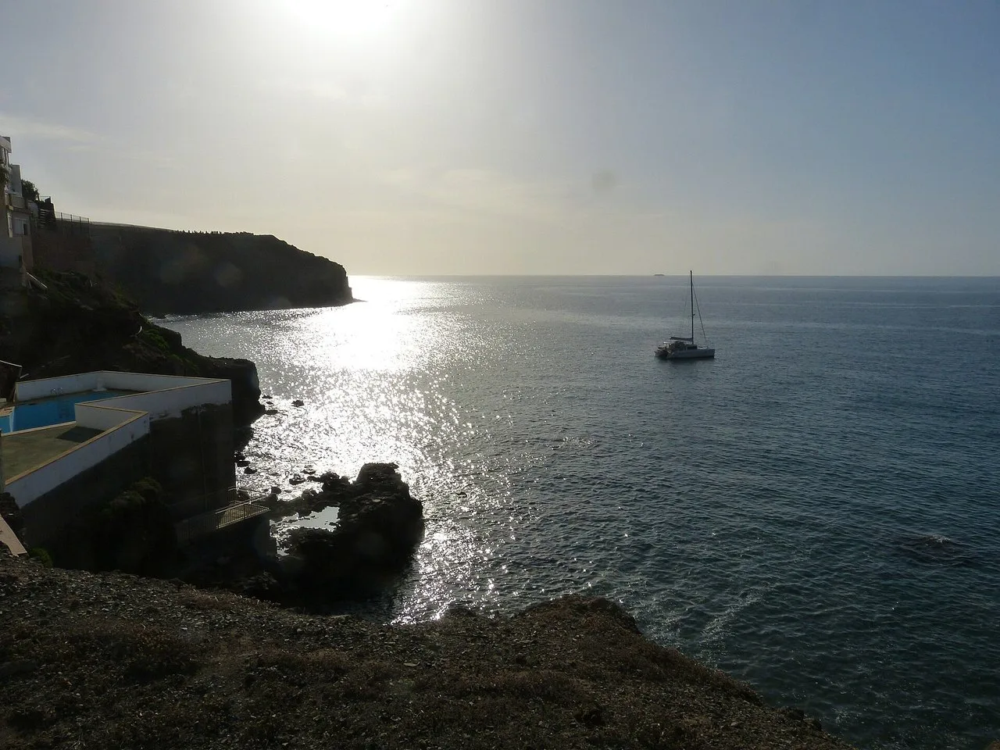

Un faro de rayas rojas y blancas plantado sobre un cabo del norte de Gran Canaria, con el Atlántico a los pies. El **Faro de Sardina** (o de Punta Sardina) está en la costa de **Gáldar**, junto al pequeño puerto y la playa de **Sardina del Norte**, y es uno de los mejores sitios de la isla para ver el **atardecer**.

Te cuento cómo llegar y qué esperar 👇

En un vistazo<h2>Lo que vas a encontrar</h2>

<b>🗼</b>Faro de 1891

<b>🌅</b>Atardecer

<b>⚓</b>Puerto

<b>🏖️</b>Playa

<b>🟥</b>Rojo y blanco

Qué ver<h2>Qué vas a ver</h2>

<ol class="guide__grid guide__grid--cuenca">
<li class="gcard reveal">
01

<h3>El faro</h3>
La torre actual es de <strong>1986</strong> y sigue en servicio, en el extremo noroeste de Gran Canaria. El primer faro dio luz en 1891.

</li>
<li class="gcard reveal">
02

<h3>El cabo</h3>
El faro se alza sobre una <strong>punta de roca volcánica</strong> con el Atlántico alrededor. Se llega casi hasta el pie.

</li>
<li class="gcard reveal">
03

<h3>La playa de Sardina del Norte</h3>
Una playa pequeña de arena oscura, protegida por el muelle. Muy de <strong>pescadores</strong>.

</li>
<li class="gcard reveal">
04

<h3>El pueblo</h3>
Casas de colores en la ladera, el puertito y algún restaurante de <strong>pescado fresco</strong>.

</li>
<li class="gcard reveal">
05

<h3>El atardecer</h3>
El sol cae sobre el mar abierto, a veces con <strong>Tenerife y el Teide</strong> en el horizonte en días claros.

</li>
</ol>

Antes de ir<h2>Faro de Sardina: lo esencial</h2>

<h3>🕯️ Un faro con historia</h3>
El antiguo faro de Sardina del Norte emitió su primera luz en <strong>febrero de 1891</strong>, para proteger a los barcos de una zona de mucho tráfico por el comercio de la cochinilla, el azúcar, el plátano y el tomate.

<h3>🌅 Para el atardecer</h3>
Es un sitio muy visitado para ver caer el sol junto al faro, con la costa y el mar abierto de fondo.

<h3>🏖️ Puerto y playa</h3>
A pocos metros está el <strong>puertito pesquero y la playa de Sardina del Norte</strong>, un rincón tranquilo con mucho encanto marinero.

Curiosidades<h2>Frente a la capital de los guanartemes</h2>

La posición de <strong>Sardina del Norte</strong> era estratégica para los conquistadores castellanos: estaba justo frente a <strong>Gáldar</strong>, donde residían los <strong>guanartemes</strong>, los reyes de la isla antes de la conquista. Después, el puerto siguió siendo importante para el comercio del azúcar, aunque perdió peso en la segunda mitad del siglo XVI.

El camino hasta el faro cruza <strong>invernaderos y plataneras</strong>, un buen retrato de la agricultura del norte de la isla, antes de abrirse a una costa escarpada y muy marinera.

<!--enr-->

Más historia<h2>Un faro para los barcos de la cochinilla y el plátano</h2>

El antiguo faro de Sardina del Norte dio su primera luz el <strong>15 de febrero de 1891</strong>. Se construyó por el creciente tráfico marítimo de la isla, ligado a la cochinilla, la caña de azúcar, los plátanos, los tomates y las papas, y antes de decidir el emplazamiento el Ayuntamiento de Gáldar creó una comisión para estudiar la costa, asesorada por oficiales de marina.

La torre actual se levantó en el mismo lugar y sustituyó a la antigua en <strong>1986</strong>. El faro sigue en servicio y marca el extremo noroeste de Gran Canaria; el puerto de Sardina fue durante décadas una pieza clave en el transporte de mercancías de la comarca.

Cómo llegar<h2>Cómo llegar</h2>

Desde <strong>Gáldar</strong> se toma la carretera hacia Agaete (C-810) y, en el entorno del kilómetro 28, se gira hacia el faro. Según la cartografía oficial, son unos <strong>7 km</strong> hasta llegar. Confírmalo en un mapa antes de salir, porque el trazado puede haber cambiado.

Aparca en los espacios cercanos al faro y al puerto, y ten en cuenta que en las horas del atardecer hay más gente.

<a class="btn guide__mapbtn" href="https://www.google.com/maps/dir/?api=1&destination=Faro+de+Sardina+Gáldar" target="_blank" rel="noopener"><svg class="ico" viewBox="0 0 24 24" width="15" height="15" aria-hidden="true" fill="currentColor"><path d="M12 2a7 7 0 0 0-7 7c0 5.25 7 13 7 13s7-7.75 7-13a7 7 0 0 0-7-7zm0 9.5a2.5 2.5 0 1 1 0-5 2.5 2.5 0 0 1 0 5z"/></svg> Cómo llegar en Google Maps</a>

Consejos de Cheno<h2>Para disfrutarlo al máximo</h2><ul><li><b>Ve al atardecer</b>: y lleva una chaqueta ligera: en el cabo sopla viento.</li><li><b>Calzado cómodo</b>: la costa es de roca volcánica.</li><li><b>Cuidado con el mar</b>: con oleaje no te acerques a los bordes.</li><li><b>Combínalo con Gáldar</b>: su centro histórico y la Cueva Pintada están a pocos kilómetros.</li></ul>

<!--faq-->

<h2>¿Te gustan estos planes?</h2>
Sígueme en Instagram como <a href="https://www.instagram.com/chenoaventuras/" target="_blank" rel="noopener">@chenoaventuras</a>: subo escapadas como esta cada semana.
<a class="btn guide__btn" href="/blog.html">Ver más planes en el blog</a>

Información consultada en octubre de 2026. El acceso y el estado de la costa pueden cambiar: consúltalos antes de ir. Fotos propias y de Wikimedia Commons: <a href="https://commons.wikimedia.org/wiki/File:Faro_nuevo_sardina_gran_canaria.jpg" target="_blank" rel="noopener">maccanti</a> (CC BY 2.0), <a href="https://commons.wikimedia.org/wiki/File:Sardina_del_Norte_1.jpg" target="_blank" rel="noopener">Wolfgang Sauber</a> (CC BY-SA 4.0), <a href="https://commons.wikimedia.org/wiki/File:Sardina_del_Norte_-_53433452021.jpg" target="_blank" rel="noopener">Nicolas Vigier</a> (CC0), <a href="https://commons.wikimedia.org/wiki/File:Sardina_del_Norte_3.jpg" target="_blank" rel="noopener">Wolfgang Sauber</a> (CC BY-SA 4.0).

