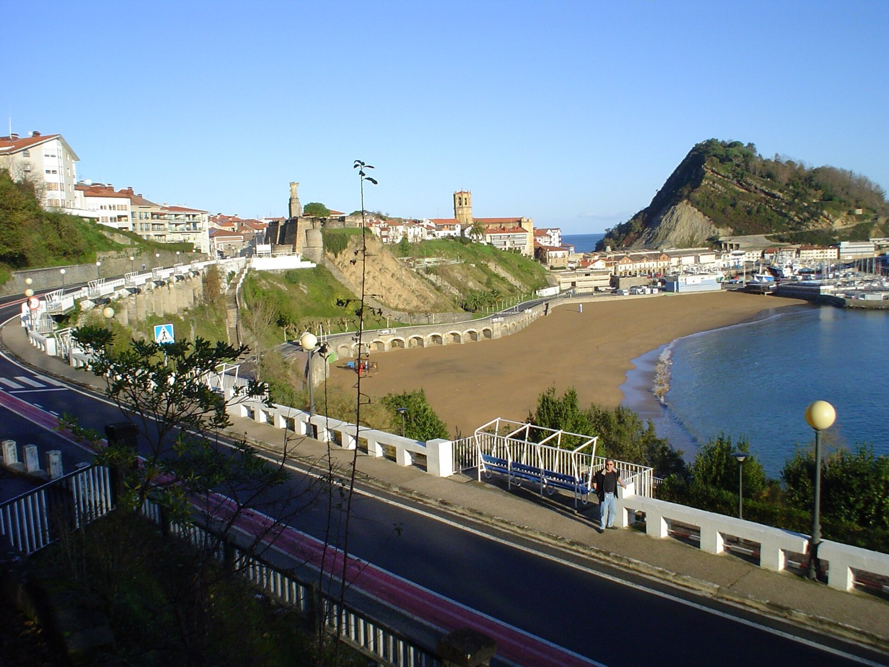
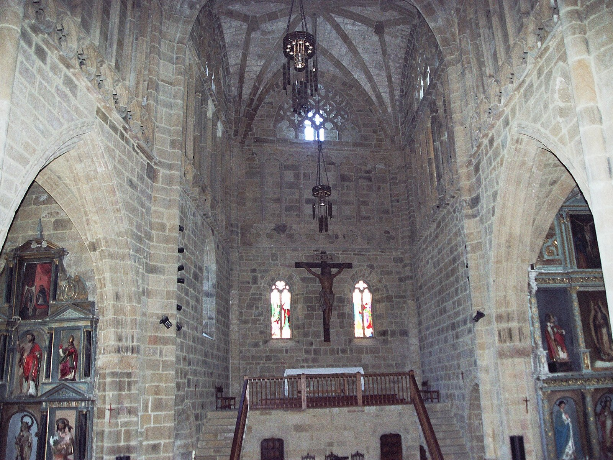
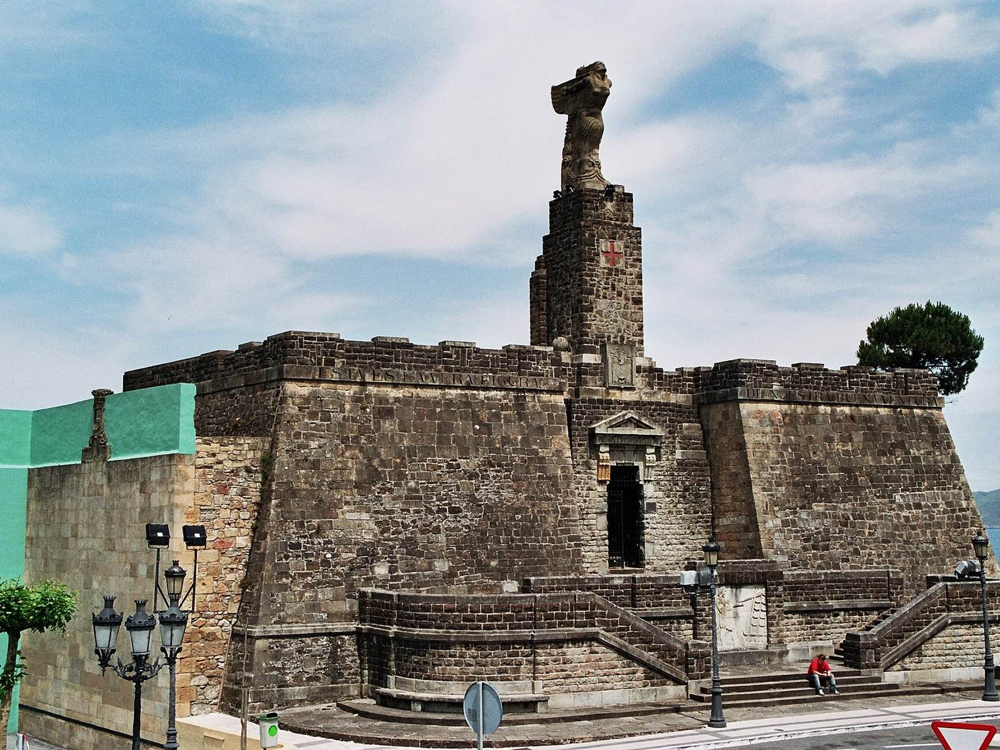
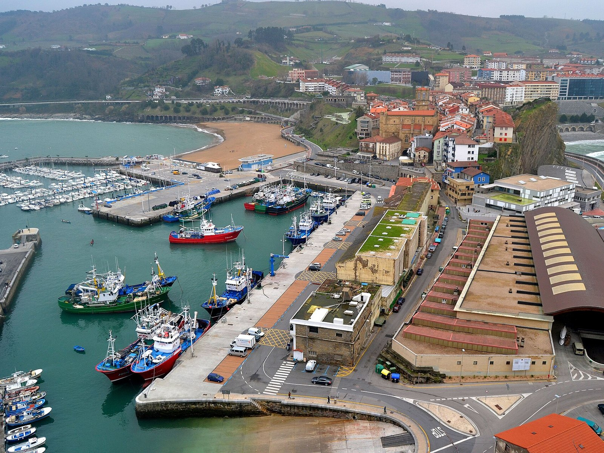
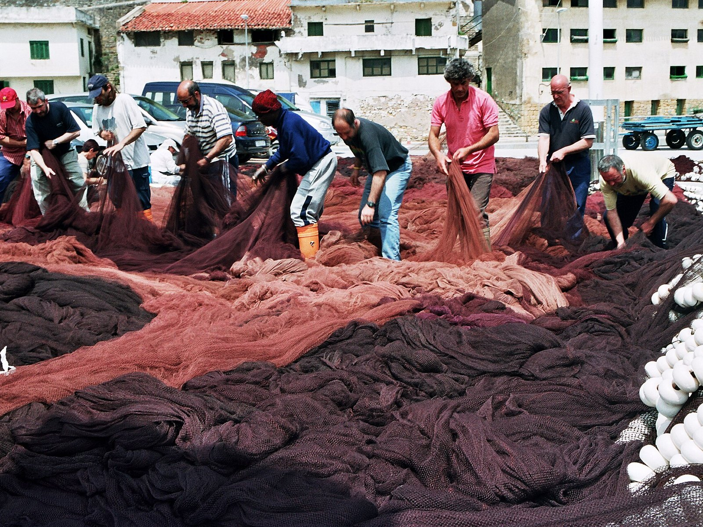
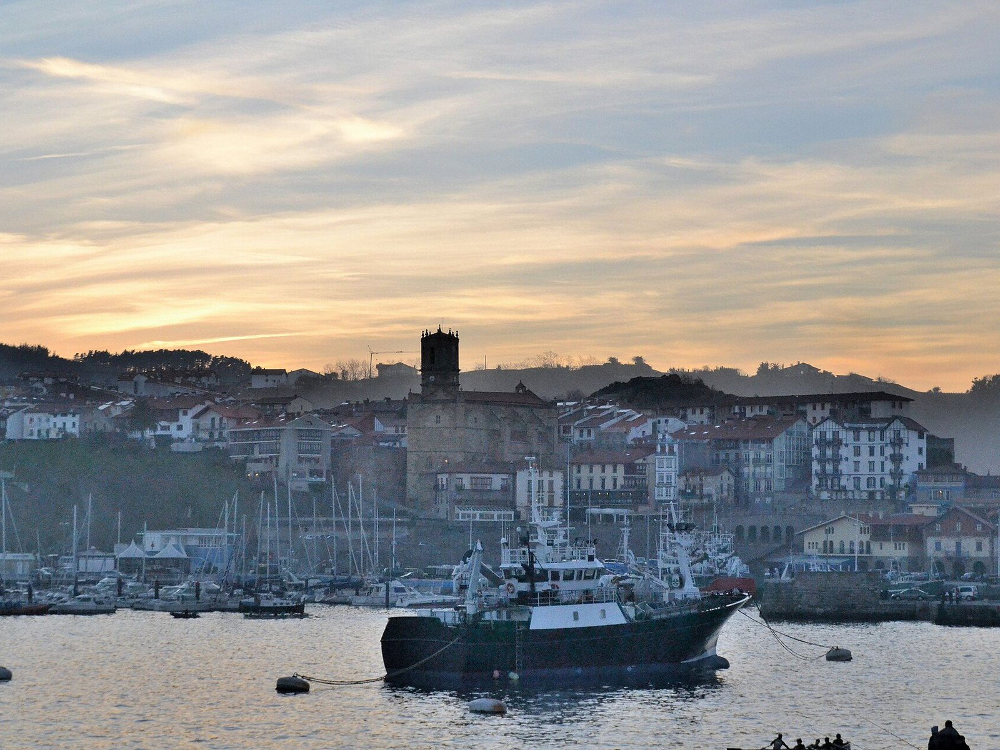

**Getaria** es pequeña, pero ha dado al mundo a un navegante y a un genio de la moda. Aquí nació **Juan Sebastián Elcano**, el primero en completar la vuelta al mundo, y también el modisto **Cristóbal Balenciaga**. El pueblo se asoma al Cantábrico junto a un monte con forma de **ratón**, rodeado de viñas de **txakoli** y con un puerto lleno de **parrillas** donde se asa el pescado en la calle.

Te cuento qué ver y dónde comer 👇

En un vistazo<h2>Lo que vas a encontrar</h2>

<b>🐭</b>El Ratón

<b>⛵</b>Cuna de Elcano

<b>👗</b>Museo Balenciaga

<b>🐟</b>Pescado a la brasa

<b>🍇</b>Txakoli

Antes de ir<h2>Lo básico de Getaria</h2>

<h3>📍 Dónde está</h3>
En la costa de <strong>Gipuzkoa</strong>, a 30 minutos de San Sebastián, entre Zarautz y Zumaia.

<h3>⏱️ Tiempo</h3>
Medio día para el pueblo y el Ratón. Un día entero con comida larga y museo.

<h3>⛵ 2026</h3>
Se cumplen <strong>500 años de la muerte de Elcano</strong>: el pueblo lo celebra con actos durante todo el año.

Qué ver<h2>Qué ver en Getaria</h2>

<ol class="guide__grid guide__grid--cuenca">
<li class="gcard reveal">
01

<h3>El Ratón de Getaria</h3>
El <strong>monte San Antón</strong> fue una isla y hoy está unido al pueblo. Desde la costa tiene forma de ratón. Sube a pie hasta el faro: hay vistas de toda la costa.

</li>
<li class="gcard reveal">
02

<h3>La iglesia de San Salvador</h3>
Gótica y muy curiosa: su <strong>suelo sube hacia el altar</strong> porque se adapta a la pendiente. Por debajo pasa un túnel que baja al puerto.

</li>
<li class="gcard reveal">
03

<h3>El monumento a Elcano</h3>
Recuerda al marino que, en <strong>1522</strong>, volvió a España tras completar la primera vuelta al mundo, después de la muerte de Magallanes.

</li>
<li class="gcard reveal">
04

<h3>El puerto</h3>
Sigue siendo un puerto pesquero de verdad. Alrededor están los asadores, con las parrillas en la calle.

</li>
<li class="gcard reveal">
05

<h3>La vida marinera</h3>
Es fácil ver a los pescadores <strong>remendando redes</strong> en el muelle. Getaria vive del mar desde hace siglos.

</li>
<li class="gcard reveal">
06

<h3>El casco viejo</h3>
Calles estrechas que bajan en paralelo hacia el mar, con casas-torre de piedra. Al atardecer, la vista desde el puerto es preciosa.

</li>
</ol>

Museo<h2>El Museo Cristóbal Balenciaga</h2>

Balenciaga nació en Getaria en 1895 y llegó a ser uno de los grandes de la alta costura en París. El <strong>museo</strong> que lleva su nombre, junto al palacio Aldamar, en lo alto del pueblo, reúne sus vestidos más famosos. Aunque no te interese la moda, el edificio y las vistas merecen la pena.

<h3>🍇 Txakoli y pescado</h3>
Las laderas alrededor del pueblo están llenas de viñas de <strong>txakoli</strong>, el vino blanco ligero de la zona. Algunas bodegas ofrecen visitas. Y para comer, el clásico es el <strong>pescado a la brasa</strong>, sobre todo el rodaballo.

Cómo llegar<h2>Cómo llegar a Getaria</h2>

En coche, a unos <strong>30 minutos de San Sebastián</strong> por la AP-8 o por la carretera de la costa desde Zarautz. Hay autobuses de <strong>Lurraldebus</strong> desde Donostia. Aparcar en verano es difícil: ve temprano.

<a class="btn guide__mapbtn" href="https://www.google.com/maps/dir/?api=1&destination=43.3036,-2.2042" target="_blank" rel="noopener"><svg class="ico" viewBox="0 0 24 24" width="15" height="15" aria-hidden="true" fill="currentColor"><path d="M12 2a7 7 0 0 0-7 7c0 5.25 7 13 7 13s7-7.75 7-13a7 7 0 0 0-7-7zm0 9.5a2.5 2.5 0 1 1 0-5 2.5 2.5 0 0 1 0 5z"/></svg> Cómo llegar en Google Maps</a>

A 10 minutos tienes el flysch de <a href="/blog/zumaia-juego-de-tronos.html">Zumaia</a>, y a media hora, <a href="/blog/san-sebastian-que-ver.html">San Sebastián</a>. En la misma costa, más al este, <a href="/blog/hondarribia-que-ver.html">Hondarribia</a>.

Consejos de Cheno<h2>Para disfrutarlo al máximo</h2><ul><li><b>Reserva asador</b> si vas en fin de semana.</li><li><b>Sube al Ratón</b> antes de comer.</li><li><b>Camina hasta Zarautz</b>: hay un paseo junto al mar de unos 45 minutos.</li><li><b>Pide txakoli escanciado</b>: se sirve desde lo alto.</li></ul>

<!--faq-->

<h2>¿Te gustan estos planes?</h2>
Sígueme en Instagram como <a href="https://www.instagram.com/chenoaventuras/" target="_blank" rel="noopener">@chenoaventuras</a>: subo escapadas como esta cada semana.
<a class="btn guide__btn" href="/blog.html">Ver más planes en el blog</a>

Información consultada en noviembre de 2026 (Turismo de Euskadi y webs locales). Los horarios del museo cambian según la temporada. Fotos de Wikimedia Commons: <a href="https://commons.wikimedia.org/wiki/File:Getaria,_Gipuzkoa,_Basque_Country_May_24,_2014_(49552380727).jpg" target="_blank" rel="noopener">Fernando Lozano</a> (CC BY-SA 2.0) · <a href="https://commons.wikimedia.org/wiki/File:Getaria_2009_11_21_1.JPG" target="_blank" rel="noopener">Jean Michel Etchecolonea</a> (CC BY-SA 3.0) · <a href="https://commons.wikimedia.org/wiki/File:Iglesia_de_San_Salvador,_Getaria_(Gipuzkoa).jpg" target="_blank" rel="noopener">Eleder</a> (CC BY-SA 3.0) · <a href="https://commons.wikimedia.org/wiki/File:Monumento_a_Elcano_en_Getaria_(Gipuzkoa).jpg" target="_blank" rel="noopener">Eleder</a> (CC BY-SA 3.0) · <a href="https://commons.wikimedia.org/wiki/File:Getaria._Gipuzkoa._Euskal_Herria.JPG" target="_blank" rel="noopener">Euskalduna</a> (CC BY 3.0) · <a href="https://commons.wikimedia.org/wiki/File:Puerto_de_Getaria_(Gipuzkoa).jpg" target="_blank" rel="noopener">Eleder</a> (CC BY-SA 3.0) · <a href="https://commons.wikimedia.org/wiki/File:Getaria_iluntzean._Euskal_Herria.JPG" target="_blank" rel="noopener">Euskalduna</a> (CC BY 3.0).

